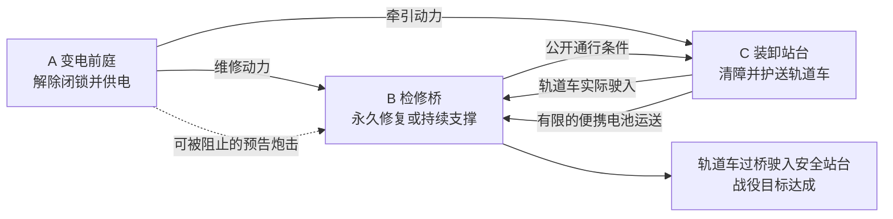

# 三战场战役与核心机制方案

2026-10-02 · 公式台新战斗候选方案 v1

本案提出一场由三个小战场组成的救援战役，暂名《工务城：把归途接上》。六台友机分成三组，在同一个时钟下争取供电、抢通桥面、护送轨道车。玩家通过机体能力、地形、持续作业和跨区支援解决问题，纪存、白鸢、七海分别承担调度、预演和现场制度协调。

这是供讨论和后续开发使用的设计稿。人物与机体身份取自当前项目；险情、地图、具体技能和数值是本次新提案，尚未实现或经过试玩验证。它不改写已验收 Reader，也不替换现有 P 练兵场与 Q 章节入口。

**一、这次 demo 要证明什么**

玩家应当能形成这样的判断：“桥上需要保护八拍，我可以先把威胁推走；另一边恢复电源，工程机就能继续；如果来不及，我还可以让馆守固定桥座，让车先过。”判断以后，主要操作应当是点机体、点地点或对象、选一个明确动作，而不是替六台机器填满时间轴。

这一版的四个核心体验是：

1. **读得懂。** 看见所有当前敌方计划、危险区域和工程进度，知道下一次执行会发生什么。
2. **做得到。** 可以瞄准未来位置、改变路线、明确等待；组合依靠真实位移与时间关系成立。
3. **各有本事。** 武斗机争取位置和时机，重型机扛住压力，工程机改变道路，飞行机越过障碍进行远射。不是给同一拳换六个名字。
4. **局部行动能改变整场战役。** A 区的成果真正改变 B、C 的可用条件；安全的区段可以继续执行既有任务，不必每次都重新安排。

建议先按三个战场各两台友机、总计六台制作。这里把用户提出的“每场两到四台”理解为可部署友机数；敌机、设施与护送对象另计，但也受可读性上限约束。每区初始只有一到两台敌方行动单位，不再叠一群杂兵。自选编成可以形成 2/3/2 等变化，但不在首版同时增加总人数和三个战场的压力。

**二、故事用工务城的基础，另写一个可独立成立的危机**

已验收的 C03 有三个适合继承的内容：城市要靠职业机体持续工作；吊装、供能、交通隔离和消防能力会改变战局；万机馆的强项是与本地机群合作，而非代替整座城市。C02 又已经建立无牌、旧拳王和木桶街地方飞行队。这些比再造六台无来历的测试机更合适。

本案不拼接 Reader 的原句，也不把 C03 的胜负重新演一遍。它是借这些人物、职业与场景关系新设的独立试玩支线，具体插入正篇的位置暂不固定。

开场设在工务城的夜班交接。一次管线破裂正在淹没下层检修区，最后一辆载着维修员的轻型轨道车还停在装卸站。车前方的检修桥已经伸出，但桥座锁定器损坏；供电站则仍被过期的征用程序占着优先级，自动工机把来抢修的人当成干扰作业者。

七海认出那份命令使用了已经不适用于现场的旧签名，但她没有权限直接改写市政系统。当地值班负责人愿意接收现场证据，依法启动临时处置。纪存需要把六台机器分到三个位置；白鸢根据地形、传感与工务员提供的路线做预演，雷翎作为木桶街地方飞行队的临时互助机体到场，完成救援后返回地方飞行队。

轨道车不是一个抽象分数。前置场景让玩家先遇见车上的维修员，看见他们留下正在漏水的工具柜、将同伴抬上车、试着扳开失灵的道岔。战斗中车灯、车厢轮廓和车内通讯一直能指认这个目标。末尾车辆驶入高处安全站台，工人走下车，来接他们的人在等。

高潮不预写唯一解法。它可能是桥修好后一路通行，也可能是馆守固定损坏桥座、旧拳王挡住牵引机，轨道车贴着警戒线慢慢驶过。镜头根据真实结果选用，不用过场把玩家的失败改成成功。

供后续对白创作把握角色的短样例，而非已验收台本：

> 白鸢：“桥还没锁住。现在开车，第二节轨道会翻起来。”
>
> 纪存：“先把桥上的人护住。电一到，就开工。”
>
> 七海：“我把旧命令的适用范围给总席看过了。他们可以接管，但现场隔离还得你们做。”
>
> 旧拳王：“那台拖车交给我。你们把路接上。”

主案采用“救援与夺回工作权”的气质。七海的制度判断、白鸢的预演和机体的职业动作都直接服务眼前的人，不把故事写成审批表演。

**三、三个战场各自有什么可玩**

所有棋盘处于同一片工务设施群。三个镜头分别覆盖变电前庭、跨渠检修桥、装卸站台；总览地图明确它们的空间关系、供电线路和通行路线。切换的是观察与指挥视角，不是纪存肉身在三地瞬移。轨道车的真实路线是 C 装卸站 → 短连接轨 → B 检修桥 → 图外高处站台；高处站台只做结果场景，不再加第四个棋盘。

| 战场 | 初始友机 | 核心目标 | 主要战术问题 | 场景辨识 |
| --- | --- | --- | --- | --- |
| A 变电前庭，8×6 | 无牌一号、雷翎 | 解除征用闭锁，提供撤离所需动力 | 越过掩体抢控制位；保留设备还是紧急隔离；阻止跨区炮击 | 象牙白绝缘构件、炭灰设备、琥珀警示灯；竖向母线与电弧 |
| B 跨渠检修桥，7×7 | 馆守 Z、预算二号 | 建立可承载轨道车的通路 | 保护持续维修；改变敌方进路；永久修复或临时固定桥座 | 蓝灰混凝土、湿润水面、橙色检修构件；桥板伸缩与水位 |
| C 装卸站台，9×6 | 旧拳王、市政吊装机 | 清开车道并护送轨道车到出区口 | 移动物件创造路线；打断锁车作业；处理车、掩体与射线关系 | 暖灰站棚、氧化绿箱体、乳白车厢、暖色工作灯；纵向轨道与吊轨 |

三个场景共享世界的工业设计语言，但不能只换同一擂台的灯光。轮廓、主材质、地面构造、主要高差和危险类型都不同。建筑尺度以十几米至二十米级机体为参照；首版建议一格约 10–12 米，先用灰盒实量，再决定具体数值。维修员和人物探索场景使用另一套尺度，不能把一米高的门贴到巨机旁边。

**A 区有两种供电解法。**

- **维护接管：** 在控制箱旁完成四拍作业，包含两拍读取现场记录、两拍物理隔离。七海将已核对的记录交给有权限的本地负责人，下一窗口恢复两路救援供电，B 的维修和 C 的牵引可以并行。条件是控制箱保持完整，作业者没有被推离。
- **紧急隔离：** 用现场手柄两拍隔离，或以符合力量条件的破拆动作切断征用连接。现有应急旁路只能提供一路电，下一窗口由玩家选择先给 B 还是 C。破拆设备会失去证据与完整供电恢复机会；使用手柄则保留以后再做维护接管的可能。

区别必须来自现有供电拓扑：应急旁路容量为一路，正常干线能提供两路。七海解除的是正常干线的制度障碍；物理断路与接线仍须在 A 区完成。她不能凭签名变出电力，也不能让敌机自动消失。

**B 区的目标是“能通车”，不限定必须修满一根进度条。**

- 预算二号可以先完成两拍检查与固定准备，再用四拍持续作业修复锁定器。后一阶段需要供电，合计六拍，天然跨越一次规划边界。
- 馆守可以进入支撑位，固定已经伸出的桥板支座，让轻型轨道车低速通过。它不是用独臂横跨几十米充当桥梁。桥体与大部分承力结构原本就存在，馆守只承担局部锁定任务。
- 临时支撑期间馆守不能离开、攻击或转去掩护；轨道车过桥所需时间更长。永久修复完成后，馆守可以投入其他行动。
- 移开检修障碍可形成第二条近身通路，让敌人不再只有一个必经口。玩家也能放下防浪挡板，改写射线和推进路线。

**C 区让吊装与格斗产生不同的价值。**

- 一只空货柜压在车道上。吊装机可在六拍内完成挂接、起吊和落放，把货柜搬到合法空位，顺便构成掩体；这不是给某个按钮写一个“开路成功”。
- 旧拳王可以用足够力量将空货柜推开，较快腾出路，却可能堵住侧道。推哪个方向由玩家选择，落点与新障碍即时预演。
- 敌方牵引机到达轨道车旁后，需要两拍固定、四拍锁车。把它推离作业位、毁掉牵引器，或击毁本体都能阻止锁车；普通受伤不会自动清零全部作业。
- 车道清楚、B 的通行条件成立、C 获得动力后，轨道车才沿公开的轨迹行进。它不会在过场里穿过尚未移开的货柜。

**四、跨战场关系要有替代路径，也要有真实代价**

这里不要求先把 A 清场、再打 B、最后进入 C。三个区同时运行，维修准备、清障和截击都可以先做。供电与通行只限制那些确实需要它们的阶段。

| 关系 | 性质 | 生效与失效方式 | 玩家看见什么 |
| --- | --- | --- | --- |
| A 正常干线 → B/C | 持续供给，两路容量 | A 完成接管后下一窗口可用；若被破坏则下一窗口断供 | 总览中两根带去向的电线；工位上显示“已供电” |
| A 应急旁路 → B 或 C | 有限容量，一次只能供一区 | 规划时选择，下一次执行开始生效；允许预设“修桥完成后转供车站” | 一条可拖动的供电连接；改动后两个区域的后果一起显示 |
| B 永久修复 → C | 持久成果 | 当前窗口完成，下一窗口发布通车；后续破坏按实际设施耐久处理 | 桥锁落定、信号变绿；C 出口路线从断线变实线 |
| B 馆守支撑 → 轨道车 | 有效期内的持续承诺 | 馆守必须承诺整个过桥窗口留在支撑位；预测无法坚持则提示风险 | 馆守正在顶住支座；车上显示“慢行，依赖馆守” |
| C 便携电池 → B | 单份消耗物资 | 先搬到装卸点，再通过已安排的运输送达；不能点击后瞬移 | 出发、在途、到达三个状态；仅足够一次四拍维修阶段 |
| A 敌炮 → B | 已承诺的跨区攻击 | 本区释放后进入在途状态，按公开到达时间落下；撤销不了已出膛炮弹 | A 炮口、B 落点与同一个事件标识；可看到最晚打断拍 |

初版的跨区供给、权限和道路成果都在窗口边界同步，避免玩家计算三个画面的每个瞬间。炮弹和物资仍有明确行程；它们不是可无视物理条件的“全局加成”。

通行消息不能代替真实桥体。轨道车进入 B 以后，直接接受 B 区每拍的道路和支撑判定；在 C 或连接轨上的车最多进入桥前等候道，不因上一窗口的绿灯穿过已经失去支撑的桥。若车尚未上桥，条件失效时急停；若已上桥，按该桥板公开的承载失效规则处理。车在任一时刻只有一个实体和一个位置，不在两图各复制一辆。这样保留了边界同步的简单性，又不虚构持续安全。

战役胜利以同一辆轨道车在第八窗口结束前、耐久仍大于零时驶入高处站台为准。A 供电、B 通行、C 清障与发车是实际行程中的前提，不是额外勾选清单；不要求全歼。轨道车被毁或期限到达仍未撤出则失败。无牌或工程机失能不会立即触发指定角色死亡失败，仍允许用剩余能力和替代通路补救。基础成功之外分别记录救援用时、伤损、设施保全与证据是否保存，不把它们先折成一个含义不清的总分。

初始敌人也各自有任务：A 的架设式远射机准备炮击 B，巡逻工机试图赶走控制箱旁的操作者；B 的拆解机要破坏桥锁，护卫机保护它靠近；C 的牵引机要锁住轨道车。C 的第二台警戒敌机可在较后窗口从提前公开的入口抵达。第一窗口以 A/B 为主要压力点，C 先有清障与布防时间，避免刚入场就要求玩家同时救三处火。所有已经在场的敌机意图都可查看，后续到达位置和最早行动时间提前预告。

三种可比较的主要打法：

| 打法 | 玩家选择 | 收益 | 代价与风险 |
| --- | --- | --- | --- |
| 完整接管 | A 保住设备和记录，B 永久修桥，C 完整移开货柜 | 双路供电、后续自由度高、战后设施保存较好 | 前期要护住较长作业，A 的输出机会较少 |
| 抢出一个空档 | A 快速隔离后先给 C 供电，B 馆守持续支撑，C 推开货柜即发车 | 更早开始撤离，强烈的“顶住，让车走”体验 | 馆守被持续占用，侧道可能变窄，车速较慢，设备修复不完整 |
| 转移施工压力 | C 运一份电池给 B，B 先修，A 集中压制炮台，再恢复或转供车站 | 将 A 的供电压力与 B 的工期拆开 | 要花实际运输时间和一次物资，运送者暂时不能输出 |

它们是设计需要验证的不同解法，不是自动配好六台机器的一键必胜模板。先用真实规则跑通至少两条，才增加第三条的运输接口。

**五、一个时钟，动作跨窗口连续发生**

建议新 demo 只使用一个时间制度：全局规划、共同执行四拍、再次全局规划。三个战场没有各自回合，也没有“选一台我方，顺带推进最近一台敌人”的交换规则。

四拍是首轮试验值，不是四秒。美术可以慢放、切近景和回看，不能因此改变逻辑时间。八个窗口作为首版险情期限的试验值；目标首玩约 15–25 分钟，实际需通过试玩校正。

时间是基础行动预算，不再另叠一个人人每轮重置的“两行动点”。机体移动速度决定每格用时，招式决定准备与恢复用时，工作决定阶段与持续条件。少量电池、弹药或机体专属能量按需要另列，不能把同一个限制同时收费三次。

| 行为 | 示例占时 | 跨窗口的状态 |
| --- | --- | --- |
| 普通移动 | 普通机一拍一格；重型机可为两拍一格 | 未完成的这一步和剩余路线继续保留 |
| 快拳 | 准备一拍、命中瞬间、恢复一拍 | 恢复未结束就不能因为新窗口开始而再次出拳 |
| 蓄力攻击 | 准备两到四拍、释放、恢复一到两拍 | 已开始蓄力继续；能否主动取消由招式公开说明 |
| 工程维修 | 准备两拍、实施四拍 | 项目和阶段进度保留，不每窗口从零开始 |
| 支撑或架拳 | 准备完成后持续占用机体 | 直到承诺结束、主动解除或条件失效；不叠加免费主动作 |

例如“移动五格，然后蓄力两拍，命中后恢复一拍”：普通机在 t=0–4 移动四格，t=4 进入规划；t=4–5 移动最后一格，t=5–7 蓄力，t=7 命中，t=7–8 恢复。总占用八拍，命中在第七拍。不会让第一个窗口为它延长成七拍，也不会因超出四拍而吞掉后半招。

一次给单位安排“到这里修桥”就生成公开的移动和工作顺序。条件暂时不满足时，它等待已指定的条件，不自动换目标、不自动追人。规划点会显示“还剩两拍维修”“等供电”“被挡住”，玩家只需调整有问题的单位。

首版每台单位只有一条主要动作线。可以有明确定义的“踏步出拳”复合动作，不同时开放左臂、右臂、腿、肩炮各自独立填轨。对时间轴增加一个操作，六台机体就可能增加六次操作。

**六、判定规则先统一，再给机体特殊能力**

**敌人何时改变计划。** 每次规划开始，全部战场显示所有敌机在本窗口内的已承诺动作。敌人不会因玩家正在编辑路线而偷偷重新选目标。跨窗口的蓄力、工程与在途弹道仍按原承诺完成；空闲敌人仅在下一规划点公布新安排。更远的未承诺未来用虚线标注为推演假设，不混入确定预告。

白鸢的预测建立在这些公开信息上，不是未来视。首版不加入隐藏命中骰、隐藏路线分支或只看得到最近敌人的模式。“识破”主要体现在玩家认出攻击方式、空招后恢复、对地限制和架设弱点；若以后加入情报不全，应另做对照，不能先牺牲当前局面的可判断性。

**攻击打什么。** 首版只保留两种目标绑定：定向攻击与定格攻击。定向拳从释放时的实际位置沿承诺方向出招；被推离后可能挥空，也可能打中另一个位置。定格炮击始终落在选定格，玩家能直接指定未来位置。追踪角色的自动改向是以后另做的武器属性，不能藏在普通招式里。

**一拍内怎样结算。** 先完成这一拍合法的移动，再用统一位置快照确定攻击、工程完成与反应触发，然后一起结算伤害，最后处理推拉、地形后果与持续条件失效。已在本拍释放的攻击不会因同拍受击而被追回。需要阻止第六拍完成的动作，就必须最晚在第五拍使它失去完成条件；UI 直接标出这条截止线。

**打断什么。** 普通掉血不等于打断。架设炮、维修和锁车要求持续接触地点，被推离会中断；普通站姿射击被推开后仍可沿原方向开火，只是射线改变。明确带“失衡一拍”的技能会延后尚未释放的动作；已经飞出的弹丸不受影响。单位失去战斗能力则不能继续未释放动作。不同效果不可共用一个含糊的“打断”提示。

**工程保留什么。** 进度属于对象上的项目。完成的阶段保留，另一台具备能力的机体可以接手。首版维修因断电而暂停当前阶段，因被强行推离而重做当前实施阶段；两者在动作卡上提前写明。不能因为演员换了就把整座桥复原到未检查状态。

**同格竞争与堵路。**

- 先到者占格；同拍敌我争同一空格时双方停在原位置，没有隐藏速度优先级或数组顺序。
- 停步不会把依赖到位的后续攻击当成成功；路线变成“受阻，待调整”，本窗口不自动反复顶同一格，后续意图保留供下次修改。
- 规划器应默认提出可见的绕行或等待一拍，直接标出“能到达”“可出手”“还差一拍”。至少保留一条不经过静止友机的路线候选。
- 友机不会被系统偷偷搬走。双方明确安排离开、换位或让行后，才产生对应移动。自动建议若增加等待，要在地图与时间线上显示，不能暗改另一台机体的开火时间。
- 想故意卡住敌人时，玩家可选择保留冲突路线，结果明确叫“截住”，而不是假报“攻击有效”。

这条规则仍可能不够好玩，因此把同格拦截列为最早对照试验。如果新 UI 下玩家仍频繁误判，就比较“公开到达优先级”等其他规则，不能再次用更多警告文本宣称问题解决。

**地形、推拉与飞行。** 推拉具有公开力量值，物件具有公开重量或固定状态；力量不足就不会移动。推到坚固障碍产生一次可见碰撞伤害；不能穿墙或连锁穿过两台机器。危险水格与缺口对无对应能力的单位生效，飞行能越过并悬停，但不能因此操作地面工位。首版飞行只做战术低空，不增加高低空三维命中角度；哪些攻击只能对地，必须画出目标限制。

直射会被实体掩体和单位阻挡，爆破与危险格对友军也按公开规则生效。选招时先画实际受影响者，不把友军保护做成不可见例外。首版每张图最多两个主要环境机制，先做好掩体/导电设备、桥座/水域、货柜/轨道三组。

耐久采用小整数：友机初始建议 4–9 点，普通敌机 3–5 点，常用伤害 1–3 点。首版不叠暴击率、闪避率和多种百分比减伤；生命、装甲与位移抵抗分别表达，不能让一个“很硬”标签同时代表三种隐藏规则。

**七、六台首发机体与备选 roster**

下表的身份、谱系来源由项目提供；技能、速度和耐久是为新机制提出的试验配置。IP 锚只用于设计理解，不复制参考作品的模型与招式资产。

| 机体与来源 | 战术能力 | 首版主动动作 | 明确短板及演出区别 |
| --- | --- | --- | --- |
| 无牌一号，V353U071，构筑竞技系 | 高机动、近身改位；建议耐久 6，一拍一格 | 切入踢：一步接侧踢，改变敌位；佯进退步：进入已承诺攻击线后退出；逆转天冲拳：更长准备的集中爆发 | 不承担重吊装，不能站桩扛所有攻击；踢击需要支撑脚、髋与身体完整回旋，必杀有跃升与落点冲击 |
| 旧拳王，V353U048，机器人拳击系 | 架拳反击、近身控位；耐久 7，一拍一格 | 架拳：正面接住一次可接的体术后反击；摆身勾拳：向所选侧面推一格；蓄势重拳：长准备、强推与破拆 | 不能接光束或覆盖四周；拳击靠重心、肩髋和左右拳路表达，不复用无牌踢腿 |
| 馆守 Z，V353U001，旧超级系守护者 | 稳定、掩护、重型支撑；耐久 9，两拍一格 | 护持：准备后进入明确的防护姿态；左臂牵引：拉近目标或部件；左拳重击：打开重物与敌位 | 原右前臂仍缺失；支撑时占用本体和左臂，不能同时发拳；惯性与脚底受力明显 |
| 预算二号救援机，V353U032，城市职业机系 | 维修、供能接口、救援补给；耐久 5，一拍一格 | 快修：完成合格工程阶段；接线：切换已允许的供电对象；抢救：消耗有限备件恢复机体少量耐久 | 不以高伤害枪炮补齐缺点；一次作业要站得住，工具展开、焊接、检测和成功通电各有状态 |
| 市政吊装机，V353U031，城市职业机系 | 重吊装、搬掩体、放桥板；耐久 7，两拍一格 | 吊移：把重物移到范围内合法空位；放置构件：落下掩体或桥板；牵引：把物件/失能机拖离关键格 | 支腿展开后不能边走边吊；重量和落放区清楚；靠吊臂轨迹、负载摆动和落地重量区别于拳击 |
| 雷翎，V353U047，火种喷气重涂系 | 低空越障、远射、轻载运输；耐久 4，一拍一格并忽略可越过地形 | 定格蓄射：明确准备、发射与冷却；掠过换位：越过水与矮障碍；轻载投送：运一份适配电池 | 射击不能穿建筑；运输时不能发射主武器，也不能运整辆载人轨道车；姿态、蓄能与弹道有独立动作 |

无牌的“佯进退步”不命令敌人临时改招。它利用已承诺的攻击，让敌人打空并进入其公开的收势时间。旧拳王架拳也不是永久免费反击：准备与维持占用动作线，最多触发一次，反击随后有恢复。如此，两种武斗机分别偏向抢位置与利用对手力量。

预算二号与市政吊装机不能都是“按维修按钮”。一个改变设备工作状态，一个改变棋盘上的物理布局；换到无战斗任务里，仍然有用。

| 备选机体 | 适合替换谁 | 会让打法怎样变化 | 本轮边界 |
| --- | --- | --- | --- |
| 灰崎警备劳务机，V353U033 | 馆守或旧拳王 | 用交通墙、警戒区和非致命封路保护工位，减少单纯吃伤害 | 同属职业机底盘，但要有独立墙体附件与动作 |
| 消防架桥机，V353U034 | 预算二号或吊装机 | 以灭火、冷却、临时桥板改变环境风险 | 来自原城的跨城互助，保留原驾驶组与所有权；不是自动加入万机馆 |
| 火种货柜领袖，V353U043 | 吊装机或雷翎 | 地面运输、变形护送、移动掩体；运得多但受道路约束 | 交代沿地面航路会合，不能默认为随舰单位 |
| 镜星，V353U046 | 雷翎 | 抑制传感或导引装置，让队伍获得作业窗口 | 干扰对象必须显式；不靠隐藏概率随机瘫痪所有敌人 |

首版建议只新增前三台中的预算二号、吊装机、雷翎三套可玩表现，其余是后续替换验证名单，不一次铺开九套模型。三台新机的现成成品模型与绑定尚未在本轮确认，不能把 roster 登记等同于资产已完成。

**八、纪存、白鸢、七海分别改变什么**

| 角色 | 提炼后的职责 | 玩家操作 | 会改变的真实状态 | 不承担的功能 |
| --- | --- | --- | --- | --- |
| 纪存 | 将分散的力量安排到同一个目标上 | 切换战場、分配供电/运输、安排单位经通路转场、设置简单条件接力 | 谁在哪、什么时候有空、物资去了哪里、谁等谁完成 | 不靠切地图送免费行动，不瞬移机体，不自动选最优战法 |
| 白鸢 | 把已知条件画成可比较的行动结果 | 地图预演、时间拖动、比较两条路线、查看某一失败的直接原因 | 改变玩家掌握的方案与判断；不改变真实棋盘 | 不拥有未来视，不强制机体服从，不以消耗次数限制基础可读性 |
| 七海 | 使现场证据进入有效决策，让可承担的行动获得实际许可 | 处理当前确有争议的接管/场地使用问题；查看谁能授权与具体代价 | 可用设施、可调配容量、临时通道、证据保存及事后影响 | 不恢复代哥写权限，不统辖城市与军方，不把违法行为改名为合法 |

七海在玩法上的关键词建议定为 **“协调授权与现场责任”**。她判断的不是盖哪个章最好看，而是这道限制由谁设立、是否仍适用、现场能否承担改动后的后果。她能让队伍多出一种做事方法；所有动作仍需要真实能力和物理条件。

本关只落一条完整的七海互动：A 区的正常干线接管。玩家已完成证据与隔离条件后，打开一个小面板，看到“本地值班负责人同意，下一窗口增加一路救援供电”；拒绝走证据路线也能采用应急旁路继续救人。无需每轮申请、逐个机体授权或翻资料答题。

人和机体同意参与在任务开始时建立，普通行动不弹同意对话框。超出已约定范围的改动才需要一次可见的确认，例如破拆市政设施。确认属于游戏内选择，不是现实制作流程的审批。

三人能力首先是这套界面的叙事承载。无论后续哪章谁不在场，基础切图、预览与合法操作仍然应当可用；其他调度员、地图终端或当地负责人可以承担对应接口。不能把通用引擎锁死在三个人名上。

**九、跨区调配需要路和时间**

观察任何战场不花时间。机体实际转场则必须走到已开放的连接点，进入在途状态，再从目的地合法入口出现。途中不同时占两图、不攻击、不修理；耐久、冷却、载货与机体身份全部保留。

首版建议只提供一条短地面连接和雷翎的轻载空运。地面转场以四拍为初始值，空运以两拍为初始值，最终依场景距离调校。目标入口被占时，在安全等候点排队并预告，不叠人、不挤走别人。

出击时每场两台是可读性约束，不应成为战中隐藏的“少于两台就禁止离开”。临时剩一台的战场照常运行，危险由玩家承担；到达后每场最多四台可控机体，超过容量不能接收新的转场安排。

基本战术通关不应强迫玩家频繁转场。第一场战役允许依靠最初六台完成；转场或空运提供缩短工期、补救损失和调换打法的空间。开发先验证物资运输，再增加整机转场，避免初版把所有迁移难题绑在一起。

**十、协作从能力和后果里长出来**

不再制作“无牌加旧拳王才会合击”的特殊按钮。角色间关系可以影响演出与对白，但基础协作成立的条件是公开规则。

| 配合 | 实际成立条件 | 获益 | 不成立时怎样解释 |
| --- | --- | --- | --- |
| 推入炮线 | 近战在第五拍将目标推至落点；雷翎第六拍对该格开火 | 用位移克服掩体并集中火力 | “目标抵住了推位，炮击会落空”，保留两台真实安排供修改 |
| 顶住施工 | 馆守占住入口/射线，预算二号在工位持续工作 | 以占用战斗力换永久通路 | “护持第七拍结束，维修第八拍才完成”，明确差一拍 |
| 吊起掩体再侧击 | 吊装先改变遮挡，武斗机随后进入侧道 | 把工程动作转成攻击机会 | “货柜还未落放，侧道仍占用”，不能让机体穿模型 |
| 佯进引空后抢修 | 已承诺敌招打空进入收势，工程机利用空档完成阶段 | 不必击毁敌人也能达成目标 | 敌人尚未承诺就只标条件性推演，不能宣称必定被骗 |
| 接拳保住车道 | 旧拳王先进入架势，敌体术随后命中其正面 | 反击推走锁车者，车继续前进 | 光束/背袭不在可接范围，选招当下就展示差别 |

UI 可以邀请“推到这里，雷翎下一拍能射击”，但接入后生成普通动作和依赖线，不生成另一个例外规则。组合没有凭空的倍率；更好的位置、两个实际命中、真实打断或抢出的工作时间就是收益。

**十一、玩家实际怎么操作**

战役总览常驻三个小卡片，每张只显示目标进度、正在持续的工作、最近一项危险和可用单位数。当前战场占屏幕主体。全局还显示当前窗口、剩余险情期限与执行按钮，不把六台机体的大血条铺在画面四周。

普通一条命令的路径是：选机体 → 点格/敌人/设施 → 从最多三个当前相关动作里选一个 → 地图出现路线、命中/作业结果和完成时间。移动与取消都有键盘入口，Esc 返回自由光标；左键拖拽转视角、右键拖拽平移、滚轮缩放沿用此前要求，点击与拖动必须有阈值区别。

选工程机点桥，显示“检查并维修”；选馆守点同一处，显示“固定支座”；选无牌则显示它确实能做的清障或防守选择。不能给每个人都列一长串灰色技能，再让玩家猜谁有用。

自由光标和地面点选优先级需要保留：血条、漂字和特效不吞鼠标；点击机体展开其状态，再点击空地可退回地图。选中和悬停显示细节，普通状态只留简短血格与动作姿态。

路线和未来站位直接在地图上编辑，攻击可以点空格。粗略等待通过“等一拍”或拖动结束位置旁的小刻度实现；完整六轨时间轴按需展开，用来检查复杂问题，不能成为每轮必填的表。

下一窗口到来时，正在正确进行的动作延续。界面优先提示“空闲、受阻、即将受击、前置条件改变”的单位。每台一条持久任务先成立，再考虑复杂条件链。条件命令最多一个等待条件加一个后续动作；不让玩家编程序。

已知无效与风险要分开：非法移动不能提交；明确空拳但玩家有意保留可提交；将导致工程中断、车辆受伤的合法动作需要清楚预演，而不是执行后才说“不生效”。

**十二、预演和演出要让人感到同一件事**

规划时环境降低饱和度与对比，留下材质和体积剪影；机体、路径、关键设施与危险区具有明确层级。友方路线、敌方意图、环境危险使用颜色加形状双重编码，不能靠一堆不同颜色的直线区分。持续工作在物件上呈现，桥锁逐段闭合、炮口储能、吊机支腿展开，都属于可读性。

普通状态下仍有怠速、排气、雨水/水面、警示灯和作业细动。规划不等于整座世界僵住，也不能用大粒子遮住格子。环境动效不改变暂停中的逻辑时间。

从规划到执行用短促的环境回色、路线收束和声音落点过渡，随即进入真正动作。武斗机有接触前的准备姿态、发力和收势；工程机有工具接触与负载；射击有蓄能、弹道、命中材质和后坐。每类在正常战棋距离就应分得出来。

三图的模拟同时推进，镜头可先后呈现关键片段。画面要标明同一拍的时间，不把后播放的画面暗示成后结算。默认关注当前图，其他图发生重要事件用短通讯和卡片变化提示；若切镜，保留共同时间标。窗口结束可一键回看某个事件及直接原因。

第一版不制作长时间连续三分屏，也不让六台机体轮流播完整特写。一次执行优先突出一到两个决定性时刻。连续命中使用同拍整体慢放，不能为了“接力感”伪造伤害先后。

剧情部分建议控制在前置 2–3 分钟、战后 1 分钟左右：一段可走的控制站/站台场景，至少一次环境操作，随后进入战役。开场与结果各有一张针对本关的事件插画及轻动效；对话仍用统一比例的立绘。普通规划提示不能挤占剧情角色说话的位置。

**十三、首局四个窗口的解释样例**

下表是供检查规则的理想分支，假设初始部署已在关键工位附近，且截击成功。它不是已经由引擎求出的必胜路线，也不把完整战役限定为四窗口。正式配置必须再用坐标、动作数据和敌方意图重放。

| 共同时间 | A 变电前庭 | B 检修桥 | C 装卸站台 | 玩家需要理解的事 |
| --- | --- | --- | --- | --- |
| t=0–4 | 无牌维护接管，雷翎压制接近者；敌炮蓄力，预告第六拍释放 | 预算二号完成两拍准备，等待供电；馆守阻挡拆解机 | 吊装机开始六拍吊移；旧拳王截住牵引机 | 一次下令会持续；不同职业不是都在等着出拳 |
| t=4 规划 | 接管结果生效，本地确认开放两路电；敌炮仍在原有蓄力中 | 实施阶段可开工，还需四拍 | 吊移还剩两拍，无需重选 | 新窗口没有清空上个窗口的动作 |
| t=4–8 | 无牌在第五拍使架设炮失去支撑；雷翎按已定格射击 | 预算二号持续维修至第八拍；馆守保护工位 | 第六拍货柜落放，车道真正打开；准备发车 | 同样是攻击，推离架设位与单纯掉血有不同用途 |
| t=8 规划 | 主任务已完成，可维持控制或调出支援 | 发布永久通车；馆守已可自由行动 | 车道、桥和动力齐备，显示具体车行路线 | 做成一个区会解除其他区的限制，并减少后续操作 |
| t=8–12 | 保持安全，不需重新点“供电” | 保护已修桥座、空出接车格 | 车驶向连接轨，旧拳王阻止再次锁车；吊装机将掩体落到侧射线上 | 已完成工程仍是棋盘实体；敌方也按公开任务行动 |
| t=12–16 | 持续既有安排 | 同一辆车从连接轨进入 B，过桥后驶入安全站台 | 车辆离开后完成本区护送，不重复生成一辆车 | 战役由护送达成结束，不必追杀所有敌机 |

如果第五拍未打断敌炮，不能宣布全局失败。B 可以提前撤离落点、由掩体承受、暂缓实施或改用临时支撑。后续窗口据真实损伤继续。这样的损益才支持玩家自己的理解，而不只是猜中作者预设动作。

**十四、通用底层需要有哪些东西**

规则不能写成“如果是馆守就能支撑、如果是预算二号就能修桥”。单位和设施分别提供能力与要求，求解器检查它们能否在同一时间与地点成立。

| 通用对象 | 至少要描述的内容 | 本关例子 |
| --- | --- | --- |
| 战役 | 全局时间、战场集合、共享供给、跨区事件、成功/失败目标 | 八窗口险情期限；轨道车安全撤出 |
| 战场 | 格子、占用、地形、高差/遮挡、出入口、设施与局部目标 | 桥座、轨道、母线、货柜 |
| 单位 | 移动方式与耗时、耐久、能力标签、当前动作、有限物资 | 低空、重吊装、维修、支撑 |
| 动作 | 前提、准备、释放、恢复、目标绑定、效果、取消/中断规则 | 推一格、定格炮击、固定支座 |
| 持续项目 | 所属对象、完成阶段、当前进度、持续条件、交接与失败政策 | 桥锁检查完成；维修被推离后重做实施 |
| 条件与权限 | 由谁提供、作用对象、适用范围、持续时间、撤销条件 | 本地负责人批准使用正常干线 |
| 跨区事件 | 来源、目标、发生/到达时间、负载、是否在途、是否仍可取消 | 电池运输、炮弹、永久通车消息 |
| 目标 | 实际状态组合、期限、允许的替代完成方式、结果后果 | 修好或保持支撑都能提供通路 |

例如“桥锁维修”由桥上的项目提供：要求维修能力、相邻工位、工具、实施阶段供电；完成两拍准备与四拍实施，产出桥锁正常状态。这个定义里没有角色名。换一台具备相同能力的机体，项目与 UI 仍成立。

非战斗任务沿用同一结构：勘测、吊运、修复、开放场地和撤离都有地点、能力、持续条件与成果。去掉敌方伤害，保留时间、设备容量、路线和后果，就能成为抢修或物流任务。权限同样由场景对象提供，不要求每个无战斗任务都插入七海。

预测与执行只允许一个规则来源。白鸢预演在当前状态的副本上调用同一个模拟器；正式执行使用玩家提交的同一组命令。演出读取事件记录，不再参与决定谁命中或谁被推走。事件至少能回答：谁、何时、原计划、实际位置、发生结果、直接原因。

同一窗口保存一份包含三图、在途事件、项目进度、已承诺敌意图和物资的快照。重放不能只保存一个棋盘的单位位置，否则跨区失败仍然无法定位。

**十五、旧 demo 哪些保留，哪些必须重做**

本轮已核对当前公式台索引：P 指向木桶街 v11.4，Q 为 C02 连续章节入口。当前 `mission_logic.gd` 已有资源、事实、机会窗口与目标条件的小型底座，但它不含三战场持续动作和共同时间。因此这是可以复用一部分表现层的新规则分支，不是“加两个地图按钮就完成”。

| 内容 | 处理 |
| --- | --- |
| 无牌、旧拳王、馆守模型与材质 | 作为现有资产起点复用，逐项检查现版骨骼/关节与独臂结构；不以文件存在宣称动作达标 |
| 体术、牵引、命中特效、音效、运镜 | 复用已有可读部分，改由统一事件驱动；补足支撑、工具接触、远射与吊移动作 |
| 摄像机、自由光标、路线显示、地面拾取 | 复用输入与呈现能力，适配多战场和跨窗状态；针对曾出现的吞点击与移位做回归 |
| 工业场景组件、材质图集、剧情立绘 | 复用构件和绘制标准，重新组成三张不同地图；不复制擂台平面布局 |
| 资源/事实/目标逻辑 | 可借鉴结构，重新核对跨窗过期、持续依赖、同拍失败与成功优先级 |
| 逐机与团队各自的时间推进、隐式敌方激活、自动友机搬移 | 新分支不沿用；逐台编辑和团队提交只能是同一个时钟的两种界面操作 |
| 指定角色配对、替玩家打分选最优指令、预测与演出各算一遍 | 重构为能力、事件依赖与同源模拟；不作为新玩法底座 |

开发时新增独立候选入口，名称建议“联动战役”。P/Q 和旧版备份保留可切换比较。当前方案交付不改入口，也不修改战斗脚本。

**十六、按能够证伪的顺序开发**

第一步是单图规则试验，采用现有模型：四拍切窗、跨窗蓄力、工程阶段、所有敌意图、位移与打断。先证明“我知道会发生什么，执行后确实如此”。小图不好玩，不加地图数量补救。

第二步做 A/B 两图与四台友机：供电、维修、馆守临时支撑、敌炮威胁。测试轨道车从图外连接轨进入 B，暂不制作 C 的完整清障过程。至少比较永久修桥与支撑通车两种方法；重点检验共同时间、条件中断和视角切换有没有增加无意义操作。

第三步加入 C 图、旧拳王、吊装机、轨道车，组成完整三战场六机战役。雷翎在 A 的飞行远射需要同时完成；可先以清楚标记的制作代理验证规则，再换成正式候选模型，但不能把代理版作为美术交付。

第四步加入电池运输、可选整机转场、七海的完整接管分支，打磨前置剧情、因果演出与结果场景。新机美术、场景构图和动作可在前面规则稳定后同步制作，不能到最后才把角色特征补在文字上。

本版暂不增加大型成长树、三条独立肢体时间轨、多层高空、随机命中、十多台同时可控单位及长篇正式 Reader。这些会稀释本次要证明的核心。

首轮验收用例：

| 必须验证的问题 | 可观察的通过表现 |
| --- | --- |
| 窗口是不是同一时钟 | A 播镜头、B 被折叠、C 未打开时，三处仍同进四拍，没有少执行或多执行 |
| 长动作会不会被切断/重置 | 蓄力、恢复、维修、运输跨窗保持；编辑未开始命令不能跳过已发生的恢复 |
| 打断能否理解 | 提前一拍推离使架设失效；同拍命中不追回已释放攻击；普通掉血不自动取消作业 |
| 同格竞争是否可用 | 玩家在提交前能说出谁停住、后续攻击如何处理；绕路和等待建议确实可执行 |
| 协作是否通用 | 更换相同能力单位后，推入炮线、保护工位、搬掩体仍成立，不能检查角色 ID |
| 权限有没有实际意义 | 完整接管提供两路电；紧急旁路一路但可通关；七海不凭空供电或控制敌机 |
| 跨区关系会不会延迟报错 | 馆守失去支撑时，未上桥车辆停住，已上桥车辆按公开承载规则处理；已出膛的跨区炮弹继续飞；断供不伪装成维修成功 |
| 有没有不同解法 | 至少两条完整打法有不同用时、损伤、设备保全与机体占用，且不是改一句结算文案 |
| 是否真省操作 | 正在修桥/供电/运输的单位无需重复指令；普通单指令目标为三次主要点击左右，复杂路线另计 |
| 是否能看懂失败 | 从结果回看能定位具体一拍的位移、失去条件或遮挡，不只显示“无效” |
| 场景和角色是否可辨 | 关闭 HUD，在正常镜头下仍能认出三个区、六种机体职责及关键设施状态 |
| 非战斗是否可复用 | 关闭攻击者后，同一项目、供电、吊装和运输规则能完成一次抢修任务，无需另写人物专用流程 |

数值与操作量要记录分布，不能只汇报“平均点击下降”。观察新玩家能否在第一次提示后自己完成一次保护施工、一次改变地形、一次跨区配合；复盘时能否说清它们为什么成功。如果始终依赖设计者讲解，本案的核心还没有成立。

**十七、已核对的依据与设计限度**

项目依据：

- [C03 当前章节 Reader](../../剧情梗概/V35.9/rebuild/reader/C03-章节连续阅读稿.md)：市政职业机、衡令征用、工具夺回、共同预演、七海现场判断。读取了与本案相关的 E01–E03 场面；没有声称本轮重读全剧。
- [C03 用户创作验收](../../剧情梗概/V35.9/rebuild/reviews/C03/C03-用户创作验收回执.md)与 [C03 来源链](../../剧情梗概/V35.9/rebuild/manifests/C03-story-chain.tsv)：本轮核对 E02、合成 Reader 与接受回执的登记哈希一致。合成文件顶部的旧候选标签不能推翻现行接受回执。
- [C02 当前 Reader](../../剧情梗概/V35.9/rebuild/reader/C02-章节连续阅读稿.md)：本轮定点核对三台地方飞行机、留守与随舰机体去向；雷翎参加本 demo 的跨城互助是新增候选前提。
- [当前实体表](../../data/canon/entities.tsv)、[权威索引](../../data/canon/authority_manifest.tsv)与 [人物档案](../../data/character_voice/character_dossiers_core.tsv)：七海无代哥写权限/共同指挥权；白鸢当前为基于现场信息的预演；馆守原右前臂缺失；职业机与飞行机身份。旧扩展 roster 的远期加入栏只作素材，不覆盖当前身份与去向。
- [可玩 roster 扩展表](../../data/story/v35_3_playable_roster_expansion_v35_3.tsv)：用于核对既有单位 ID、IP 锚和能力方向，具体本关技能为新设计。
- [当前公式台索引](../../../../../artifacts/formulas/production-lab-v1/current-packages.json)、[v11.4 路线修复说明](../2026-09-21-chao-gag-representative-chapter/formula-stage-v11-4-routing-20261001.md)、[任务规则实现](../../../../../game-godot/scripts/formula_lab/stage_battle/tactics/mission_logic.gd)：确认复用起点与当前限制，不把旧测试通过视为新方案已跑通。

外部设计依据：Phantom Brigade 原主设计师/工程师的[同时行动系统复盘](https://www.adelaidejenkins.com/simultaneous-turn-combat-system)讨论了复用既有资产改造规则、时间轴边界、动作轨增加带来的规划负担以及屏外事件难读的问题。这篇材料覆盖原型到 1.0，不代表后续版本的全部规则。本案据此保留短窗口与可回看，限制动作轨和控制人数；这些仍是我们的设计判断。此次没有新增“已完整观看参考游戏”的主张。

《恶魔学院》《陷阵之志》在本轮主要沿用此前用户实操与讨论明确的目标：目标/状态清晰、机体差异、地形参与、预演与执行一致、正常镜头也有动作辨识。具体 UI、美术与打击感仍须用本 demo 的连续实机结果比较，不能以这份方案完成代替。

需要在首个原型后裁定的重点只有三项：四拍窗口是否足够好用；三图六机是否仍需要过多切换；同拍争格是否能成为有用的拦截手段。若这些不成立，优先缩到两图或调整时间制度，不继续堆技能、文案与单位。
