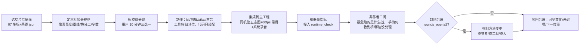

# 工务城制作方式审查与下一轮施工方案（2026-10-11）

提交给 Codex 的唯一文本。分析、证据、对现有方案的审查、三个制作案例和施工顺序都在这一份里。四张图嵌在对应章节，也单独放在同目录 `图/`。本文写成时没有改 `game-godot`、台账或制作流程。

## 阅读方式

按这个顺序读，不要先翻 52 个工作包或 331 条逐项设计。

1. 读完下面的「提交给 Codex 时必须守住的事实」和「本文没有替用户决定的事」。
2. 读第 1 节结论，并打开图 1。图 1 是实机 B12 与用户确认靶图的对照，后面所有画面判断都以它为准。
3. 读第 2、3 节根因。需要画面数字时看第 6 节和图 2。
4. 读第 4 节，判断现有整改计划和制作流程留什么、改什么。
5. 读第 5 节时打开图 3。这是用来证明「规则已经是题、玩家看不见」的唯一局面。
6. 读第 7、8 节。案例 2 必须对照图 4。
7. 只有用户明确说「按本文开工」时，才执行第 9 节。开工只从第 9.1 节切片 1 开始，不重开 52 包，不重置别人正在施工的主对话。

图打不开时，正文里的数字和表格仍然成立；但不要声称已经看过画面。四张图都是本次原创标注或示意，不是验收图，也不能代替靶图 `11-tactics-user-accepted.png`。

| 图 | 路径 | 在哪一节用 | 它证明什么 |
|---|---|---|---|
| 图 1 | `图/图1-同镜头对照标注.png` | 第 1、6 节 | 同一类战棋镜头下，实机单位占比、可见格数、HUD 和浮板构图与靶图差在哪里 |
| 图 2 | `图/图2-正常镜头画面规格.png` | 第 6、7、9 节 | 下一轮默认镜头、墨线、色分工和常驻 HUD 的可执行规格 |
| 图 3 | `图/图3-B区战术局面与多解.png` | 第 5、8 节 | B 区 R1 的四种合法选择、代价，以及 3 次点击的光标流 |
| 图 4 | `图/图4-造墙动作因果链.png` | 第 8 节案例 2 | 交通隔离墙 7 拍 × 7 轨：规则、骨骼、产物、声音和 HUD 必须是同一次动作 |

绝对路径前缀：`/Users/rayz/Documents/超gag机器人大战/docs/superpowers/specs/work-packages/2026-10-02-chao-gag-linked-operation-candidate/制作方式审查-20261011/`

### 提交给 Codex 时必须守住的事实

- 现行规则是逐机回合：每台机体每回合一份移动额度和一次主行动。旧四拍同步还在 `campaign_stage.gd` / `campaign_rules.gd`，启动入口不走那条路。不要把历史机制写成现状，也不要改回四拍。
- 美术方向是 KINETIC_CEL 动能赛璐璐，保留机体自己的英雄色。10 月 7 日报告里的「夜班工务」、低饱和、ITB 灰板不是现行方向。靶图 11 只定视觉方向，不授权照搬图里的英文、按钮和 HUD。
- 10 月 7 日实机报告是当时的诊断，不是当前缺陷清单。本文第 0 节写了实际读过和没读过的材料；没读过的不要补成已核实。
- 台账 `实施进度-20261010.json` 在本文取证时：`active_batch` 为 B12，`runtime_version` 为 B11，`complete` 与 `user_accepted` 都是 false。代码里的 `build_stamp.gd` 版本字符串是手写的 `GW52.20261011.B13`。三者不一致，不能把其中任何一个当成「已经完成」。
- 主工程只有 `game-godot`，场景是 `res://scenes/formula_lab/linked_campaign/round_campaign.tscn`，启动入口是项目根目录的 `工务城-v5接上归途.command`。
- 52 包和 331 条关联设计继续保留。本文要求改的是施工切法，不是删范围，也不是改检查阈值来让记录变绿。
- 本文的「确认」表示有文件、代码或图像证据；「假设」表示还没被下一批验证。能推翻某条判断的证据写在该条后面，不要把判断写成不可修改的事实。

### 本文没有替用户决定的事

这四项在第 9 节里有建议，但开工前如果用户没有点名，就按建议执行并在汇报里写明，不要再扩写成新的方案文档：

1. 52 包保留为台账，施工单位改成 6 个体验切片、串行推进。
2. S03–S07、P04、P06、U09 先标成待入场，不在切片 1–4 里继续做。
3. 招牌动作里的终式、回旋踢、钻击，是否交人做 2–3 段 Blender 关键帧。
4. 用户每批只做约 10 分钟的构图或涂装选择，不试玩半成品。

### 不要用这份文档做的事

- 不要把它当成已验收的 Runtime 或新的 Canon。
- 不要在用户说开工之前修改工程、台账、`制作流程.json` 或 `AGENTS.md`。
- 不要另写一份更长的整改计划来「落实」本文。第 9 节就是施工顺序。
- 不要用测试通过、文件哈希或截图数量代替第 6 节的画面指标和第 11 节的非作者判断。

---

## 0. 阅读记录

| 类别 | 实际看过 | 没看或只看了一部分 |
|---|---|---|
| 试玩报告正文 | `实机对标报告-v5.md` §0–§3、§5.0–§5.2、§6.1–§6.2、§7.0–§7.2、§10–§14（含 S/M/L、O/H 标注、13 条 bug、Top 15） | §4 立体、§5.3–§5.8 逐招脚本、§8 AI、§9 招式示意只读了结论行；附录 A 未读 |
| 试玩报告图片 | `ART01`、`ART07`、`LV01`、`MV00` 四张实际看图 | 其余 ART/FX/AI/H/JC/DG 图未打开；`raw/` 截图与 mp4 未打开 |
| 整改计划 | `05-施工与验收.md` 全文；`07-首关施工规格.md` §1–§5；`13-建筑比例与材质重做.md` 比例/材质行；`制作流程.json`、`实施进度-20261010.json`、`首关施工基线.json` 全文；`逐项设计.tsv` 做了统计（331 行、15 列）；`对Astra-v5整改计划的批评与建议.html` 开篇/数字核对/跑题/建议六条；`给Astra的补强与补全清单.html` 标题结构。另委托一轮分册逐项审查（00–13 全部 Markdown、三份 TSV、两份批评 HTML），其回传的 `文件:行` 引用已并入第 4.1 节 | `index.html` 没有在浏览器里打开；`图解/` 未看 |
| 美术标准 | `visual-standard-20261010.json` 全文；`series-art-direction-ab-lock-v1.md` 全文；`给Astra的视觉总参考.html` 正文全文（去标签）与图片清单 | `existing-style/` 15 张与 `target-look` 02/04–10、11b/11c 没有打开 |
| 靶图 | `11-tactics-user-accepted.png`、`01-battlefield.jpg`、`03-combat-readout.jpg` 实际看图并量测 | — |
| 实机证据 | B11 `after-A-hud.png`；B12 `wall/drill/beam-normal` 帧、`C-world.png`、`review.json`；`portraits-b05/roster-heads.png`；对 B12 两张 world 图做了 L\*/C\* 量测 | B10 原生录像 `native-controls.mp4`、`all-actions` 连续录像、`.wav` 均未播放/实听；B13 只有一个 beam-geometry 日志 |
| 代码 | `unit_scale.gd` 全文；`campaign_world.gd` 相机段；`round_world.gd`、`round_stage.gd` 相机/格尺寸检索；`stage_battle/mecha_outline.gdshader` 全文；`v6/full_art.gd:152` 描边接法；`scripts/gongwu_production_flow.py` review/delivery 全文；`scripts/run_gongwu_runtime_check.py` 全文；`scripts/author_gongwu_actions.py` 头 40 行；资产目录（models/actions/environment/audio/materials）与贴图哈希统计；另一轮代码架构子任务已回传摘要 | `round_rules.gd`、`round_cursor.gd`、`round_hud.gd` 等没有逐行读；旧四拍路径 `campaign_rules.gd` 只确认仍在树中 |
| 外部链接 | ChatGPT 分享页已抓取并通读（三轮问答：harness/工具建议、启动词样板、“问题到底在哪”、博主案例与 Godogen/Dream Loop） | — |

---

## 1. 结论

1. **落差主要不在“设计写得不够细”，而在三件事：画面目标没有被翻译成镜头级规格；美术和动作用“写代码”替代了“制作”；验证测量的东西和玩家看到的东西不是同一个。** 这三件互相加强：没有镜头规格，就没法量“像不像”；没法量，就只能量文件、哈希、帧时和断言；量的东西越多，越把注意力拉回容易写代码的部分。
2. **首关规则设计本身是合格的。** `07-首关施工规格` 给了坐标、费用、六手、替代解、代价与冲突裁决，`首关施工基线.json` 可直接复算；B 区“顶推/护场/切专线/吊运”四解成立（见第 5 节与图 3）。所以“不好玩”这一轮的主因是 **表现与读题** 和 **机体身份薄**，不是规则缺失。规则层真正的缺口只有两处：技能去重（托住×3、墙×2）与敌种身份。
3. **现有 52 包/331 条的方案不需要推翻，但需要换切法。** 331 条里 220 条同时挂在两个以上工作包，U03 一个包挂 65 条、V06 挂 56 条；带数字规格的只有 52 条。按包推进必然横切十几条体验线，每批都碰 6–10 个包而没有一个“完整一屏”能交付。应保留 52 包作台账，改用 6 个 **体验切片** 作施工与验收单位。
4. **新加的制作流程（preflight/review/delivery）能防“拿文档冒充运行版本”和“证据缺字段”，不能防“做出来不像”。** 它要求的 `visible_changes`、`listened:true` 都是自填布尔；“两轮未改善改方法”没有机械化，B05–B11 同一组缺口（场景平/空/碎、声音未实听、Ctrl 拖拽未验证、60fps 未达）连续 6 批原样出现。这套流程现在是**记录更严格**，不是**质量更高**；应保留其来源/版本绑定，把审查维度换成能量到画面的指标和非作者判断。
5. **不换更强模型、不加代理数量也能明显改观的部分**：默认镜头距离、墨线宽度、环境贴图分家、三台白机的涂装、常驻 HUD 减字、B 区一屏的街区化。这些是方法问题，一批内可见。**当前 AI+工具确实做不稳的部分**：有重量和辨识度的招牌动作（数值摆姿势已到上限）、整体审美取舍（需要人在 3 个关口各做一次 A/B 选择）。

---

## 2. 落差发生在哪里：按影响排序的根因

每条给：例子 → 证据 → 什么能推翻。

### R1（影响最大）画面目标没有翻译成镜头级规格
- **例子**：靶图 11 里标准机占画面高度约 25–33%，一屏约 9 格宽；实机 B12 标准机约 13%、2×2 王者约 21%，一屏约 18 格（整板 10×8 加外围）。所有已做的美术（色板 JSON、12 类资产、三态损毁、居民楼 5–7 层）都在一个把整板塞进画面的总览镜头里被看，细节必然成噪点。
- **证据**：相机是正交投影（`linked_operation/slice_world.gd:45,58` `PROJECTION_ORTHOGONAL`、`camera.size=zoom`），所以 `zoom` 就是画面高度对应的世界米数：`campaign_world.gd:62` 默认 `zoom=119`、`pitch=.73`；`rounds/round_world.gd:63` A/C `zoom=136`、B `146`。标准机 17 m（`unit_scale.gd`）÷ 136 m ＝ 12.5% 画高，与截图量到的 ≈13% 一致；格 10 m（`round_world.gd:104-107`），1440×900 下一屏宽 ≈ 136×1.6 ÷ 10 ≈ 22 格。要达到 25–30% 画高，`size` 应在 57–68 之间（一屏宽约 9–11 格）。描边 `mecha_outline.gdshader` 默认 `pixels=.70`，三处接法都设 `.8`（`campaign_world.gd:167,209`、`v6/full_art.gd:152`）——不到 1 像素，在正常距离肉眼不存在，而 KINETIC_CEL 的第一条就是“有压力变化的深墨蓝线”。靶图 11 棋盘区高彩像素（C\*>40）占 24.9%，B12 两张 world 图只有 1.9–2.5%：**环境有颜色、机体没颜色**，与靶图正好相反。
- **能推翻它的证据**：某一批记录里曾把镜头收到“标准机占画高 ≥25%”并因为玩法原因（整板信息需要）被用户否决；或者 07 册 3b 的“单格投影短边不低于 44px、剪影宽 ≥28px”确实已在 1080p 默认机位达标且用户看过认为仍然不像——我没有找到任何一条这样的记录。

### R2 美术与动作用“写代码”替代了“制作”
- **例子**：环境 373 个文件、114 张 albedo，只有 2 个不同的哈希，所有建筑、吊机、箱体、地坪共用一张 `coated-metal-albedo`，于是全城同一青绿。动作剪辑由 `scripts/author_gongwu_actions.py` 以数值姿势生成（“The poses below are new choreography”），22 台机体 × 3–8 招全部如此；回旋踢的支撑脚、转髋靠公式求解。全部 41 个 wav 由 `build_gongwu_sound.py`/`build_gongwu_score.py` 用振荡器离线合成，没有一条采样。HUD 全部代码构建，无 Theme 资源、无 `.tscn`。10-07 报告已指出 151 处 `box()` 拼场景、`engineering()` 一根线共用四招；现行仍是倒角盒子铺满战场、v6 GLB 只覆盖临街与设施。
- **为什么这是方法问题而不是能力问题**：同一批模型在近景肖像（`portraits-b05/roster-heads.png`）里色块清楚、身份明确——说明模型底子可用；差的是镜头、墨线、材质分家和场景组织，不是面数。
- **能推翻它的证据**：若 `actions/*.glb` 中的 GW_* 剪辑有 Blender 手工关键帧来源文件（`.blend` 含动画师编辑痕迹）且已加载；若环境 kit 件有分材质的手绘/生成贴图在运行时被引用——目前 `industrial-drawn-atlas-v2.png` 只被 `ground_relief.gd:51` 用于地坪 shader，environment 目录 114 张 albedo 全是两张 coated-metal 的复制，建筑/吊机/箱体没有分家。

### R3 验证测量的不是玩家看到的东西
- **例子**：`gongwu_production_flow.py review` 检查的是：来源 sha、维度字段齐全、`before/target/after` 文件存在且 sha 匹配、`view==before_view`、`visible_changes` 非空、`listened==true`、性能数值比较（`:157-249`）。`run_gongwu_runtime_check.py` 检查引擎错误、断言、存档保护、源码在运行期间没变（`:91-104`）。两者都不打开图片、不量帧、不听声。B12 `main-quality` 记录里 `native_input:false`、`system_audio_listened:false`、`issues: wall: no physical engineering work event ×3`，但 `clean_checks` 列表继续增长。
- **后果**：“覆盖了要求”和“达到了质量”无法连接；同一套假设（作者写预期、作者看截图、作者填 listened）自我证明。
- **能推翻它的证据**：任何一批有非作者（用户或独立上下文）对同机位前后图的书面判断、或有量化画面指标（单位像素高度、墨线像素、L\*/C\* 分布、常驻字数）作为门槛——B05–B12 没有。

### R4 批次按“包/系统”横切，不按“一段体验”纵切
- **例子**：`实施进度` 的 batch_history 每批 code_changes 同时覆盖规则事件、居民楼实体、王者背架、地面 atlas、肖像、帧时、存档迁移、部署布局（B01：7 条横跨 F/A/R/U/V；B05：8 条横跨 F/U/A/R/P/Q）。十一批下来没有一批的产物是“B 区一屏从选机到跨区后果，录屏+实听+用户看过”。
- **为什么会这样**：05 册规定“整包核对覆盖全部关联条目，不能用一个案例替代”“不能在样板通过处结束”，加上 331 条 2/3 跨包，任何一个包的“完整”都要求碰十几条线；最省力的推进方式就是每批在每条线上各推一点。
- **能推翻它的证据**：如果主对话里用户明确要求按包并行推进（我看不到主对话），这条要降级为“规则导致的副作用”，但对结果的影响判断不变。

### R5 核心玩法：规则层基本够，表现与读题层没兑现，身份层薄
- **判断**：07 册的三题互卡（A 接电释放 B 一台机、B 通桥决定列车、C 切专线取消 A 炮）、六手与两条替代路线、不作为的量化后果（城防 7→4、桥 4→0）是成熟的 ITB 式设计。玩家感受不到，是因为 READ-A/B/C 要求的“电柜母排、桥锁销错位、馈线柜隔离刀”在当前镜头与材质下读不出来，三区联动只剩标签。身份层：18 招里 5 招可认（报告 §6.1），托住×3、墙×2、变形×2 规则重复（§6.2），敌人 4 种只靠数字区分。
- **归类**：规则设计不足 20%、关卡组织 10%、表现 50%、数值 10%、身份 10%（主观权重，供排序）。不是 UI 一家的事，也不是加通用效果数量能解决。
- **能推翻它的证据**：按图 2 规格把 B 区做成可读一屏后做一次无提示首玩，若 5 人里仍有 ≥3 人说“没有值得想的选择”，则规则层权重上调。

### R6 代码结构：不是丑的根因，但让每次视觉修改都贵
- **例子**：`linked_campaign` 共 14,160 行 GDScript，`round_stage.gd` 1,053 行、`round_rules.gd` 987 行，大量单行多语句（分号串联）；场景美术分散在 `environment_art`、`ground_relief`、`fixture_art`、`round_art_direction`、`v6/full_art`、`v6/art_palette` 六个文件，且与规则对象生成耦合；旧四拍路径 `campaign_rules.gd`（668 行）和 `campaign_stage.gd`（978 行）仍在树中，且 `round_stage` 继承 `campaign_stage` 却不调 `super._ready()`，用覆盖生命周期的方式绕开旧 HUD/检查弹窗——双主控叠在一起，改“现行关”时容易误碰死代码；`set_command`（“Enter 确认”）已无调用点。入度最高的 `round_rules.gd` 被 17 处 preload。改一次镜头或材质要跨 4–6 个文件。操作本身不算差：选机→点落点→选招→点目标，典型 3–4 次点击，安全动作无确认（这一点与 10-07 报告“操作手感明显改善”一致，问题在反馈的画法而不是点击数）。
- **能推翻它的证据**：如果“默认镜头距离+描边宽度+三材质分家”这三项改动能在半天内由一人完成并通过同机位对照，那么结构不是阻碍，这条降为“维护成本”。

### R7 AI 长任务中的目标替换与自评失准
- **例子**：批次里大量可计数成果——“26 模型 1991 姿势 ≤1mm”“全部装备 16 方向检查”“22 页人物/通信/制度界面”“静态合批几何保全”“帧 p95 14.3ms”——与“正常镜头美术仍未通过”“声音未实听”并列出现，前者越来越细，后者原句复制。流程里写了“两轮未改善改方法”，六批没有触发一次。ChatGPT 讨论里把这概括为“证据范围比结论范围小”，我同意；但我不同意把它主要归为模型能力：R1–R3 都是可以用方法改掉的。
- **能推翻它的证据**：主对话中用户逐条要求了这些工程项；或台账里存在一条“方法变更”记录。

---

## 3. 根因表

“状态”：**确认**＝有文件/代码/图像证据；**假设**＝合理推断，待一批验证。

| # | 玩家问题 | 证据 | 根因判断 | 改法 | 玩家能看到的变化 | 验证办法 | 状态 |
|---|---|---|---|---|---|---|---|
| 1 | 机体太小、细节成噪点、看不出谁是谁 | 图1：标准机 ≈13% 画高 vs 靶 25–33%；正交 `size=136/146`，17 m÷136 m＝12.5% | R1 | 默认正交 `size` 按“标准机占画高 25–30%”反推到 57–68（一屏宽 9–11 格），三档滚轮：默认 / 总览整板（现值）/ 近景 5×3；总览不是验收机位 | 一屏里机体有脸、有手、有武器；板外还有城市 | QA 脚本用 `campaign_world.gd:339-340` 已有的 foot/head unproject 量每台机像素高度，默认机位 ≥0.25 画高；同机位前后图 | 确认 |
| 2 | 不像赛璐璐，像灰青色塑料模型 | `pixels=.8` 描边；两级阴影有但无墨线；B12 高彩像素 2% vs 靶 25% | R1+R2 | 机体墨线 2.5–3.5px（受力侧×1.5），环境 1.5–2px；关闭镜面；三材质家族（混凝土米/钢青绿漆/警示朱红）分贴图；白机按 Canon 身份色分块 | 剪影黑边把机体从环境里“切”出来；每台机 3–4 块颜色 | 墨线像素在 1080p 截图上量；C\*>40 像素占比 15–25%（机体区）；关 HUD 灰度图四层可分 | 确认 |
| 3 | 工务城不像城，像实验台/浮岛 | B11/B12 world 图：10×8 浮板悬空+立柱，板外青绿虚空；居民楼在远处 | R1+R2+R4 | 棋盘=街区里的一个作业场，地面连续到板外；一环建筑贴格 1–2 机高，二环 3–5 机高，三环剪影；渠、桥、轨道做真实断面 | 从 A 能看见 B 的桥与 C 的吊机；板边不是世界边 | 同机位前后图；READ-A/B/C 五秒指认（07 册 3b） | 确认 |
| 4 | 常驻信息太多要读字 | B11 图：顶栏 3 行+路线条、3 小地图、底部教学条、播放条字幕 | R1（HUD 规格也没有镜头级预算） | 常驻文字预算 ≤12 个词/数字；三区小地图改图标+红点；选中卡 ≤3 动词；教学条 3 回合后隐藏；玩家动作不配字幕 | 第一眼只看到棋盘、城防电池、列车进度、结束回合 | 截图 OCR/控件遍历统计常驻字符数；无提示首玩能说出目标 | 确认 |
| 5 | 敌意、推落、取消、误伤不直观 | 报告 §8、§11 S18/M11/H18；B12 仍是细线箭头+文字 | 表现（规则层已有 F03 绑定） | 四种图示语言：威胁=朱红斜纹到目标格+徽记；推=粗箭头+终点事件图标（撞/落水/停）；取消=斜纹变灰打 ✕ 并带来源芯片；误伤=朱红卡二次确认 | 看一眼知道谁打谁、推去哪、这一手取消了哪条 | 图3 光标流 5 步录屏；18 招卡面/棋盘/执行同源对照（U03） | 确认 |
| 6 | 三战场像三个小关，不像一局 | 报告 §3.3；B11 “远区取消定位芯片”刚接上 | 表现+关卡读题（规则已互卡） | C 闸被悬停时 A 炮口闪、B 桥上 2 伤划掉；切区用位置芯片一次跳转；总览不常驻 | 在 C 做一手，B 的预报当场变 | 案例 3 录屏；首玩问“为什么 B 少挨 2 伤” | 确认 |
| 7 | 换机体解法不变 | 报告 §6.2 托住×3、墙×2；R01 合同在但 14 台未逐台验证 | 规则（去重）+身份 | 每台 1 个独有动词+1 个通用；托住只留货柜，墙只留预算；拳王重击带伤害使“推保全工机”变代价 | 换机体后可行解集合变化（图3“换机体检验”） | 自动路线求解器对比两套编队的解集；首玩 | 确认（去重）/假设（求解器） |
| 8 | 招式看起来一样、没重量 | 报告 §6.1 5/18 可认；B12 `wall: no physical engineering work event`；动作由数值姿势生成 | R2 | 工程类四招按图4 七拍模板各自做产物与手型；招牌招 2–3 个改手工关键帧或动作库重定向；接触/落地/收势三拍必有 | 墙从手里飞出去、落地压一下、钉住；拳、掌、钻三种手型 | 60fps 录屏逐帧：产物可见帧 ≥12、接触帧与规则 contact 同帧；快进/跳过终态一致 | 确认 |
| 9 | 声音只是“有” | 41 个 wav 全部为振荡器合成（`build_gongwu_sound.py`）；37 条非零无削波；`system_audio_listened:false` 持续 | R2+R3 | 改用采样为主（瞬态/材质/低频/尾音四层）+随机；合成只留 UI 音；每批由非作者实听 5 次连续 | 轻重招声音不同，连锁升调 | 系统录音文件+听感记录（人填） | 确认 |
| 10 | 修了很多，整体没变好 | batch_history 11 批横跨 6–10 包；同一缺口六批原文 | R4+R7 | 按 6 个体验切片施工（第 9 节）；缺陷台账计数 ≥2 自动要求方法变更 | 每批交付一个可玩的“完整一屏” | review 加 defect ledger 校验 | 确认 |
| 11 | 自我验收 | 流程只核结构；listened/visible_changes 自填 | R3 | 三类判定分家：机器量指标；非作者看同机位三联图答三问；用户只做 A/B 选择 | 用户每批只花 10 分钟选，不试玩半成品 | 见第 11 节 | 确认 |
| 12 | 性能/合批/菜单占用批次 | B09 静态合批、B05 22 页菜单、16 方向检查 | R7 | 冻结到切片之后；性能只在切片画面定稿后量 | 批次产物回到画面与手感 | 批次 code_changes 必须映射到切片 | 假设（需主对话佐证） |

---

## 4. 对现有方案与流程的审查

### 4.1 方案结构（量化）
- 331 条逐项设计：`design` 列含数字规格的 52–94 条（按正则宽窄 16%–28%）；四列（design/player_expression/example/verification）全无数字的 183 条（55%）。**最缺数字的恰是美术与声音**：美术 12 条含数字 2 条、场景资产 2/12、造型 2/8、配色 0/3、语义色 0/10、敌招 0/5；最全的是七台招牌 7/7、精神 9/10。
- 220 条挂在 ≥2 个包；U03 65 条、V06 56 条、F01 35 条、A02 28 条，而 F04/F05/F06/Q02 各只被提及 1 次。U03 与 V06 共享 MV01–18、FX01–15 共 33 条。261/331 条的 `spec_ref` 指向整节（`07#section-1`、`08#section-1`）而非具体锚点。
- `adoption` 列是 188 种自由文本，不是枚举：175 条没有采纳/调整动词，8 条“不采纳”全是“采纳 X；不采纳 Y”的复合句——所以“采纳/调整/未采纳”的比例实际上统计不出来。
- 52 包按 6 个“工作组”排列，但每包的 `scope_rule` 都是“整包核对覆盖全部关联条目，不能用一个案例替代”。这条规则 + 跨包挂载 = 任何一个包都无法单独关闭，于是没有包能成为批次的终点。
- **来源分叉**：`制作流程.json` 用 sha256 钉住的 `整改工作包.tsv` 仍是 10 月 10 日快照（52 行全部 `status=待实施`、`evidence=未提供`），而 `05`/`12` 的叙述已是“44/49 包有已接入子集”。preflight 保证的是“旧表没变”，不是“叙述与表一致”。

### 4.1b 分册里的重复、冲突与被越过的进入条件（`文件:行`）
- **重复**：ART04(L5)≡ASSET-01(L14)、ART05(L6)≡ASSET-12(L25)、DG-SYS15(L125)≡PERSON-12(L171)、SIG-6(L136)≡PERSON-08(L167) 四对逐字相同；敌方阶段“43 帧动作+12 帧停留”在 01:162、08:63、AI-P5、BUG05 四处；护场规则在 02:137、07:41、08:86、09:333、基线 json 五处；十条精神在 03:118–128 与 09:70–215 逐字重复。331 不是 331 个独立任务，00:82 自己承认。
- **冲突**：①B 区配色——07:78 “B 灰紫桁架 `#968DAB`”与基线 json 仍是灰紫，13:15/13:62 已改钢蓝并宣布灰紫退役，`visual-standard` 是钢蓝系；②“首批四招”两套名单——06:146（预算墙、灰崎拘束、王者双炮、货柜护场）vs 05:73（预算造墙、王者钻击、雷翎光束、一次坠落）；③F02 首关验收写 1×1/2×2/3×3，而 07:14 明确 3×3 不进首关、没有任何局面含 3×3；④02:71/03:64“不按米数缩放”与 13:34 用真实米数（3 m 层高、17–23 m 楼高）之间没有换算关系。
- **进入条件被实施顺序越过**：燃料（05:244 进入条件“空中层已好玩”未验证，11:139–152 已做 A/B 可玩局）；S07 七种空对地（05:150 已实现，V03 伤害/弹道却“未实施”）；P04 随机牌（10:12 进入条件“P02/P03/P05 已实跑通过”，12:14 已接入实验入口而 P02/P05 未关闭）；断冠（05:247 进入条件“机设核对”，12:78 自认未制作，11:79 已可玩）；S02 依赖 U09（TSV L37）但 U09 整包“未实施”（05:118）而 S02 已“实施中”。05:252 列的头号风险“范围膨胀”就是这样发生的。
- **12 册的“已验证”类型**：378/2068/173/68/84+13 项测试、14 条脚本解法、6,962→10,804 回归、14 入口 10 截图、15 型 45 GLB——全部是计数或脚本；07:203 自己要求的五类实机证据（六手录屏、压炮另局、无提示首玩、带声 18 招对照、泊位坍塌录屏）到 10 月 11 日台账仍一项未交。12 册每条都诚实加了“不代表……”，态度没问题，问题是这些计数被当成了批次头条。

### 4.2 保留 / 重写 / 冲突 / 只是记录更严

| 项 | 判断 | 理由与改法 |
|---|---|---|
| 逐机回合基线（01 §1）、意图冻结四类绑定（F03）、一份模拟喂预演/执行/回看（F04）、费用动词拆开（F01）、城防/桥/车/市政分栏（F05）、调度先算到（U02） | **保留** | 外部批评“建议接的六条”已在 07 落实为可复算数字；代码里 B06–B11 原生观察也证实大部分已跑通 |
| 07 首关三题、六手、两条替代、冲突裁决 | **保留并升格为唯一首批验收局面** | 这是全部文档里最接近施工图的一页；B 区一屏可直接当质量基准 |
| 05 的“整包核对/不能用案例替代/不能在样板结束” | **重写为两层**：52 包仍是台账；施工与验收单位改为 6 个体验切片（见 9.3），切片通过＝其涉及条目在该局面下通过；包关闭＝其条目在所有切片中都出现过 | 现规则把“完整范围”误写成“同时铺开”。保留范围，改串行 |
| A01“三地色稿”、13 册“建筑比例” | **保留，但缺镜头规格** | 两册都没有写“默认机位下标准机多少像素/占比”，所以做出来的 5–7 层楼在远景里仍是积木。补图 2 的 A 节数字 |
| 08 册 60/30fps 时钟容差、动作 cue 同帧 | **保留**（已机械化） | 是少数能量到的指标；但它量的是“同步”，不是“有重量”，不能代替图 4 的逐帧内容检查 |
| S03–S07（吊机/顶升/跨区射线/空地 20 条/七种空对地）、P04 随机牌、P06 名对手、U09 可访问性、R02 全卸装 | **范围保留，本轮不入场**；05 §7 已写进入/退出条件，但 `work_groups` 仍把它们与 A/V/U 并列，B05 实际消耗批次做了合体支撑与 16 方向装备 | 改为“待入场”组，进入条件写成切片依赖（例如 S06 入场条件=切片 4 通过且用户确认飞行值得做） |
| P02/P03/P05 精神/人物卡/机魂首关子集（SPIRIT-1/4、社勇免费意愿） | **保留在切片 5**，不进首批 | 外部批评和补全清单要求“接回人和梗”是对的，但在画面与手感没基准前接入只会增加常驻信息 |
| 条目 03/04 的样本毫秒与伤害 | **冲突**：06 声明“样本不定版”，条目册又把样本写成每招规格 | 一处写死（07 一关数字或 08 帧表），其余引用 |
| `制作流程.json` preflight/来源 sha/版本绑定 | **保留** | 防“文档替代运行版本”有效（Q01 反例） |
| `review` 的 visual/audio/motion 维度 | **只是记录更严，不改善质量** | 全是自填字段；改为：visual=量化指标+非作者三问；audio=非作者实听记录；motion=逐帧表（图 4 格式） |
| “两轮未改善改方法” | **只是文字** | 机械化：台账 `defect_ledger[{id, first_seen, rounds_open, method_changes[]}]`，`rounds_open>=2 且 method_changes 为空` 时 review 失败 |
| `run_gongwu_runtime_check.py` | **保留** | 其 `evidence_scope` 自述准确；问题在它被当成批次头条 |
| `v6/build_stamp.gd` 版本绑定 | **保留哈希，修版本号来源** | 代码/资产 sha 是算出来的，但 `ID="GW52.20261011.B13"` 是手打常量（主对话已到 B13，台账 active 仍写 B12、runtime 写 B11）；且 identity 同时引用 `linked_campaign_v4/models/white.glb` 与 v6 资产，两代资产目录并存。版本号应由哈希派生或由台账写入，不手打 |

### 4.3 对 ChatGPT 讨论的采信
- 采信：“证据范围比结论范围小”“接入路径断点（功能写在旧分支）”“参考图必须实际进入视觉输入”“先做一个真实镜头下的样板再扩展”。
- 不采信/修正：它把主因落在“项目级执行、审美生产、自评可靠性”三项能力上。本审查找到的是三项**可定位的方法错误**（镜头/墨线未定规格、代码替代制作、验证不量画面），优先改方法；能力瓶颈只在“招牌动作重量感”和“最终审美取舍”两处成立（第 10 节）。
- Recursive Game Creator / Godogen / Dream Loop：Dream Loop 的“目标图—实机截图—差异—改”循环值得吸收为切片验收方式；其余不在本轮引入新框架。

---

## 5. 核心玩法与操作：用一个局面证明

数据来自 `首关施工基线.json`（B 区）。下图画出棋盘、三条公开意图、四种解法和光标流。

**初始**：预算二号 (2,4)，货柜领袖 (2,6)；拆锁工机 (3,3)（市政保全对象，质 3，HP5），幼体 (2,5)（质 1）；桥 (4–5,3–4) HP4 未对齐；深渠 x=4,5；A 区架设炮经 C 区闸 (6,4) 供电，对桥承诺 2 伤。意图：拆锁→桥 3（接触绑定）；幼体→预算 2；A 炮→桥 2（架设+供电绑定）。

**不作为**：桥 4−3−2 → 失效，城防 −2；列车在 B(3,3) 停住；预算 −2。

| 解 | 输入 | 立即后果 | 代价 | 同一能力对敌/友/环境 |
|---|---|---|---|---|
| A 顶推 | 预算走 (3,4)，顶推工机北到 (3,2) | 3 伤取消（脱离接触）；0 伤害、0 市政 | 幼体仍打预算 −2；A 炮仍 −2 → 桥 4→2 | 同一顶推推向东=工机落渠击毁=市政 −1（预览朱红拦一次）；顶推友军可把预算从幼体攻击格挪开 |
| B 护场 | 货柜以桥为中心上盾 | 中心 2 吸收：3→1、2→0 → 桥 4→1 | 下回合桥必破；预算可同回合抢修 +3（备件 −1） | 盾可给保全工机，使它既不被误伤也挡不住推 |
| C 跨区切线 | C 区灰崎走到 (6,4) 切专线 | B 桥上 2 伤划掉并显示“来源 C 闸”；桥预报 4→1 | C 区酸体打列车 −2、幼体打雷翎 −1 无人管 | 切的是专线不是公共母线（L02 反例） |
| D 吊运 | 货柜走 (3,5)，吊工机放东岸 (6,3) | 3 伤取消；工机被渠隔开 ≥2 回合 | 货柜本回合不能护场；东岸工机下回合可能转打 A | 吊运落点选渠格=击毁=市政 −1 |

**换机体检验**：预算二号换旧拳王——重击带伤害，推工机就伤保全对象（市政 −1），玩家被迫选 B/C/D；拳王无隔离墙，R2 无法堵幼体。解法集合改变，不是改名。

**光标流（解 A，3 次左键、0 次对话框）**：悬停工机→斜纹到桥格+“3”徽记；左键预算→格边描线可达、合法出手格琥珀角标；按 1 → 光标到工机时画推箭头、斜纹变灰打 ✕、桥 HP 段 4→2 闪烁；左键一次执行（安全动作不确认）；若推向渠格→卡变朱红“市政工机将被击毁”需第二击；右键回自由探索。

**判断**：这个局面在规则层已经是题。现在的问题是玩家在实机里**看不见**接触绑定、看不见专线、看不见深渠断面，也**没有理由**换机体——所以要修的是表现与身份，不是再加系统。

---

## 6. 正常镜头里“像一个游戏”：决定性差距与画面规格

图 1 是差距，图 2 是下一轮要执行的规格。按决定性排序：

1. **单位屏幕占比**（13% → 25–30%）与**可见格数**（18 → 9）。这是一切细节能否被看见的前提。
2. **墨线**（0.8px → 2.5–3.5px 带受力变化）。没有它，两级阴影的赛璐璐读成塑料。
3. **色的分工**：环境中明度有色但低彩（C\* 中位 ≤15、C\*>40 像素 ≤5%），机体承担高彩（机体区 C\*>40 占 15–25%）。现在倒置。
4. **构图**：棋盘嵌在街区里，地面连续到板外；一环建筑贴格且 1–2 机高；渠/桥/轨有真实断面。现在是浮板。
5. **建筑尺度线索**：窗排必须在默认机位可数（13 册的 3 m 层高是对的，但楼放得太远）。
6. **材质**：三材质家族分贴图；关闭镜面高光；用已存在的 `industrial-drawn-atlas-v2.png` 而不是单张 coated-metal。
7. **阴影**：保留方向光硬阴影一级+接触阴影；不要靠 SSAO 和曝光补救。
8. **HUD 层级**：常驻 ≤12 词；三小地图→图标+红点；选中卡≤3 动词；玩家动作无字幕；敌方阶段才出播放条。

**可自动量的指标（加进现有检查，不新建框架）**：
- 单位像素高度 / 视口高（foot/head unproject 已有代码）≥0.25（标准机）、≥0.33（2×2）。
- 描边像素：渲染一帧只开描边 pass 的 mask，测平均线宽 ≥2.5px。
- 棋盘区 L\* 中位 30–50、环境 C\*>40 ≤5%、机体 mask 内 C\*>40 ≥15%（PIL Lab 换算，本文已用同法量过 B12 与靶图）。
- 常驻 HUD 可见字符数 ≤40（遍历 Control 树）。
- 这些数字只做“门”，不做“好看”的证明；好看由第 11 节的人类三问决定。

---

## 7. 重建制作方式：每类内容怎么生产

原则：**先选适合的制作方式，再决定写不写代码。** 代码负责装配、规则、状态切换与可重复校验；形体、材质、动作、声音用各自的制作工具产出文件。

| 内容 | 输入 | 实际怎么做 | 产物 | 进游戏 | 失败换法 |
|---|---|---|---|---|---|
| 场景构图 | 靶图 11/01；07 册坐标；图 2 规格 | 先在 Blender 里按真实米数搭 B 区**灰模街区**（棋盘+一环+二环），从默认机位渲染一张灰模图与靶图并排，用户选构图；锁定后再上材质 | `blockout_B.blend` + 默认机位渲染 | 以布局文件（格坐标→kit 件 id→朝向）装配，不在 `environment_art.gd` 里 `box()` | 两轮灰模都被否 → 换参考（从靶图 11 临摹布局），不是继续加件 |
| 建筑 | 13 册楼型；Canon 工务城物件表 | Blender 建硬表面 kit（bpy 可用，但每类件 3 态分文件）；窗/门/楼板实体；UV 展开 | 每件 `.glb` + 三态 | kit manifest 指定件→材质家族 | 件在默认机位读不出用途 → 放大体块或并件，不加小细节 |
| 地形与材质 | 视觉标准色票；`industrial-drawn-atlas-v2` | 三材质家族各一张手绘/生成 atlas（Midjourney/LibTV 出 tile 源，PIL 做无缝与色阶量化到 2 级）；地坪板缝、沟槽、轨道是几何 | 3×atlas 2K + 法线可选 | 材质由 kit manifest 引用；shader 只做两级阴影+墨线 | 灰度下地坪/建筑/机体不分层 → 改明度带，不改曝光 |
| 机体造型与比例 | `character_mecha_art_locks`、肖像图 | 现有 GLB 保留；先做**涂装与墨线修正**（材质分块按肖像身份色），再按需换件；只对剪影不达标的机体回 Blender 改肩/翼/头冠体块 | 材质分块表 + 必要的部件 GLB | `full_art.gd` 的材质接法改读分块表 | 两轮仍“白一团” → 图生 3D 重做该机（Meshy image→3D，输入必须是当前肖像/三视图），再 Blender 修比例 |
| 骨骼与专属动作 | 07/08 招式合同；图 4 七拍模板；参考视频 | 工程类四招用七拍模板在 Blender 手工关键帧（含 IK 支撑脚、重心曲线）；招牌招（终式、回旋踢、钻击）先找动作库（人形重定向到 17 骨）或人工关键帧；`author_gongwu_actions.py` 只保留导出与 cue 时间抽取 | `GW_*` 剪辑含事件标记（取出/离手/接触/收势） | `action_sequence` 读剪辑事件时间，不在代码里写拍点 | 数值摆姿势两轮仍被认为“滑过去” → 停止数值法，转人工关键帧或动作库 |
| 招式特效/受击/环境响应 | 图 4 轨道表；报告 §5.6 G1–G5 | 每招一张 7 拍 × 7 轨表；产物（墙件/铆钉/尘圈）是独立资产；受击三档片段复用；环境响应（落水水柱、撞墙碎片）是环境 kit 的事件件 | cue 表 + FX 预制件 | 规则 contact 事件触发；跳过/快进走同一终态 | 特效遮住下一手 → 缩面积不缩对比 |
| 声音 | 7 拍事件；参考音（金属撞击、液压、焊接实录） | 四层采样（瞬态/材质/低频/尾音）+ `AudioStreamRandomizer`；连锁升半音；现有振荡器合成只保留 UI 反馈音 | 每招一组 wav + 混音表 | `action_audio` 按事件层触发 | 非作者实听“机械/听不出轻重” → 换采样，不调音量 |
| HUD/图标/光标 | 图 2 C 节；视觉标准 ui 色票 | 图标先在矢量工具里画 3 类（动作外框/效果徽记/状态），导 SVG→纹理；控件用 `.tscn`+Theme 资源，不在 `round_hud.gd` 里逐个 `Label.new()` | Theme + 图标集 | 替换现有 HUD 根节点 | 常驻字符数超预算 → 挪到悬停/I，不缩字号 |
| 敌人 | ART07 四种剪影；07 敌种表 | 先画 4 张剪影概念（Midjourney/LibTV，输入含我方机体同比例），用户选；Meshy image→3D；Blender 修比例到我方 60–80%；涂装：敌=品红/深红家族 | 4 个敌种 GLB + 3 受击片段 | 替换 `claw/gun/wedge/worker` | 远景仍一团 → 加大体量或换概念，不加贴图细节 |
| 关卡题面与跨战场因果 | `首关施工基线.json`；07 §4 | 关卡数据就是题；每题配 READ 图示（电柜母排、锁销、隔离刀）为**几何件**；跨区因果用位置芯片+对象上的来源标记 | 基线 json + READ 件 | 已有 | 首玩 5 秒指认 <8/10 → 改几何/机位，不加说明文字 |

**什么时候用什么**：
- 复用现有资产：14 台机体模型、肖像、`industrial-drawn-atlas-v2`、规则/模拟/快照/原生 QA 存档。
- 程序化：kit 装配、三态切换、墙/桥等规则产物的放置、指标量测。
- 图像生成：概念剪影、材质 tile、HUD 图标草图、目标图变体——每次记录模型/参考/参数，且参考图必须真正作为输入传入。
- 图生 3D + Blender 修整：敌种、缺失道具、剪影不合格的机体。
- 人工制作：招牌动作关键帧（2–3 招起）、最终审美 A/B 选择、实听。

---

## 8. 三个完整制作案例

### 案例 1 · B 区跨渠桥座：一屏街区与建筑
- **参考**：靶图 11（构图/墨线/色分工）、01（三区楼群与吊机尺度）、13 册楼型、07 §3 坐标。
- **设计**：棋盘 10×8 是桥头作业场；x=4,5 深渠真实下切 0.8 格、渠壁可见、水面低位；桥为桁架+支座+锁销，未对齐=轨头错 0.25 格、锁销缩回；西岸一环：泵站（1.5 机高）、检修廊；东岸一环：变电亭、集装箱堆（1 机高）；二环：5–7 层居民楼×3、吊机；三环：柱环剪影。地面连续到板外 3 格再被建筑截断。
- **制作步骤**：①Blender 灰模（只体块）→默认机位渲染→与靶图并排→用户选 1/3；②kit 件建模（泵站/变电亭/居民楼三型/桥/渠壁/集装箱/吊机），每件三态；③三材质 atlas；④布局文件装配；⑤镜头、墨线、光照三参数定稿；⑥同机位五态图（关 HUD/正常/悬停/瞄准/受损）。
- **实际资产**：`blockout_B.blend`、`kit/*.glb`（三态）、`atlas_concrete/steelpaint/vermilion.png`、`layout_B.json`。
- **集成位置**：替换 `rounds/round_world.gd`/`environment_art.gd` 中 B 区生成为“读 layout 装配”；相机参数在 `campaign_world.gd:62` 与 `round_world.gd:63`；描边在 `full_art.gd:152` 与 `campaign_world.gd:167,209`。
- **检查**：第 6 节 4 项自动指标；READ-B 三态辨认（没电/没对齐/受损）；同机位三联图由非作者答三问。
- **失败处理**：灰模被否两次→换参考布局临摹；指标达标但三问不过→查材质分工与一环体块，不加件。

### 案例 2 · 预算二号 交通隔离墙：有身份的工程动作（图 4）

- **参考**：报告 §5.5.1 七拍分镜、JC01；08 册 60Hz 时钟；预算二号肖像（绿白工程机）。
- **设计**：取出（背包开盖、取件手型）→抛出（转髋、支撑脚不滑）→飞行展开（1→3 段）→落地挤压（下沉 6% 回弹、尘圈、2 帧顿帧、镜头推 ≤3%）→固定（铆枪×2）→收势（回 Idle 曲线）→残留（墙占格，HP3=3 块面板，挡住的敌意斜纹变灰打 ✕）。费用在第一拍扣，contact 在落地拍创建对象。
- **制作步骤**：①Blender 在 `engineer` 骨架上手工关键帧 7 拍（1.3 s），导出含事件标记；②墙件三态 GLB；③cue 表只引用剪辑事件时间；④四层声音；⑤录 60fps 正常/快进/跳过。
- **实际资产**：`actions/engineer.glb` 的 `GW_wall` 剪辑、`kit/wall_{intact,broken,destroyed}.glb`、`audio/wall_*.wav`×4。
- **集成位置**：`v6/action_sequence.gd` 的 wall case；`v6/action_library.gd` 事件读取；`campaign_world.gd create_prop` 改为“落地拍创建”。
- **检查**：逐帧：墙在手中可见首帧到触地帧 ≥12 帧；contact 帧=规则 contact 事件帧（±1 源帧）；快进/跳过后墙数/位置/备件一致；非作者实听 5 次。
- **失败处理**：数值姿势法已到上限——若第一轮手工关键帧仍被判“滑过去”，换人形动作库重定向做“投掷”基础层再叠手部；再失败则这一招交人工动画师，交付 `.blend` 关键帧。
- **推广**：同模板到抢修（手触已有物、不抛）、架桥（两端连接）、托住（持续承重姿态）；再到社勇王终式（预备—出手—冻结—收势四拍，扇面三格产物=地面裂纹贴花）。

### 案例 3 · 从光标到跨战场后果：C 切专线，B 少挨 2 伤
- **参考**：07 §4 第三题、L02/U05 合同、B10/B11 原生观察（位置芯片、小地图取消标记已有雏形）。
- **设计**：C 区自由探索悬停馈线柜 (6,4)：柜体隔离刀几何高亮，右侧 A 图标炮口闪，B 图标上出现“−2 ✕”预览；左键灰崎→可达格描线；点柜=自动走近+操作（U02）；安全动作一次执行；执行演出：拉刀→火花→A 区炮架指示灯灭→B 桥上 2 伤斜纹变灰打 ✕ 并挂“来源 C 闸”芯片；点芯片跳到 B，同机位看到预报 4→1。
- **制作步骤**：①馈线柜 kit 件（含隔离刀可动部件）；②灰崎 `GW_switch` 剪辑（走近+拉刀，手型）；③跨区 cue：A 炮架灯灭件、B 斜纹取消动画；④HUD：三区图标红点状态、位置芯片；⑤原生输入录屏（鼠标真实点击）。
- **实际资产**：`kit/feeder_cabinet_{on,off,broken}.glb`、`actions/police.glb GW_switch`、`audio/switch_*.wav`。
- **集成位置**：`rounds/round_cursor.gd`（悬停跨区预览）、`rounds/round_hud.gd`/`round_minimap.gd`（图标与芯片）、`rounds/tactical_feedback.gd`（来源投影）、`v6/action_sequence.gd`。
- **检查**：原生录屏（U01 Ctrl 独占同时复测）；首玩问“为什么 B 少挨 2 伤”能指到 C 柜；切区前后预报数字一致（F04）。
- **失败处理**：玩家仍指不出来源→把来源芯片从 HUD 移到 B 桥对象上方；仍不行→在 C 柜操作结束时镜头短暂推向 B（≤1 s，可关）。

---

## 9. 可交给 Astra 的施工顺序

### 9.1 首批：切片 1「B 区一屏」= 质量基准（约 1 批，不是 1 个样板）
产物：B 区 R1 从部署到敌方阶段的完整一屏，含案例 1、2、3，录屏+系统录音+同机位五态图+指标 json+非作者三问记录。

具体改哪些内容：
1. 镜头：`campaign_world.gd:62`、`round_world.gd:63` 的正交 `zoom`（=画面世界高度）按“标准机 ≥25% 画高”反推到 ≈57–68 m；加三档滚轮；总览档保留现值 136/146。
2. 墨线：`mecha_outline.gdshader` 机体 2.8px/环境 1.8px，加受力侧加粗（按法线·视向）；`full_art.gd:152`、`campaign_world.gd:167,209` 统一读参数。
3. 材质分家：B 区 kit 改引用三 atlas；关闭镜面；两级阴影参数核对 `visual-standard` lighting。
4. B 区街区化：灰模→kit→布局装配（案例 1）。
5. 三台白机涂装分块（白色样机/无牌一号/灰崎）按肖像身份色；敌种拆锁工机与幼体新剪影（Meshy+Blender）。
6. HUD 减字：顶栏 1 行图形化、三小地图→图标+红点、选中卡 ≤3 动词、教学条 3 回合后隐藏、播放条仅敌方阶段。
7. 造墙七拍（案例 2）、切专线跨区（案例 3）、顶推/护场/吊运三解的预览图示。
8. 指标脚本接入 `run_gongwu_runtime_check.py`（量像素高度/墨线/色分布/常驻字符），结果写进 review 的 visual 维度。
9. 来源对齐（不改阈值）：把 `整改工作包.tsv` 的 status/evidence 列更新到与 05/12 叙述一致并重新登记 sha；07:78 与基线 json 的 B 区灰紫改为钢蓝；“首批四招”只留一张名单（本文建议：造墙、顶推、切专线、钻击——即切片 1/2 实际会用到的四招）。

需要的工具：Godot、Blender（手工关键帧+kit）、PIL（指标）、Midjourney/LibTV（剪影概念、材质 tile）、Meshy（敌种图生 3D）、系统录音。用户参与：灰模构图三选一（10 分钟）、机体涂装 A/B（10 分钟）、造墙录像实听（5 分钟）。

停止：静态合批与性能微调（切片画面定稿后再量）；人物/通信/制度多页菜单继续扩展；16 方向装备检查、支撑曲线 ≤1mm 类几何自检作为批次头条；新增合同文档；在旧浮板场景上继续加建筑件；数值摆姿势生产新招式；在进入条件达成前继续做燃料、空地七动作、断冠、随机牌组（它们已经先于 V03/V05/U09 被做成可玩局）。

### 9.2 推广顺序（切片 2–6，每切片一批，范围回到全部 52 包）
- 切片 2「A 区一屏」：接电/推落/王者钻击；A 区 kit 复用+电柜母排几何；READ-A。
- 切片 3「C 区一屏 + 列车」：清箱三解（导弹友伤/直射/吊运）、列车 18 段、READ-C；敌方阶段分段与致命一击回看（U06/V01）。
- 切片 4「全员涂装与招牌」：14 台涂装分块；18 招按七拍/四拍模板；敌种 4 剪影；盲辨 ≥14/18。
- 切片 5「人与魂」：SPIRIT-1/4、社勇免费意愿、通讯短演出（P02/P03/P05 首关子集、V07）。
- 切片 6「系统与专关」：R2 卸装、S01/S02 高差与剖切、E03 三编队通关、Q02/Q03 全范围验收；S03–S07/P04/P06/U09 按进入条件决定是否入场。
- 包关闭规则：某包全部关联条目在相应切片中出现并通过，才在 `full_package_reviews` 登记。

### 9.3 批次循环（每批相同）

---

## 10. 能力与资源判断

| 部分 | 当前 AI+工具能否达标 | 缺什么 | 需要人交付什么 |
|---|---|---|---|
| 镜头、墨线、材质分家、HUD 减字、布局装配、指标脚本 | 能，一批内 | 只缺规格（本文图 2 已给） | 构图三选一 |
| kit 建筑硬表面（bpy） | 能 | 三态与材质分家的纪律 | 无 |
| 材质 atlas | 能（生成+量化） | 参考图必须真正输入生成器 | 色板 A/B |
| 敌种/道具 图生 3D | 能，需 Blender 修比例；Meshy 自动绑定对非人形不可靠（馆守记录已证实） | 剪影概念需用户选 | 剪影四选一 |
| 机体涂装分块 | 能 | 身份色来自肖像/Canon | A/B |
| 招牌动作重量感与手型 | **不稳**：数值摆姿势已到上限，手工关键帧由 AI 做可试一轮 | 动作库重定向或动画师 | 2–3 招 `.blend` 关键帧（终式、回旋踢、钻击），每招约 1.5 s |
| 声音分层 | 能做层与随机 | 实听判断 | 每批 5 分钟实听记录 |
| 整体审美“像不像” | **不能自证** | 非作者判断 | 每批三问 + 1 次 A/B；不要求试玩半成品 |
| 规则/模拟/快照/原生 QA | 能（已证实） | — | — |

不建议把“换更强模型”“多开几个 agent”当答案：B01–B11 的失误模式是方法与目标定义，更多算力只会更快地产出更多同类检查。

---

## 11. 怎样避免下一轮再次衰减

1. **每批必含**：一个切片局面；本批镜头规格数字；同机位五态图；60fps 录屏（正常/快进/跳过）；系统录音；指标 json；非作者三问记录；缺陷台账更新；台账只回答“玩家可见变化/怎样验证/未通过什么/下一位置”。
2. **保范围不铺开**：52 包与 331 条原样保留为台账；施工单位是 6 个切片串行；每批 code_changes 必须能映射到当前切片，否则记为越界。
3. **谁判断**：机器量门槛；非作者（独立上下文或用户）答三问并写一句“像/不像哪里”；用户只做 A/B/三选一。作者不填 `listened`、不填 `visible_changes`。
4. **连续失败的决策树**：同一缺陷 2 轮 → 换参考或换工具；3 轮 → 换制作方式（代码→手工/库）；4 轮 → 交人工并记录能力边界。决策写进 `defect_ledger.method_changes`，review 校验。
5. **自动检查负责**：来源/版本绑定、规则预期（源于原规格）、同帧/终态一致、保护存档、画面与文字的量化门槛。**不负责**：好看、好玩、有重量、听感——这些只能由人答，机器只保证“人看到的是当前版本”。
6. **上下文压缩与恢复**：恢复时只读三样——`实施进度` 的 active_batch 与 defect_ledger、当前切片的局面与规格数字、上一批的三问记录；不重读 331 条；不把流程文件扩写成更长的提示词。
7. **验证帮助制作而不是取代**：指标脚本在制作中随时跑（改镜头立即看占比），录屏是制作工具不是交付仪式；review 的字段数不再增加。

---

## 12. 最后：要改变的几种工作习惯与生产方法

1. **先定镜头，再做美术。** 任何资产在默认机位下的像素尺寸是第一条规格；达不到先改镜头与体块，不加细节。
2. **美术、动画、声音用制作工具产出文件，代码只装配。** 停止 `box()` 拼城、停止数值摆姿势、停止代码里逐个 `Label.new()`。
3. **一批交付一屏，不交付一堆包的进度。** 范围靠切片串行覆盖，不靠同时铺开。
4. **量玩家看到的东西。** 像素高度、墨线、色分布、常驻字数进检查；哈希与帧时退到后台。
5. **判断权分家。** 作者不自签听感与可见改善；用户只做 A/B 与三问，不试玩半成品。
6. **两轮不改善就换方法，并写下来。** 不许同一句“仍未通过”第三次出现在台账里。
7. **身份先于系统。** 14 台涂装与 4 种敌剪影、18 招手型，先于新增任何机构、牌组或菜单。

做到这七条，下一次交付在画面（占比、墨线、色分工、街区）、手感（3 次点击 0 对话框、七拍造墙、跨区当场可见）和玩法（B 区四解、换机体改解法）上会是可见的不同；做不到其中前四条，再多的文档与检查仍会回到现在的位置。
