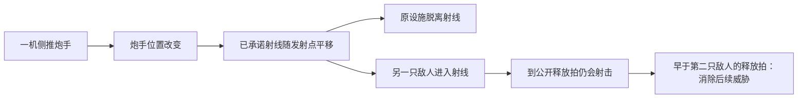

# 陷阵之志：视频案例、因果规则与公式台改进

2026-10-04 · 公式台研究 / Candidate 设计建议

**最值得借鉴的是：一次简单操作能同时改变伤害、位置、射线、地形和下一次威胁，而玩家能在确认之前读懂这些变化。** 我们已有推拉、质量、支撑、炮弹飞行和四拍预演，但不少作用最终都收束成“取消敌人的动作”。这会削弱借敌攻击、改变射线、转移目标物、以地形代替输出等打法。下一步应先把这些关系做通，再增加招式与敌种。

本稿对照当前 `linked_campaign` 三战场实现；不把早期木桶街版本的问题全部算到现版头上。这里给出研究和下一轮验证设计，没有修改战斗规则，也不替代现行 v3 方案。新招式、敌人变体和关卡条件均为候选，既有 Reader、人物权限与 Canon 不变。

[五段原视频片段与因果说明](陷阵之志-视频案例索引-20261004.html) · [研究覆盖记录](../../../../../artifacts/research/into-the-breach-20261003/review-coverage.json)

## 1. 研究范围与证据边界

| 来源 | 内容与时长 | 本次核对方式 |
| --- | --- | --- |
| [麻辣匪甲：教学 1](https://www.bilibili.com/video/BV1gV411M7N2/) | 43:27；基础教学、卫星、任务坦克与冰面 | 全片按时间顺序浏览画面；对照语音转写定位操作解释；26:20–30:14 加密核对操作前后状态 |
| [教学 2](https://www.bilibili.com/video/BV15F411o7Ht/) | 37:08；重开困难局、水坝、列车、支援火炮 | 全片顺序浏览；03:55–05:11、13:00–17:30 加密核对 |
| [教学 3](https://www.bilibili.com/video/BV11W4y1Z7Rp/) | 44:30；地形改造器、烟雾、原型炸弹、环境危险 | 全片顺序浏览；07:05–09:25 加密核对；其余案例用解说与前后画面交叉检查 |
| [教学 4](https://www.bilibili.com/video/BV1Hs4y167RE/) | 40:31；冰面、冰冻救援、护盾设施、成长配置 | 全片顺序浏览；14:35–17:29 加密核对，特别检查非致命目标与一次概率防御 |
| [青幻译制：设计反思](https://www.bilibili.com/video/BV1Rx411X7Lg/) | 59:26；Matthew Davis 的 GDC 2019 复盘 | 核对[原演讲](https://www.youtube.com/watch?v=s_I07Iq_2XM)全文转写及[官方幻灯片](https://media.gdcvault.com/gdc2019/presentations/Into%20the%20Breach%20Postmortem%20Final.pdf)，定位设计取舍；不冒称逐秒观看整个译制版 |

方法需要说清楚：本次是**连续时间段的画面序列分析、语音转写核对与具体操作链复盘**。全片概览间隔为 20–30 秒，关键段为 2–3 秒；这比孤立截图能验证更多因果，但仍不等于以原速连续感知全部视频。上述 3 小时 45 分钟是素材总时长，不是完整观看时长。本稿不据此评价精确的输入延迟、音画同步或打击音质，也没有亲手操作《陷阵之志》。研究页保留原声视频片段，便于回看。

第一集可见 v1.2.88 与基础内容设置；第二集约 01:14–01:23 重开困难局并启用高级内容。不能把系列前后的敌种、难度和装备差异误读成同一局的规则变化。时间码按本地视频对应，密集画面定位约有数秒误差。

以下分清三种信息：视频中实际执行并看到结果的操作；作者提出但未执行的设想；我们针对超 GAG 的设计建议。没有核实的例外不写成通则。

## 2. 我们要学会读的完整操作循环

1. **部署先读任务和地形。** 不只看敌人：列车要经过哪里、水坝会淹哪一带、任务物能否移动，都影响第一回合站位。部署不是把三台机体平均摆开。
2. **先辨认威胁的形状。** 点敌人看武器与特性，棋盘上看方向、受威胁对象；需要比较先后时再展开攻击顺序。拳击与直射炮弹即使暂时瞄准同一格，也不能用同一条含混的红线替代。
3. **选机、试走位、看武器落点。** 移动范围、到达路线和攻击范围承担不同信息。武器预览不仅画可点的格子，还画伤害、推向哪里、撞击或危险后果。炮击可以瞄空格，用周边冲击波推动单位。
4. **一次操作后重新读剩余威胁。** 不是依次把三台的最强招点完。先解除队友束缚，可能让它重新拥有处理另一个威胁的能力；先杀光环单位，会改变其余单位的耐久或死亡后果。
5. **撤销移动与重置回合是不同工具。** 录像里能试走位后撤销；实际出手后的反悔用有限的回合重置。这给探索留空间，也让提交动作仍有分量。不能把这个限制直接套到我们尚未执行的草稿编辑上。
6. **结束回合后核对公开顺序。** 环境、敌人、任务物、增援等先后可以成为解题条件。早发生的攻击能消除晚发生的威胁；但这是该游戏的顺序规则，不能用错开的演出暗示我们同拍结算也有这种优势。
7. **下一回合接收新局面。** 已公开的攻击可以计算，不代表未来每一轮敌人的选位都已知。新威胁重新公开，玩家再做有限规模的决定。

## 3. 具体操作与巧妙之处

### 案例 01：躲开炮弹，反而把建筑让给了炮弹

[教学 1，07:14–09:49](https://www.bilibili.com/video/BV1gV411M7N2/?t=434)。教程把近战推移和直射线连在一起讲：把敌人推离原射线，可以保护建筑；但己方从炮弹线上躲开时，后面的建筑会暴露。另一侧出拳还可能把敌人撞向建筑，造成额外损失。作者尝试走位、撤销，再换角度。

巧妙之处不是“拳有击退”，而是**受击者的位置同时决定下一次攻击的路径、碰撞对象与保护关系**。自机少掉血未必是当前最好的结果。重装机主动挡炮，应当是清楚的资源选择，而非系统判错。

对我们的要求：预览推移时同时更新敌方射线，标出“母线不再受击 / 后方车厢新受威胁”。仅显示敌人减 1 血、后退 1 格不足以支持判断。

### 案例 02：炮击最有价值的落点，可能是空地

[教学 1，11:48–12:58](https://www.bilibili.com/video/BV1gV411M7N2/?t=708)。火炮能越过直射障碍；中心伤害与相邻格的推力分别生效。把瞄点放在目标旁边，就能选择推向水域的方向，不必正中目标。

这使火炮和直射炮的区别落在**作用几何**，而非射程更远、伤害更大。移动站位、空格瞄准与推力方向共同提供组合空间。

对我们的要求：空地应是明确的合法作用对象；瞄点预览要同时画中心、周边作用和每个被推动对象，不能要求玩家先理解内部技能表。

### 案例 03：借敌人的攻击清理另一个敌人

[教学 1，26:20–30:14](https://www.bilibili.com/video/BV1gV411M7N2/?t=1580)，本段逐步核对。约 27:54 展开顺序，28:09–28:15 出现敌方互击；29:18 又发生一次回合重置，随后换安排。29:51 的顺序显示环境先发生，随后敌方行动，再到任务物；30:03–30:12 可见火焰伤害、敌方互击和卫星发射陆续结算。

**推开不应等同于让攻击凭空消失。** 敌人的攻击承诺还存在，玩家改变的是谁站在它的作用位置。只要先后可读，这条攻击就能被利用。录像中的重置也说明：作者需要试错、查顺序；不是每次看一眼就能完美解出。

对我们的要求：能明确回答“这条攻击还会不会发生、从哪里发生、落在哪里”。同拍释放的两招应保持同拍规则，不能借播放顺序制造不存在的抢先击杀。

### 案例 04：拆水坝，改变一整片棋盘的性质

[教学 2，02:02–04:36](https://www.bilibili.com/video/BV15F411o7Ht/?t=122)，03:55 后逐步核对。部署和第一轮走位为水坝创造击破机会；约 04:08 火炮调整敌人位置，04:16–04:20 击毁水坝，下游地带变成水域，位于其中的地面敌人被消灭。剩余目标另外处理，不是“破坝自动完成全部任务”。

有价值的链条是：**任务设施受损 → 多格地形转变 → 不同单位对新地形有不同反应 → 原来的伤害预算被改写**。同一支队伍因此获得了该地图特有的打法。

也要保留例外：录像里自己的大型机甲落水后仍活着，但不能正常出手；这不是“所有不会飞的单位遇水都死”。我们可以采用不同的浸没规则，但必须明确公开，不能让玩家凭别的游戏经验猜。

### 案例 05：列车的行进空间，也是一种需要保护的资源

[教学 2，13:00–17:30](https://www.bilibili.com/video/BV15F411o7Ht/?t=780)，本段逐步核对。列车的下一段路径有提示。14 分钟附近，作者先完成看似划算的击杀，发现另一个威胁没有解掉，于 14:25 重置，再调整三台机体的顺序。

这里不仅要算击杀和建筑损伤，还要保留列车下一步的通路。**一个单位还活着但挡住轨道，与它不挡路，是两个截然不同的结果。** 任务物使占格、推移和行动次序有了即时价值。

对我们的 C 区：选招预览要直接告诉玩家车能否通过，以及是谁、在哪一拍仍挡着。不能只在结算后说“车未移动”。

### 案例 06：先推自己的队友，恢复它处理威胁的能力

[教学 2，16:35–17:30](https://www.bilibili.com/video/BV15F411o7Ht/?t=995)，本段逐步核对。约 17:04 用炮击的周边推力把被束缚的己方机甲移开；并非直接炮击伤害队友。解除空间束缚之后，另一台机甲可以继续处理敌人，而不必把动作花在修理、硬扛上。

这是不依赖合击按钮的协作：**甲的一次操作改变乙的可行动条件，乙再完成原本做不到的动作。** 身位变化就是增益，未必需要再叠“协作伤害 +20%”。

对我们的要求：推拉友方、救出工位、腾出射界，应和攻击敌人使用相同的空间规则。UI 要反馈“束缚解除 / 通路打开 / 当前命令仍有效”，而不是给所有强制位移统一贴“打断”。

### 案例 07：真正让攻击取消的是烟雾，不是推力

[教学 3，07:05–09:25](https://www.bilibili.com/video/BV11W4y1Z7Rp/?t=425)，本段逐步核对。地形资讯解释沙地受击会产生烟雾；约 08:34 攻击留下烟雾，08:42 把另一只准备攻击的敌人推入其中，攻击取消。作者随后专门区分“推一下”和“被烟雾覆盖”这两个原因。

推力、地形状态和攻击限制各自简单，却能组合出新的解法。代价也没有消失：烟雾同样会限制己方单位出手或修理，不能把队友送进去之后仍假定原计划照常完成。

**这是本次发现的最直接实现差距：我们的成功推移会普遍调用取消未完成动作。** 把这一层改正确，比先增加十个状态图标更有价值。

### 案例 08：任务物也可以移动，保护不等于原地守住

[教学 3，12:55–13:28](https://www.bilibili.com/video/BV11W4y1Z7Rp/?t=775)。作者解释原型炸弹任务时，区分直接打中炸弹与用旁边的炮击推力移动它。这里采用解说与前后画面核对，不把未完整展开的后续排列写成已验证最优解。

可借鉴的是解法维度：除了击杀攻击者、搬动攻击者，还可以**搬走需要保护的物件**。可移动货柜、电池、车厢因此应有公开的耐久、质量、占格与受力规则，不能只是任务开关。

### 案例 09：死亡不总是减少威胁

[教学 3，09:32–10:17](https://www.bilibili.com/video/BV11W4y1Z7Rp/?t=572)。特殊灵能单位使其他敌人的死亡带来后续生成物。优先消除来源，与先杀普通敌人，会产生不同的后续压力。

这种敌人改变了已有动作的收益顺序，不只是更高血量。超 GAG 可以用“孵化器官 / 回收无人机 / 供能节点”提供类似关系，但应让增益来源与受影响对象连得上、看得见；首轮不同时塞进多种死亡触发。

### 案例 10：冰冻目标，保住的既是生命也是任务

[教学 4，14:35–17:29](https://www.bilibili.com/video/BV1Hs4y167RE/?t=875)，本段逐步核对。任务要求冰冻并保住两个机器人，提供可控的冰冻坦克。约 16:06 一个目标被冻结；下一轮约 16:36 冻住另一个，目标标记变绿，仍须处理其他危险。

同一个敌对单位可以同时是“当前攻击来源”和“需要保全的对象”。把它打死当然能消掉这次攻击，但不能完成同样的任务。状态控制由任务条件获得价值，而非靠给控制技能加离谱倍率。

这里适合启发受旧命令约束的无人作业机；不意味着所有外敌都要非致命处理，也不应让正面歼敌路线普遍吃隐性道德惩罚。

### 案例 11：一次成功保全，实际依赖概率救场

同一段 [16:14–16:27](https://www.bilibili.com/video/BV1Hs4y167RE/?t=974)。玩家承认一处建筑无法完全防住；界面电网防御为 19%，结算出现绿色抵抗反馈，作者明确表示运气好。

所以“本回合无损”不等于“安排保证无损”。我们的白鸢预演如果承诺确定性，就不能把这种概率成功画成确定的绿色安全。若以后引入随机机制，必须把发生概率和可能损失分开显示；本轮不建议新增命中骰子来增加复杂度。

### 案例 12：成长改变的是可用解法，不只抬伤害

[教学 3，39:00–42:30](https://www.bilibili.com/video/BV11W4y1Z7Rp/?t=2340)及[教学 4，00:00–03:00](https://www.bilibili.com/video/BV1Hs4y167RE/?t=0)。系列中能看到移动、飞行、攻击后再移动、武器改造与额外武器带来的部署差异。攻击后再移动是特定能力，不能误记成所有机甲的基础规则。

低数值让多一格移动、多一点伤害、一次转向都可能跨过明确门槛。我们不必先做长期成长系统，但应能在同一小局面对比：换一个移动/推力/作用形状配置，会得到什么不同解法。

## 4. 开发者复盘给出的约束

用户提供的第二个视频是开发者演讲的译制。本次同时核对了原演讲，避免把转述当成第二份独立证据。

| 原演讲时间 | 开发者明确讨论的取舍 | 对本项目的判断 |
| --- | --- | --- |
| [11:04–12:54](https://www.youtube.com/watch?v=s_I07Iq_2XM&t=664s) | 行动消耗影响下次行动先后的原型，增加复杂度，却没有产生足够的新决定 | 四拍制必须证明“等一拍、提前释放、跨窗持续”有不同收益；有时间轴本身不构成创新价值 |
| [15:35–19:55](https://www.youtube.com/watch?v=s_I07Iq_2XM&t=935s) | 预告攻击后只保护自机会过于容易；建筑和存活若干回合的目标使控制敌人有意义 | 敌人的目标和不可轻易移动的任务对象，是推拉玩法的支点；无需每关清光所有敌人 |
| [25:11–30:21](https://www.youtube.com/watch?v=s_I07Iq_2XM&t=1511s) | UI 要交代目标和武器类型；复杂作用范围、难以预料的敌种变体被删减 | 能力设计必须同时给出可读的棋盘表达，不能先堆规则再补说明书 |
| [45:46–47:51](https://www.youtube.com/watch?v=s_I07Iq_2XM&t=2746s) | 多一个敌人可能形成很陡的难度变化 | 以未解决威胁和可用动作来调压力；三图各加一只敌人，未必只是温和加难 |
| [54:01–55:23](https://www.youtube.com/watch?v=s_I07Iq_2XM&t=3241s) | 玩家不容易自然学会瞄准目标旁边来推移 | “规则很少”仍需要专门教学；先安排一次肉眼能看懂的空格炮击，再要求熟练组合 |

不能据此下结论说“一切同时行动都不好”。演讲里的时间原型与《幻影旅团》的固定窗口规划并不相同。我们需要的是同局面对照与玩家判断证据，不是借名作结论替自己的时间制度背书。

## 5. 当前三战场已经具备什么，还缺什么

以下为 2026-10-04 读取当前代码所得；是实现核对，不冒充本轮原生试玩。

| 项目 | 已有事实 | 实质差距 |
| --- | --- | --- |
| 时间与承诺 | 四拍窗口；空闲敌人在规划点建立命令；未完成动作跨窗保留 | 多处关键后果仍要到逐拍预演中找。公开“哪拍发生什么”尚未等于让玩家一眼理解因果 |
| 推撞与动作 | 质量、推力、锚定、撞物伤害已有 | 成功推移后统一取消未完成动作，压缩了改变攻击路径、保留攻击、持续条件失效三种不同结果 |
| 已发射攻击 | 炮弹是独立在途对象，保留落点与到达拍 | 这一点应保留；不能为了增加打断爽感，让击杀射手抹掉已经出膛的炮弹 |
| 地图 | 深水、坑洞、碎骸、掩体、桥板支撑、九十度转台已有 | 缺少可复用的“受击后地形变状态，再影响单位”的组合层；不能笼统说完全没有地形机制 |
| 尺寸 | 多格占用、质量、净空、移动耗时已有 | 大型单位全部覆盖格的支撑、转台不支持多格负载等限制需要在瞄准前显露；无需仿造连续刚体物理 |
| 任务 | 三图目标、补给与桥车联动、增援源、退敌、清场后修复已有 | 很多地图物仍偏一次性任务接口；需要让少量设施同时进入通行、掩体、受力与攻击关系 |
| 编成 | 已有体术、炮击、牵引、悬浮、工程等差异；常态耐久已是小数值 | “轻拳/重拳”不是现版全部能力，但区分还没有稳定转化为玩家能主动发现的组合 |
| UI | 目标、进度、地方名单、敌方资讯、风险定位、四拍预演都有 | 风险清单以己方受损、失效命令与设施损伤为主；缺少就地展示“我这一招改变了哪些关系、还剩什么没解决” |

代码依据：

- [动作结算与推移取消](../../../../../game-godot/scripts/formula_lab/linked_campaign/campaign_rules.gd)：`simulate`，尤其 281–285 行；`cancel` 307–311 行。`done` 动作不会被倒撤，因此这里针对的是仍待完成的命令。
- [时间和在途炮弹](../../../../../game-godot/scripts/formula_lab/linked_campaign/campaign_rules.gd)：174–255 行；同拍使用共同位置快照计算释放，伤害随后合计。
- [地形、尺寸、推撞、转台](../../../../../game-godot/scripts/formula_lab/linked_operation/board_rules.gd)：`traversal_cost`、`apply_support`、`push`、`rotate_platform`、`inspect_cell`。
- [当前能力与机体参数](../../../../../game-godot/scripts/formula_lab/linked_campaign/catalog.gd)。
- [命令反馈与风险清单](../../../../../game-godot/scripts/formula_lab/linked_campaign/campaign_stage.gd)：`order_feedback`、`window_risks`、`inspect_hover`；[现有 HUD](../../../../../game-godot/scripts/formula_lab/linked_campaign/battle_hud.gd)。

## 6. 下一轮优先改的底层规则

### 6.1 把“目标怎样绑定”和“什么会打断”分开

首批只公开少数稳定类型。下面是超 GAG 候选规则，并非宣称《陷阵之志》每一种武器都完全如此：

| 玩家看到的类型 | 移动攻击者后 | 旋转攻击者后 | 什么才会取消 |
| --- | --- | --- | --- |
| 朝向攻击：拳、直射、固定方向光束 | 发射点随本体移动，保留已承诺的本体方向与作用形状；重新显示实际路径 | 方向随本体转动；预告同步更新 | 被击毁、该招明确允许的硬直/封锁，或公开的施放条件失效；普通位移不自动取消 |
| 定点攻击：向已锁定地格投射 | 目标格不暗中追人；到释放时按该武器的射程、视线条件检查 | 不自动改目标格 | 锁定规则所需条件失效，或明确的打断效果；失效原因要说明 |
| 已出膛攻击 | 不再依赖射手是否还活着、是否转场 | 不改弹道 | 到达后碰撞/拦截等公开规则；不能倒撤 |
| 接触作业：切割、牵引接合、抢修 | 若失去接触才停工；仍满足接触不应无理由清空 | 按工位的朝向要求判断 | 接触、供能或作业资格丧失；哪些进度保留由任务明确规定 |

尚未引入追踪攻击。以后确有需要时单独标识“追踪”与可打断的锁定阶段，不能把普通攻击偷偷变成追踪。

**失去接触也不必一律抹除已有工程成果。** 焊好的部分、已经搬开的物件可以保留；必须持续保持的牵引与支撑可以失效。当前 `cancel` 对 work 清零，需要在项目数据中分清“累积进度”与“持续占用”，避免玩家反复做已完成的劳动。

### 6.2 让协作从共同规则中长出来

另一条同样成立的链可以是：炮击空格 → 同时推开敌人与队友 → 敌人离开切割工位，队友获得安全站位 → 工程继续。奖励来自真实空间与时间结果，不先加合击倍率，也不让协作把另一台机体免费瞬移过来。

机体特色先按“能改变什么”拉开：

- 体术：精确改身位、转向、近身破架；演出区分短促抢位、扭身摔投、重心压进。动作的落点方向必须与规则一致。
- 远程直射：利用通道、挡射和穿透；蓄能、发射、路径、命中分开表达。不能与炮击只差颜色。
- 曲射：中心与周边不同作用，越障和区域控制；空格瞄准成为自然操作。
- 牵引与工程：移动任务物、建立支撑、改变通路；收益体现为其他机体或任务多出一条解法。
- 悬浮与重型：站位自由和占地/抗推形成不同交换。重型不能只有更高血量，飞行也不能只是外观。

这不是再加五套独立职业系统。先复用现有机体与能力，使同一组伤害、位移、接触、支撑和射线规则真的交叉。

### 6.3 每张图先做好一个会变化的核心物理关系

优先使用已有地图对象：A 的隔离屏/供能节点，B 的桥板/水渠，C 的货柜/轨道。初版每图只增加一个主要状态变化，不一次加入火、冰、酸、雾、导电、离心力的完整百科。

候选首批状态链：

- 货柜完好 → 被移动后形成新掩体；被击毁 → 碎骸降低通行效率、原射线重新打开。
- 桥板完整 → 受损提示 → 失去支撑；不同移动类型、不同覆盖面积有明确结果。
- 冷却管被击破 → 短时蒸汽区 → 局部武器受限，其他路径仍可使用。蒸汽对敌我一视同仁，持续时间公开。

第三项是待测的新机制，不应凭世界观名词随意规定“蒸汽能挡一切”。首次用一种清楚的封锁效果即可，规则和图标共同验证。

物理感来自可预测的结构关系：桥没了就失去支撑，转台连同站位和朝向一起改变。没有必要引入连续重力或随机刚体翻倒；那会削弱格子预演的可靠性。大型机体必须展示完整占用轮廓，不能只检查中心格；现版转台不支持多格负载，应先明确提示，再决定是否扩展。

### 6.4 保留四拍候选，但对“每一拍有没有价值”做对照

现有预算表达统一为：到达时间 + 招式准备 = 释放拍；收势决定下次可接令时间。移动五格的耗时由机体与地形决定，不能再同时收一笔意义不清的行动点。弹药、气势是另一种资源。

规划期间不重新选择敌人命令；跨窗蓄力保持承诺。未知的后续意图与增援应标成未知或明确范围，白鸢不需要神谕化。

至少比较三个局面中的两种时间表达：现有共同四拍，与更简单的“我方安排后按公开顺序结算”的对照。若某局面四拍只增加拖条、等拍和无效移动，却没有增加可理解的解法，优先简化该类招式/交互。暂不因为这份研究就整体推翻系统。

## 7. UI 学什么：让地图自己回答问题

《陷阵之志》的资讯窗口不是把所有字段都常驻。录像中常见的是：指到单位，出现它的特性和武器；指到格子，出现地形含义；选武器，地图展示该操作；查先后，再展开顺序。**信息跟着问题出现，而不是跟着数据表出现。**

| 玩家此刻的问题 | 我们下一轮应该给的回答 | 表现位置 |
| --- | --- | --- |
| 现在什么最危险？ | 哪个设施/任务受威胁，在哪拍，伤害或阻塞是什么 | 设施旁的简短威胁牌；三图区签只显示需关注的变化 |
| 这里真的能去吗？ | 完整占用轮廓、实际绕路、到达拍；阻挡理由明确 | 目的地与路线；保留现有途经格能力，普通操作不必逐格点 |
| 这一招会做什么？ | 中心伤害、推移方向、最终占格、碰撞/支撑后果 | 落点上的预览图形；不要先跳到全屏文字模拟 |
| 推开它之后还会打吗？ | 原射线淡出，新射线出现；保留/取消及原因 | 敌人和实际目标之间；拳、直射、曲射用不同形状 |
| 这次配合帮了谁？ | 队友束缚解除、作业继续、通路打开等具体结果 | 发生处一条短反馈，因果对象短暂联动高亮 |
| 有没有漏掉什么？ | 改完之后仍有效的设施威胁；不只汇总预计受伤 | 地图保留未解威胁，风险按钮可以定位 |
| 为什么和我想的不一样？ | 对应拍的原因：“炮弹已出膛”“质量不足”“同拍已释放” | 执行事件与可点回看；避免统一“无效/失败” |

UI 不替玩家自动选最优解。预览应显示所选方案后果，保留消灭、拖延、承伤、搬任务物等判断空间。不能用一个综合评分让所有打法都变成点最高分。

未执行的走位与命令修改应免费撤回；不把“看一次白鸢预演”变成额外惩罚。演出前可以有明确的规划→执行过渡，但同拍效果应整拍表达，不能为更热闹而制造假先后。

美术上要保留功能层次：机体有自己的 IP 配色；地面用材质、边缘厚度、接触阴影表达支撑与高差；危险面有独立纹理/轮廓，而不是把敌人、路线和整个场景都染成同一种色。被打坏的桥板必须在普通镜头下看出断口，蒸汽必须有体积与遮挡感，货柜挪动必须看得出轨道重新贯通。**美术不只是给规则贴图，它决定玩家能否相信并读懂规则。** 本轮视频分析不能替代新资产的实际画面验收。

## 8. 把研究落实为三个小局面，而不是再扩一大套系统

这三个是下一轮的验收设计，尚未实现，不宣称已证明通关或平衡。先在现有三图中划出局部，用现有资产；每个局面只要求两三台机体、一个主要新关系。

| 局面 | 必须能成立的不同解法 | 关键反例与验收 |
| --- | --- | --- |
| A：借炮清路 | 侧推已承诺直射的敌人，使炮线离开供能节点、击中另一威胁；或用重装承伤；或花更多动作直接击毁炮手 | 推移不能自动消音。早一拍推移会改射线；同拍已出膛不能追回。瞄准时就能看出谁会被打 |
| B：断桥与救援 | 把地面敌人推向无支撑区；或保住桥板让地面队友通行；悬浮机选择跨水绕行 | 悬浮敌人不吃同一种地形解。大型机体覆盖格规则可见；击碎桥板也可能损害自己的路线，不能只对敌人有效 |
| C：让车通过 | 搬走货柜并把它变成新掩体；把锁车机推离接触点；冻结/接管无人机或直接击毁，各有成本 | 只杀敌却仍堵轨道，车不能通过；货柜不能凭空消失。下一窗口的入口威胁提前告知，不能刚解决就无预告刷怪 |

A 局面的最小验证例：第 3 拍朝南开火的炮手，经第 2 拍侧推后，射线整体平移；原设施安全，另一只第 4 拍才出手的敌人可能被先击毁。把侧推改到第 3 拍，不能倒撤同拍已经释放的射击。两种后果需要在提交前就可区分。

三图各自证明后，再加一条跨区连接：例如 A 接通后 B 的支撑装置可用，且生效边界明确标到公共拍号。不先堆三条互相等待的前置链，也不要求玩家逐一浏览所有机体的完整四拍表格。

记录的不是“自动测试胜了几局”这么单一的结果，而是：

1. 玩家能否在执行前说出当前威胁、所选操作会改变的对象与时间；
2. 是否能用两种不同机制完成目标，并理解它们消耗和后果的差别；
3. 预览与结算是否一致，错误原因是否能从棋盘定位；
4. 从产生意图到完成安排，需要多少无意义切换、撤回和解释；
5. 陌生玩家能否发现一个没有被教学按钮直接给出的配合。

同时保留规则回归：推移但继续攻击、烟雾/封锁才取消、发射后射手死亡、同拍互击、友方被推后条件仍成立、作业失去接触、支撑改变、不同尺寸占格，以及前后窗口的增援承诺。只有这些稳定之后，演出才有可信的战术内容可以放大。

## 9. 建议推进次序

**第一步：纠正动作与位移的关系。** 先处理通用取消、方向/固定格绑定和持续作业，连同就地因果预览一起做。单改结算而不改预览，仍会让玩家觉得动作失灵。

**第二步：做通三个局面。** 每图一个可变化的核心对象、一种明确的地形反例。验证体术、直射、曲射、牵引与悬浮真正有不同用途。不给每对机体额外写专用协作脚本。

**第三步：接回三战场战役。** 调整威胁密度、出现节奏、公共时间反馈和跨图提醒；再用机魂短对白、环境反馈与差异化招式演出强化玩家已经能理解的因果。

这轮材料足以支持上述有限范围的改动；仍不足以宣称全部机队、所有高级内容、长期平衡和整体手感都已研究透彻。后续研究应围绕测试暴露的具体问题补看，而不是继续累计视频数量，或把“再加几个状态”当作丰富玩法的替代品。
