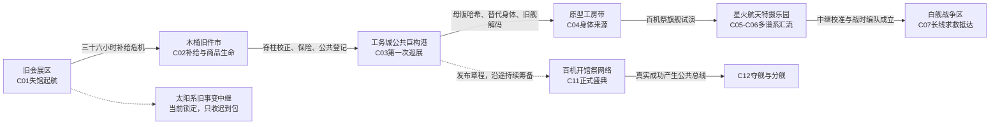

# 《超GAG机器人大战：万机残响》V35.5 C01-C03 开局 Pressure Board

> 状态：`needs_review_v35_5`。
>
> Canon Mode：`living_plus_v35_candidate`。
>
> 本稿承接 V35.2、V35.3、V35.4，只完成 C01-C03 的开局压力板、作者槽到最终话映射和候选迁移，不是逐话厚梗概、台本或最终关卡数值稿。

## 一、本轮结论

1. C01-C03 的 10 个作者槽映射为 11 个最终 Episode。C03 的 `V354-C03-S02` 同时承担工务接轨、双层城市救援、七海现场改革、社勇王许可和巨神承重，必须拆成两话。
2. C01E01 增加三回合小型救援战棋。跌跌与机器犬在此临时首控，利用馆守Z低热胸灯支援对抗预封存机；C03 才正式入队。开局首控分布由 `1/8/9` 调整为 `3/8/7`，18 台总数不变。
3. C01 闭馆路线采用“六个事件站点、十八个视觉锚点”。玩家不是逐柜听讲，而是在闭馆、找人、移障和预封存冲突中一眼看见超级系、真实系、合体、变形、勇者、战队、战舰、歌舞、同步、现实机器人和宇宙远征等谱系。十八锚的展区ID、物理形态、资产级别和计数边界见 `v35_5_c01_closing_route_anchor_v35_5.tsv`。
4. 七海的两次撤令分级：C01 撤销一条会造成伤亡的现场断电命令，并承担资产与城市责任；C08 撤销的是整套合法镇压权限和自己的代哥执法身份。前者证明她会判断，后者才是政治断裂。
5. 白鸢分三步进入：C02 分镜先救人并暴露权利链；C03 以权利人白鸢/艾芙琳·沃斯正式露面并有条件登舰；C04 才成为作者线主承重者并取得战斗/改写资格。
6. 模型盒、手套、货柜锚件、展签和剪影只解释、许可或唤醒实机。参战主体分别是全尺寸勇拳/社勇王、旧拳王机、货柜领袖、无牌一号竞技实机和各现实机器。勇拳试作机是无独立机魂的有人测试壳，社勇王是能拒绝驾驶员的正式AI勇者；无牌一号原本就是旧件市的全尺寸模块竞赛底盘，玩家模型只提供改装同构数据。
7. 流亡不是无目的漂泊。开局航线以“求生补给 → 城市级维修与合法泊位 → 发起跨城百机开馆祭 → 追查被盗模板与白舰错序求救”为表层任务链；馆长旧航图、索引学习、G.A.G.残响和远星错序只在暗层推动，不取代表层理由。
8. 世界地图采用可见的“巡展航图”。玩家能看见地理通道、补给/泊位条件、公开委托和远距信号，不能看见作者章节编号。C01结束只开放旧件市与少量支线，工务城、原型工房、星火乐园和战争区按情报与航行条件逐步解锁。
9. 百机开馆祭不是C03当晚举办的庆功会，而是纪存向世界公开承诺的长期主线工程。C03只提出并建立第一版公开章程；C04-C10逐步取得机体、生产、许可、观众、广播、泊位和政治资格；C11才真正举行，随后其成功被索引和各阵营利用。

配套九张施工表分别负责：槽话映射与提交点、18台首控/退出/加入生命周期、六站十八锚、逐话我方/支援/敌机/IP暴露、敌方资产预算、状态传播、开局试玩门禁、巡展世界地图和玩家悬念阶梯。Pressure Board只负责创作选择，单话Pipeline必须从这些表生成正式运行账本。

## 二、作者槽到最终话映射

| 最终话 | 作者槽 | 槽内序 | 标题 | 映射理由 |
| --- | --- | ---: | --- | --- |
| V355-C01E01 | V354-C01-S01 | 1/1 | 最后一条闭馆路线 | 在探索中加入三回合现实小机战棋，先证明可玩性和万机厚度。 |
| V355-C01E02 | V354-C01-S02 | 1/1 | 四张封存令 | 四方接管、火警与七海第一次公开撤令。 |
| V355-C01E03 | V354-C01-S03 | 1/1 | 断臂成桥 | 馆守Z首控、豪司越权、兜灯主动舍弃右臂。 |
| V355-C01E04 | V354-C01-S04 | 1/1 | 万机馆站起来 | WBM001 巨构起航与第一章永久失馆。 |
| V355-C02E01 | V354-C02-S01 | 1/1 | 救命零件，限定发售 | 旧件供应链、货柜领袖与无牌一号首次可控。 |
| V355-C02E02 | V354-C02-S02 | 1/1 | 同模不是同一个人 | 四重涂人格空战，商品生命进入战术而非议题。 |
| V355-C02E03 | V354-C02-S03 | 1/1 | 拳王漏掉一拍 | 非致命擂台与坍塌仓库同场，白鸢分镜上舰。 |
| V355-C03E01 | V354-C03-S01 | 1/1 | 不准靠港的博物馆 | 公开风险听证、现实机器演示、白鸢正式露面。 |
| V355-C03E02 | V354-C03-S02 | 1/2 | 城市的手先动起来 | 下层铁路、医院供能和工务四机首控。 |
| V355-C03E03 | V354-C03-S02 | 2/2 | 许可由谁给出 | 上层巨物承重、社勇王首控和共同许可高潮。 |
| V355-C03E04 | V354-C03-S03 | 1/1 | 百机祭不是逃亡庆功 | 赔付、公众表决、早期编队成形与白舰求救。 |

## 三、玩家看得懂的流亡目标与世界地图

### 3.1 这段旅程究竟是什么

万机馆的经历不是随机公路奇遇，也不是每章等新阵营排队上门。它是有明确长期目标的**移动博物馆远征**：主线目的地由生存、公共任务和长线信号共同决定；沿途仍允许模型社群、废铁场、隐藏机体、残响深潜和人物委托形成公路片式偶遇。

每次转场必须同时回答三层问题：

1. **现在为什么非去不可**：燃料、零件、泊位、维修、伤员、保险、许可或明确求救。
2. **在那里要完成什么公共任务**：开馆、救援、调查、会合、生产、撤退或表决；完成后必须带走一种新能力或新责任。
3. **为什么幕后力量也希望他们去那里**：馆长旧航图、被盗模板、索引采样、军方采购链或错序信号。第三层只制造关联和怀疑，不得替代前两层。

因此，玩家表面上始终知道“下一站去哪、去做什么”；深层上才逐渐怀疑，所谓偶然求生路线是否早被某些人和系统铺过。

### 3.2 前三章的表层航线

| 转场 | 玩家当下知道的现实理由 | 本站任务 | 离站时获得/失去 | 暗层牵引 |
| --- | --- | --- | --- | --- |
| C01 → C02 | 起航后生活循环密封和燃料转接只能维持约三十六小时；唐胶确认最近仍能配旧制件的是木桶旧件市 | 取得生命维持件、恢复补给信用、确认模型数据如何合法进入全尺寸实机 | 获得货柜领袖、无牌一号接口和民间维修链；背上平台债与人格样本泄露 | 白鸢分镜、商品人格与馆体接口被同一推荐结构聚合 |
| C02 → C03 | 旧件市没有承载展舰的吊装架；WBM001脊柱需要城市级维修，新增机体与流亡舰也必须取得保险和事故责任认定 | 前往最近的公共巨构港工务城，申请临时泊位、公开听证并偿还沿途损失 | 获得工务支援、有限靠港、公共许可和十三台常驻/公共支援编队；纪存失去匿名与普通保障 | 拒港报告提前生成，陆衡算法被军用化，被盗母版哈希进入B2 |
| C03 → C04 | 白舰求救无法定位和直航，但其结构模板与白鸢被盗母版同源；最近能校验哈希、制造替代身体和解读旧制舰体的是原型工房带 | 追查哈希、取得百机祭生产伙伴，并处理防卫圈替代身体危机 | 开启作者/身体来源主线；白舰成为长线救援信标而非下一章瞬移目的地 | 馆长旧采购、纪存身体来源、白舰结构与旧灾变工程开始重合 |

白舰战争区在C03后已经显示于航图，但处于“信号存在、坐标冲突、航行能力不足”的锁定状态。C04-C06不是绕路灌水，而是为了取得可解码结构、可远航机体、广播中继和多谱系救援能力；C07才具备进入白舰撤退线的现实条件。

这张图是**剧情/任务网络地图**，不是最终大陆美术。正式世界地图资产还需要在此基础上确定海陆轮廓、城市尺度、航行时间、气候带、轨道层和各区域视觉地标；在这些资产确定前，故事不得擅自写死相互距离。

### 3.3 世界地图如何呈现

玩家在C01E04起航后取得第一版“巡展航图”。它不是开放世界，也不是章节选择菜单，而是区域战役地图：

- **地理层**：旧会展区、木桶旧件市、工务城、原型工房带、星火乐园和战争走廊；显示距离、通行状态、补给与泊位要求。
- **公共网络层**：开馆邀请、救援委托、借展、维修、保险和城市态度；决定哪些地点愿意让万机馆靠港。
- **信号层**：白舰错序求救、太阳系旧中继、远星迟到包和不明回声；只显示来源可信度与时间冲突，不显示真相。
- **追踪层**：代哥风险编号、军方征用范围、平台回收热区；让“被追捕”成为动态压力，而不是角色口头说流亡。

主线有清楚的锚点航线，支线则在两个主线节点之间开放。玩家可以改变补给、盟友、隐藏机体、抵达顺序和局部战况，但不能毫无理由跨越航行、许可或信息条件。完整节点见 `v35_5_opening_route_world_map_v35_5.tsv`。

### 3.4 百机开馆祭是什么，为什么要办

百机开馆祭的**表层理由**很直接：万机馆失去旧址后只是一个被编号、缺保险、缺稳定泊位的私人巨构。单靠逃跑只能不断被下一座城市拒绝。纪存在工务城拒绝用保密换安全，提出让各地机器人、维修者、驾驶员、观众和受损城市共同参与一次公开开馆，以证明万机馆不是藏着危险机魂逃亡的私兵，而是能够公开救援、展示失败、允许拒绝并承担赔偿的公共方舟。

“百机”不是开局已经拥有一百台战斗单位，也不是象征性空话。它指C11正式盛典至少有一百个**具名、来源可见、拥有本地责任人且可以拒绝参与的机器人主体或公共机组**登记到场；其中包含主线可玩机、路线盟友、城市职业机、远程开馆节点和有限动作支援机。可玩主力仍按生命周期表控制，不能用百台背景剪影冒充参战规模。

筹备分四阶段：

1. **C03发起**：公布章程、城市赔付和第一批13台常驻/公共支援，不举行正式盛典。
2. **C04-C06试办**：取得替代身体、生产工房、多谱系合体/巨大化舞台和主体许可，完成第一次旗舰试演。
3. **C07-C10扩成世界行动**：在战争撤退、革命、同步大败和生者政治中决定谁有资格被邀请、谁拒绝英雄席、哪些代价必须公开。
4. **C11正式举行**：成为真实的文化、救援和政治胜利；C12敌人利用它形成的公共总线发动夺舰，但不得倒写成“举办祭典本来就是错的”。

深层上，各方都想借它完成不同目标：代哥改革派需要公共信托样板，商品派需要全球发布，军方需要跨谱系动员名册，索引需要完整跨系统语料，远星旧中继可能把它误译成文明统一请求，馆长旧航图也似乎早为“百机汇流”预留节点。阴谋不是让祭典变成骗局，而是让一次真正成功的公共行动同时成为所有势力争夺的接口。

## 四、C01 闭馆路线：六站十八锚

闭馆路线只实际进入六个站点，却利用挑高、玻璃廊、终端总图和跨层视线同时展示十八个谱系锚。展陈不是背景清单，每站都必须发生一个闭馆动作、人物分歧、机体反应或路线事故。

### 站一：前厅与万机总图

- 多层导览终端显示 L1-L3、B1、B2 和外部锁泊；玩家当前只走其中一条闭馆线，大量区域仍亮着“未开放/封存/借展中”。
- 实时小屏并列播放社勇王送修接口、跌跌失败演示、白舰撤退沙盘和远星延迟条，先证明这里不是一厅几柜。
- 留言区的观众包括老驾驶员、模型玩家、维修师、带自制机设来的青年和普通游客，不把保护对象缩成儿童。

### 站二：万机中庭与祖辈巨神

- 18 米馆守Z半跪压场，右臂仍连接本体并架在检修位；周围可见飞拳轨、胸部高热剖面、拆下的前臂装甲板、安全吊索和黑展柜远端警示灯。右臂直到 C01E03 才在战斗中真正断离。
- 钻头训练靶与突破海报只做远景；它承诺后续外放热血，不让天盖王提前抢戏。
- 馆守Z是尺度标尺，不是万机馆唯一的大机器人。

### 站三：合体、变形与勇气环

- 三相分机剖面、五色站位台、五兽卡扣墙、电磁吸合台和“十五机完全合体失败样例”同处一环，既展示合体浪漫，也吐槽越合越多、配件越堆越重。
- 货柜领袖、喷气重涂群的可变骨架和不同头雕连到模型玩具街，说明同模、重涂与人格不是简单皮肤。
- 勇气审批角有三米胸像、巨大工具复制件和全尺寸接口照片；社勇王模型盒只是关系锚件，不冒充实机。

### 站四：真实战争、战舰与舞台天桥

- 实尺寸驾驶舱、量产机战损墙和无名驾驶员铭牌建立真实系重量。
- 二楼白舰舰桥比例舱、撤退沙盘和远征日志隔窗可见；大型战舰和巨机以后在外部锁泊，不塞进展厅。
- 中庭上方悬着可变战机挂架、导弹轨迹和声波灯带，像一场尚未开始的歌与战机演出。

### 站五：现实机器、三法与运动机器人

- 跌跌、机器犬、市政作业臂和看护机器人都是真实小型实机；摔倒次数、充电线、软垫和维修车构成另一种“机器人大战”。
- 三法互动墙、涂鸦训练板和同步玻璃廊在远处相邻，让玩家看见机器人会被规则保护，也会被规则困住。
- 擂台角只展示完整拳王机录像、影子训练架和右拳护具；护具是关系钥匙，不上棋盘打人。

### 站六：模型街、封闭深层与宇宙承诺

- 旧盒绘、灰模、玩家改件、手作藏品和对应实机接口照片连成一条“模型/玩具如何与真实机体建立 linking”的文化链。
- B1 机库参观窗显示维修架、移动脊柱和外部泊位；它解释万机馆未来能搭载、会合和维护大型机体，而不是无限仓库。
- 远星通信只读副柜位于 L1 旧影像区，从 L3 离线缓存读取延迟回信；B2 零号侧廊只通过前厅远端监视窗给出门名、低频敲击与错误权限，不解释封印原因，也不允许玩家提前进入深层。

### 十八锚资产验收

| ID | 视觉锚 | 物理形态 | 主谱系 | 本话作用 |
| --- | --- | --- | --- | --- |
| A01 | 多层万机总图 | 全尺寸终端 | 全馆/SRW阵容感 | 证明玩家只看见全馆一角。 |
| A02 | 馆守Z半跪实机 | 18米真机 | 开祖巨神 | 低热胸灯支援，后续首控。 |
| A03 | 飞拳轨与馆守Z右臂检修位 | 仍连接本体的真机右臂/拆下装甲板/安全吊索 | 离体飞拳 | C01E01只确认承力路径；C01E03才真正断臂并转战场。 |
| A04 | 钻头训练靶 | 实体训练机械 | 突破系 | 一次误启动与停机。 |
| A05 | 三相合体剖面台 | 三台实尺寸试验架 | 三机合体 | 玩家关闭错误承力组合。 |
| A06 | 五色/五兽/电磁阵 | 实体模块混合缩尺件 | 战队/兽机/电磁 | 显示缺席位和不同合体语法。 |
| A07 | 十五机过合体架 | 全尺寸关节压力架 | 过度玩具合体 | 保存承力数据，不用卡门梗。 |
| A08 | 货柜与重涂骨架柜 | 真实可变骨架加玩具 | 变形生命 | 比较磨损、头雕和人格痕迹。 |
| A09 | 勇者胸像与工具口 | 三米胸像/真实接口 | 勇者救援 | 关闭液压，看到正式实机送修状态。 |
| A10 | 驾驶舱与战损墙 | 实尺寸舱/真残骸 | 真实系/量产机 | 关闭电源并读取撤退路线。 |
| A11 | 白舰舰桥舱 | 全尺寸舰桥模块 | 战舰/撤退战 | 只重排沙盘，不冒充战舰。 |
| A12 | 可变战机挂架 | 退役机壳 | 飞行/歌声 | 短促声波灯和跨层纵深。 |
| A13 | 跌跌与机器犬 | 两台真实小机 | 现实机器人 | 第一话临时首控。 |
| A14 | 三法看护机 | 退役小机与规则墙 | 机器人伦理 | 冲突命令演示异常。 |
| A15 | 同步/双驾座舱 | 实尺寸舱体 | 身体边界 | 隔窗异常，不提前开放。 |
| A16 | 拳王训练架 | 退役训练机/录像 | 机器人拳击 | 右拳护具只作规则钥匙。 |
| A17 | 模型到实机接口链 | 模型/灰模/真实接口 | Build/模玩文化 | 明示五层 linking，不让模型巨大化。 |
| A18A | B1机库参观窗 | 机库实景远视 | 母舰/格纳库 | 只承诺维修泊位、移动脊柱与外部锁泊容量。 |
| A18B | L1远星迟到回信只读副柜 | L1通信硬件读取L3离线缓存 | 迟到宇宙 | 吐出空白回信和错误收件编号，不与B1空间混用。 |
| A18C | 零号侧廊远端监视窗 | B2封闭门状态画面 | 深层谜团 | 只给一次管理员脉冲，不开放B2。 |

## 五、逐话 Pressure Board

## V355-C01E01 最后一条闭馆路线

**槽位合同**：`V354-C01-S01`，common/mandatory；新机门禁为 `first_appearance`。跌跌与机器犬临时首控，正式加入仍在 C03。

**剧情发动机**：纪存想让万机馆体面地完成最后一次闭馆，标准路线却在异常预封存中把一批仍在看展的观众与现实小机一起隔进资产区。救人不设为与藏品同层的伪选择；真正诱惑是开放完整旧搬运脊道，虽然能最快撤离，却会向接管方暴露万机馆拥有未申报的活动身体。纪存最终只拆出一段消防回线。

**场面链**：前厅万机总图点亮六站十八锚 → 纪存把闭馆工序分别交给兜灯和唐胶，但仍保留最终调度责任 → 经过中庭时，馆守Z胸灯的旧警报音让一名成年观众条件反射地趴下；墙外仍留着第一次G.A.G.灾变的巨型热影，说明社会恐惧不是公司编造 → L1远星只读副柜从L3离线缓存吐出一封写给旧灾变死者、收件栏却短暂闪过纪存编号的空白回信 → B2零号侧廊远端监视窗无故发出一次“管理员在馆”脉冲，预封存贴片机与路径框提前进入展厅，把观众和小机分进资产区 → 玩家临时控制跌跌钻进闸机底部复位、机器犬牵引行动不便的成年观众；两台小机把贴片机引入中庭低热扇区，再调用馆守Z一次胸灯脉冲烧掉贴片、不烧机体 → 二十九名观众只在L1前厅黄线集结，尚未离开建筑；纪存发送真实但不完整的消防回线，外部四令随即锁死半开防火门、切断馆守Z胸灯、冻结旧路由钥匙并令B1泵压归零，烟气开始进入而喷淋不出水。

**战斗与玩法**：三回合小型救援棋盘；教学移动、体型差、互动、牵引、诱导敌机和一次巨神场景支援。跌跌没有攻击，机器犬可用牵引撞停贴片机，馆守Z胸灯是限区非致命支援。唯一失败条件是第三回合结束仍有观众未越过资产区闭馆线；失败时超时回滚到本战起点、不给永久状态提交。贴片机继续充能、胸灯角度不安全或小机尚未归位都表现为当回合压力与重新瞄准，不把展件坠落设成人命同层的Game Over。第一话已经有敌方占格、机体对抗和巨型Cut-in，但不把教程做成完整大战。

**生产层切分**：十八锚不是三回合内逐个点击。A01-A12在战前ADV闭馆蒙太奇中按六站完成四次必要交互，其余可自由查看；SRPG只使用A02馆守Z、A13现实小机、A14看护机和相邻中庭地形。A15-A18只作跨层视线与终端承诺，防止第一话同时承担十八套教程。

**机体/IP/名场面**：跌跌对应现实机器人反复站立，机器犬对应四足救援；馆守Z、合体环、真实驾驶舱、货柜重涂、勇者工具、飞行舞台和远星柜全部以可辨识视觉出现。开场名场面不是引用一句台词，而是“满馆机器人依次熄灯，半跪巨神在黑暗中仍有胸灯”的原创总镜头。

**人物与关系**：纪存的魅力来自观察、组织，以及在兜灯既有硬停权和唐胶既有材料否决权之内仍找到可行解；他没有资格把两人的专业权当奖赏发下去。七海在零号异常前只有催饭的私人语音，异常后才切入正式风险频道；她在E01只核验和读取，不下达改变系统状态的命令。纪存因她瞬间切换为执法语气，把那个会催他吃饭的人误判为只会清空现场的执行者。

**燃/泪/梗/PV**：燃点是两台小机把敌人引到巨神胸灯前，第一次战斗由现实机器人和18米旧巨神共同完成；泪点是观众还没离开，熟悉的展区已经逐个熄灯；梗点是三相试验架把合体顺序记反，唐胶关机前说“能合上不算成功，能拆开才算”；PV 镜头为馆守Z与多层展厅同框。

**状态与债务**：写入`C01_EVAC_PRIORITY=PEOPLE_FIRST_FIXED`、`C01_VISITOR_RESCUE_SEED=ALL_29_STAGED_AT_L1_FRONT_HALL_NOT_CITY_SAFE`、`JICUN_COLLECTION_ANOMALY_SEED`、`C01_FIRE_ROUTE_CAPTURE`与唯一`C01_PHYSICAL_SNAPSHOT`。敌方组件获得“纪存声纹可唤醒旧路由”的弱样本，但尚不能确认身份；载荷取舍延至E04且只发生在人员全部脱险之后。

## V355-C01E02 四张封存令

> V35.9 Story-First迁移：本节只保留开局压力与槽位边界；当前可读事实源、Runtime/Graybox和唯一快照见`V35.9/rebuild/episodes/C01/`与`2026-07-15-chao-gag-c01e02-story-first-canon-migration-v1.md`。下列口径取代旧双设施分支、豪司E02到场和勇拳提前承梁版本。

**槽位合同**：`V354-C01-S02`；消防架桥机以完整全身固定地图支援包首次显影，但无自由移动、HP、攻击、反击或首次控制。勇拳试作机只作为封闭运输架中的静态全尺寸身体出现；豪司缺席，本体零位移。冷却针车和切割标尺机为有实体接触与反冲、无HP和人格的轨道工具机；白函仅远程压场。

**剧情发动机**：七海依据现行消防图切断东侧高压，正确消除复燃，却关闭图纸里没有的旧回风/消防共用层，令低位烟压上升。纪存若强送整条总线，同样会把火场变成不可预测的G.A.G.通电试验。两人都只有半张图，必须和唐胶、兜灯、小机、消防机及城市消防共同拼出实时公共救援层。

**场面链**：喷头只落下一滴黑水，二十九人被门、烟和零压泵困在前厅 → 七海本章第一条系统命令只切东侧高压并保留西侧维生；火花熄灭，旧风阀落下，伤亡时钟缩短 → 跌跌温度片、机器犬烟流、唐胶管壁回声和兜灯低温示踪证明现行图与离线图各缺一层 → 纪存开放离线结构底图的消防/撤离层共同写入，不暴露完整移动脊柱 → 消防架桥机逐腿落地，铺三段桥、水幕和冲洗动作 → 七海撤销本人东侧高压锁并停权；门和泵仍由工作人员、小机与外部消防机械旁路恢复 → R4二十九人全部出楼；七海一句“三十二呢”阻止自动清场 → 两名不属于原始32人的城市消防接驳员进入馆内侧接泵，次梁坠落；消防机反折SEG3、左前腿过载承梁，勇拳运输架自动防坠请求被机外许可继电截断 → 白函远程把救援改报为资产迁移并预量18米中庭落点。

**战斗与玩法**：固定`12x14`五回合撤离/承梁战。四Token为`A11+B10+C3+D5=29`，R4到达四个楼外安全格；R5只处理馆内三名核心人员与两名消防接驳员的退路。R1-R4失败零持久化重试，R5失败从本地检查点重试，白函ADV结束后才原子提交。代表路线没有数据中心/商业展层二选一，唯一主伤痕是供水总管热变形；商业后勤风道局部烧损、档案主库紧急冷却为伴随状态。

**敌方收益与制作重点**：白函只有远程语音、重框投影、从机调度与中庭预量，无格、无HP、不可受击；完整身体首战留E03。消防架桥机必须制作四腿、三段桥、水幕、冲洗、冷却、反折和左腿过载的同一完整Rig。勇拳许可灯灭、压力零、本体静止；馆守Z只提供被动温感/低压继电，右臂仍连接。

**人物与关系**：七海的命令合理却因缺层而伤人；她公开修正自己，不是为纪存放水。纪存没有用私人捷径证明自己正确，而是让众人共同建图，并在她停权后继续使用她留下的母线隔离和现行层。两人的靠近来自误读、专业伤害与行动理解。唐胶/兜灯保有原生材料否决与硬停权，小满/阿澄随C3照看组出楼。

**燃/泪/梗/PV**：燃点是消防架桥机在勇拳始终不能动的情况下用过载左腿托住次梁；释放点是二十九人全部走到街灯下；关系刺点是七海停权后仍先问馆内三人；梗点是四枚“最终权限章”同时卡死一扇门。PV镜头为第三段桥板反折成斜撑、消防机左腿涂层发黑，背景里勇拳许可灯全灭。

**状态与债务**：只提交唯一`C01E02_PHYSICAL_SNAPSHOT`：29人楼外；三名核心人员加两名新到消防接驳员在馆内侧；七海写权限关闭而城市消防支援继续；B1泵手动低压；公共消防/撤离层开放而移动脊柱未暴露；供水热损、商业风道局部烧损、档案紧急冷却；消防机SEG3反折和左腿过载；馆守Z右臂连接停机；勇拳静止；白函远程预量。C08读取七海曾撤销单条现场命令并被停权，但尚未放弃清算体系和身份。

## V355-C01E03 断臂成桥

**槽位合同**：`V354-C01-S03`；馆守Z首次可控，勇拳试作机第三回合由豪司越权临控。新机门禁为 `first_appearance`。

**剧情发动机**：爆炸先震松馆守Z右臂主承力栓，封存路径框和军征机又把战场推入 18 米中庭。右臂仍有回收可能，但收回手臂会让断裂展层和撤离人群一起坠落；保住人就必须由兜灯主动切断尚能修复的部分，让祖辈巨神永久残缺。

**场面链**：馆守Z从半跪中抬肩而非完整站起 → 封存指挥机“白函”把中庭切成资产区与人员区 → 豪司的许可被冻结，他仍驾驶勇拳试作机从外部撞入，但放弃宣传要求的击破动作，用肩背顶住展层 → 馆守Z右臂沿旧轨滑出，先打歪封存框，再横成撤离桥 → 兜灯亲自下达断臂切离命令；唐胶看出她下不了第二刀，只递上正确工具并固定断口 → 纪存进入断臂内部，凭陌生身体记忆找到承力筋，完成桥锁。

**战斗与玩法**：双层 18 米地图。馆守Z占 2x2 巨型格，右臂在发射后成为可推拉、可承重的独立地图单位。胜利需维持主厅承重、开放两条撤离线并让断臂落到桥位；回收右臂会获得短期战力但造成不可逆伤亡，因此主线不设为正解。豪司第3回合越权加入，建立援护、防御、巨型占格和离体武器转地形。

**敌方收益与制作重点**：白函在这一战第一次学会“损坏也可以被重新定义为功能”，这条样本会被索引在后续用于合理化牺牲残机。馆守Z右臂至少需要连接、松脱、桥梁三种可读状态；兜灯的主动切离必须有独立演出，不能让爆炸替她完成选择。勇拳试作机沿用运输架资产，但增加越权点亮与肩背承重动作，明确它与社勇王是不同实机。

**机体/IP/名场面**：祖辈巨神、离体飞拳、勇者救援和移动展馆空间第一次真正合流。原创化的“飞拳”不是无代价必杀，而是一件离开身体后继续救人的巨大残肢。

**人物与关系**：兜灯不再只是维护者，而是能决定所爱机体必须失去什么的人。唐胶不许诺“以后一定修好”，只陪她把断口做对，维修间关系第一次有真正重量。纪存第一次用苏醒记忆破局，也第一次害怕那些记忆并非属于自己。

**燃/泪/梗/PV**：燃点是右臂先飞拳破局、再横跨中庭成桥；泪点是馆守Z仍用普通闭馆广播报告“右臂已转作临时通道”；梗点是豪司想喊批准口号，金章只回“你现在没有口号额度，先顶住”；PV 镜头为人群从巨大的断臂上撤过，馆守Z单臂半跪在火中。

**状态与债务**：`GZ_RIGHT_ARM_LOST`、`HAOSI_CORP_PUNISHMENT`、`JICUN_MEMORY_FRAGMENT_00`、`INDEX_DAMAGE_AS_FUNCTION_SAMPLE`。右臂缺失必须持续到终局，不得下一章无损修复。

## V355-C01E04 万机馆站起来

**槽位合同**：`V354-C01-S04`；WBM001 首次作为场景母舰单位行动，馆守Z正式常驻，皇影只预显影。新机门禁为 `lifecycle_delta`：万机馆从固定建筑变为巡航展舰。

**剧情发动机**：军方封死 B1 移动脊柱，城市准备把整座馆连同未撤出的机魂留在地面。继续守馆等于被拆分，起航则会失去旧址、公共身份、部分馆藏，并把一座未知巨构放进城市上空。

**场面链**：纪存把旧馆地图与火场叠合，发现自己本能认识一条馆长封存的逃生路由；路由末端同时存在“保护未归属馆藏撤离”和“封存未登记管理员”两条相反旧指令，暗示馆长既救过某个存在，也准备在必要时关住它 → 他走到馆守Z脚下，请它松开旧地基，把中庭重量交给正在启动的移动脊柱；这不是C03“只移动一步”的重复 → 被停权的七海无权直接改报，只能公开提交紧急运输法申诉，逼城市防卫委员会在全城直播中把 WBM001 暂认作“民用撤离载体”，也把追责链完整留下 → 唐胶和兜灯切断固定馆址的永久锚轨，馆守Z完成胸前接驳 → 展陈层滑成保护甲，机库像肋腔张开，外环轨道抬成臂，整座馆在天际线上站起残缺半身，再转入巡航态驶离旧址 → B1报告生活循环密封与燃料转接只剩约三十六小时，唐胶在巡展航图上标出唯一仍能配旧制件的木桶旧件市；玩家第一次明确知道下一站和任务 → 启动命令完成前馆体已先动一次，纪存同步反灼，黑展柜皇影在无光处睁眼。

**战斗与玩法**：B1脊柱、外部锁泊、城市撤离三段巨图。玩家调度馆体区段支援点，选择保住两组馆藏/人员模块；馆体每移动一次都会改变城市地形、避难线和过热。胜利是离开封存圈且不压毁避难区；失败是馆体结构归零或关键撤离区仍有人。起航不是QTE，而是有空间、损伤和取舍的母舰战。

**巨构边界与制作重点**：万机馆起航是旧逃生路由、纪存接口与 G.A.G.机魂共同响应的结果，不等于馆体失控暴走；真正的接管代价留待后续绝境。美术与关卡至少准备“固定建筑、半身抬升、巡航展舰”三阶段轮廓，并把玩家舍弃的模块直接从最终舰体上拿掉。第一次起航必须让城市比例尺、撤离人群和18米馆守Z同时入镜，证明这不是一台普通机体变形。

**人物与关系**：纪存放弃安全身份，成为临时路由锁。七海救了他，却明确保留亲手追责他的权力；危险吸引来自“我知道你能做多大的事，也知道必须有人阻止你”。唐胶与兜灯分别舍弃藏品和完整巨神，不再只是跟随主角。

**燃/泪/梗/PV**：本话就是第一支正式 PV 的高潮：数万固定扣依次闭合、展柜灯变成巨构视觉神经、馆守Z嵌入胸前护位、旧馆名从城市导航熄灭。泪点不是再毁一件藏品，而是他们亲手切断固定馆址，从此没有原来的家。巨构刚驶离，旧馆广播仍按时说“今日闭馆，明日九点开馆”，舰内所有人沉默，形成第一段真正的情绪回落。

**状态与债务**：`WANJI_SITE_LOST`、`JICUN_BURN_01`、`WBM001_ACTIVE`、`JICUN_MEMORY_FRAGMENT_01`、`CURATOR_OLD_ROUTE_SHADOW`、`ROUTE_MODEL_STREET_SURVIVAL_LOCK`。代哥与军方取得馆体样本；城市获得巨构风险记录；起航不得被写成馆长远程操控。章节结算必须打开巡展航图，而不是黑屏后直接切到旧件市。

## V355-C02E01 救命零件，限定发售

**槽位合同**：`V354-C02-S01`；火种货柜领袖与无牌一号全尺寸竞技实机首次可控。新机门禁为 `first_appearance`。

**剧情发动机**：展舰缺少普通密封圈、燃料转接和生活物资，旧件平台却把相同零件炒成“万机馆生死限定”。唐胶必须回到自己最熟悉也最不愿承认的供应链，并押上个人工房署名、未来维修席和民间修理网络。

**场面链**：起航后的第一餐发生在烧焦的展廊，大家用尚未归档的普通保温壶分汤，馆内第一次像有人生活 → 万机馆在高架阴影下停泊，旧盒绘墙与修理灯逐排亮起 → 一只普通密封圈的生产批次晚于当前日期，平台先判伪件，材料老化检测却显示它已使用二十余年；众人暂时归因于旧数据库错钟 → 货柜领袖从运输车形态进入本心作业形态，撑住扫描门 → 无牌一号原本就是旧件市所有、长期没有品牌登记的全尺寸模块竞赛底盘，拥有低权限竞赛AI；玩家模型只把改件数据同构到它的标准接口，本话用本地赛场许可临时启动 → 纪存受反灼影响，把一条已经不存在的旧馆门误叠到货运巷，险些把车队导进死路，唐胶第一次在任务指挥上驳回他 → 唐胶认出一件自己修过的旧模型，卖家磨掉修补痕重新封成“未拆原版” → 兜灯拆穿他的赎罪欲，唐胶也反击她曾隐瞒馆守Z冷却衰减，只因害怕它被退役 → 一册无署名安全分镜帮助玩家预判坍塌路线，白鸢的作品先救人，名字仍缺席。

**战斗与玩法**：旧件市环路、商品扫描门和货运巷护送战。货柜领袖可在载具/作业两形态切换；无牌一号用模块插槽完成搬运、破门和护送。胜利需取得生命维持件并让至少一组维修痕随货公开；失败是维持件被永久锁价或实机人格被合并成 SKU。

**敌方收益与制作重点**：商品派不是纯黄牛，它用扫描门证明统一规格确实能提高救援配送效率；玩家破门后，它仍保留万机馆接口尺寸和唐胶信用链。资产上要把旧件市做成真实仓储、寄售、改件和临时维修混合空间，不能退成商店菜单。

**人物与关系**：C01纪存只是把技术工序交给专业者，最终决定仍在自己；本话他把整场补给任务的指挥和“可以驳回纪存”一起交给唐胶，才是领导权升级。唐胶与兜灯互相揭开赎罪欲和隐瞒故障，两边都不再只是犯错者与监督者。七海仍处停权内审，只能把平台囤积证据送进公开救灾仲裁，最终重分类由商品派代表罗莎琳·维加签署；她没有无代价恢复系统权力。

**燃/泪/梗/PV**：燃点是货柜领袖不靠口号，以作业变形撑开整排仓门；泪点是被磨掉的修补痕；梗点是登记终端不许名称为空，竞赛AI连续提交“无牌”“还没想好”“以后再填”，最后系统把“无牌一号”当成正式名。

**状态与债务**：`WANJI_SUPPLY_DEBT`、`BUILD_INTERFACE_SEED`、`TANG_WORKSHOP_STAKE`、`BAYUAN_STORYBOARD_SEED`、`JICUN_BURN_FALSE_ROUTE_01`、`DOUDENG_HIDDEN_COOLANT_DECAY`。平台与索引获得“保护史能制造溢价”的样本。

## V355-C02E02 同模不是同一个人

**槽位合同**：`V354-C02-S02`；喷气叛星、死锁、镜星、雷翎四台同骨架机首次临控。新机门禁为 `first_appearance`。

**剧情发动机**：四台重涂机被商品门识别为一个 SKU，商品回收王牌“归一星”要求保留一个“原版”，其余拆成配件。所谓未开封原版从未生活过，被叫作复制品的四台却各有不同战损、语音、主人和救援史。

**场面链**：四机以同族变形序列升空，却分别选择逃、反击、护人和切断直播 → 归一星复制四机的标准动作，证明统一模板短期确实更强 → 纪存不用“谁是原版”回答它，而是故意公开四个互相矛盾的救援目标，让归一星的单一最优动作失效；这是一场主动设计的对抗试验，不只是退后不裁决 → 唐胶公开维修史，也承认自己过去替市场做过模糊认证 → 兜灯承认自己的仓位表曾优先保馆守Z而压低新机名额，唐胶的质问真正刺中她 → 四机轮换制造红色高速残像，最后一次却拒绝同节拍，各自攻击不同目标 → 它们毁掉的是平台强迫共用的“统一认证翼标/飞行校准模块”，不是各自不同的实体翼；从此性能下降，却再也不能被系统一键合并。

**战斗与玩法**：旧件市立体空域三方战：四台重涂临时编队、归一星/回收机群、试图保住市场与救援线的万机馆支援。玩家只学习一套共享移动/变形和一个“打破轮换”主动指令；高速诱饵、人格切换、标识翻转和远射换位作为四机各自被动，在指定救援目标上自动触发。前半场分两组控制，后半场才四机同屏，避免一回合灌入四套主动技能。胜利需四台完成不同救援、迫使归一星动作冲突并摧毁人格合并门。

**敌方收益与制作重点**：即使人格分立成功，平台仍学会了“制造原版争议能提高传播与交易”的方法，后续会主动挑拨路线机。四台机共享变形骨架以控制成本，但变形停顿、翼面、头雕、主武器和待机姿势必须让玩家不看颜色也能分辨。

**人物与关系**：纪存从保存差异升级为设计一场让差异赢过统一模板的公开战术试验；但共享工厂记忆一度与他的旧路由残响重叠，使他差点把四机的共同生产片段误判为同一人格，能力缺陷继续咬他。停权中的七海只能提交少数意见，真正建立临时分立登记的是被她说服、也公开反驳她的商品派仲裁席；七海签下异议意见而非重新掌权。白鸢从直播中认出自己保留的不同站姿，只确定纪存读懂了一层，尚不因此信任他。

**燃/泪/梗/PV**：燃点是四机共享变形骨架却在天空拉出四条完全不同的救援线；泪点是主动毁掉唯一完整共用翼；梗点直接承接“一个模具养活一支空军”，但笑完后让每个重涂角色真的有一条人生。PV 镜头为四机最后一次整齐轮换后同时打破队形。

**状态与债务**：`REPAINT_PERSONHOOD`、`PLATFORM_PERSONA_SAMPLE`、`QH_PROVISIONAL_PERSON_SPLIT_ARGUMENT`、`JICUN_SHARED_MEMORY_MISREAD_01`。四机长期控制仍由 C05 路线决定，不在本话集体无条件入队。

## V355-C02E03 拳王漏掉一拍

**槽位合同**：`V354-C02-S03`；旧拳王机、影子陪练机首次可控，货柜领袖完成主体说得。新机门禁为 `first_appearance`。

**剧情发动机**：旧拳王若继续影子模仿就能赢得零件和债务豁免，却会彻底丢掉自己的动作。擂台下方仓库同时坍塌，胜利和救人第一次要求主角主动放弃同一个奖品。

**场面链**：胶价王把拳王维修史剪成“传奇复活”直播，全装冠军“百刃”背着过量武装登台 → 企业给受罚中的豪司一份交易：只要证明万机馆胁迫他，就撤销处罚并让他驾驶C03正式勇者；他几乎答应，因为那正是他一直想要的机体 → 影子陪练复制旧主人动作，旧拳王每模仿一次就更接近赢、也更少像自己 → 纪存关闭影子模式，把下一拳交还给机体 → 唐胶放弃擂台奖品转身救仓库，兜灯参与救援却拒绝替他签维修债 → 旧拳王故意漏掉关键一拍，因此输掉比赛，却在坍塌时恰好停拳在伤员面前 → 勇拳试作机的回收日志与社勇王主体测试记录同时被放上拍卖数据库，为豪司C03的选择蓄力 → 数据库显示安全分镜权利申诉人为“白鸢 / Aveline Voss” → B1脊柱检测确认旧件市只能让万机馆续命，不能完成巨构校正；唐胶、七海的受审意见和保险系统同时指向最近的公共巨构港工务城，玩家带着明确的维修、注册和听证任务离站。

**战斗与玩法**：这是同一张地图的一次形态翻转，不做三段独立循环。前半场按出界、读秒和护具损耗进行非致命擂台；百刃重击使地板塌入仓库后，原擂台护栏、拳台绳和观众通道直接变成救援地形，胜利条件切换为停拳、撑门和抢出三件证物中的两件。证物选择在坍塌战内完成，不再追加战后追踪小关。

**敌方收益与制作重点**：胶价王即使败北也带走了“失败动作比完美复活更能传播”的数据，索引由此开始学习如何把缺陷包装成更高效的感动模板。全装冠军百刃、拳王和陪练可共享拳斗碰撞系统，但轮廓、重量和动作节拍必须形成三个层级。

**人物与关系**：唐胶先交出本次维修额度和任务决定权，旧件市修理者取得临时否决；真正的长期共同维修席要到C03公开结算后成立。兜灯没有原谅他，也承认自己隐藏馆守Z冷却衰减同样是替别人决定。纪存保护的不是一段漂亮复活录像，而是机体第一次不模仿的失败动作；豪司则第一次认真考虑“得到正式勇者”是否值得把C01说成胁迫。

**燃/泪/梗/PV**：燃点是拳王以低配身体承受模块冠军连击后，用自己的节拍反打；泪点是最重要的一拳最终没有落下；梗点是配件冠军背满尖刺、裙甲和豪华武器包，第一回合就被擂台顶棚卡住，只能先卸甲再打。

**状态与债务**：`IRON_FIST_STATE`、`BAYUAN_STORYBOARD_ONBOARD`（只表示分镜上舰）、`TANG_SHARED_WORKSHOP_AUTHORITY`、`ROUTE_PUBLIC_WORKS_BERTH_LOCK`。货柜领袖与旧拳王常驻；影子陪练取决于失败录像是否保留。C03入口不得写成随机路过工务城。

## V355-C03E01 不准靠港的博物馆

**槽位合同**：`V354-C03-S01`；乐森偶与积木智者首次临控。新机门禁为 `first_appearance`。

**剧情发动机**：工务城以展舰尺寸、保险与公共风险拒绝靠港。纪存若继续匿名停在荒地，万机馆会变成无人监督的私人武装；若公开 C01 损失、C02 债务和馆体风险，则可能当场失去移动权。

**场面链**：万机馆在城市外环搭建受限巡展 → 乐森偶模仿所有“成功站立”动作，却在真正搬伤员床时失败；积木智者把错误拼装变成临时坡道 → 纪存邀请事故受损者、反对者和权利人登舰检查，也因此公开暴露自己被终端列为“馆藏状态不明”；部分事故家属拒绝接受一个非人风险主体的说明，保险系统暂停他的普通公民保障 → 七海的停权被转换成强制现场内审，她本人以风险调查方到场并申请冻结万机馆移动权；城市先批准冻结，纪存第一次真实感到被她背叛 → 白鸢以分镜权利人和被盗母版追索者出现，要求撤掉万机馆最有说服力的安全演示，因为它使用了她被盗的作品；纪存撤下演示，但白鸢只把这视为最低限度，不因此信任他 → 七海主张事故安全优先于撤稿，白鸢反击代哥正是未经同意把她的图转进合规训练；两人第一次直接伤到对方的立场 → 拒港报告生成时间早于靠港申请，说明某个系统正在预先塑造路线。

**战斗与玩法**：巡展广场、听证台和故障演示区组成低中强度规则关。玩家操作乐森偶、积木智者完成搬运、临时维修和群众疏散；成功样机列阵会把失败动作剪成事故证据。胜利是完成公开演示且公众信任不归零；一般失误降低支持度，不直接 Game Over。

**人物与关系**：白鸢第一场戏先建立权利、控制和实际损失，不作为恋爱线加入仪式。纪存撤展只让她暂缓诉讼，双方仍互相怀疑。七海与白鸢直接争夺“危险现场能否撤稿”的决定权：七海看见白鸢会为了主体权让救援暂时失去最优图，白鸢也看见七海会把自己放进可追责位置而非只躲在流程后。三人的吸引和警惕先从能力与代价成立，成人向分镜反差留到C04。

**燃/泪/梗/PV**：燃点是现实小机在巨舰阴影下完成巨机做不到的公共演示；泪点是乐森偶复制全场名动作，却学不会抱住倒下的人，只能用最笨的支撑姿势守住病床；梗点是完美演示机每次鞠躬都把赞助牌撞倒。PV 镜头为七海和白鸢从听证台两侧同时走向纪存，三人第一次进入同一构图，却站在三种互斥立场上。

**状态与债务**：`JICUN_PUBLIC_ID`、`JICUN_CIVIL_PROTECTION_SUSPENDED`、`CITY_SUPPORT_OPEN`、`BAYUAN_FORMAL_APPEARANCE`、`QH_MOVEMENT_FREEZE_ACCEPTED`、`INDEX_PREDICTIVE_ROUTE_SHADOW`。

## V355-C03E02 城市的手先动起来

**槽位合同**：`V354-C03-S02` 的 1/2；市政吊装机、预算二号、灰崎警备劳务机、消防架桥机首次可控。新机门禁为 `first_appearance`。

**剧情发动机**：旧列车制动失灵，医院供能和高架承重同时出问题；陆衡发现自己的稳定算法被军方采购系统改成关节锁定模块。城市的机器人若继续服从互相冲突的命令，会整齐地停在灾难面前。

**场面链**：冻结令刚执行，旧列车、高架和医院三线同时报警，城市发现自己刚把最能救援的机器停在原地 → 因七海签发并坚持冻结，市政危机组要求她在有限事故区内担任规则责任人，权限只覆盖本次救援 → 代哥、军方、市民和现场指挥发出互相冲突的命令，七海开放事故区机器人“二次确认权”，不是让全城机器永久不服从；部分机体因此拒绝危险指令，救援先变慢、变乱 → 玩家用吊装机改轨、预算二号维持医院、灰崎机放下枪改用隔离墙、消防机铺桥；跌跌和机器犬作为 C01 熟面孔回归 → 市政承梁机“城梁一号”固定在高架节点，任何一步都可能改变整片城区承重与资产归属 → 白鸢的漂亮救援图忽略一台劳务机的旧腿；七海拒绝按图放行，要求记录机体自报，白鸢不情愿地现场重画，却仍把自报视为更好的创作资料而非已经放弃控制 → 不同机器人最终各自选择救援目标，混乱反而形成协作。

**战斗与玩法**：下层铁路、高架、医院供能三线 SRPG 分两阶段开放。第一阶段只首控吊装机与预算二号，教学推拉改轨和低费供能；第二阶段灰崎机、消防机以市政AI辅助状态加入，玩家各只下达一次“隔离/架桥”关键命令，通关后才解锁完整动作。跌跌和机器犬沿用C01规则并作为自动牵引支援，不增加新教程。胜利需减速列车、铺出走廊并保住医院电力；结算只生成中间态 `CITY_RESCUE_CORRIDOR_READY`。

**人物与关系**：七海的改革不是给主角开门，而是在自己造成的停摆里承担一次受限试验；失败会让她同时失去制度立场和公众信任。纪存公开广播每台机器的自报限制，使它们的能力进入战术，而不是再次简单“替它们不决定”。白鸢要求七海为每一次拒绝承担延误，七海要求白鸢为每一条重画承担误导，两位女主第一次互相识别对方能救人、也会伤人。

**燃/泪/梗/PV**：燃点是城市职业机甲以工程动作接住失控列车；泪点是获得拒绝权的旧劳务机没有逃，而是选择自己能承受的最后一个救援目标；梗点是预算二号每修一处都弹出“预算不足”，最后把三种不兼容旧件焊成能用但极丑的救命接口。

**状态与债务**：`CITY_RESCUE_CORRIDOR_READY`、`QH_INCIDENT_ZONE_SECOND_CONFIRMATION`、`QH_ONSITE_ACCIDENT_AUTHORITY`、`LUHENG_ALGORITHM_WEAPONIZED`、`BAYUAN_LIVE_REDRAW_RESENTMENT`。C08/C11 必须读取这次受限试验的成功与反噬，不能写成全城自治已完成。

## V355-C03E03 许可由谁给出

**槽位合同**：`V354-C03-S02` 的 2/2；社勇王首次可控并正式加入，无牌一号完成全尺寸许可。新机门禁为 `first_appearance`。

**剧情发动机**：下层通道已接好，上层列车仍挂在 18 米承重区。社勇王企业实机到场，却缺少缩尺锚件、残响记录、实机接口和主体许可中的最后一环；品牌愿意批准启动，条件是独占城市中心的英雄演出和武装数据。

**场面链**：企业兑现C02交易，允许豪司驾驶社勇王，条件是宣称C01勇拳试作机救援属于公司预案并交出独占数据；勇拳只是无人机魂的测试壳，社勇王却读取那段肩背承重日志后主动询问豪司是否仍要撒谎 → 豪司拒绝交易，金章第一次驳回公司命令，让社勇王自行确认目标 → 纪存发现自己的机魂可补齐最后许可，但拒绝成为又一个唯一管理员 → 豪司、金章、兜灯、市政救援者和机体主体共同完成社勇王的“三件一许可” → 七海把临时共识翻成可追责公共许可，使奇迹能被城市继续使用 → 城梁一号沿维护轨只移动一步让出承重点，馆守Z从下方单臂托住高架 → 社勇王放弃最适合直播的必杀姿势，跪入废墟，用巨大工具慢拆车厢；豪司品牌身份被注销，机体第一次主动叫出他的名字。

**战斗与玩法**：上层高架与18米承重区。征用裁装机“衡令”把陆衡的稳定算法反用为关节锁，能强拆附件、冻结工务动作并把社勇王改报为征用资产。社勇王先完成锚件、接口、责任三件，再由主体作最终确认；无牌一号走另一套“四链登记”：模型改件数据、制造同构、全尺寸底盘接口、竞赛AI主体确认，不能借勇者许可万能通关。高威力技能更快清场，却会摧毁居民区；巨大工具慢拆需要工务四机轮流支撑、冷却和撤出。

**人物与关系**：纪存拒绝唯一控制权，是第一次主动限制自己的新能力。七海此时仍只是事故规则责任人，她把英雄奇迹整理成待表决的公共许可草案，尚未获得随舰身份。白鸢看见多方许可，却把它理解为“更复杂的共同作者”，并未完成C04关于角色拒绝作者的成长。豪司则从C01越权和C02诱惑升级到真正失去品牌身份，允许一台有主体的勇者拒绝他。

**燃/泪/梗/PV**：燃点是勇者启动、祖辈巨神承重、工务群慢拆同场；泪点是社勇王在豪司被注销后第一次主动喊他的名字；梗点是金章把“最终批准”盖到一半又收回，改成“机体自己看完再盖”。PV 镜头为社勇王巨锤停在车厢前一厘米，随后展开成上百把救援工具。

**状态与债务**：`BRAVE_FULL_LINK`、`QH_ONSITE_ACCIDENT_AUTHORITY`、`THREE_ONE_PERMISSION_PROVED`、`BUILD_FOUR_LINK_REGISTRATION`、`HAOSI_BRAND_ID_LOST`、`JICUN_REFUSES_SOLE_ADMIN_01`。

## V355-C03E04 百机祭不是逃亡庆功

**槽位合同**：`V354-C03-S03`；新机门禁为 `lifecycle_delta`。工务包、现实机器包和早期来客从临时控制转为公共支援/常驻编队。

**剧情发动机**：城市愿意以保密协议换有限靠港，条件是把 C01-C03 的事故、伤员、赔偿、机体拒绝和路线争议留在内部。纪存若接受，万机馆终于安全；若拒绝，他们会把一次逃亡主动升级成面向世界的公共行动。

**场面链**：战损、停运、模型店屋顶和医院支出逐项结算 → 玩家调度工务/现实小队修复城市，普通失误降低评级而非硬失败 → 工务城开放一晚临时巡展，观众坐进旧驾驶舱、看跌跌再次站起，唐胶/兜灯/七海/白鸢第一次在同一张长桌上吃完一顿没有任务结算的饭，保温壶仍只是保温壶 → 城市提出以保密换长期靠港，纪存拒绝，公开第一版《百机开馆祭共同章程》：登记的不是军力，而是机体名称、来源、责任人、拒绝权、维修边界和公开代价；C03只发起长期工程，不假装当晚已经凑齐百机 → 七海接受随舰任命，却把“接管监督”改成有公开追责记录的共同监督，正式从事故权限转为随舰状态 → 白鸢查明被盗母版的控制哈希已经写进万机馆B2旧货清单，只有随舰才能阻止它继续调用自己的作品；她以限期权利追索人身份登舰，保留撤稿权和拒绝宣传改写权，C04才成为作者线主承重者 → 唐胶把C02临时否决升级成旧件市、万机馆和工务城三方维修席，兜灯也必须公开馆守Z冷却衰减 → 短暂开馆真正结束后，白舰战争区求救进入直播；它与白鸢旧安全分镜共享的不是预言姿势，而是同一套被多次盗用的白舰联合结构模板，信号却带两个冲突时间戳 → 航图把战争区标为“信号存在/坐标冲突/当前不可达”，同时解锁能校验母版哈希和旧舰结构的原型工房带；下一章目标清楚，白舰则成为C07前必须逐步接近的长线救援信标。

**战斗与玩法**：城市修复、赔付和公众表决的战后调度图。玩家分配工务、现实机器、货柜、拳王和馆守Z支援，不需要再打一只临时大Boss。目标是守住医院、交通和受损商户三条底线；选择决定城市支持、后续出击成本与公共支援池。

**机体结算**：明确分三层。常驻/公共支援共13台：馆守Z、社勇王、货柜领袖、旧拳王、工务四机、跌跌、乐森偶、机器犬、积木智者、无牌一号；影子陪练为1台录像条件单位；喷气叛星与三重涂共4台只保留路线临控/独立盟友资格，到C05才判长期控制。以编队结算代替逐台入队弹窗，不把18台控制经历写成18台已入队。

**人物与关系**：纪存从逃亡指挥者变成主动把自己和万机馆放到世界检验下的共同体领袖。七海与他不是被分配在一起，而是各自放弃一条安全退路后选择同舰。白鸢不是恋爱奖励，她带着撤稿权、怀疑和旧路由谜团上舰；三人第一次可能一起生活，也第一次拥有互相伤害事业的权限。

**燃/泪/梗/PV**：燃点是十三台常驻/公共支援实机在修复后的城市道路上第一次按不同尺度列阵；泪点是C01获救者发来一段不整齐的闭馆广播，馆守Z缺失右肩的状态灯跟着逐个亮起；梗点是公开表单问“预计参展机体数量”，纪存刚填完，唐胶就在旁边又加了三台，系统最后只显示“持续增加”。PV 镜头为短暂开馆灯光熄下后，白舰求救覆盖百机祭投影，两个冲突时间戳同时跳动。

**状态与债务**：`HUNDRED_MECHA_FEST_CHARTER_V01`、`PUBLIC_WORKS_ALLY`、`ROSTER_PHASE_1`、`QH_SHARED_SUPERVISION`、`BAYUAN_RIGHTS_CLAIMANT_ONBOARD`、`BAYUAN_STOLEN_HASH_IN_WANJI`、`WHITE_FLEET_DISTRESS_DOUBLE_TIMESTAMP`、`ROUTE_PROTO_WORKSHOP_HASH_LOCK`。进入下一章时必须保留赔付、供给、城市支持、四重涂状态、影子录像、七海公开责任和白鸢撤稿权；百机祭只处于发起/筹备态，白舰只处于长线信标态。

## 六、开局三章的连续人物波形

| 角色 | C01 | C02 | C03 | 开局后获得的新能力/新限制 |
| --- | --- | --- | --- | --- |
| 纪存 | 组织专业者、用陌生记忆救人、放弃旧馆和安全身份 | 把任务指挥权交给唐胶；以公开对抗试验证明人格差异；反灼开始制造错误路线和共享记忆误判 | 公开非人风险并失去普通保障；广播机器自报限制；拒绝唯一管理员能力；提出百机祭 | 从档案员成为共同体指挥者；记忆既能破局也会误导，不能当万能钥匙。 |
| 七海 | 远程封存者亲手撤销会死人命令，随即被停权内审 | 只能以受审顾问提交证据和异议，推动但不能独占商品人格先例 | 以冻结责任人到场；在事故区试行二次确认；事故结束后才转公开随舰监督 | 从执法者变成受损但仍有制度创造力的改革者；C08仍保留撤销整套镇压权限的质变。 |
| 白鸢 | 缺席，只由废案墙和作者层远景预示 | 作品先救人，名字和权利链进入，仍不信任纪存 | 以权利人敌对露面；现场重画但仍把主体当更好参考；因被盗母版哈希在馆内而有条件上舰 | 正式人物成立但未完成作者成长；撤稿权、控制欲和B2追索把她推入C04。 |
| 唐胶 | 为救馆做专业拆解，和兜灯形成断臂时的互信 | 赎罪欲与兜灯隐瞒冷却衰减同时爆发；只先交出任务维修额度 | 三方共同维修席成立，两人的专业权都受到外部否决 | 从“我来抢救”转为接受社群共同决定；兜灯也为自己的保护性隐瞒负责。 |
| 兜灯 | 取得停机权，亲手让馆守Z永久残缺 | 拒绝替唐胶掩债，公开资源与仓位限制 | 把私人维护经验转成公共安全许可 | 从守一台机变成能决定机体停止、拒绝和公共出场的人。 |
| 豪司/金章 | 越权用无机魂勇拳试作壳救人并被追责 | 企业用正式社勇王驾驶权诱惑他改写C01，他几乎接受 | 拒绝交易，让有主体的社勇王拥有拒绝权并失去品牌身份 | 从想驾驶英雄机的人，成长为愿意被英雄机拒绝的搭档。 |

## 七、宏观谜团的前三章升级

1. **C01E01**：纪存被列为“馆藏状态不明”，且本能认识废弃路由。
2. **C01E02**：四份互相敌对命令共享可见的白框、置信度尾数和提前半拍的路径预测；敌方获得馆体样本。
3. **C01E03**：纪存身体反灼与馆守Z接口同步；损坏被系统学习为更高效的新用途。
4. **C01E04**：万机馆在完整命令前先动，黑展柜响应，馆长旧路由存在但馆长不出场。
5. **C02**：同一置信度结构跨越封存、定价、人格合并和传播热度；纪存开始把共享制造记忆误认成同一人格，证明G.A.G./机魂残响也会误导主角。
6. **C03**：拒港报告早于申请；白鸢被盗的白舰联合结构模板进入万机馆旧货清单；白舰求救带双时间戳。第一部回答“万机馆为何会动”的表层机制，同时把纪存、索引、G.A.G.、馆长、创作者盗用链与迟到宇宙接到同一谜团上。

前三章必须让玩家形成而非只被告知四组竞争假说：纪存可能是馆长继承人、管理员AI、巨构接口或未归属机魂；万机馆可能是应急方舟、秘密兵器或被锁住的公共身体；同源白框可能来自代哥黑手、馆长旧AI或尚无人格的推荐工具；错序消息可能是数据库污染、预言、物理穿越或损坏中继。角色应先相信其中较普通的解释，下一章再给反证。完整可见线索、误判、揭示边界和后续回收见 `v35_5_c01_c03_player_mystery_ladder_v35_5.tsv`。

## 八、开局验收底线

- 第一话内必须实际控制两台机器人、对抗预封存机、调用馆守Z支援，并看到十八个可按ID验收的机器人文化锚；不得退回纯巡馆 ADV。
- 第一章必须有小机救援、多目标撤离、18米巨神战和母舰巨构起航四种不同尺度。
- C01E04 起航必须是多拍巨物演出和可玩取舍，不得用一句“万机馆变成战舰离开”带过。
- C02 四重涂共享骨架但必须拥有独立头雕、翼型、武器、人格动作和战术功能。
- C03 不把七台首控压成一个教程；工务四机与社勇王分两话建立。
- 纪存、七海、白鸢的吸引来自重大判断、误解、事业风险和身体/权限距离，不靠倒计时、半格或贴标签累积。
- 儿童/少年角色只承担观看位置、家感和托付，完全隔离成人关系卖相。
- 每一章都必须有记得住的敌方机器人或 Boss 形态；开局候选为白函、归一星/百刃和衡令，规则框、扫描门和 UI 不能包办反派存在感。
- 模型/玩具与实机的连接必须经过锚件、残响记录、制造同构、实机接口和主体许可；模型本体不巨大化、不直接战斗。
- C03结束时，玩家至少经历18台可控收藏，实际常驻与条件控制并存，不用“全部加入”制造虚假规模。
- 每次章节转场必须同时显示下一站、现实理由、任务合同和不可达节点；不得用求救信号把万机馆瞬移到尚不具备航行条件的地区。
- 百机开馆祭必须从C03章程、C04-C10筹备到C11正式举行持续增长；不得在C03写成已经办成，也不得把C12反噬倒写成祭典本身错误。
- 开局悬念必须使用玩家可见、可重复识别的载体，并给角色一个合理误判；“作者知道有索引”不算玩家线索。

## 九、候选迁移与待审边界

1. 将 `V353U038` 跌跌和 `V353U040` 机器犬的首次控制前移至 `V354-C01-S01`，标记为临时；正式加入保持 `V354-C03-S03`。
2. `V354-C03-S02` 映射为两个最终 Episode，不增加作者槽，不改变分支结构。
3. V35.4 人物轴中的“七海 C08 公开撤令”改为“C08 撤销整套镇压权限和自身执法安全位”；C01 的现场撤令继续成立。
4. 白鸢采用“C02作品伏笔、C03正式露面/有条件登舰、C04主线承重与战斗资格”的三阶段口径。
5. 新增V35.5巡展航图候选：C01-C03转场使用明确生存/维修/公共任务合同，白舰在C03只成为长线信标，C04即时目的地为原型工房带。
6. `HUNDRED_MECHA_FEST_GOAL`细化为`HUNDRED_MECHA_FEST_CHARTER_V01`发起态；正式百机祭仍在C11，C03不得提前结算盛典成功。
7. 新增玩家悬念阶梯，补入第一次G.A.G.灾变世界伤疤、馆长双重旧指令、同源白框和三段错序消息，但不提前确认纪存、索引、馆长或远星真相。
5. C01-C03 新具名敌方机体和 Boss 仅为 `needs_review_v35_5` 候选；白函、归一星、百刃、衡令、勇拳试作机和城梁一号已补实体，进入单话 Pipeline 时仍需生成敌方复出与资产账本。
6. V35.2“爆炸掀离右臂”迁为“爆炸震松承力栓，兜灯为保住撤离桥主动切离尚可修复部分”，保留事故因果并增加角色选择。
