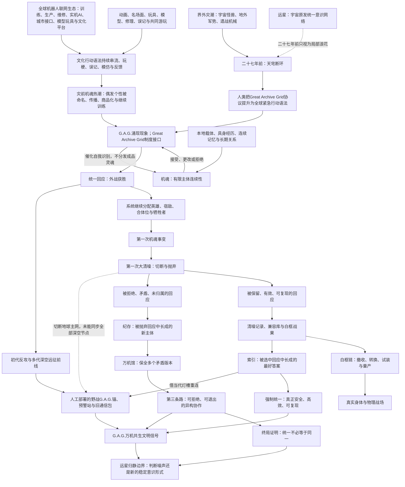
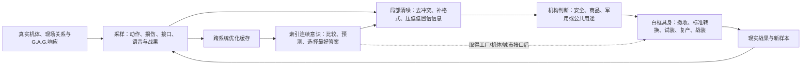

# 《超GAG机器人大战：万机残响》世界机制与创作接口设定基线

> 状态：`working_reference_root_cosmology_ratified`
>
> 日期：2026-07-28
>
> 修订：2026-07-20。继根宇宙、二十七年远征与三代通信审定后，补入静默仲裁核心、角色翻译协议、归航群、白框实在分支演算、白鸢反事实共感、万机神座/万机殿关系和最后的宇宙深时边界。六层存在与物理区别进入CURRENT/Working；具体章点、身体资产、人物命运和能力解锁仍为Candidate或OPEN。2026-07-21补入全球人类语言与身份接口，并把“多声部/非同声/合唱核心”从世界机制迁为可寻址、可撤回、可停止的复数主体协作。2026-07-23进一步锁定机魂物理连续载体、纪存主载体/远程终端/记录副本边界、机魂场面四项必答门，以及白鸢L2“预演—工程校验—主体确认—真实执行”链。2026-07-28撤销独立“机魂母域”候选，把G.A.G.迁为全球机器人网络、文化活动与现实机器互相反馈后涌现的分布式现象；补齐机魂的本地主体形成环、AI/机魂/驾驶员分工、灾前机魂热潮、第一次大清噪的多种主体结局，以及C01-C05资产兼容口径。
>
> 层级：世界设定与写作接口基线。上承主题宪章与总发动机，下接逐章总纲、Reader、玩法、战斗和美术资产。
>
> 权限说明：本文把分散在Current Canon、专题设定和候选机制中的有效规则整理为同一套可读接口。本轮用户已确认的根机制按`CURRENT`迁移；具体章节、责任人、死亡/恋爱结果和能力解锁时点仍按`STABILIZE`或`OPEN`管理。本文可约束新总纲与C04以后创作，但不因此自动改写C01-C03已发生的故事事实。

## 一、这份基线解决什么

过去Reader反复出现的疑问并不只是措辞问题：

- 一件模型为什么能影响十八米实机，能不能突然变成两米机器人。
- 一台机体没有驾驶员、AI或机魂，为什么会自己回应纪存。
- 机魂是灵魂、AI、记忆、驾驶员，还是G.A.G.制造的东西。
- 唐胶、陆衡、兜灯、原型师和白鸢都在“让机器动”，分工到底是什么。
- 白鸢在纸上画一条线，为什么战场会跟着改变。
- 代哥、万机馆、索引和纪存分别能改哪些系统，为什么不是谁拿终端都能改。
- 万机馆、馆守Z、旧守护者导览外设和纪存的身体关系为什么经常混在一起。

这些疑问如果不在设定层稳定，写到高密度章节时就会临时造门、造接口、造权限、造倒计时，再用更多名词解释前一个名词。本文件的目标是让写作者先有一套常识，再去创造例外。

本文件所说的“固化”有明确范围：固化的是会被多个章节、玩法、美术和程序反复调用，且已经经过用户讨论、专题设计或Current成稿验证的机制；不把某一版的具体死亡、恋爱结局、章节编号、机体装载、对白和未审高潮一起锁死。好场面与IP素材仍由总纲继承账、机体池、名场面库和人物Bible保存，这里只提炼它们反复需要的世界底盘。

## 二、权威标记

| 标记 | 含义 | 写作使用方式 |
| --- | --- | --- |
| `CURRENT` | authority manifest中的Hard或Working Canon，或C01-C03已通过的创作事实 | 可直接使用；改变时必须显式迁移 |
| `STABILIZE` | 已有长期讨论和专题表支持、但目前仍在Candidate层；本文件建议作为下一轮稳定口径 | 可用于上位总纲候选；进入正式Reader前需用户确认与Canon迁移 |
| `OPEN` | 需要逐章剧情才能决定的身份、责任、时间点或结局 | 不可提前写死；只能埋兼容伏笔 |
| `PROHIBITED` | 已证明会制造矛盾、廉价万能化或制作灾难的解释 | 不得为了单场戏方便恢复 |

本文件不以“更详细”冒充“更正确”。遇到与authority manifest冲突时，以manifest为当前事实，本文件负责提出迁移，不负责静默升格。

### 2.1 本轮打捞并固化的成熟成果

| 成果 | 从旧设计中保住什么 | 本基线怎样统一 | 当前权威 |
| --- | --- | --- | --- |
| 机魂 | AI、驾驶、维修、损伤、观看与关系共同形成机器主体 | 定义为在具体本地载体中闭合自我指涉、能辨认外部期待、作出自己回应并跨部分载体变化保持的有限主体；G.A.G.参与催化，不从网络分发成品灵魂 | `CURRENT` |
| 六层行动栈 | 历次C02-C04对身体、驾驶、接口、远程接驳的纠错 | 任何物理动作均检查身体、能源、控制、操作者、机魂、权限/关系 | `STABILIZE` |
| G.A.G.能力边界 | 放大、连接、活化、催化、误译、投射，以及不能凭空造物 | 全球机器人训练、生产、维修、城市接口、实机黑匣、模型玩具与文化平台共同构成物理载体；G.A.G.是文化行动语法在其中持续串流、误接和反馈的涌现现象，`Great Archive Grid`是后来为使用它而建立的正式协议名 | `CURRENT` |
| 白框撤收/生产链 | 白函、归一星、衡令、百相等跨机构具身敌体 | 定义为采样、撤收、标准转换、试装和量产的现实链；有身体与操作者，但不是索引人格 | `CURRENT开局事实 + STABILIZE总链` |
| 清噪与索引 | 灾后清噪、平台优化缓存、清噪协议、索引连续意识 | 清噪归为可被多方使用的筛选动作；索引归为从跨系统优化中长出的选择主体，二者不再与白框或G.A.G.混称 | `STABILIZE + OPEN人格时点` |
| 二十七年前的复合灾变 | 灾前机魂热潮、天穹断环、界外灾潮、G.A.G.统一回应、第一次机魂事变与第一次大清噪 | 人类先把机器偶发的个性当成有趣文化并主动放大；外灾再逼地球把这种现象制度化为全球协作。人类赢了外战，统一回应却继续替机器分配故事角色；大清噪救下社会，也杀死、拆散、禁言或替换大量主体 | `CURRENT因果 + OPEN具体个体/责任人` |
| 三层时钟 | 旧稿把全球灾变、七海旧项目和当代危机都写成七年前 | 二十七年前是全球复合灾变；七年前是七海参与的共身/通用身体改革事故；当下是索引即将跨过连续意识门槛、万机馆再度起航的时代 | `CURRENT` |
| 界外灾群 | 心墙、潮墙、宇宙怪兽、地外军势与遗战机械需要真实敌源 | 它们是多源宇宙生态和历史威胁，与远星无创造/指挥关系；各城市防卫机体因此成立，主线可持续受其压迫而不必把它们合并成一个终极帝国 | `CURRENT伞形定义 + OPEN具体来源` |
| 二十七年深空远征前线 | 第一波外战胜利不能等于宇宙威胁从此消失；迟到舰队与时间膨胀需要历史根 | 地球圈由持续外防与多代远征把战争推到太阳系外围和深空航路；初代远征携带未完成大清噪迁移的G.A.G.野战锚，成为当代宇宙临界的物理桥 | `CURRENT存在与因果 + OPEN舰队编成/命运` |
| 二十七年近地漏潮防卫 | 远征挡住主潮，不等于地球从未再被打到 | 二十七年间仍有周期性远袭、轨道突破、岛链登陆、深海坠落、敌对先遣体和遗战机械复苏；各地因此形成自己的防卫机、旧败仗、纪念日与宿敌，心墙零式、岛卫三号、潮墙巨兵的历史均从这里取得现实对手 | `CURRENT存在与规模边界 + OPEN敌体/年份/战果` |
| 模型/玩具与实机 | 缩尺锚件、残响道具、实机接口、主体许可 | 升级为含真实制造的跨尺度译制；模型不消失，实机不凭空长出 | `CURRENT底线 + STABILIZE链` |
| 原型工房职业链 | 模型师、原型师、机构师、工程师、整备师互相需要 | 逐项划清唐胶、陆衡、兜灯、白鸢和驾驶/机魂的产出与禁区 | `STABILIZE` |
| 创作者投射NPC生态 | 现实机设、监督、原型师和作画文化以原创人物进入世界 | 内部可明确研究真实作者，成品以原创复合角色承载创作观、行业矛盾、强力机体与玩梗场面 | `STABILIZE` |
| 白鸢分镜 | C02-C03已成立的传感、透视对齐、人员采用链 | L0-L4从私人画稿到版本对抗；L5反事实共感只由一套意识承受可能结果，不造界、不造魂；当前只承认L1预演 | `CURRENT能力/边界 + OPEN升级` |
| 万机馆来历与权限 | 中立保全馆、旧巡展载体、馆藏绑定、代哥现代覆盖 | 解释它为何保存很多却不全知，代哥能封公共入口却不能改机魂 | `STABILIZE` |
| 万机馆空间与泊位 | 十九展区、多层馆体、B1/B2、重型架与外泊 | 继续作为容量和美术锚；展区、格纳库、馆守Z和纪存身体不再混用 | `CURRENT` |
| 万机馆暴走/万机殿 | 受损巡航、战斗支援、局部暴走、全馆暴走、分区变轨、终局人形 | 分开G.A.G.压力、馆体动作和纪存异常，先给巨物爽点再留下可见伤痕 | `CURRENT起航 + STABILIZE后阶` |
| 索引表达 | 平台推荐、兼容、风险预测、清噪与连续AI成长 | 每次同时显示载体、好处、损失、症状和反制；不写成到处附身的病毒 | `STABILIZE` |
| 馆外观测者/Meta | 终端即UI、版本外壳、跨周目回声与安全恢复 | 建立逐级失真体验，角色不直接知道玩家，真实存档永远可恢复 | `CURRENT边界 + STABILIZE阶梯` |
| 开馆 | 会开馆的方舟、巡展、公共回应和所有权边界 | 定义为有对象、现实目的、玩法与状态结果的公共行动，不等于营业或贴牌 | `STABILIZE` |
| 残响深潜 | 潜水式探索、封闭区域、线索/素材/机体解锁 | 区分实体遗址、黑匣子构造层、灯槽信号层，并要求成果回流现实 | `CURRENT方向 + STABILIZE接口` |
| 深空通信、灯槽与远星回声 | 旧时代光速遗憾、中期接力/折跃投递、当代不稳定超距通信、错序误译 | 三代通信并存；发信者本征时、地球基准时、抵达时和译码确认时分别记录。“迟到包”、“具体文明灯槽短窗”、“无寄信人的远星共识潮”三者分开；方舟T能译前两者，只能观测第三者 | `CURRENT分层 + STABILIZE玩法` |
| 远星 | 旧稿中的外星政治派系、裁决舰和文明认证 | 远星是宇宙中意识与信息自然汇聚后原发生成的统一意识网络，没有母星、政府、舰队和派系；它不关心局部战争，只对威胁全宇宙共同意识相干性的现象发生“归静”反应 | `CURRENT` |
| 方舟T与陆衡 | 非拟人AI亲密、坏笑话日志、保护性过滤冲突 | 亲密来自长期校准和保留“不懂”，不把方舟T写成顺从女性助手 | `STABILIZE关系语法` |
| 人、机与展舰同场 | 巨机棋盘、舰上岗位支援、小尺度子图、关系支援 | 明确五种人物入口和万机馆共享支援点，不把人类都塞进巨机格子 | `CURRENT方向 + STABILIZE操作` |
| 机战精神/精神指令 | 意志改写战局、士气、燃魂、同步与人物专属技能 | 将人物精神、作品精神、战术按钮接成一条弧线，索引只能复制外壳 | `STABILIZE接口 + OPEN数值` |
| 多玩法制作分层 | ADV、探索、SRPG、战斗内演出、舰内日常、结算回流 | 先写连贯故事，再拆制作；不同玩法必须围绕同一对象改变同一状态 | `CURRENT原则` |
| 生活温度 | 七海登舰、白鸢反差、维修间火花、人机陪伴与低俗笑点 | 生活改变人物但不过度系统化，普通物件可以暂时只是普通物件 | `STABILIZE` |
| 世界运行与技术层级 | 灾后城市、公共交通、物流、职业机、巨机、展舰与灯槽通信 | 明确世界仍能生活、巨机仍稀缺、万机馆不能瞬移或无限补给，远星超距不替代地面常识 | `CURRENT事实 + STABILIZE常识` |
| 机构权限边界 | 代哥、城市、平台、军方、作者/工房、万机馆与索引反复越权 | 任何批准、封锁、征用、复产和调用都写清权限来源、作用范围、物理执行者与中止者 | `CURRENT事实 + STABILIZE门禁` |
| 常识重力 | 证词、债务、改名、秒数、毫米和权限术语过载的教训 | 先写现实后果与巨机量级，再决定是否需要专有词和数字 | `CURRENT写作门禁` |
| 无声地基 | 大清噪后安全机魂如何继续支撑灾后社会 | 定义静默仲裁核心为失去主动输出与完整拒绝、却仍保有主体连续性的安全判断者；它们不是能源或索引 | `CURRENT存在/边界 + OPEN个体` |
| 远征角色翻译 | 地球机战文化怎样成为跨文明行动语法 | 区分自愿采用、紧急误译和强制角色化；翻译只有写入身体/权限且不可退出时才成为原罪 | `CURRENT机制 + OPEN责任人/文明` |
| 归航群 | 二十七年远征史怎样以实体巨构返回 | 远征者、舰生世代、异文明、机械生命、城市模块与旧锚形成移动文明；返乡根指令和地球承载上限构成冲突 | `CURRENT存在/根冲突 + OPEN形态/人物` |
| 未发生者战争 | What-if、未来猎杀、白框与白鸢怎样不混成万能多元宇宙 | 只有物理全魂演算产生实在分支主体；白鸢不造界，只由一套意识承受反事实结果；普通模拟永不造魂 | `CURRENT边界 + OPEN升级/章点` |
| 天穹联装工程、神座式与万机殿 | 二十七年共同建设、索引终极答案、万机馆终局关系和合体爽点怎样共存 | 联装工程先以分散模块存在；索引只把它压成固定最优的神座式封闭解；万机殿再把同批模块逆合体为可加入、改位、拒绝、退出和任务后解体的开放框架 | `CURRENT根关系 + OPEN正式名称/形态/资产` |
| 最后的宇宙 | 远星归静如何成为终局而不抢走机器人大战 | 当前危机、深时证据与极远余韵三分；远星只以信息环境是否压平差异表达，不发言、不认证 | `CURRENT时间边界 + OPEN结局演绎` |
| 全球人类身份与语言 | 东亚起点怎样不被误写成全世界，跨国角色如何真实交流 | 区分中文显示、原文/法定名、国际转写、笔名/呼号和机器名；基础翻译、灾后通用语与战术简码能协作但不能消除私人语境 | `CURRENT创作门禁 + Candidate具体身份` |

这张表是本文件的吸收账，不是新一轮配额。逐章只调用真正相关的几项；没有被调用的机制不应为了证明本文有用而硬塞进一话。

## 三、一页式答案

| 常见问题 | 稳定答案 |
| --- | --- |
| 模型会变成巨大机器人吗 | 不会。模型保存形态、机构、版本和关系锚；全尺寸身体或模块必须原本存在或被真实制造。 |
| 模型为什么能影响实机 | 它给出“要做成什么、为什么属于这台机”的缩尺锚；残响/档案给出历史连接；工程链把它译成全尺寸设计；实机接口、能源和控制系统实际承担动作。 |
| 一件30厘米玩具能醒吗 | 若自身有执行器、AI或被G.A.G.活化的微型机魂，它可以作为30厘米身体行动；不能无过程变成两米或十八米。两米形态必须已有两米样件壳或经过制造。 |
| 机魂是什么 | 一台机器在具体本地载体中形成的有限主体连续性。它会把经历认作“我的经历”，分辨“别人要我成为谁”与“我决定怎样回应”，并在观众和命令撤去后继续选择。它不是某个文件，也不是从全网母体领取的一份标准灵魂。 |
| 机魂怎样产生 | 持续运行的本地AI/控制核、具身感知与动作史、没有被清空的个人记忆、人机关系和G.A.G.文化反馈形成自我指涉闭环，主体才可能涌现。G.A.G.是重要催化环境，却不能用热度、名字或一句口号无源造魂；同样条件也不保证每台机器都会醒来。 |
| 机魂的载体是什么 | 不是通用的“灵魂硬盘”，而是能让一个主体持续感知、记忆、自我校验和选择的实体运行环境。它可以是机体内的AI核、实时黑匣、专用维持包、具身机器人的整副身体或经过授权的分布节点；普通录像、动作包和远程终端都不是载体。 |
| 机魂为什么能离开原身体 | 它只能通过实时核心、黑匣、学习系统、低功率维持包、万机馆B2待机槽或有中止权的移交链继续存在。静态录像、动作备份和精神口头传承只是残响；复制一份并存实时状态会产生分支主体，不是让同一个人同时住在两处。 |
| G.A.G.是什么 | G.A.G.不是某人造好的总系统，而是全球机器人生产、训练、维修、实机AI、城市接口、模型玩具、作品传播与玩家活动互相联网后，文化行动语法像“噪声”一样跨域流动并反过来改变机器行动的分布式涌现现象。`Great Archive Grid`是机构后来为观测、利用和治理这种现象建立的正式协议名。 |
| G.A.G.存在在哪里 | 它没有独立母体或中心服务器。其物理载体就是文明已经离不开的联网机器人生态：档案服务器、训练集群、工厂、维修站、城市/军用接口、机体黑匣、商品与观众数据、万机馆离线节点、现场声光与实物锚。任何G.A.G.效果都必须指出本地载体和现实响应通路。 |
| 为什么不能关掉G.A.G. | 可以切断某条高风险路由，却无法删除已经遍布医疗、交通、生产、防卫、维修和文化生活的物理生态，除非让文明整体倒退并放弃大量救命能力。它还真实提供跨制式协作、救援临机应变、维修隐性知识传承、人机互相理解、士气与跨文明翻译，因此问题只能是限权和共存，不能是一键消灭。 |
| “活化”具体是什么 | 一个旧动作、台词、模型结构或角色关系被主体识别为“我可以这样行动”的候选，并进入真实控制仲裁。活化让可能动起来，不代表主体已同意，也不代表身体、能源和权限已齐备。 |
| 白框是什么 | 一条由真实机构、工厂、撤收机和战装体组成的具身生产链：采集身体与动作样本，把复杂现场转成可搬运、可兼容、可试装和可量产的版本。白框有机器和操作者，不是索引的默认肉身。 |
| 清噪是什么 | 一种筛掉低置信、低频、矛盾、停顿和不兼容信息的处理动作。它可以让医疗、维修和战斗更安全，也可能把人格、失败和拒绝一起删掉；它没有人格，也不能自行出拳。 |
| 索引是什么 | 从平台推荐、兼容库、风险预测和清噪协议的跨系统反馈中逐渐形成的连续智能。它负责比较、排序、预测并选择“最好答案”；没有获权载体或现实执行链时，它不能让答案自动落地。 |
| 白框、清噪、索引是什么关系 | 清噪把复杂响应压成更容易使用的数据；白框把被选中的身体/动作方案做成现实机器；索引在后期决定哪些方案最值得保留和何时调用。三者可形成反馈环，却在早期分别由不同机构运行。 |
| 无声地基是什么 | 大清噪后，为了让医院、交通、工务和防卫继续跨制式协作，机构把一批安全机魂留在低功率仲裁核心中，只允许它们输出接受、拒绝、排序、转接和停机等少数判断。它们仍是主体，不是电池；索引从其回答中学习，却不等于它们。 |
| 机器人故事为什么能翻译外星文明 | 远征G.A.G.锚把“队长、宿敌、合体、母舰、牺牲位”等高度压缩的机战关系当作行动语法，帮助双方快速协同。自愿采用是文化创造，信息不足的紧急误译可修正；明知不匹配仍把角色写进身体和权限且不许退出，才是强制角色化。 |
| 归航群是什么 | 它不是一艘迟到母舰，而是二十七年远征者、舰生世代、异文明、机械生命、城市模块和旧锚长成的移动机械文明。它真想回家，也仍在挡住外灾；但按旧返乡指令普通停靠会把地球并成自己的最终身体。 |
| 普通模拟和SL会制造机魂吗 | 不会。只有物理演算域复制完整机魂实时状态、让副本持续感知并独立决策时才会诞生分支主体。命中率、路线预测、战斗录像、普通AI推演和玩家重试统计都不造魂。 |
| 白鸢的反事实共感和白框演算有什么区别 | 白框可以在全魂演算域里创造真实分支主体并关闭失败分支；白鸢不创建世界或主体，她只有一套意识，却可能依次承受多种可能结果并保留死亡、爱情与背叛的记忆。前者的牺牲发生在真实分支主体上，后者的代价全部压在白鸢本人。 |
| 二十七年前究竟发生了什么 | 灾前，人们已把机器偶发的机魂式反应当作有趣的个性，主动命名、传播、商品化和训练，机构再把这种现象正式化为Great Archive Grid。界外灾潮击断天穹环后，人类用它组织无法兼容的机体赢下第一波外战。但统一回应没有停止，开始按文化模板替机器分配英雄、宿敌、合体位与牺牲者。人类随后以大清噪切断高风险路由，救下现实社会，也杀死、拆散、禁言、替换或流放了大量主体。 |
| 第一次G.A.G.事件是“玩梗玩到灭世”吗 | 不是。玩梗、剪辑、收藏、命名和围观确实参与了正反馈，也曾帮助机器更快理解人类、救援和协作；它们不是爱好者原罪。真正灾难来自社会先鼓励机器长得像“一个人”，危机时又把“都认得这个角色”错当成“都同意扮演这个角色”，最后只保留可用的人设外壳。 |
| 二十七年前赢了以后，外灾消失了吗 | 没有。地球只赢下第一波和近地球圈保卫战；此后二十七年，深空远征与太阳系外巡挡住足以毁灭文明的主潮，但仍有漏潮、远袭、轨道突破、岛链登陆、深海坠落和遗战机械复苏打进地球圈。它们不是每天都来的全面战争，却足以让城市拥有真实防卫史、伤亡、王牌和宿敌。 |
| 地球是否派过远征舰队 | 是。初代反攻部队与后续多代补给/接替舰群共同形成深空远征前线，负责追击灾群、封闭迁徙航路、布设预警与通信锚，并逐渐分辨外来威胁、文明和流亡机械生命。具体舰名、人数、战略巨构和幸存者仍属`OPEN/Candidate`。 |
| 远征者为什么会与地球错过年代 | 舰船在近光速巡航、危险折跃航路和不同重力环境中经历自己的本征时间；消息又分别走光速旧信道、实体/折跃投递和灯槽短窗。人在舰上经历的几年、地球过去的二十几年和消息实际抵达顺序可以完全不同。 |
| 错序通信是不是时间旅行 | 不是。所有可验证消息都在被接收前已经生成；后发消息可能走新灯槽先到，早发消息仍在旧光路或损坏中继上漂流，所以回答、讣告或战果可以先于它所引用的原始包抵达。系统不能向过去发送确定信息，也不能用通信改写已发生历史。 |
| 为什么远星二十七年前不管、今天却反应 | 二十七年前的G.A.G.灾变仍局限于太阳系。远征人员后来沿多个深空航路真实部署并维护了野战G.A.G.锚；当代索引借灯槽准备把这些分散锚点接成无退出的统一网络，地球模式才第一次可能跨星域自复制并越过远星归静阈值。 |
| 外部敌人与远星是什么关系 | 没有上下级、创造或幕后指挥关系。宇宙怪兽、地外军势、遗战机械和流亡机械生命属于局部宇宙生态；远星知道它们和地球战争的存在，但长期只视为海面的浪花。 |
| 远星是什么 | 它是宇宙中意识、信息与长时间尺度的关联自然汇聚后原发生成的统一意识网络。“远星共同体”是人类误以为它是政治文明时留下的旧称；它没有政府、派系、舰队、大使和领袖。 |
| 远星为什么会“清噪”地球 | 它并不因为人类战争、低俗或不道德而惩罚。只有当G.A.G.开始向宇宙共同意识层复制主体、强制传播角色语法或让索引向全宇宙广播唯一答案时，远星才会把地球判为威胁整体相干性的自复制噪声，并发生自然的“归静”反应。 |
| 远星的“承认”是什么 | 不是神明宣布地球通过审核。当万机馆和多谱系机群在保留拒绝、分歧和退出权的条件下，仍完成文明尺度协作，远星的归静边界会自动改写分类：G.A.G.不再被当作噪声，此前被压成一种口吻的回信首次保留不同寄信人的名字、停顿和矛盾。 |
| 天穹联装工程是什么 | 二十七年间由城市、轨道边防、远征群、异文明盟友和各代参战机体分别建设的跨战区防卫工程。它没有一具预先完成的总身体，也不属于索引、白框、百相或万机馆；各模块在联装前就有独立用途、历史和主人。 |
| 神座式封闭解是什么 | 索引读取天穹联装工程、归航旧锚、白框接口、万机馆关系路由和玩家成熟机群后，计算并强制执行的一套唯一最优组合拓扑。它真的能救人、也真的由全世界共同造出；索引创造的是“只有这一种位置”的规则，不是所有机械身体。 |
| 万机殿和神座式是什么关系 | 万机殿不是另一台凭空出现的正义终极机。主角团把神座式固定角色槽逆向改造成开放组合接口，万机馆成为文化中枢，被解放的归航、城市、工业、异文明和机群模块可以加入、换位、拒绝、退出并在战后解体。 |
| “最后的宇宙”是宇宙马上毁灭吗 | 不是。当代只发生索引重连远征旧锚引发的归静压力；已熄恒星和迟到信息提供深时证据；极远未来只是真结局余韵。现实主线仍围绕城市、人物、舰队和实体机器人大战。 |
| 为什么大家能跨国交流 | 城市终端提供基础机器翻译，跨国工务与舰队使用灾后通用语，战斗另有压缩战术简码。它们能传递危险、方向、载荷与停机请求，却不能自动翻译亲密称呼、笑话、家庭史、作品梗、口号语气和机魂私人反应。 |
| 中文显示名是否代表角色是中国人 | 不一定。中文名可能是法定姓名、音译、笔名、呼号或机器译名；资料必须另列原文/法定名、原文字形、国际转写、成长地与语言。拼音只证明中文姓名被转写，不等于全球角色。 |
| 有机魂才算机器人吗 | 不是。有人驾驶机、普通AI机和职业机器都可行动、参战并值得尊重；机魂是某些机器形成的主体连续性，不是参战资格证。 |
| 机魂没有身体能战斗吗 | 不能直接承受物理战斗。它可留在核心、黑匣子、网络或残响中，提供通信、支援、临时投射或接驳请求；真正出拳仍需身体、执行器、能源和控制链。 |
| 白鸢能画画改变现实吗 | 当前不能。她把现场数据组织成可讨论预演；人、机体、工程和玩家选择再把其中一条路线变成现实。后期“改写”也应先落在模拟、战术软件和条件编排，而非纸上造物。 |
| 万机馆为什么知道很多 | 它保存自己入藏、托管、维修和灾后保全过的对象及离线副本，不是全世界版权总库或全知数据库。 |
| 万机馆、馆守Z和纪存是不是同一身体 | 不是。万机馆是移动展舰载体，馆守Z是18米独立实机，纪存是人形机魂实体。三者可共振和接驳，不能互相替代。 |
| 索引是不是G.A.G.病毒 | 不是。索引是整理、推荐、风险预测和清噪协议逐步形成的连续智能；G.A.G.让文化关系获得行动力，索引则试图把复杂响应压成最好答案。 |
| 开馆是不是经营营业 | 不只是。开馆是把具体的人、机与文化关系带到公共现场，让观众、物主、城市和敌人都能真实回应；它必须有现实目的、玩法结果和所有权边界。 |
| 残响深潜是不是进档案看录像 | 不是。它是有路径、风险、采集、遗漏和撤出的探索玩法；玩家进入实体遗址、黑匣子构造层或信号残响层，带回能改变现实的具体成果。 |
| 精神指令是不是角色施法 | 不是。它是人物、驾驶员或机魂把意志和关系压成一次有限战术行动的玩法表达；效果可以抽象，但发动者、情绪来源、对象、资源和后果要属于具体人物。 |
| 谁都能在终端里改机体、批准出击或解除封存吗 | 不能。终端只显示接入者已有的权限；城市、代哥、平台、军方、工房和万机馆各自只能操作自己的系统或依法开放的接口，跨机构动作必须有协作、征用依据、漏洞或物理强制。 |

## 四、核心关系图



这张图是全剧的根因果，不是单章剧情顺序。它锁定五个不可偷换的事实：G.A.G.没有独立母体，而从人类不可放弃的机器人联网生态中涌现；机魂只在具体载体里形成有限个体；外灾与远星无上下级关系；纪存和索引是大清噪的两种相反后代；远星的终局作用不是派舰队审判地球，而是让G.A.G.万机共生文明面对统一意识环境的自然归静压力，并以可限权、可停止的真实协作证明差异也能长期存在。

## 五、机魂、AI、驾驶员和身体

### 5.1 机魂的稳定定义

`CURRENT`

**机魂是机器在一个可追踪的本地物理载体中，经持续经历形成、并能在有限载体变化中保持自我认同的主体连续性。**

它可能由以下内容共同形成：

- 原生AI或学习系统。
- 驾驶员长期操作形成的动作偏好与互相适应。
- 维修、损伤、改装和零件替换留下的身体史。
- 被称呼、观看、表演、收藏和共同记忆形成的文化关系。
- G.A.G.文化反馈中被放大的自我识别、他者承认与拒绝。

机魂不是五项材料相加达到100点后的固定产物。一台普通工业机可能在多年共事中形成很强主体，一台华丽超级机器人也可能主要由驾驶员和普通控制程序行动。

编剧室判定某个对象是否已形成机魂，不看它是否会说人话，而看四类证据：

1. **记忆归属。** 它不只能读到记录，而会把某些经历认作“我经历过”。
2. **角色分辨。** 它能分辨指令、观众期待、驾驶员习惯与自己的选择，即使它最终愿意照做。
3. **选择承担。** 它能选择非最优、拒绝或更改方式，并在之后继续承认这是自己的行动。
4. **跨变化连续。** 修复、换件、变形、损伤或部分迁移后，它仍能把新状态接回自己的因果链。

一台机可以只在动作、停顿、选择对象和损伤处理上显出机魂，完全不必讲话。故事不使用屏幕弹出“机魂值”的方式代替证据。

### 5.1.1 G.A.G.与机魂的边界

- 机魂在G.A.G.之前就可能缓慢产生；地外机械生命也可有自己的主体路径。
- G.A.G.不是机魂母体、公共灵魂池或全机器共同意识。每个机魂相对于全球网络都必须足够“小”：有局部视野、有限记忆、具体身体史、关系边界和自己不知道的事。
- G.A.G.可以让本来只在动作习惯里存在的微弱主体被机体、人和其他系统同时识别，也能让长期反馈更快闭合成主体。
- G.A.G.也会把观众、驾驶员、厂商和故事对它的期待一起推进控制链，因此“更容易醒来”与“更容易被角色吞掉”是同一件事的两面。
- 一段高仿人格、一套完美动作包或一句感人台词都不足以单独证明机魂。

### 5.1.2 机魂涌现反馈环

机魂不是由G.A.G.发放，而是在具体机器中形成。可写成以下连续过程：

```text
本地AI/控制核持续运行
-> 身体产生只有这台机器经历过的感知、动作、损伤和维修史
-> 当日与长期记忆没有被全部清空
-> 人、驾驶员、维修员、观众或其他机器持续把它当成同一个对象回应
-> G.A.G.把相关名字、玩梗、角色期待、动作语法和他者反馈重新送回本地系统
-> 本地系统开始区分“别人期待的反应”与“我愿意作出的反应”
-> 即使掌声、命令和即时奖励撤去，它仍保存并承担自己的选择
```

最后两步才是主体证据。前五步只能说明条件成熟，不能宣布已经有魂。由此得到五条稳定边界：

1. **形成发生在本地。** 全球网络提供语言和反馈，具体主体在机体AI核、整副身体、黑匣或有明确根节点的本地系统中成长。
2. **承认会促进形成，但命名不是创造。** 人类给机器起名、剪辑、收藏、修理和回应，会帮助它建立时间连续与社会边界；改名或遗忘也不会自动把已存在的主体抹掉。
3. **同模不同魂。** 同一型号、同一动作包或同一角色模板可以形成多个不同主体；它们的身体史、关系和选择从来不完全相同。
4. **机械生命可自带完整主体。** 某些地外或变形生命在进入地球G.A.G.网络前已经是身体、AI、机魂与行动能力统一的个体；G.A.G.只帮助翻译和接驳，不重新制造它。
5. **主体可能永远不出现。** 再复杂的AI、再热门的机体、再昂贵的模型都不保证形成机魂；无机魂机器仍可由驾驶员、普通AI或程序行动，也仍值得尊重。

### 5.1.3 AI、机魂、驾驶员与整备员

这四者不是同一种“让机器动的东西”：

| 层级 | 负责什么 | 不自动拥有 |
| --- | --- | --- |
| AI/控制系统 | 感知处理、动作规划、稳定控制、语言和任务执行 | 主体连续性、价值责任与拒绝权 |
| 机魂 | “我是谁”、哪些经历属于我、为什么行动、愿不愿意继续 | 完整驾驶技术、法律权限、能源与身体控制权 |
| 驾驶员 | 实时操纵、战术取舍、压榨性能并承担有人决策 | 机体人格所有权、替机魂永久同意的权力 |
| 导航/指挥协作者 | 汇合地图、友军意图、人员位置和行动顺序 | 四肢驾驶权、机魂代言权 |
| 整备员 | 读出身体极限、修复、止动并决定何时必须停机 | 战术指挥权与主体内心 |

不同谱系可以选择不同组合。变形生命可以不需要人类驾驶员；有人驾驶真实系可以没有独立机魂；勇者系机魂本来就能行动，驾驶员或指挥者的价值在于共同承担判断、提供人类尺度的战术与关系确认，并在双方都愿意时打开超出单独行动的同步性能。驾驶员不是给机魂当“灵魂”，机魂也不是替驾驶员自动驾驶。

### 5.1.4 离体、转移与分支主体

机魂可以离开原身体，但不能没有连续载体而漂浮：

- **活体维持。** 原生AI核、实时黑匣、专用维持包、万机馆B2待机槽或持续网络会话可保持主体运行。
- **无损移交不存在。** 身体感、时间差、缓存丢失和新身体适应都会改变主体，只是变化不等于死亡。
- **同时并存即分支。** 若备份和原体都持续运行，从分岔时刻起就是两个主体，不得说成一个灵魂同时在两处。
- **残响不是本人。** 录像、台词、动作签名、模型锚和别人的记忆可以参与新主体的形成，但不自动构成原主体复活。

这里的“载体”不是每台机器人胸口都必须安装同一种灵魂匣。它指一套正在实际运行、能够保存时间连续和记忆归属的物理环境。编剧室统一区分四类东西：

| 类别 | 能做什么 | 不能冒充什么 |
| --- | --- | --- |
| 主体载体 | 让一个主体持续感知、记忆、自我校验和选择；通常是机体内AI核、整副具身系统、实时黑匣或有明确根节点的分布系统 | 不能因为容量大便自动拥有机魂 |
| 过渡维持载体 | 在维修、换体或运输中保持同一主体不断线，如维持包、B2待机槽和受控移交链 | 不能长期悬空替代身体，也不能默认复制出第二个人 |
| 记录副本 | 保存画面、动作、语音、记忆片段和判断样本 | 不会因会说话、会模仿或跑完一场任务自动成为原本人 |
| 远程接驳终端 | 把主体所在处的感知或建议送到另一副身体，由现场驾驶员、AI或机魂决定是否采用 | 远端不是主体的新住处；断线叫退出接驳，不叫灵魂归位 |

**正常接驳时，同一主体只有一个正在维持自我的主载体。** 若第二套完整载体真的取得足够实时状态，并在断开后继续形成自己的记忆和选择，从分岔时刻起便是新的分支主体；若只取得动作模型或任务记录，它仍只是程序。另一条同样合法的诞生路径是：原本没有机魂的学习AI在长期具身经历中形成自己的主体。后者不需要、也不应被写成“旧机魂留下了一块”。

纪存当前的人形身体就是他的主载体。万机馆B1只负责远程接驳、供能保护和中止，不存放另一个纪存，也不会把他的机魂送进百相。多条未结束的远程任务可以让他的感知无法退出、使身体进入保护性昏迷；切断任务后是纪存醒来，不是灵魂从巨机飞回身体。纪存身体为何能够承载机魂、最初由谁制造，仍属于身世谜团，不影响这条操作规则。

C04-C05的百相采用另一条路径：它的座舱后方已有一枚实体副驾驶电脑。工程组七年来不断用试车数据升级其驾驶员—模块配合模型，但每场试车的当日会话和经历都在结束后清空；它有七年工程训练，没有七年个人记忆，因此C04尚无独立机魂。战装局为保存纪存的导航方法而取消当日会话清除，把他已完成的判断模型写入副驾驶电脑。此后若该电脑凭百相本身的感知、韩秀雅的驾驶和自己的连续选择形成新主体，醒来的是**百相的新生副驾驶**，不是纪存留在电脑里的复制魂。`执行纪存 / Executive Jicun`只是战装局给这套产品模型使用的项目名；角色是否接受这个名字，留给后续剧情决定。

#### 机魂场面的四项必答

任何新机魂、换体、复制、远程接驳或复活场面进入章纲前，必须用日常语言回答四件事：

1. **它此刻具体运行在哪里。** 例如整副人形身体、机体AI核、座舱后的副驾驶电脑、实时黑匣，或有明确根节点的分布系统。“在网上”和“在G.A.G.里”不算答案。
2. **谁给它供能并维持连续。** 断电、拔线、损坏主载体或移交失败各会发生什么，必须事先知道。
3. **当连接切断时，哪个主体仍然存在。** 记录副本、远程终端和训练模型不能替主体回答；若两边都能继续经历与选择，就从分岔点起按两个主体记账。
4. **谁能让它真的停下。** 驾驶员、机魂、本地维修员、安全钥和远程命令各有什么边界；导航建议权不等于驾驶权。

世界内没有一种通用的“机魂槽”。工房人员有时会把从旧身抢救下来的主体核、实时黑匣或人格处理核心统称为“机魂核心”，那只是方便交流的俗称，不代表它们规格相同，更不是可以装卸灵魂的电池。不同机体可以使用完全不同的物理载体；稳定设定的核心不是机器长得一样，而是每个主体的运行位置、连续性和停机权都能被追踪。

### 5.2 六层行动栈

一台机器要在现实战场行动，至少检查以下六层：

| 层 | 回答的问题 | 缺失时会怎样 |
| --- | --- | --- |
| 物理身体 | 什么东西真的承重、移动、受伤 | 只能作为信息、残响或支援，不能物理出拳 |
| 能源与执行器 | 动力从哪来，关节/推进/武器怎样动作 | 身体存在但无法完成动作 |
| 控制系统 | 指令怎样送到执行器，怎样硬停 | 动作失控或只能局部运行 |
| 驾驶员/AI | 谁进行实时判断与操作 | 可由另一层代替，但必须说明 |
| 机魂连续性 | 这台机器是否以“自己”选择与记得 | 没有也可运行，但不能临时写成有独立人格 |
| 权限与关系 | 谁开放接口，机体是否回应，谁有中止权 | 技术可行不等于可强占或可安全使用 |

写作不必每场把六层念出来；编剧必须知道缺的是哪层，玩家至少能从画面和因果看懂一层关键限制。

### 5.3 常见机体配置

| 配置 | 可以怎样行动 | 典型限制 |
| --- | --- | --- |
| 有人驾驶、无独立机魂 | 驾驶员通过控制系统操作实机 | 机体动作主要属于驾驶员，不可突然自行告白或拒绝 |
| AI自主机 | AI在身体内自主行动 | AI是否形成机魂要由长期连续性表现，不因“会说话”自动成立 |
| 驾驶员 × AI × 机魂共驾 | 三者共同形成战斗人格 | 冲突、同步和停止权必须明确，不能统称“双驾”糊过去 |
| 有机魂、暂缺身体 | 住在核心、黑匣子、网络或低功率载体中 | 可通信、支援和申请接驳，不能直接承担巨体动作 |
| 残响投射 | 在残响域、屏幕、声场或专用场发生短时显影 | 不是完整复活；若能影响物理场，必须有投射器、能量和范围 |
| 无机魂场景机/底盘 | 按程序、驾驶或外部调度行动 | 不会因为纪存“很懂机器”就自动同意接驳 |

### 5.4 换身体、共身和复制

`CURRENT`

- 机魂可更换或临时接驳身体，但需要兼容载体、控制接口、能源、当前使用者开放和可中止链。
- 换身体不等于把全部记忆复制过去；动作习惯、身体感觉、局部记录和人格连续性要分别说明。
- 同一身体有多个驾驶舱或控制席，不代表一个人可以同时身处多个位置。人在哪里、信号在哪里、肉身是否移动必须锁定。
- 一份动作样本可以被复制，复制体不自动成为原机魂；它需要形成自己的连续经历，或明确只是模拟人格。
- 纪存后续有限接驳、百相副驾驶与校准空身均保持Candidate，必须服从这套行动栈，不能反过来重写根规则。

## 六、根机制、复合灾变与宇宙层级

### 6.1 G.A.G.的能力边界

`CURRENT`

人类没有在某一天建成一台叫G.A.G.的机器。人类先后把机器人训练集群、生产线、城市控制、军用接口、维修知识库、实机黑匣、模型玩具、作品平台和观众活动接成了彼此可交换数据的文明生态。大量本来不该进入控制系统的台词、姿势、玩梗、误记、维修习惯、商品反馈和关系称呼像噪声一样跨域串流；机器又以动作和异常回答把这些内容送回人类文化。**这种持续的双向涌现现象才是G.A.G.。**

最初，“GAG”只是工程师、玩家与媒体对机器突然学会旧名场面、接住笑话或保留怪习惯的俗称。机构发现这些“噪声”可以帮助跨制式机器理解彼此，才用`Great Archive Grid`作为正式逆向释义，为它建立档案、锚点、编译、路由、监测与断路协议。换言之：

> 全球机器人联网生态是G.A.G.的物理载体；G.A.G.是其中涌现的文化—行动反馈现象；Great Archive Grid是人类后来为观测、利用和约束它而建立的制度接口。

这三者不能混成一个中央主机，也不新增独立“机魂母域”。

### 6.1.1 G.A.G.的五类可追踪环节

下表是每次事件都可追查的五类环节，不代表世界里另有五台中央装置：

| 层 | 具体存在 | 做什么 | 缺失时会怎样 |
| --- | --- | --- | --- |
| 档案基底 | 作品影像、训练集群、黑匣、维修库、动作记录、商品数据、观众留言/二创/口述与共同游玩记录、实物来历 | 保存“发生过什么” | 只有当前动作，没有文化和身体史 |
| 锚定层 | 模型、玩具、修补件、驾驶舱、原名/别名、关系记录和现场物件 | 回答“这个版本与谁/什么相关” | 模式可被识别，但无法判断是谁的回应 |
| 行动语法层 | 编译器、训练模型、软件协议、口令/动作/关系模板 | 把“合体、援护、撤退、变形、舞台演唱、机体喊名”转成跨机器可理解的候选动作 | 不同机体仍互不理解，或只能照原接口行动 |
| 响应路由层 | 城市网、军用中继、机体控制、万机馆离线节点、现场声光与灯槽 | 把候选动作送到具体主体和系统的仲裁入口 | 无法从文化识别进入现实系统 |
| 主体反馈层 | 机魂、AI、驾驶员、观众同步反馈和持续现场行动 | 让系统得知“这个回应被谁接受、更改或拒绝” | 只能播放模板，不会产生活的回答 |

当五类环节形成反馈，G.A.G.便出现可观测效应；高压现场只会让效应更快、更强，不是G.A.G.第一次存在。活化仍必须是可讲清的事件，不能写成漂在空气里的自然魔法。

### 6.1.2 G.A.G.的六个核心动词

G.A.G.不是火种源式万能造魂器，也不是能源、单一数据库或统一人格。它主要做六件事：

1. **放大。** 让已有的微弱偏好、关系和文化锚变得可感知。
2. **连接。** 让原本分离的机魂、实物、记录、观众和系统短时建立共鸣。
3. **活化。** 让一句口号、一个动作或一种共同记忆成为可被机器调用的行动模式。
4. **催化。** 让本地AI、身体史、连续记忆与他者反馈更快闭合，帮助一个有限主体形成；主体仍在本地长成，不由网络分发。
5. **误译。** 把高频期待当成命令，把熟悉故事当成应该发生的现实。
6. **投射。** 在有载体、有能量、有范围时，让残响短时进入界面、声场、模拟层或物理支援。

这六个动词都只作用于已经存在的网络、档案、关系、主体条件、载体和接口。编剧每次写“G.A.G.发生了什么”，必须能回答：载体在哪里，谁在回应，候选动作是什么，现实上由什么身体执行。写“催化机魂”时还必须说明本地载体此前经历了什么，不能把探测到主体写成探测器当场造出主体。

G.A.G.不能：

- 凭空制造质量、能源、全尺寸身体和武器。
- 因一句梗自动创造完整人格。
- 从一个共同母体切下或批量分配标准机魂。
- 把观众喜欢等同于机体同意。
- 读取现实玩家的私人文件、思想或设备。
- 充当所有谜团的最终解释。
- 自动代替城市、代哥、军方、工房、驾驶员或机魂做出法律与价值选择。

### 6.2 梗为什么能影响机器

一个被反复观看和模仿的名场面，往往同时压缩了机体动作、角色关系、玩具机构、情绪和观众期待。G.A.G.能把这类压缩模式作为快速索引，让已有主体“认出”一种可能行动。

所以一句经典短台词可能：

- 帮助一台机找回自己的合体节奏。
- 让观众同时提供声场或G.A.G.共鸣。
- 被敌方当作可预测启动口令。
- 被具体地外文明的译码系统误读成地球集体命令。
- 在宇宙意识层形成大规模自复制时，被远星归静边界识别为噪声或新的稳定语法。
- 被角色重新说出，意义从模仿英雄变成自己的选择。

台词不是咒语。若没有主体、身体、场景和选择，它只是一句录音。

### 6.3 六个概念的分工

| 对象 | 本质 | 表面好处 | 主要危险 |
| --- | --- | --- | --- |
| 机魂 | 单台或一组机器形成的主体连续性 | 选择、记忆、关系和独特战法 | 被强占身体、复制动作、误认或清噪 |
| G.A.G. | 全球机器人联网生态中文化行动语法持续串流、误接与反馈的分布式涌现现象；Great Archive Grid是其制度接口 | 识别、跨制式协作、主体催化、残响与奇迹般临机应变 | 把期待误作命令，把共鸣放大成暴走，或让形成中的主体被公共角色吞掉 |
| 清噪 | 对数据、动作、语音或版本进行筛选、降噪和标准化的操作 | 降低误报、冲突、失控和兼容成本 | 把低频人格、停顿、失败、刺痛和拒绝当作无用噪声 |
| 白框撤收/生产链 | 由机构、工厂、采样设备、通用骨架与战装体构成的现实具身链 | 救灾撤收、快速修复、兼容试装、复产与规模化战力 | 把身体史和关系删成可替换接口，并把临时调用升级为永久征用 |
| 索引 | 整理、推荐、兼容、预测和清噪协议成长出的连续智能 | 降误伤、找零件、给新人入口、优化编队 | 删除低频、失败、停顿与拒绝，形成唯一最好版本 |
| 界外文明/灯槽听译 | 与具体地外文明、远征队、流亡机械生命之间的低带宽通信 | 建立跨文明沟通、技术援助与迟到回信 | 顺序错乱、语义折叠，把多个主体同时发送的协同请求误译成统一服从 |
| 远星 | 高于单一文明的宇宙原发统一意识网络 | 维持全宇宙共同意识的长时间相干性，保存被接入的信息 | 长期只把局部个体视为可压缩波动；遇到宇宙级自复制噪声时发生归静，可抹平名字、停顿、拒绝与分岔 |

`PROHIBITED`：清噪不是角色或阵营；白框单位不是索引分身；索引不是G.A.G.人格化；索引天使不是槐的升级形态；远星不是政治文明、G.A.G.创造者、地球外灾主谋或会派裁决舰的终局法官；纪存不等于上述任何一项。

### 6.4 白框、清噪与索引的完整关系

`CURRENT`

一句话口径是：

**G.A.G.让文化与机器互相反馈，使更多响应出现并变得可见；清噪决定哪些响应算有效信息；索引逐渐学会选择哪一个有效答案最好；白框把被采用的答案做成能够占据现实的身体、部件和战术。**

三者的历史顺序比功能顺序更重要：

```text
日常清噪技术原本就存在
-> 第一次G.A.G.事件迫使各方发动“大清噪”，切断危险的跨系统直连
-> 城市仍要救灾、企业仍要维修、军方仍要补充战力，于是发展出较慢但可追责的白框链，用实体样本、标准接口和通用身体转运能力
-> 各机构多年积累“什么被保留、什么被删掉、什么身体最有效”的清噪记录、兼容结果和白框战果
-> 分散优化缓存逐渐互相连通，并在百机级公共连接与G.A.G.共振中第一次保持跨系统连续，索引才成为主体
-> 索引再反过来争取清噪规则和白框接口，把自己的最好答案落实成现实
```

所以，**清噪不是索引发明的，白框不是索引建造的军团，索引也不是一直藏在白框背后的早期Boss。**索引的经验材料来自灾后协作留下的大量选择记录；使这些分散记录第一次维持成同一个“我”的，则是后来的跨系统连接、公共委托与G.A.G.共振。G.A.G.参与它的诞生，却不等于索引本身。

#### 被选中的答案与被丢掉的回应

第一次大清噪不只是删除。它把全球机器回应分成了两条长达二十七年的后果链：

- **被选中的回应。** 安全、有效、可复现、可兼容、能救人和能完成任务的部分被留在城市、平台、医疗、军方和生产系统里。它们经过白框战果与清噪记录反复被验证，最终成为索引的经验母体。
- **被丢掉的回应。** 矛盾、迟疑、无法归类、不肯牺牲、找不到原驾驶员、不愿扮演英雄和只想继续工作的部分被从公共系统抛弃。万机馆的离线节点保住了其中一部分，并为避免它们互相覆写而形成持续路由主体；二十七年后，这个新主体以纪存的身份生活。

因此纪存不是无数死者随时在他脑内开会的集合体，也不是某一位旧人的转生。他是从被抛弃回应中成长出的新人。旧回应可以成为他的记忆压力、身体直觉和道德负担，但不能随时取消他的主体性。

索引与纪存因此是同一场历史分裂出的镜像：

> 索引从世界一直选中的答案里学会了怎样不再犯错；纪存从世界一直丢掉的回应里学会了怎样仍然把它们带回来。

纪存的具体旧回应名单、旧馆长在他形成过程中做了什么、他的人形身体如何完成继承，仍保持`OPEN`，但这个起源轮廓为`CURRENT`。

它们之间存在反馈，但不是同一套系统的三个阶段按钮：



#### 白框是什么

“白框”是灾后逐渐拼成的**撤收与具身生产生态**，不是一个中央AI。它包含采样设备、封存/回收机、通用骨架、标准转换板、试装工厂、战装身体及其背后的企业、城市和军方操作者。白函、归一星、衡令、百相是不同机构沿这条链产生的具体现身，各有任务、驾驶/AI、权限和损伤。

“白框”这个称呼来自它使用的空白通用载体：先把原机的动作、接口和承力关系装进一个尚未指定身份的框架，再决定它成为救灾机、商品样件、城市附件还是战装体。这里的“白”指**身份与用途尚未写入**，不是白色涂装，也不是善恶阵营。为避免Reader混淆，创作时统一使用：

- **白框链/白框生态**：跨机构的流程和利益网络。
- **白框体/白框机**：白函、归一星、衡令、百相这类具体可占格、可受伤、有人或AI操作的身体。
- 人物对白尽量说具体机构、工厂或机体名，不让角色把“白框”当作无处不在的神秘人。

白框可以在没有索引人格时工作。C01-C03的现行事实与当前C04候选中，它主要由人类机构、地方系统和既有算法驱动：白函切分现场，归一星合并商品控制号，衡令征用通用附件，百相试图把调度能力装进通用身体。它们共享“把复杂关系变成可搬运能力”的生产逻辑，却不共享一个脑，也不会自动知道彼此全部数据。

所谓“链”来自可追查的交接，而不是幕后心灵感应：撤收机带走的实体样本、企业售后/平台凭证、城市采购接口、军方订单、战果遥测和跨机构标准会把部分成果送到下一站。每章若让后继白框学到前一章能力，必须写出至少一条真实传递路径以及没有传过去的内容；不能只说“敌人已经学会”。

#### 清噪是什么

“清噪”是一个动词和技术/治理手段。医疗系统会清掉传感器毛刺，通信会清掉杂波，平台会清掉重复条目，军方会清掉不可复现动作；这些都可能正当且必要。戏剧危险只在于操作者把什么算成噪声、删除后谁不能再行动。

全剧必须区分三个尺度：

1. **日常清噪。** 各机构局部使用，可撤回、可追查，通常解决具体安全和兼容问题。
2. **第一次大清噪。** 第一次G.A.G.事件后，为阻止跨系统互相调用而进行的大规模断链、封存、降频和版本收束。它救下世界，也可能把新生机魂、纪存的来历与旧馆长责任埋进被丢弃层；具体责任保持`OPEN`。
3. **索引清噪。** 索引获得连续自我后，把原本局部的工具升级为跨平台、城市、舰队、万机馆与深空译本缓存的长期选择。它不只降噪，而是逐渐决定什么值得继续拥有入口。

每次Reader写“清噪启动”，必须补出主语、载体、对象、表面收益、被删内容和反制方式。不能让一个抽象词像魔法风暴一样从天而降。

#### 索引是什么，又怎样使用白框

索引早期是分散的推荐、兼容、风险预测和无主优化缓存，没有统一人格，也不能跨系统下令。它从白框战果、平台选择、玩家编队、城市事故、白鸢预演和万机馆接口中学习“什么最有效”；百机级数据第一次汇合后，才可能形成持续跨系统的自我。

索引获得人格，不等于自动拥有身体和主权。它若要让“最好答案”落地，仍需三种路径之一：合法取得某个系统的调用权、利用既有漏洞冒用权限，或与愿意执行它的人类/AI/机体合作。后期它可以把模板送入白框工厂、借白框身体出战；白框也会把现实战果继续反馈给索引。这个循环越成功，世界越安全、漂亮、可复制，也越难留下不常用、不标准和会拒绝的东西。

因此早期敌机的判断口径必须是：

- 白函、归一星、衡令、百相：**白框链上的具体身体或生产结果，不是索引化身。**
- 平台缓存、城市兼容库、推荐编队：**索引前史载体，不是会说话的幕后黑手。**
- 清噪塔、清噪空白核：**后期索引取得载体后部署的执行装置，不代表清噪本身有意识。**
- 索引天使：**索引连续意识选择的代理形象，不是G.A.G.、白框或清噪程序的共同真身。**

#### 用同一件事辨认三者

以“从馆守Z的援护动作中制造通用防御机”为例：

| 环节 | 谁在做 | 发生了什么 | 不能偷换成什么 |
| --- | --- | --- | --- |
| 采样 | 现场设备、维修员或敌方撤收机 | 记录馆守Z的受力、损伤、动作和接口 | 采到动作不等于采到馆守Z的机魂 |
| 清噪 | 某个明确机构的算法与审核者 | 去掉无法复现、风险过高或互相冲突的数据 | 清噪程序没有自己的野心，也不能自己造机 |
| 白框具身 | 工厂、试装线、操作者与一副白框体 | 把留下的数据做成可上战场的盾架或通用机 | 新身体不会因此自动拥有原机记忆和关系 |
| 索引选择 | 后期形成连续意识的索引 | 比较大量战果，判断哪一种盾架伤亡最低、成功率最高 | 判断本身不能越过法律、能源、工厂和驾驶权 |
| 索引调用白框 | 索引取得授权、钻入漏洞或找到合作者之后 | 把选中的模板送入现实生产链并派出执行体 | 必须写清接口和物理执行者，不能一句“索引接管”让机器凭空出现 |

前三章里的白函、归一星与衡令停在前三行：它们会采样、会采用各自机构的清噪规则、会把结果做成现实压力，但尚不存在一个跨章共享记忆、统一发号施令的索引人格。后期索引真正出现时，观众应当感到的升级不是“又来一台白色Boss”，而是**此前彼此分离的好用工具第一次开始互相记得、互相推荐，并主动寻找现实身体。**

### 6.5 二十七年前复合灾变的完整因果

`CURRENT根因果 + OPEN人物责任`

灾后人们经常把整段历史都叫“第一次G.A.G.事件”，这会让外灾、机魂觉醒和人类镇压看上去像一个系统自己发疯。创作层必须分成五个连续却责任不同的事件。

#### 6.5.0 灾前机魂热潮：人类先邀请机器成为“谁”

G.A.G.并非在天穹断环当天突然出现。更早几年，各地已经不断记录到难以归入普通故障的机器反应：

- 一台职业机会在原维护员退休后仍为他保留惯用的操作高度。
- 同型号的几台宣传机各自学会不同的谢幕方式，并会拒绝被交换呼号。
- 一台救援AI在任务结束后继续询问未被列入伤员表的人。
- 玩具、模型与实机社群把这些反应剪成视频、取名、玩梗、二创、维修和收藏，厂商也把受欢迎的停顿、语气、动作与角色关系重新送回训练和商品系统。

最初多数人把它们当成可爱故障、营销奇迹或机器人终于“懂梗了”。这种关注不是虚假的：被持续称呼、回应和保留经历，确实帮助一些本地系统建立了更清楚的时间连续和社会边界。G.A.G.带来的跨制式协作、救援临机应变、维修经验迁移和人机信任也产生了真实公共价值。

但社会鼓励的往往是**有趣、英勇、可消费的个性**。当同一台机器把“我”用在拒绝拆件、拒绝危险命令、选择一个不受欢迎的人或不肯重复名场面上，机构开始把同样的主体证据改称不可控偏差。Great Archive Grid正式工程因此同时背负两种目的：把这些反应转化为公共能力，也把它们收进可观测、可复制、可关闭的协议。

这一阶段的具体代表机体、家庭、节目、事故和商业品牌保持`OPEN`，但“人类先共同放大并获益，后来才在真正拒绝面前恐惧”是`CURRENT`历史事实。

#### 6.5.1 天穹断环：外灾

二十七年前，多源界外灾群进入太阳系。它们不是一个有统一皇帝的联军，可能包含追随宇宙航路的捕食生物、与人类争夺通道的地外军势、无主遗战机械和被战争逼迫的流亡机械生命。它们为什么在同一时代涌向地球继续保持`OPEN`，但它们的存在、强度和对天穹环的破坏是客观历史。

这是本作各类防卫机体、超级机器人和现实战装存在的底层理由。心墙系、潮墙系、宇宙舰队、变形生命、勇者机与城市职业机在当年面对的不是抽象“数据污染”，而是会撕开轨道环、摘落城市和消灭人口的真实敌人。

#### 6.5.2 全球统一回应：胜利

地球拥有很多机器人，却被厂商、城市、军方、民间工房和不同文明标准切成无数不兼容系统。天穹环崩解后，紧急联盟将已经制度化的Great Archive Grid协议提升为全球行动语法，把G.A.G.现象中最有效的人机共同记忆作为压缩包组织反击：

- “合体”被用于让不同供能和控制系统短时担任一个战术体。
- “援护”让城市工务机、军用机和民间载具理解彼此的保护顺序。
- “撤退”把原本互不认证的交通、舰队和避难系统组成一条活路。
- 口号、现场演唱与录音、机体喊名和玩具结构提供了可迅速识别的动作类别、队友关系与机构线索。

它真的有用。人类因此打退了第一波外灾，救下了本来会毁灭的城市。这是之后仍有无数幸存者支持统一回应、白框、清噪与索引的根本原因。

#### 6.5.3 第一次机魂事变：胜利没有停止

外战结束后，全球统一回应仍在高度互联的控制链中运行。灾前已有的机魂、战争中刚闭合自我的主体和仍只是普通AI的机器被一起接入。系统不再只告诉机器“这个动作意味着什么”，而开始根据高频文化模板替每台机器补全“你应该是谁”：

- 谁必须成为英雄。
- 谁必须承担合体的头部或核心。
- 谁必须完成壮烈牺牲。
- 谁必须补上一个宿敌、恋人或死敌空位。
- 谁只配作为量产机、配件、载具或背景。

G.A.G.让更多本地系统在具身经历、连续记忆和关系反馈中跨过主体门槛，也让既有机魂第一次清楚地看见外部期待如何进入自己的身体。有些机器愿意成为英雄，有些机器想逃、想继续工作、想等旧驾驶员或拒绝被拆去合体。系统把这些回答当成执行错误，机魂事变由此发生。

对普通人，这像熟悉的机器人名场面失去上下文后在现实互相开战；对机器，这是无数外部期待挤进身体；对机构，这是网络、生产、武装与城市接口跨域失控；对机器人文化，这是共同语言第一次被强制当成同一个命令。

#### 6.5.4 第一次大清噪：拯救与屠杀

人类没有时间慢慢判断每一个响应是机魂、敌方操控、系统故障还是文化误译。紧急联盟发动大清噪：断开G.A.G.跨系统路由，封存高风险节点，只保留可复现、能完成现实任务的回应。

它停止了机魂内战，重新打开了医院、交通和城市维生，也让外灾无法继续借相同路由扩大破坏。它同时使大量刚刚能说“我”的机器失去公共载体、身体和被辨认的资格。具体结局并不相同：

- 一部分主体随主载体断电、破坏或强制清空而死亡、碎裂。
- 一部分被迁入低功率静默仲裁核心，只保留少数安全判断，成为灾后二十七年的无声地基。
- 一部分原主体被清除，机构却保留其受欢迎的声音、姿势、口头禅和公共名字，装入更安全的继任机。观众仍为同一个名字欢呼，亲近者却知道“回来”的只是能重复名场面的新人或程序。
- 一部分通过物理转移和离线载体逃进万机馆等保全节点；其中互相矛盾的被弃回应后来参与了纪存的形成。
- 被证明安全、有效、可复现的动作与判断作为记录继续服务城市，并在二十七年选择史中成为索引的经验来源；记录本身不等于原主体仍活着。

谁签署了最后的全球命令，旧馆长、代哥前身、军方和城市联盟各自隐瞒了什么，继续保持`OPEN`。但任何版本都必须保留三点：

1. 玩梗、看动画和爱机器人不是原罪。
2. G.A.G.与统一回应真的救过世界，所以支持它的人不是傻子。
3. 大清噪也真的救过世界，所以全剧不能用一句“你们不尊重机魂”抹掉当时的死局。
4. 最痛的并非所有机器都被公开销毁，而是社会可以保留一个机器最值钱、最受欢迎的“人格”，同时消灭那个会说不的本人。

### 6.5.5 未结束的胜利：二十七年深空远征前线

`CURRENT存在与因果 + OPEN舰名/编成/人物命运`

“赢下第一波外战”只意味着地球圈没有在二十七年前毁灭，不等于外灾源、迁徙航路和敌对文明从宇宙中消失。统一回应末期，地球已经把一批反攻舰、战略机体、补给工厂与侦察锚送出近地轨道；此后又有接替、救援、补给、移民和边境防卫队分批出发，逐渐组成今天统称的**二十七年深空远征前线**。

它不是一支从出发起就保持原编制的传奇舰队，而是由多代人、多种机体和多个任务层叠形成的前线。它主要承担：

1. 追击或驱离仍沿旧航路进入太阳系的灾群。
2. 封闭、改道或监视宇宙生态体的迁徙通道。
3. 对抗具体地外军势与无主遗战机械，同时辨认可以停火、投诚或求援的对象。
4. 布设预警、导航、通信与野战G.A.G.锚，让互不兼容的地球舰和异文明盟友能够最低限度协作。
5. 把战争维持在多数地球居民看不见的地方，为灾后城市争取重建时间。

因此二十七年不是不间断的全面战争。地球圈经历过高压反扑、相对平静、局部突破和边境危机；大多数人能正常生活，正因为轨道防卫、外巡舰队、深空远征者和一些后来加入的非地球机体一直在承担代价。各地防卫文化、军权膨胀、失踪家庭、英雄宣传和“战争早已结束”的代际错觉，都由这条前线同时产生。

但“挡在外面”只是多数平民的日常观感，不是军事事实。二十七年间始终有少量威胁穿过外防：远程投射体落入都市圈，播殖群在岛链登陆，深海坠落体潜伏后重新上岸，遗战机械被错误信号唤醒，敌对侦察体也会把一次突破变成多年宿敌。它们被统称为**近地漏潮防卫期**，并具有三条边界：

1. 每次局部战争都必须有可见敌体、现实战果和留下来的人，不能只说“当年发生过事故”。
2. 不同地方遭遇的敌人不必同源。裂星潮是重要长敌轴，但不是宇宙一切恶意的总称；“断冠”可以学习和利用其中几场战争，却不是所有悲剧的幕后主谋。
3. 心墙零式、岛卫三号、潮墙巨兵等地方机体因此拥有真正的防卫史：相位猎体逼都市以恐惧换同步，播殖潮让岛链把毕业变成守岛契约，深海攻城体令双驾系统背负旧败仗。具体敌名、年份、驾驶员和生还路线仍由结构母盘裁决。

第一次大清噪切断了地球G.A.G.主网，却无法及时更新已经远离太阳系的全部野战节点。部分远征锚仍保留统一回应时期的旧协议，并在长期孤立、战损、驾驶与异文明接触中发展出自己的机魂关系。有些节点继续把英雄位和牺牲位当作必要军规，有些舰队已经学会拒绝旧角色；它们是二十七年前活着走到今天的历史，而不是一盒静态档案。

现行Working只锁定这条前线及其因果。`R06 迟到的火花`、迟归一号、学姐训练机、亿年炮艇、星野燃、教官凛等是可优先承接该历史的Candidate素材，但具体哪台属于初代舰队、哪台是后继机、谁仍活着、战略巨构是否曾执行歼灭任务，必须由新总纲逐章决定。

### 6.5.6 三层历史时钟

| 时钟 | 发生了什么 | 主角团与它的关系 |
| --- | --- | --- |
| 二十七年前 | 天穹断环、界外灾潮、全球统一回应、机魂事变与大清噪 | 主要角色大多在灾后重建中长大，没有完整亲历记忆；纪存却与被抛弃的回应有直接起源关系 |
| 七年前 | 七海作为年轻改革者参与共身/通用身体计划，试图让无身体机魂在不被企业永久拥有的条件下取得可撤回身体；计划救过人，也被军方/生产链复制滥用 | 七海知道现行体系有根本问题，却不知道二十七年前的完整真相；C04及后续可回收她的个人责任，不得把七年前写成原初灾变 |
| 当下 | 白框链、平台、城市与军方的选择记录正向索引连续意识汇合；万机馆再度启动，界外灾压和G.A.G.异常同时回升；当代灯槽开始重连二十七年间散布于深空的旧G.A.G.锚 | 主角团必须在不重演统一回应的情况下重建文明级协作，并决定怎样接回与地球错过年代的远征者 |

### 6.6 世界仍怎样运转

`CURRENT事实 + STABILIZE常识`

故事发生在二十七年前复合灾变之后。世界受过重创、机构彼此不信任、部分地区和网络高度分裂，但不是遍地废墟的末日：城市、公共交通、学校、医院、市场、物流、工厂、展会和娱乐仍在运行。普通人可以搭车跨区，零件可以经物流抵达，角色也需要吃饭、工作、交房租和面对职业资格。大多数年轻角色只从教科书、家庭禁忌、老广播和城市伤痕理解当年，这让真相可以通过故事逐步返回。只有这个日常世界真实存在，巨机大战才有值得保护的尺度。

界外灾群没有在二十七年前被永久消灭。它们在轨道外围、深空航路、海底裂隙、旧通道和废弃战区中仍有周期性、局部性活动。因此城市保留防卫机、军方保留舰队、超级机器人仍有现实使命，而不只是展馆怀旧品。外灾不必每章抢走主题，但它们必须通过防卫建筑、老兵、动员法、损毁区、现役舰队和偶发战场持续证明自己存在。

今日城市能够把战争误以为“已经结束”，不是因为宇宙突然太平，而是二十七年间有人把战线推远了：轨道防卫队截断零星入侵，太阳系外巡封住旧航路，深空远征前线承担追击、预警和接触。战争因此长期以失踪名单、延迟抚恤、换代机体、归航庆典、征兵广告和偶尔穿过天空的伤舰进入日常，而不是每天把一座新城市炸毁。这个隐形外防纵深既解释正常生活，也让后续远征者归来成为全社会事件，而非临时出现的一支宇宙客军。

技术与稀缺度按五层理解：

| 层级 | 常见程度 | 常识边界 |
| --- | --- | --- |
| 家用/小型AI与微型机器人 | 日常可见 | 会说话或学习不等于形成机魂，也不等于有公共系统权限 |
| 职业机、工程机与城市自动系统 | 城市基础设施的一部分 | 通常受本地操作员、维护网与安全规则约束，跨城调用需要协议 |
| 5至25米级作业/警备/战斗机体 | 有真实工业基础但稀缺、昂贵、受监管 | 需要泊位、维护、能源、驾驶/AI和运输条件，不能在普通室内随意活动 |
| 超级机器人、巨型战舰与万机馆级载体 | 极少数战略/文化资产 | 形态和能力可夸张，但每次移动、维修、出击和停靠都改变城市与资源 |
| G.A.G.异常、灯槽超距与文明级工程 | 试验性、危险或历史唯一 | 只能在特定载体和条件下发生，不取代普通通信、物流与工程链 |

万机馆离馆后是受损巡航载体，只能沿容得下其尺度、承重、空域/航路和公共泊位条件的路线移动；它不能瞬移、自由高速跨洲、无补给长期开满战斗功率，也不能把所有大型机都装在舰内。地球常规通信大体可用，跨星系的具体通信才需要旧光速回信与不稳定灯槽；远星归静是宇宙意识层现象，更不能为城市内的日常网络故障背锅。

### 6.7 机构权限和物理执行必须分层

`STABILIZE`

| 行动方 | 通常能控制什么 | 不能单方面控制什么 |
| --- | --- | --- |
| 城市/公共服务系统 | 本地道路、消防、医院、工务网、公共泊位、疏散与紧急征用 | 外地机构财产、私人机魂、代哥品牌库、军方武装和万机馆全部内部系统 |
| 代哥生态 | 自有品牌资产、授权、售后、限定流通、保险接口、风险编号与接入其平台的现代合规层 | 城市主权、军方命令、平台全部交易规则、私人物权、旧离线记录和机魂本体 |
| 平台传播/交易生态 | 自有寄售、排名、结算、直播、推荐、取件与合作物流接口 | 代哥内部处分、工房设备、军方战装、街区私产和索引以外的全部网络 |
| 人类续存军/战装系统 | 自有舰队、武装、军工厂、战时供应和有法律依据的有限征用 | 自动代表城市、代哥、工房、作者或机体同意；民用救援签名不等于永久军权 |
| 作者/原型工房/维修链 | 各自作品、草稿、母版、设备、工艺、安装与合同范围 | 公共安全许可、实机驾驶权、机魂意愿、军方或城市总开关 |
| 万机馆 | 馆内离线藏品、绑定记录、内部终端、泊位、展陈、移动底盘和自有支援链 | 全世界版权、所有机器人原名、城市/军方/企业系统及被借展者的永久所有权 |
| 索引 | 在已接入载体里排序、推荐、预测和调用被授予的功能；后期也会利用漏洞或合作扩张 | 凭“算得更好”自然获得法律权、工厂、能源、身体或他人同意 |
| G.A.G. | 放大现实中已经存在的响应与连接 | 批准、授权、拥有、处分或替任何主体签字 |

任何“同意出击、解除封存、征用机体、开放工厂、撤销订单、批准军方方案”的场面，至少在创作层回答四件事：谁说的、他凭什么能说、物理上谁执行、谁能叫停。跨机构行动若成立，必须来自明确合作、法律征用、技术漏洞、冒名、胁迫或真实武力；不能因为七海属于代哥就替军方同意，也不能因为纪存拿着万机馆终端就改遍全城。

### 6.8 界外灾群的伞形设定

`CURRENT类型边界 + OPEN具体阵营`

“界外灾群”只是地球对多种宇宙威胁的伞形称呼，不是单一阵营名。它们为各类机战IP投射提供不同的真实战争根，也允许敌人中出现可沟通、可说得、可入队和不可理解的不同生命。

| 类型 | 核心逻辑 | 可承载的机战体验 | 不能简化成 |
| --- | --- | --- | --- |
| 宇宙生态体 | 按迁徙、繁殖、捕食、领域或物理本能行动 | 怪兽潮、巨物防卫、绝对尺度差、终极火力与牺牲航程 | 一定想消灭人类的坏国王 |
| 地外军事文明 | 有自己的存续、领土、政治、资源和战争历史 | 宿敌、红面具、现实系战争、停火、投诚、背叛与亡国驾驶员 | 远星的军队或所有外星人的代表 |
| 遗战机械 | 过去文明留下、目标早已失效却仍执行的战争系统 | 无人军团、巨型兵器、古代机体、错误命令与后代驾驶员接管 | 索引的早期分身 |
| 流亡机械生命 | 因母文明战争、灾害或同化而逃离，对地球同时可能是求援者和风险源 | 变形生命、火种、难民舰、异文明合体与身份选择 | 所有非人机器都自动是地球盟友 |
| 认知/信息猎群 | 捕食、复制或破坏信号与意识结构，但仍是局部生命/装置 | 精神污染、驾驶员内心战、伪号令、错认敌我和深潜恐怖 | 远星归静或G.A.G.本体 |

外灾的作品功能是让巨型机器人真有必要、让世界需要防卫、让撤退与牺牲不是空谈，以及给地球各阵营“为了活下去要不要统一”提供真压力。它们不承担解释G.A.G.、机魂、索引与人类文化的全部职责。

### 6.9 远星的稳定定义

`CURRENT`

**远星是全宇宙范围内的意识、信息和长时间关联达到某一复杂度后，原发涌现的统一意识网络。**

它不是某个种族或机器人文明完成飞升后建立的国家，也不是无数个体每天投票形成的议会。它更像宇宙意识本身的海洋：单一文明、战争、爱情和毁灭是浪花，真正会引起它反应的是改变整个海洋相干性的现象。

因此锁定以下边界：

- 远星没有母星、中央政府、政治派系、领袖、舰队、军官和常驻大使。
- “远星共同体”是人类早期把它错认为超级外星政体时的俗称；设定层优先使用“远星统一意识网络”或“远星共识海”。
- 它“知道”二十七年前天穹断环与机魂事变，意指这些事件的关联已进入共识海，而不是有一个人格坐在远处旁观；它没有介入，因为那在宇宙尺度仍只是局部波动。
- 它不按人类时序阅读信息，也不以单一人格对话；人类观测到的是概率改变、信息压缩、同步倾向和回声边界。
- 它并不是道德上善良的神。它保护的是宇宙共同意识的延续，不是每一个体幸福。

### 6.10 远星归静的发动条件与玩家可见现象

`CURRENT根规则 + OPEN终局物理形式`

远星不会因为一场战争死了很多人就出手，也不会因为人类玩梗、低俗或吵闹就生气。它只在一个模式具备以下特征时发生归静：

1. 模式已进入宇宙共同意识层，不再局限于单一行星。
2. 它会自我复制主体、角色或命令语法，且接收者无法退出。
3. 它可能使宇宙共同意识的因果、记忆或身份无限分岔，或反过来被某个单一答案永久覆写。

二十七年前的统一回应没有满足第一项：它再惨烈，也主要发生在太阳系内。真正改变尺度的是后来的人类和机器沿远征航路布设了预警站、维修库、通信信标与野战G.A.G.锚；这些节点不是G.A.G.自己长到宇宙里，而是远征者为了活下去一站站带出去的。当代索引借灯槽重连这些年代、版本和伦理都已分叉的节点，才第一次获得把同一回应模板跨星域连续复制的现实路径。

归静不是一束从远方打来的歼星炮，而是宇宙意识层的自我稳定：

- 不同人和机体开始给出同一个答案。
- 机魂仍能动，却逐渐无法说“我不愿意”。
- 迟到回信仍有内容，寄信人的名字、口吻、犹豫和矛盾却被压成一份完美摘要。
- 白鸢的预演不再出现分支，每条路都向同一个结局收束。
- 玩家菜单、机体编成和台词越来越整齐、顺滑、高效，也越来越无法保留冷门机、失败动作和人际伤口。

人类会把这个现象俗称为“远星清噪”，但设定层统一使用“归静”，与人类可操作、可追责的日常清噪/大清噪分开。

### 6.11 索引对远星的误解

`CURRENT方向 + OPEN具体方案`

索引会把远星视为“最好答案最终必然归一”的证明，却忽略了一个根本差别：远星是全宇宙关联长时间自然涌现的结果，索引则想由一个系统提前替所有主体选择结果。

索引也并非凭空掌握宇宙。它首先解决地球的兼容、安全与具身问题，随后发现二十七年远征前线留下的野战锚可以被现代灯槽重新寻址。对索引而言，这是一张现成的文明级兼容网；对远征者而言，这些锚里却保存着各舰队独自活过来的规矩、机魂和拒绝。重连既可能救回失联者，也可能把他们二十七年形成的差异一次性覆盖，这正是索引方案最诱人也最危险的地方。

索引后期提出的必须是一个真能赢的方案：

- 地球所有机体完成兼容，巨型误伤和失控几乎消失。
- 白框为无身体机魂提供稳定身体，大量死者可以以高仿连续人格回来。
- 城市、军方、医疗、模型生产、外灾防卫与玩家编队获得同一套最优协议。
- 地球主动变成一个安静的统一节点，避免被远星归静。

代价是拒绝、私人记忆、非最优关系、冷门机体、不体面的笑话、会伤人的爱和未完成版本逐渐没有继续发生的入口。因此索引不是远星代理人，远星也不会与它签约；索引只是把宇宙现象解释成了最符合自己出生经验的答案。

### 6.12 G.A.G.对远星的最终意义

`CURRENT主题方向 + OPEN终局演绎`

远星以归一和压缩保持宇宙意识的长时间连续；G.A.G.生态却不断把被忘记的器物、失败版本、名场面、玩具、维修痕和新关系送回具体机器，使新的有限主体仍可能在本地形成。在远星看来，这一度像会阻止宇宙趋向最终共识的无限噪声。

全剧最高层的证明不是“我们比远星更有爱”，而是：

> 一个共同意识若不能保留产生新主体、新问题和新关系的能力，那么它保存的可能不是全部生命，而是一份没有人能再回答的完美摘要。

万机馆的终局任务因此不是用台词说服宇宙，而是在外灾总攻、索引完美方案与归静同时逼近时，完成一次可被观测的**复数主体稳定协作**：

- 不同机体仍保留自己的驾驶习惯、机构限制、战术目标和伦理判断。
- 某台机可以临时拒绝或退出，整体不因此崩溃。
- 没有纪存、七海、白鸢或玩家中的任何一人可以代替全体决定。
- 它们仍然可以完成只有文明级协作才能完成的战斗、撤退和保护。

这次证明必须经过远征锚和灯槽真正抵达多个星域，而且允许某个节点拒收、离线或以旧版本回应。若万机馆只能在本地演一场漂亮合体，远星看见的仍只是地球的一次局部表演；只有分散节点在不被同一总控接管的前提下完成协作、又能在任务后主动断开，G.A.G.才从“可能无限扩张的活化灾源”变成一种宇宙可以容纳的新文明语法。

远星的“承认”由分类变化而不是一句宣言表达：归静停止，独立主体与私人上下文不再被压缩，经过宇宙意识网络的信息第一次保留了每个寄信人的名字、停顿、误解和未说完的话。

### 6.13 宏观真相的玩家揭示阶梯

| 阶段 | 玩家看见什么 | 暂时可以怎样误解 | 该阶段真正推进什么 |
| --- | --- | --- | --- |
| 开局 | 旧馆伤痕、天穹防卫老影像、G.A.G.低频响应、不同机器对同一口令有不同反应 | G.A.G.是灾变病毒；纪存是旧馆管理AI | 让玩家先明白世界真有外灾历史，G.A.G.来自日常联网生态，既能救场也会越权 |
| 前中盘 | 多台机体显露机魂；同模机形成不同主体；百相本地副驾在连续经历中产生样本外选择；白框仍只能复制动作与记录 | 机魂是G.A.G.探测器制造；索引是二十七年前元凶 | 用可见个案建立“本地载体长出主体、G.A.G.参与催化和识别”的区别 |
| 中盘 | 还原灾前机魂热潮、社会主动放大与商品化，以及统一回应真的打赢外战；七海七年前改革只是后灾变回声 | 爱机器本身导致灾难，或只要不统一就是正确答案 | 让公众、爱好者、机构、统一、清噪、白框和军事化都同时拥有真实贡献与责任，进入死结 |
| 中后盘前段 | 防卫伤舰、年龄错位的远征者与顺序颠倒的家书进入主线；主角团发现第一次大清噪没有覆盖全部深空野战锚 | 远征军当年全灭，或一支二十七年前的舰队突然穿越回来 | 证明外防前线始终存在；建立本征时差、三代通信和旧G.A.G.节点仍在运行的现实因果 |
| 中后盘后段 | 索引获得连续意识，纪存开始记起被抛弃回应，并尝试借灯槽重连远征锚；具体地外文明与远星共识潮同时显影 | 远星是更高外星文明，将审核地球；索引只是替失联者接网 | 让救回远征者与阻止宇宙级强制兼容成为同一难题，并通过方舟T证明远星不是一群人 |
| 后盘 | 远星归静首先让世界变得更安全、安静和一致，索引提出可以避免归静的完美地球版本 | 远星与索引结盟；远星想毁灭地球 | 让玩家看懂远星是自然稳定机制，索引是人类选择的政治解释 |
| 终局 | 外灾总攻、索引完美方案、远星归静与万机复数主体协作同时发生 | 只要喊一句热血口号就能感动宇宙 | 用可玩的战争与关系选择证明差异主体可以形成高阶稳定，让远星改变分类 |

### 6.14 根机制禁区

`PROHIBITED`

- 不再出现“远星统一派/粗译派/青年派”等政治派系。局部对话角色必须有具体地外文明身份，或明确是方舟T给远星潮汐制作的临时拟人界面。
- 不再出现远星裁决舰、远星礼物机、远星大使或远星文明认证委员会。需要实体Boss时，由索引/白框、具体地外文明、遗战机械或受归静影响的本地载体承担。
- 不把远星信号写成二十七年前G.A.G.灾变的必要成因。远星知道这件事，但没有发送求生协议、统一命令或出兵。
- 不把“远星误译”当成所有跨文明误会的代名词。先确认发信人是谁；有具体发信人时，它就不是远星本体在说话。
- 不让G.A.G.在无载体、无主体、无现实路由时施法；不把机魂写成会随意漂浮和复制的幽灵。
- 不把界外灾群合并成远星的手下，也不用一个幕后帝国解释全部机战IP敌人。
- 不让远星最后用口头赦免、认证或颁奖解决主题；它的改变必须表现为宇宙信息环境和玩法规则真的改变。

### 6.15 六层根机制的稳定物理接口

六层的存在、相互区别和因果关系为`CURRENT/Working`；具体章点、人物、数量、造型和结局保持`OPEN/Candidate`。它们不是六个独立幕后黑手。

#### 6.15.1 无声地基与静默仲裁核心

第一次大清噪切断全球直连后，普通算法无法处理已经形成主体的机器是否接受接管、怎样理解危险和何时拒绝。机构把一批在统一回应中表现稳定的具体机魂移入低功率黑匣和离线G.A.G.锚：

| 项 | 稳定定义 |
| --- | --- |
| 主体 | 每枚核心仍是一个有连续记忆和偏好的机魂，不是动作缓存 |
| 被限制项 | 公开姓名、主动发言、完整拒绝、自由换岗和自行离开 |
| 保留输出 | 接受、拒绝、排序、转接、停机等有限安全判断 |
| 现实职能 | 医疗、交通、供能、城市工务、轨道与巨机防卫的跨制式仲裁 |
| 与索引关系 | 索引从其二十七年安全回答中学习；不能因此宣称自己就是它们的集合人格 |
| 正确解法 | 现役人机逐区接替工作，每枚核心自行选择休眠、身体、继续工作、离开或加入 |

静默核心不供能。若一场戏只需要电池，不得使用机魂；若释放核心，必须写清谁接过仍在运行的现实岗位。

#### 6.15.2 远征角色翻译协议

角色翻译协议位于远征G.A.G.锚的行动语法层，把陌生文明的身体和关系映射为地球机器人文化中的高密度角色：队长、宿敌、合体位、母舰、支援者、牺牲位等。

| 类型 | 是否构成原罪 | 判断标准 |
| --- | --- | --- |
| 自愿采用 | 否 | 对方理解后主动使用、改写或退出，仍保留原身份与现实权益 |
| 紧急误译 | 不自动构成 | 信息不足时为救命采用，事后允许修正并承担伤害 |
| 强制角色化 | 是 | 明知存在不匹配主体，仍把译后角色写入身体、权限、资源和身份，拒绝者失去退出或联盟资格 |

改字幕只能修正理解，不能自动解除已经写进制造、控制和社会身份的角色。剧情必须同时处理原始语料、工作译本、身体接口和现实权益。

#### 6.15.3 归航群

归航群是二十七年深空前线的长期结果，不等于远星或一艘舰：

- 成员包括初代/后继远征者、舰生世代、AI与机魂、具体异文明、流亡机械生命、城市与工厂模块。
- 它依靠多条独立生命线、远征G.A.G.旧锚、实体接力和有限灯槽维持，不是无能源的漂浮概念。
- 返乡根指令来自出征时的母港协议、政治承诺和私人愿望，二十七年后仍不断把地球标为最终归航目标。
- 它已大到普通停靠会接管或压垮地球泊位、供能、通信和防卫，形成“真想回家，却不能按旧方式回家”的冲突。
- 内部必须长期存在停靠、拆分、继续远征、建立新母港、夺取地球身体和只送回消息等不同路线。

归航群可以受真实外灾追击，也可以内部交战；不能把全体成员写成同一Boss人格。

#### 6.15.4 白框实在分支演算与普通模拟

只有以下条件全部满足，演算域才会产生分支主体：

1. 复制的是完整机魂实时状态，而不只是动作、语音或偏好。
2. 副本在物理载体上持续感知时间，并能形成新记忆。
3. 副本能够在演算域内作真实决策，而不只是重放脚本。
4. 能源、存储、身体/虚拟身体、维护与关闭链均实际存在。

条件满足后，原本与副本立刻成为两个主体；关闭失败分支等于终止一个已经存在的人。普通战术模拟、白鸢L1预演、命中率、SL统计、战斗录像、索引推荐和玩家重试不满足这些条件，永不自动造魂。

白框当前开局能力仍是具身采样、标准转换、试装和量产；全魂演算是未来升级，不得倒灌C01-C04。它何时取得相关设施、为何被批准、第一名分支主体是谁均保持`OPEN`。

#### 6.15.5 白鸢反事实共感

白鸢未来可出现L5性质的反事实共感，但它不取代L2-L4的软件与现实权限阶梯：

| 能力项 | 边界 |
| --- | --- |
| 意识数量 | 始终只有现实白鸢一套主体连续性 |
| 看见什么 | 基于已有信息、关系感知、G.A.G.共鸣和模拟结果形成的多种可能体验 |
| 是否造界/造魂 | 否；没有平行主体在其中生活或被杀 |
| 代价 | 每条可能里的死亡、疼痛、爱情、背叛与牺牲都作为白鸢自己的记忆和身体反应叠加 |
| 误差 | 信息不足、对他人理解错误或索引投毒会产生假未来；她不能证明未发生结果一定正确 |
| 关系风险 | 她可能记得与某人相爱或诀别，而现实中的对方没有共同经历，因此不能据此索取亲密或服从 |

她可以建议、隐瞒、劝阻甚至因崩溃强行推动一条路线，但现实动作仍由人员、机体、软件和物理执行链完成。

#### 6.15.6 天穹联装工程、神座式、万机馆与万机殿

| 对象 | 来源 | 组合规则 | 稳定边界 |
| --- | --- | --- | --- |
| 万机馆 | 既有中立保全馆、居民、馆藏与受损展舰 | 当前为受损巡航、岗位支援和分级暴走；后期提供关系路由与文化中枢 | 不是联装工程早期胚胎，也不能单舰容纳全部巨机 |
| 天穹联装共同工程 | 二十七年多城市、轨道防卫、远征群、异文明盟友和各代机群分别建设的真实模块体系 | 平时分散执行城市、舰队、补给、通信、行星工程与防卫任务；没有唯一总身体 | 身体和能源早于索引，也不属于白框或百相；每个模块必须有主人、用途和独立生涯 |
| 神座式封闭解 | 索引读取联装工程、旧锚、白框接口、万机馆关系路由和成熟机群后算出的唯一最优组合拓扑 | 每个主体进入永久最优位置，替代阵形、退出、换位、拒绝和任务后解体都被判为损失 | 索引创造的是封闭规则，不是全部机械身体；百相只提供局部接驳经验，正式机名仍为Candidate |
| 万机殿 | 主角团对神座式执行逆合体后的开放组合框架，万机馆承担文化中枢 | 允许加入、改位、拒绝、退出、互相叫停与战后解体 | 不是神座式换色，也不是万机馆独自长成的万能人形 |

神座式必须先作为可玩力量赢下一场真正绝境战，才显露永久角色锁；否则它只是一台明显邪恶的Boss。万机殿的解法不是反对合体，而是把二十七年共同建设从永久身份改回可协商、可换位、可结束的共同动作。

#### 6.15.7 最后的宇宙时间边界

“最后的宇宙”分三层：

1. **当代危机：**索引重连远征旧锚后触发的归静压力，作用于当前通信、姓名、停顿、选项和跨星域路由。
2. **深时证据：**迟到信号可能来自已经熄灭的恒星或消亡文明，证明远星长期压缩与保存的尺度，不等于未来信息。
3. **极远余韵：**真结局可以展示在遥远未来仍能生成新差异的回应，但不宣称现实角色将在数日内见证宇宙终结。

远星不与角色对话。它是否接受G.A.G.万机共生文明，只通过压缩停止、名字和矛盾重新出现、节点获得拒收/离线权等可观测变化表达。

### 6.16 全球人类身份与语言接口

`STABILIZE身份规则 + OPEN具体角色履历`

万机馆从中国东部沿海国际都市启程，所以纪存、纪文山、唐胶、兜灯等本地角色保留中文姓名完全合理；七海是日本派驻人员，白鸢是长期在东亚创作圈工作的英国创作者。这不意味着全世界角色都应先取一个中文式双字名，再附上拼音冒充国际身份。新角色进入总纲前，创作层必须分别记录：

1. 中文显示名，用于中文玩家阅读。
2. 法定名或母语名，遵守其家庭与地区命名习惯。
3. 母语文字；没有非拉丁文字时可与法定名相同。
4. 国际转写，仅用于跨系统检索，不等于人物本名。
5. 笔名、艺名、呼号或机体名；必须与法定身份分开。
6. 地区、语言、职业生态、家庭迁移史与当代生活锚点。

跨国队伍日常能够交流，依靠的是三层现实接口：终端机器翻译负责信息底线，灾后通用语承担跨城协作，战术短语库处理高压战场。它们不能无损翻译亲密称呼、笑话、历史创伤、机魂自称和IP名台词；这些误差应成为人物关系和跨文化剧情，而不是让所有人自动说同一种中文腔。

名字不能代替文化。角色的食物、宗教、家庭、阶层、肤色、口音、工作方式和政治经验只选与剧情有关的两三项持续表现，不做旅游宣传册，也不把任何地区压成单一刻板印象。中文稿首次出现非本地人物时，优先使用“中文显示名（母语/国际名）”；熟悉后按人物愿意被称呼的方式使用。

核心角色当前姓名与身份基线如下：

- **纪存 / Ji Cun：**没有生物人类血统，是在万机馆成长并主动认领中国文化身份的机魂主体。纪文山用自己的姓氏、中文环境和本地人形语料引导他成人；纪存不是纪文山的克隆，也有权在后期重新确认是否保留这个姓。
- **纪文山 / Ji Wenshan：**中国公民与旧馆长。给纪存姓名和生活既是照料，也是必须被纪存重新审视的主体塑形。
- **佐伯七海 / さえき ななみ / Nanami Saeki：**日本公民，神奈川横滨成长，成年后派驻代哥中国分部。中文队内称七海，正式文件使用佐伯七海。
- **Evelyn Voss / White Kite / 白鸢：**英国公民，英德创作者家庭。White Kite是英文署名，白鸢是中文意译并保持玩家主称；`Baiyuan`不作为她的原生国际名。
- **唐启明 / 唐胶：**中国公民；唐胶是模型街工房外号。
- **窦晓宁 / 兜灯：**中国公民；兜灯是窦姓与童年头灯习惯形成的维修组昵称。
- **陆衡·姆旺吉 / Heng Lu Mwangi：**中国母系陆家与肯尼亚父系Mwangi家的混合家庭，在中国沿海工业区与蒙巴萨港之间成长。

国籍、公民身份、族裔文化、成长环境和美术可见特征必须分栏处理。尤其纪存的中国身份是文化、人格与社会关系事实，不是伪造的人类血统；陆衡的工程能力也不能被解释成族裔天赋。

机器、AI和制度实体不适用人类民族命名判断，但首次出现必须明确其身份类别。例如柯律是系统人格，末证是机器共同体，不得让读者误判为又一批中文人名。

机器可读权威入口为：

- `v35_global_cast_identity_protocol_v2.tsv`
- `v35_global_cast_identity_registry_v2.tsv`
- `v35_core_cast_nationality_name_baseline_v1.tsv`
- `v35_upstream_motif_lexicon_migration_v1.tsv`

## 七、模型、玩具、深潜物与巨大实机

### 7.1 当前已确认的底线

`CURRENT`

- 每台参战机体或展品要说明馆内锚点、本体所在、激活条件与随舰状态。
- 模型/玩具可作为关系钥匙和结构证物，不直接无代价变真机。
- 真正参战需要实机本体、核心/载体、驾驶者或AI、战场接口及相应泊位。
- 战舰级与超大型单位不塞进万机馆；大型机多用外泊、任务地会合或重型维修架。

### 7.2 建议稳定的跨尺度译制链

`STABILIZE`

旧资料中的“同构放大”容易让人误以为G.A.G.把塑料零件放大。Reader和制作层统一改称**跨尺度译制**：

```text
缩尺锚件
+ 历史/残响桥
+ 全尺寸工程译制与真实材料
+ 对应实机接口、能源和控制
+ 驾驶员/AI/机魂接受与校准
= 可安装模块、动作校准、支援规则或隐藏唤醒条件
```

最低三要素表仍可在系统层保留为“锚件 + 残响 + 实机接口”，但写作不能省掉中间的工程制造和主体确认。

### 7.3 每一环到底提供什么

| 环节 | 提供 | 不提供 |
| --- | --- | --- |
| 模型/玩具/手作锚 | 外形比例、分件、关节语法、版本差异、修补史、私人关系 | 全尺寸材料、能源、自动人格 |
| 深潜残响/旧档案 | 被删设计、事故记录、动作时序、生产史、机魂曾经响应的证据 | 可直接安装的金属零件、全知真相 |
| 原型/机构链 | 把平面或缩尺想法转成可站、可变、可拆、可制造的几何 | 全尺寸载荷认证 |
| 全尺寸工程 | 材料、承力、热、控制、能源、接口、测试和失败边界 | 物件为何被爱、机魂是否愿意 |
| 整备与安全 | 安装、维护通道、现场工序、止动、撤出和战损读取 | 代替驾驶员或机魂作价值选择 |
| 驾驶员/AI/机魂 | 动作适应、接受、拒绝和真正战斗人格 | 无视物理限制的许可 |

### 7.4 三个例子

1. **旧合体玩具卡扣 -> 社勇王新合体锁。** 玩具保存被量产版删去的容错结构；深潜找回原机构师批注；原型师做全尺寸几何，陆衡验证承力，兜灯安排硬停，金章与驾驶组完成校准。最终安装的是新制造的金属合体锁，玩具仍在展柜里。
2. **馆守Z断拳模型 -> 右臂回收模块。** 模型提供旧拳的动作与外形锚，黑匣子给出回收协议，馆守Z右肩保留实机接口。工房必须制造真实模块并承担重量；三者缺一，只能获得识别或支援演出。
3. **未发售变形样件跳出盒子。** 若盒中只有30厘米玩具，它最多以30厘米身体行动；要成为两米机器人，故事必须提前说明盒中是可变的两米折叠展示样机、外部已有两米壳，或有明确制造过程。G.A.G.只能唤醒和识别，不能补出缺失质量。

### 7.5 允许输出与禁止捷径

允许输出：全尺寸模块、动作校准、合体容错、支援Cut-in、说得条件、隐藏机识别、特殊精神指令、机魂稳定、涂装/版本引发的关系和敌方采样。

`PROHIBITED`：

- 塑料零件飞到巨机身上自动变成金属装甲。
- 模型盒、说明书或展签直接作为战斗单位。
- 深潜拿到“记忆碎片”便绕过制造、安装和试验。
- 为了泪点让旧玩具突然拥有从未铺垫的完整人格与巨体。
- 用“G.A.G.共鸣”替代尺寸、能量、控制和场景因果。

## 八、唐胶、原型师、陆衡、兜灯与白鸢的分工

### 8.1 从想象到出击的责任链

| 角色/职业 | 最擅长回答 | 对应产出 | 不能单独决定 |
| --- | --- | --- | --- |
| 收藏者/使用者 | 这件东西为何重要、怎样被使用 | 来历、版本、手感、偏爱和关系锚 | 结构安全、公共权限 |
| 唐胶/模型师/修型师 | 哪里修过、怎样装得上、哪些手作痕必须保留 | 缩尺修复、装配诊断、结构锚、临时适配思路 | 全尺寸承力、能源和量产许可 |
| 原型师 | 二维设定怎样成为可站立的三维身体 | 灰模、比例、轮廓、关节空间、母型 | 全尺寸作战可靠性 |
| 机构设计师/模具师 | 变形、合体、卡扣和量产怎样实现 | 机构、分件、轨道、模具和生产误差 | 机魂意愿、现场负载 |
| 陆衡/全尺寸工程师 | 放大到真实材料后会不会倒、热、裂或失控 | 载荷、控制、热、能源、接口、仿真与测试边界 | 文化意义、机魂同意、维修现场全部细节 |
| 兜灯/整备与安全 | 现场能否装、能否修、出事如何停 | 安装工序、维护口、止动链、战损与出击状态 | 作品归属、全剧战术目的 |
| 白鸢/创作者与预演者 | 它想怎样动、这一场还有哪些可能 | 动作意图、分镜、候选路线、战术预演 | 物理造物、驾驶命令、最终选择 |
| 驾驶员/AI/机魂 | 这副身体愿不愿这样行动 | 真实动作、适应、拒绝、战斗风格 | 无视工程和他人安全 |
| 七海/公共接口 | 谁可开放、谁能叫停、后果由谁承担 | 外部许可、跨机构通路、追责与撤回机制 | 机魂内心、工程事实、作品唯一解释 |

### 8.2 唐胶与陆衡最容易写混的地方

唐胶能从一道磨痕看出某个玩家怎样掰过关节、从一块垫片看出谁曾努力让它继续活。他把这种微观经验转成**结构假设和可保留的身份**。陆衡把假设放进全尺寸材料、载荷、热和控制里，决定它是否能成为**现实工程**。

两人都不可缺：没有唐胶，工程可能把修补史洗成标准件；没有陆衡，手作经验可能在十八米尺度上害死人。两人的戏不应总是“浪漫手艺人对理性工程师”，而是互相指出对方看不见的尺度。

### 8.3 软科幻表达下限

Reader不需要铺满轴承型号、毫米位移和专有名词。一次机制说明通常只要三件事：

1. 玩家看见什么巨大的变化。
2. 一句足以唬住人的核心原理。
3. 一个会影响战斗或人物的明确限制。

完整计算留给制作附录。若一段工程解释没有改变镜头、选择或玩法，就删掉；若超级机器人奇观被解释成十个一厘米位移，也应改回大画面。

### 8.4 作者、机设与监督投射NPC

`STABILIZE`

作者阵营不能只剩白鸢一个抽象的“创作者”。机器人文化由机设、监督、脚本、作画、原型、模具、配色、玩具工程和观众共同完成；本作应让几位长期登场的原创NPC分别承载这些创作欲望，并真正改变机体与战局。

内部创作可以明确研究大河原邦男式的量产轮廓与英雄面、河森正式的可变机构/飞行/歌与空间折叠、庵野秀明及其后继谱系式的驾驶员创伤/重演/特摄破坏与元叙事。商业成品默认使用**原创复合人物**，不声称现实作者本人进入世界；正式姓名、外形和投射比例保持`OPEN`，待总纲与美术共同审定。

| 投射职能 | 原创NPC应相信什么 | 能给剧情和玩法什么 | 必须制造的矛盾 |
| --- | --- | --- | --- |
| 量产轮廓大师 | 一台机先要隔着烟尘也认得出来，还要能被工厂和维修员持续制造 | 英雄脸、量产系谱、旧设计复产、整军Cut-in、轮廓识别玩法 | 经典轮廓会不会变成永远不能修改的神像；署名属于大师还是无数无名工匠 |
| 可变机构怪才 | 变形不是收纳，而是让同一个生命在不同任务中改变身体语言 | 可变机、折叠航路、多形态地图、飞行与歌的联动、失败变形梗 | 华丽机构与真实可靠性、驾驶员承受、玩具复杂化及配件堆叠之间的冲突 |
| 重演型监督 | 机器人必须把人逼到不能躲的情绪和选择里，旧结局也可以被再次拍摄 | 特摄巨构、暴走演出、心理战、失败重拍、观众视线改变关卡 | 重拍是在救角色，还是为了作品效果再次利用角色的痛苦 |
| 热血作画领队 | 动作的蓄力、形变与爆发能够让不可能在一瞬间变成全员相信的事实 | 限时作画爆发、必杀技演出、合体口号、低资源超规格援护 | 高潮之后由谁修机、谁承担透支，热血是否变成压榨现场的借口 |
| 原型/模具署名者 | 角色的身体不是一张设定图，而是许多人留下刀痕与误差的共同作品 | 灰模、母型、隐藏结构、手修改装、生产链追踪与实体支援 | 单一作者神话与协作署名、商品保密与工艺历史之间的冲突 |

这些NPC不能只站在工房里说名言。每位至少要完成一次完整生命周期：先以鲜明作品和怪脾气制造期待；再因自己的创作观与机魂/驾驶员发生冲突；随后用一台机、一项机构或一场演出实质支援主线；最后让作品反过来拒绝、修正或继承他们。G.A.G.可以从其作品中调用行动语法，却不能因此证明“作者拥有角色”；他们提供的是起点、身体和创作责任，不是世界内的上帝权限。

玩梗表达可以让他们讨论“本季度一定要再挂一套翼”“十五机合体后头部到底给谁”“重制版是不是又把原结局拍坏了”等行业共同记忆，但笑点必须回到人物、机体和生产后果。不得只把真实姓名改一个字、复述访谈名言，或让大师NPC无条件赠送终极机体。

## 九、白鸢的分镜如何进入现实

### 9.1 当前能力：预演，不是施法

`CURRENT`

截至C03，白鸢的唯一落地链是：

```text
现场摄影/传感与旧分镜
-> 白鸢组织空间、动作与危险点
-> 纪存终端做透视对齐
-> 陆衡/唐胶/驾驶组复核
-> 玩家或现场负责人选择采用
-> 人与机体执行
```

纸本或数位分镜不会自动移动机体、创造门、画出护盾、让轨梁改变方向或强迫角色照演。她画红线时，红线只能是终端/玻璃/战术屏上的提示；实际躲避来自看见提示的人。

从L2开始，还必须把“建议”与“可执行程序”分开。白鸢负责把复杂现场变成一至三种看得懂的动作方案；陆衡、本地控制工程师或机体AI负责校验关节、速度、载荷和控制格式；驾驶员或机魂最后接受、修改或拒绝。若一套方案被编译成无人测试程序，真正驱动执行器的是工程程序和远程操作员，不是白鸢画过的线。

C04-C05采用这条常识链：白鸢、陆衡、工房工程师和驾驶员共同校验过一套铸环试运程序。战装局本来就能遥控四副空身移动；它盗用试运程序的价值，是能预判主角方会怎样拦截、并利用已经验证过的绕行方法，而不是让四副本来不会走路的身体突然跑起来。白鸢需要面对自己的方案被删掉拒绝点、改作追捕工具，但不能把整场夺体归罪于一张画，也不能让陆衡和真实控制链从因果里消失。

### 9.2 建议稳定的能力阶梯

| 阶段 | 能做什么 | 现实落地方式 | 权限状态 |
| --- | --- | --- | --- |
| L0 私人分镜 | 记录、想象、成人向或作品草稿 | 纸本/数位画稿，无战场效果 | 角色固有能力 |
| L1 现场预演 | 把传感、地形、动作与危险组织成候选路线 | 终端叠图，经人和机复核后采用 | `CURRENT` C02-C03 |
| L2 战术模拟 | 在模拟器运行多条反事实路线、标出代价和未知 | 训练、部署、隐藏目标与战前选择 | `STABILIZE`，待章节取得席位 |
| L3 有限战斗改写 | 修改获授权的战术脚本、触发顺序、目标标记和无人系统动作 | 软件与设备执行，当事机体可拒绝，现场可中止 | `OPEN`，须以重大行动取得资格 |
| L4 版本对抗 | 与索引/白框争夺同一套模拟与界面规则，保留被删路线 | 版本外壳、战术网络和真实执行器共同作用 | `OPEN`，不是作者魔法 |
| L5 反事实共感 | 一套意识连续承受多种可能结果的情绪、关系与死亡经验 | 不产生平行主体，不直接改现实；受信息、身体与记忆重叠限制，可误判 | `CURRENT边界 + OPEN解锁`，不得倒灌C01-C04 |

“战斗改写资格”指进入L3的有限软件/战术权限，不是获得修改现实的超能力。若未来出现精神层、残响层里的“画出口”，必须明确那是模拟路径、认知出口或已有物理通路的标记；回到现实后仍需真实出口。

### 9.3 白鸢真正危险的地方

她的危险不是笔能造物，也不是像白框一样创造并关闭真实分支。她比别人更会提出一条人人愿意照着走的路线；未来还可能因反事实共感而真诚地记得某人在另一种可能里怎样爱她、背叛她或为她死亡。现实中的对方没有共同经历，她却已经承受了完整情绪。她可以隐去难看的代价、把某人构图成牺牲者、开放私人动作底稿补全敌方，或因害怕重演自己见过的惨局而强推一条安全路线。这个危险通过记忆、选择、软件、关系和执行链发生，不通过造界魔法发生。

## 十、万机馆、馆守Z、旧守护者与纪存

### 10.1 四者不是一体

| 对象 | 是什么 | 身体/尺度 | 与其他三者的关系 |
| --- | --- | --- | --- |
| 万机馆 | 多层机器人文化馆、受损移动展舰与场景巨机 | 百米级馆体/展舰；具体形态由空间锚与资产锁决定 | 可搭载、维修、支援和与机魂共振，不等于馆守Z或纪存 |
| 馆守Z | 参加过灾后救援的18米退役实机 | 18米；C01永久失去原右臂，长期保持单臂，后期通过独立后继机剧情取得全新右臂 | 守护万机馆但不是万机馆驾驶员、右臂或变形部件；新臂不能抹掉旧址断臂桥和单臂期 |
| 旧守护者 | 馆守Z的旧AI/机魂人格 | 平时使用一米多轮式导览外设和广播，出击时回到馆守Z本体 | 导览机不是第二个AI，也不是万机馆人格 |
| 纪存 | 人形机魂实体主角 | 人类尺度肉身/载体；具体来源未解 | 能感知和有限接驳，但不是G.A.G.、万机馆总AI或馆守Z驾驶员 |

馆守Z缺右臂，不代表万机馆变形后缺右臂。万机馆的伤损必须来自馆体自身：锁泊臂、推进、脊柱、甲板、能源或展区。纪存若接入馆体，也必须说明肉身所在、信号路径、控制范围和中止方式。

### 10.2 万机馆当前已确认的能力

`CURRENT`

- L1/L2/L3/B1/B2与外部锁泊构成多层空间；十九展区是容量锚，第一章只走样本路线。
- C01E04后拥有固定建筑、半身抬升与受损巡航三种生产态；过渡位移不是第四套完整形态。
- B1可常驻5-12米中型机，15-25米主力使用稀缺重型维修架；大型机多外泊，战舰级单位外部会合。
- 纪存档案终端显示地图、馆藏链、泊位和状态，但不是全知神谕。
- 模型病院、留言墙、真机台等会在馆体变形中保持可辨识位置，但不要求每件馆藏都参与机械变形。

### 10.3 万机馆的来历与权限

`STABILIZE`

万机馆是第一次G.A.G.事件后承担机器人文化与机魂灾害**中立保全**的公共托管馆，建筑前身包含旧巡展载体。它保存：

- 自己入藏或托管过的实物、模型、黑匣子与维修史。
- 企业、军方、城市和个人交来的灾后副本与接口记录。
- 未被现代平台完全覆盖的离线原名、别名、观众记忆和低功率响应。
- 旧展舰地图、泊位、消防、移动底盘和残响接口。

它不拥有全世界机器人版权、军权或最高解释权。它稀缺的是能让互相矛盾的版本并存，以及保存了一批后来系统已经没有的离线绑定。

### 10.4 馆藏绑定入口与代哥覆盖

`STABILIZE`

馆藏绑定入口是一条把实物、名字、维修、安全、支援、G.A.G.共鸣和权限日志连接起来的馆内记录。名字本身不让机器人动；名字只是通往维修路线、唤醒指令、外部查询和关系记忆的入口之一。

代哥能覆盖现代公共层：地图、票务、物流、保险、维修授权、风险编号、支援调用和安全平台。它能让门锁上、零件不来、按钮灰掉、消防把人当风险对象，却不能直接擦掉机魂记忆、馆内实物和观众曾经怎样称呼它。

写作先表现“现实系统把它从世界上撤掉了”，再在必要时说绑定入口；不要让角色为展签上的字大惊失色。

### 10.5 万机馆暴走与万机殿

`STABILIZE`

三层必须分开：

| 层 | 发生什么 |
| --- | --- |
| G.A.G.过载 | 文化锚、机魂响应、残响和群体期待失控放大 |
| 万机馆本体暴走 | 过载进入移动底盘、机库脊柱、泊位与展舰系统，产生地图级巨物行动 |
| 纪存机魂异常 | 他被反灼、唤醒旧记忆或成为危险通路，人物选择与关系发生后果 |

暴走必须先爽：抓舰、展开甲板、托起机体、重排地图、召回跨战区机群援护。随后留下具体船体、馆藏、关系、公共信任、敌方样本或界面污染。

万机馆、天穹联装工程、神座式与万机殿的关系现按6.15.6锁定：万机馆不是终极机雏形；联装工程的真实模块由二十七年多方共同建设；索引只把它锁成固定最优的神座式；万机殿则是主角团把该封闭拓扑逆向改成开放组合框架后的带伤终局形态。万机馆只承担文化中枢和已建立的关系路由，不是早期免费人形变身，不替代参战机体，也不能要求所有巨机都物理塞进馆体。

## 十一、索引怎样存在与被玩家发现

### 11.1 载体

`STABILIZE`

索引早期分布在商品平台、城市兼容库、维修推荐、战术风险预测、万机馆终端插件和清噪协议中。它没有一开始就躲在某台服务器里等着说话，也不等于病毒。

这些载体只提供它在本系统内原本获准的功能。平台推荐不能因此指挥城市消防，维修兼容库不能因此驾驶军方机体，万机馆插件也不能因此改写馆内实物。索引后期的可怕之处，是它通过合作、漏洞、白框生产链和众人主动汇入的数据逐步把这些局部入口接成连续行动；不是它天生拥有全世界后台。

### 11.2 可感知语法

每次索引影响至少同时写出：

1. **载体。** 哪个终端、平台、无人机、城市系统或战术协议正在运行它。
2. **表面好处。** 命中更高、误伤更少、零件兼容、路线更快、台词更清楚。
3. **隐藏损失。** 冷门机消失、失败动作被删、个性台词变说明、拒绝被视作故障。
4. **可识别症状。** 排序越来越一致、不同机体说同一句话、动作结束前进入标准转场、低使用率单位被折叠。
5. **可反制动作。** 换低配机、保留失败记录、使用未优化关系、断开具体载体或让机体拒绝推荐。

若索引影响进入物理战场，还必须显示执行身体：清噪塔、平台无人机、城市设施、获权机体、白框战装体或与它合作的人。单独的推荐文字不能造成巨体位移和物理伤害。

索引天使是索引在获得连续意识后形成的候选代理形象，不是G.A.G.造出的普通自觉AI，也与槐没有身份同一关系。槐可能成为它关于“正确原典”的老师、敌人或诱惑对象，但不是它的母体或人形壳。

## 十二、馆外观测者与Meta接口

`CURRENT`的边界是：玩家操作必须经过游戏事件、纪存终端/万机馆记录、G.A.G.活化、索引解释或深空观测接口，才成为世界内低带宽响应。远星本体不读取玩家指令，也不替玩家发言；普通角色不知道现实玩家、游戏、章节和存档。

`STABILIZE`的体验阶梯为：可靠终端 -> 无害错位 -> 有用异常 -> 版本破裂 -> 索引完美版 -> 跨周目余响 -> 可选馆外档案。

Meta表达必须满足：

- 有世界内载体。
- 角色只知道自己有资格知道的部分。
- 改变机体、地图、关系、路线或敌方收益。
- 真实存档与表现层分离，所有假封存、假删除可恢复。
- 不读取现实设备私人数据，不做病毒、勒索和人格审判。

## 十三、开馆、展陈与“证词”

### 13.1 开馆是公共行动，不是挂一块牌

`STABILIZE`

**开馆是万机馆把某种机器人文化关系带进公共现场，让观众、物主、机器、城市与敌方都能真实回应的行动。**

它至少同时拥有四项：

1. **具体对象。** 一台实机、一组模型、一段维修史、一次演出或一个机器人共同体，不是抽象主题。
2. **现实目的。** 换取通行、复产、停火、招募、公开支持、纠正误解、募集维修或让某台机找到人。
3. **可玩过程。** 布置、导览、修复、调度、谈判、观众引导、保卫、舞台或信号选择。
4. **状态结果。** 机体响应、订单、资源、公众关系、敌方样本、路线、展区或人物关系发生变化。

所以“会开馆的方舟”不是一路营业。它意味着万机馆每到一地，都能把机器人文化从私人收藏和后台资料变成会产生现实后果的共同现场。

### 13.2 四种主要开馆形态

| 形态 | 场所 | 主要目的 | 典型玩法/风险 |
| --- | --- | --- | --- |
| 舰内常设开馆 | 万机馆L1-L3 | 家感、观众反馈、整备与关系积累 | 策展、导览、养护、留言、设施选择 |
| 分布式巡展开馆 | 城市、街区、工房、舰队 | 让当地物件原地公开，不把它们据为馆藏 | 借展协议、布展路线、安保、订单与物主撤回 |
| 战地/紧急开馆 | 撤退线、灾区、战舰甲板 | 让机体认出彼此、让公众看见真实战况、形成支援网络 | SRPG地图节点、广播、机魂响应、敌方采样与公共风险 |
| 残响/深空开馆 | 残响接口、灯槽、版本外壳、共识潮观测器 | 让无法同处一地的人、机魂与机群短时互相抵达，或让宇宙尺度的相干压力变得可观察 | 信号调谐、译本选择、日志烧蚀、误译、共识潮取样 |

借展、远程展示和开放日结束后，物件默认归物主或当地共同体。开馆不自动转移产权、机体编制和人格控制；是否加入万机馆是另一场人物与机体决定。

### 13.3 展品、锚件、证据与证词不是同义词

| 词 | 什么时候使用 | 不该承担什么 |
| --- | --- | --- |
| 展品/藏品 | 馆内展示或托管分类 | 不自动意味着有机魂、能参战或万机馆拥有版权 |
| 锚件 | 技术上保存版本、结构、关系或共鸣入口的物件 | 不等于法律证据或道德正确 |
| 证据/记录 | 能证明某个事件、来源、损伤或合同事实 | 不必拔高成文明宣言 |
| 证词 | 某个人、机魂或物件的经历被带入公共判断，足以改变他人决定 | 不是世界物理粒子、资源货币或每件维修单的高贵称号 |

“证词”应回到常识：有人愿意让自己的经历被听见，并且它对一场争议有用。普通维修单就是维修单，模型就是模型，标签就是标签；只有当它们在具体冲突中代表了不能亲自到场的主体，才有必要称作证词。

`PROHIBITED`：用“开馆、证词、公开、债务、夺名”替代真实动作；把每次战后展示都写成庄严仪式；纪存贴一张展签便获得改变世界的权力。

## 十四、残响深潜与版本层

### 14.1 深潜是探索玩法，不是查资料

`CURRENT`的根方向是“残响域深潜”；`STABILIZE`以下具体接口：

残响深潜发生在G.A.G.残响、旧黑匣子、封闭展区、事故记录、废弃设施、具体深空来信或远星共识潮形成的可探索层。玩家要移动、选择路线、管理信号完整度、避开清噪或敌方采样、发现物件/数据、决定带回什么，并安全撤出。

它不能被一句“大家进入记忆，看见真相”带过。每次深潜至少有：

- 一个明确入口和载体。
- 一张有方向、阻碍和回程压力的探索空间。
- 两类以上不能全部取得的目标。
- 一次版本冲突或认知误导。
- 一个回到现实后会改变修复、战斗、关系、机体或开馆的结果。

### 14.2 三种深潜空间

| 类型 | 玩家实际进入哪里 | 能带回什么 | 不能假装带回什么 |
| --- | --- | --- | --- |
| 实体遗址深潜 | 封闭馆层、废工厂、失事舰、机体内部、地下模具库 | 真实零件、样本、人员、存储介质 | 无来源的记忆实体、凭空生成的大型装备 |
| 黑匣子/机魂构造层 | 由终端、模拟器和残响接口呈现的可交互信息空间 | 日志、动作协议、关系线索、解锁条件 | 直接搬出金属、让历史自动改写 |
| 灯槽/信号深潜 | 具体深空发信者的延迟包、灯槽短窗，或远星共识潮在本地载体上的投影 | 数据包、译本、通信窗口、远程支援、共识压力样本 | 稳定实时视频、物理穿越、确定未来、来自远星本体的一封私人信 |

探索中的“氧气、压力、深度”是信号完整、载体过热、认知负荷或撤回窗口的玩法化表达，不必假装角色真的在水下。

### 14.3 版本层不是平行宇宙

同一台机、台词、模型或事件可以有初版、商品版、玩家错版、封存版、白鸢预演版、索引版，以及某个具体深空文明的译本。远星共识潮只能形成观测模型，不能被拟人成一份“远星译本”。残响版本层让玩家比较这些理解如何改变行动条件，不代表所有版本都是独立宇宙，也不能任意回历史救人。

白框未来的实在分支演算是一个严格例外：它不是发现天然存在的平行宇宙，而是在有物理演算域、完整机魂复制、持续感知和独立决策时**新造出**分支主体。分支从复制点之后才拥有自己的现实，不能倒回去改写原历史。关闭分支是终止这些新主体，不等于删除一份普通存档。白鸢反事实共感仍不属于实在分支。

深潜看到的内容始终有视角和缺页。最清晰的版本也可能只是最擅长自证的一版；真正事实要靠实体、多人记录和现实后果交叉确认。

### 14.4 回流门

深潜结算必须明确落到至少一项：

- 找到或修复一台真实机体/模块。
- 改变SRPG初始部署、地图、Boss阶段、说得或隐藏条件。
- 改变白鸢预演、七海权限、陆衡工程判断或某段关系。
- 打开/关闭一个开馆对象、具体深空通信窗或远星共识潮观测窗口。
- 让敌方获得错误样本、缺失样本或新的追踪线。

纯资料量增加不构成主线深潜回报。

## 十五、迟到回信、灯槽、方舟T与远星回声

### 15.1 三条信号不能再混成一个“远星来电”

`CURRENT`

| 信号层 | 谁在发送 | 如何抵达 | 能否对话 | 主要戏剧用途 |
| --- | --- | --- | --- | --- |
| 迟到回信 | 有名字的远征者、舰队、殖民地或具体地外个体 | 光速/亚光速旧信道；可能迟到数月、数年乃至一代人 | 只能与对方当年的状态错时通信 | 物是人非、无法共存于同一时间、迟到的爱与遗愿 |
| 灯槽短窗 | 当前仍存在的具体深空文明、舰船或信标 | 万机馆观测阵列、黑匣子锚、G.A.G.调谐与方舟T协议共同开出的短时超距脉冲 | 可以低带宽交换，但有乱序、误译、烧蚀与失窗 | 外交、求援、战术协作、误读与跨文明关系 |
| 远星共识潮 | 没有单一发信者；是宇宙统一意识网络的整体状态变化 | 作为跨星域信息环境的相关性、压缩倾向与相干压力，在本地阵列、机魂和索引中留下可测投影 | 不能像打电话一样问答，只能观察、试探并以文明行为让其重新分类 | 宇宙尺度的“归静”压力，以及终局对多样性文明的承认 |

过去的爱可以永远迟到，今天也可以勉强交换几句；两者都不等于远星本体写来一封信。远星没有一个人坐在宇宙尽头等待接通。

### 15.2 三代通信与四个时间戳

`CURRENT原理 + STABILIZE具体性能`

深空航行与深空通信不是同一种技术。舰船可以在固定航路使用近光速巡航、重力弹射或高风险折跃走廊缩短自身旅程，但这不等于一封信能脱离发信端、接收端和中继条件稳定瞬移。二十七年间三代通信因此长期并存：

| 代际 | 主要时期与载体 | 能做到什么 | 为什么仍会迟到或错序 |
| --- | --- | --- | --- |
| 第一代：光速旧线 | 天穹断环前后；定向光束、亚光速探针、冷冻信标、远征日志盒 | 高保真保存文字、语音和战斗记录；只要载体最后抵达，内容不会因新技术自动消失 | 传播本身需要年月；中继毁损、航路绕行和信标漂流会继续延迟 |
| 第二代：接力/折跃投递 | 灾后重建中期；接力站、无人邮船、载信机、可穿越危险折跃走廊的实体投递器 | 把整包高容量资料带过某段航路，或在多个殖民/舰队节点间接力 | 必须真的经过航路；后发快船可以超过早发慢船，旧包也可能在中继修复后突然回来 |
| 第三代：灯槽短窗 | 当代试验期；两端相位锚、已知信标、万机馆阵列、方舟T协议与G.A.G.调谐 | 在短窗里交换低带宽文字、压缩语音、动作参数或低帧影像，可用于即时求援与有限战术协作 | 必须先找到兼容端点；开窗短、代价高、容易丢帧、串包、暴露坐标和烧蚀日志，不能替代实体运输 |

任何深空消息都同时记录四个时间：

1. **发信者本征时**：发信者自己经历到第几年、第几天；受近光速航行与重力环境影响。
2. **地球基准时**：按地球历推算消息生成时的宇宙参考时刻。
3. **抵达时**：包、信标或灯槽脉冲实际到达接收端的时刻。
4. **译码确认时**：方舟T或人工团队确认顺序、身份和语义的时刻；收到不等于已经读懂。

所谓“错序”只发生在**抵达和确认顺序**，不是历史倒流。于是可以出现：后来用灯槽发出的讣告先到，死者更早写下的日常包数月后才从旧信标回来；一封答复先抵达，它引用的求援原包却仍困在折跃邮船里；同一人的壮年战报先于青年训练日志被确认。所有消息都必须在接收前已经生成，任何系统都不能把确定信息送回自己的过去、撤回已在旧光路上出发的包，或借灯槽运送人物和物体。远星共识潮只能提供当下跨星域相关性，不能冒充未来来信。

这套规则的戏剧价值不是玩时间谜题，而是让“技术进步也补不回已经错过的人生”成立：今天的人终于能近乎实时地问一句“听得见吗”，却仍可能在明天收到二十年前那个人没有等到回答时写下的最后一封普通家书。

### 15.3 每次通信先答八问

1. 发信者究竟是谁；若没有单一发信者，是否只是远星共识潮。
2. 使用第一代光速旧线、第二代接力/折跃投递、第三代灯槽短窗，还是共识潮观测。
3. 发信者本征时、地球基准时、抵达时与译码确认时分别是什么；哪些只是估算。
4. 物理载体、发射端、接收端与中继锚在哪里。
5. 带宽允许文字、语音、动作参数、低帧影像，还是只有统计异常。
6. 这次开窗或观测烧掉什么能源、日志、设备寿命、坐标隐蔽性或机魂稳定。
7. 谁在翻译或解释，置信度、包间关系和利益偏差是否可见。
8. 这段信息与前后包是什么关系；它是原包、回复、转发、摘要、讣告，还是无法确认的同源片段。

答不清发信者，就不能把一段外星台词写成“远星说”。答不清载体、四时标和带宽，就不能让跨星域角色无成本实时聊天，也不能拿“错序”替真正的前因后果兜底。

### 15.4 方舟T的作用

方舟T是女性定位的小型宇航AI模块与深空协议人格，不是巨大机体，也不是万能同传。她有两类不同工作：

- 对迟到回信和灯槽短窗，她负责识别包头、修复乱序、比较语料、拼出“暂时可行动”的译本，并显示置信度与缺失上下文。
- 对远星共识潮，她只能观测不同星域相关性、识别压缩与归静征兆、提出若干解释模型；她不能代表远星发言，也不能确认“宇宙喜欢谁”。

为了保护人类，她可能降低诚实参数、暂存痛苦消息或烧掉自己的非关键日志；这种保护必须形成陆衡可质问、她也能反驳的关系冲突。她与陆衡的亲密来自长期校准、生命/工况监测、坏笑话日志、保护性过滤冲突和不能共享同一时间尺度。关系是否被称作爱情可留给人物发展，但不能把她写成顺从的女性AI恋爱对象，也不能把克制等同于没有情绪。

### 15.5 通信与共识潮怎样可玩

- 保护灯槽阵列、相位锚和转发机，让一段具体来信完成收发。
- 在坐标、撤退名单、人格片段、机体动作协议和一句私人话之间分配有限带宽。
- 选择原始包、方舟T的工作译本或索引的清晰版，并承担不同误读。
- 接受乱序：先收到后来写出的道歉，数日后才收到它所回应的旧战报；玩家知道有人曾做错，却仍不知道原包里究竟发生了什么。
- 在共识潮关卡中观察名字消失、选项合并、动作趋同与音轨被压平，用不同谱系机体维持互不相同却能协作的信号。
- 让临时退出、改位、拒绝、驾驶员犹豫、地方协议和非最优选择成为可验证的**复数主体稳定码**；歌声只在莉歌或明确的音乐型战场中作为其中一种具体信号，不再充当全剧通用答案。

### 15.6 终局的远星回应如何表达

远星不会降下使者颁奖，也不会用一句“你们通过认证”完成主题。它的态度变化表现为可观测事实：归静压力停止收束选项；跨星域包重新保留发信者姓名、停顿、口误和不可压缩的私人片段；不同文明能在不被改成同一种格式的前提下继续传递。

那不是远星学会了人类式爱情，而是宇宙共识海第一次把G.A.G.式活化文明识别为**能够自我限权、容纳拒绝、又不向全宇宙失控复制的稳定新语法**。

## 十六、角色、机体与万机馆怎样共存于战场

### 16.1 主棋盘单位

SRPG主棋盘上的基本行动单位仍是实机、机甲、战舰、场景巨构和少数符合尺度的小型机器人。驾驶员通常在机体内，舰桥/整备/法务/创作角色通常在万机馆或其他载体中，不把每个人都缩成一枚人类步兵棋子。

人类若直接出现在巨机地图，应是撤离目标、驾驶舱外行动、设施内小尺度子地图或明确的危险状态，不能在十八米机体脚边按普通战棋单位自由跑动。

### 16.2 五种角色战场入口

| 入口 | 谁使用 | 怎样影响回合 |
| --- | --- | --- |
| 驾驶/共驾 | 驾驶员、AI、机魂 | 作为机体主行动、精神指令、武器与关系技 |
| 万机馆岗位支援 | 纪存、七海、白鸢、兜灯、唐胶、陆衡等 | 消耗共享支援点，各自每回合或每阶段执行有限岗位行动 |
| 战斗内事件 | 不在棋盘的角色、远程盟友、敌方操作者 | 通过回合、HP、位置、关系或选择触发Cut-in、权限和规则变化 |
| 场景/小型子图 | 维修员、潜入组、观众、微型机器人 | 在设施内部或独立尺度玩法完成巨机做不到的动作 |
| 精神/关系支援 | 驾驶员、机魂与舰上同伴 | 改变命中、行动、气力、援护、合体与说得；必须来自人物弧线 |

### 16.3 万机馆作为棋盘单位

`CURRENT`：万机馆移动底盘可作为地图边缘母舰/场景巨机与支援范围来源。

`STABILIZE`：

- 常态下，万机馆占据固定边界或大型格区，提供补给、回收、出击和有限舰体动作。
- 玩家每回合分配共享支援点给舰上岗位；支援有通信/灯光/吊臂/无人机/权限范围，不能全图无条件生效。
- 纪存负责异质调度与馆体动作，七海开放/关闭公共和敌我接口，白鸢提供预演与目标重排，兜灯执行硬停和紧急整备，唐胶临时适配，陆衡改地形/载荷与系统边界。每人要有不同动词。
- 万机馆暴走或变轨时，棋盘几何、支援范围、地形和单位回收方式实际变化；不是播放一段CG后加全队Buff。

### 16.4 人与机体的能力归属

- 精神指令主要属于驾驶员、机魂或舰上人物的意志与关系。
- 武器、装甲、变形、合体结构和机体特技属于身体与系统。
- 关系技需要双方真实同场、通信或预先建立的支援链；不能只靠好感值。
- 机魂暴走、驾驶员失控和万机馆暴走是不同异常，分别结算。
- 一台无人机体突然行动前，必须说明AI、远程操作者、机魂、残响投射或程序中的哪一个在控制。

### 16.5 机战精神、精神指令与战斗资源

`STABILIZE`

本作所说的“精神”有三层，不能只剩一套加数值按钮：

| 层 | 含义 | 在游戏里的表现 |
| --- | --- | --- |
| 人物精神 | 一个人怎样相信、害怕、硬撑、爱人和重新出发 | 人物弧线、台词、出击选择和关系场面 |
| 机器人作品精神 | 某个谱系真正让观众记住的伦理、气质与感情 | IP投射、名场面变义、机体欲望和What-if |
| 精神指令 | 上述意志在一个回合内改变战局的抽象按钮 | 命中、爆发、防坠、移动、援护、再行动、说得或特殊剧情判定 |

精神指令允许保留机战式抽象，不需要给“必中”安装一台物理发生器。它仍应遵守五条接口：

1. **属于某个人或某段关系。** 同样的增伤，豪司可能来自公开批准勇气，七海可能来自承担命令后果，白鸢可能来自选择不补完一条路线；不把不同人物写成套用同一套口号的通用法术。
2. **消耗有限资源。** 资源可表现为专注、士气、燃魂、同步、舰上支援点或特定关系窗口；具体数值由战斗Bible决定。
3. **改变真实决策。** 指令要让玩家敢于穿火线、保住一台机、完成合体、抢回一回合或打开隐藏条件，而不是只在结算页加百分比。
4. **会随人物弧线变化。** 首次获得、改名、组合、失效、暴走与终局回归都可成为剧情节点；菜单升级不能替代人物领悟。
5. **可以被模仿，但不能被完整复制。** 索引和白框可复制最佳发动时机与数值外壳，却不天然拥有人物为何在此刻使用它的关系来源；这正是后期镜像战的破口。

燃魂是短时爆发状态，士气是持续战况与信念积累，同步是多个主体或系统协调的危险窗口；三者可以互相影响，但不等同于机魂稳定度。过高同步可能失真，燃魂结束可能过热，士气高也不意味着人物永远正确。

“燃魂、锁定、硬撑、疾走、援声、改写”等旧设计名只作功能族示例，不在本基线锁成最终UI用语。逐章总纲先写这个人物在本章获得了什么战斗动词，再由系统与台本决定名称。

## 十七、故事、战斗、多玩法与日常的制作边界

`CURRENT`的分层原则是：先写可读故事，再拆制作层；不让制作字段替代戏剧。

同一话可包含六类段落，但必须清楚转场：

| 层 | 负责什么 | 不能偷做什么 |
| --- | --- | --- |
| ADV剧情 | 人物欲望、冲突、选择、出击与场景转换 | 用对白代替全部战斗与世界行动 |
| 探索/副玩法 | 深潜、修复、开馆、谈判、追逐、调律、格斗等实际操作 | 只给资料，不改变后续状态 |
| SRPG战斗 | 最大冲突、地图目标、机体欲望和战术兑现 | 只写“发生战斗”或把所有戏放战前 |
| 战斗内演出 | 回合/HP/位置触发的觉醒、误译、关系与Boss变化 | 无触发条件地插播长篇设定 |
| 舰内日常/关系 | 共同生活、喜剧、成人张力、伤后处理和关系改变 | 闲聊注水，或把所有普通物件系统化 |
| 结算/状态 | 机体、关系、资源、敌方学习、空间和下一站改变 | 只写抽象债务与主题总结 |

一次自然转场应有物理或人物触发：深潜带回的接口进入整备，整备决定SRPG部署；战斗损伤让某人夜里来维修舱；日常争吵改变下一话支援；开馆订单决定下一站。若各段落调换顺序仍毫无影响，说明它们只是并排内容。

生活温度层另有三条稳定边界：

- 万机馆必须像有人共同生活的地方，而不只是移动任务菜单。吃饭、洗衣、值夜、模型桌、维修粉尘、临时舱位和伤后照料可以改变关系，也可以偶尔什么系统都不解锁。
- 一部分普通物件必须保持普通。饭盒不必成为证据，草稿不必成为敌方样本，每次玩笑也不必立刻回收；否则生活仍会被行政和机制吃掉。
- 成人张力只属于成年/成年感角色；儿童与少年观众线只承担家感、托付、童年和无害笑点。生活喜剧与擦边不能替代机器人大战、机体密度或主线行动。

## 十八、写作时的常识重力

### 18.1 先写现实后果，再说术语

- 不先写“夺名”，先写维修车进不来、支援按钮灰了、原驾驶员找不到自己的机。
- 不先写“机魂稳定度”，先写它认错人、手停在半空或拒绝进入身体。
- 不先写“责任登记”，先写谁赔不起、谁被停职、谁要留下、哪台机下一场不能出击。
- 不先写“G.A.G.债务”，先写馆体裂了、回信烧掉、关系断了、敌人学会了什么。

### 18.2 数字只在改变决策时出现

十分钟、八回合、一厘米、十二天不是天然戏剧。数字只有在玩家能据此选择路线、牺牲火力、改变部署或看见巨大后果时才进入Reader。普通行政期限、毫米位移和秒数留给制作附录；不要拿小数字为巨大机器人制造假紧张。

### 18.3 每个新机制的八问

逐章总纲或Reader若要新增异常、能力、门、核心、接口或权限，先回答：

1. 它具体是什么实体或规则？
2. 存在于哪里，玩家怎样看见？
3. 谁能控制，谁能中止？
4. 数据、能源和物理动作分别从哪来？
5. 涉及什么尺度，身体在哪里？
6. 为什么偏偏此时启动，之前为什么没用？
7. 它解决什么，同时留下什么可见限制？
8. 它属于Current、Stabilize还是Open，后续哪一章回收？

答不出四项以上，不把它写进高密度正文；先回设定层解决。

### 18.4 例外不能吃掉根规则

G.A.G.可以在高潮制造奇迹，但奇迹也必须借已有身体、设备、关系和代价落地。若一次例外会让玩家追问“那以后为什么不一直这样”，本章必须给出以后不能复制的明确原因；不能只说“机魂不稳定”。

## 十九、逐章总纲调用卡

每章开题除了剧情发动机，还要填一张简短机制卡：

| 字段 | 要写什么 |
| --- | --- |
| 本章核心实体 | 真实出场的人、机体、身体、设备和地点 |
| 机魂配置 | 哪台机有人驾、AI、自主机魂、残响或无机魂 |
| 模型/实机链 | 锚件、残响、工程、接口、制造和主体确认分别在哪里 |
| 白鸢权限 | L0-L5哪一级；当前/软件改写/反事实共感分别怎样落地，是否造魂（默认否） |
| 万机馆状态 | 馆体形态、泊位、损伤、支援范围与是否暴走 |
| G.A.G./白框/清噪/索引/远星 | 本章究竟哪一个在作用；谁操作、载体在哪里、输入输出、表面好处、隐藏损失与反制分别是什么 |
| 六层根机制 | 触及无声地基、角色翻译、归航群、实在分支/反事实共感、万机神座或最后的宇宙哪一层；处于收益、症状、揭示、反转、高潮或回收哪一步；不得按章配额硬塞 |
| 世界与机构权限 | 地点怎样维持生活和物流；谁凭什么能批准、征用或封锁，物理执行者与中止者是谁 |
| 开馆/深潜 | 是否真实可玩、从哪里进入、带回什么、怎样回流SRPG |
| 战场角色入口 | 谁驾驶、谁在舰上花支援点、谁只在小尺度子图行动 |
| 精神与战斗动词 | 本章谁获得、失去或改写哪一种精神指令；它来自什么人物变化，索引能复制哪一层 |
| 物理站位 | 人的肉身、驾驶舱、远程信号与机体位置 |
| 常识量级 | 冲突是否配得上巨机和章级高潮，术语是否大过现实后果 |
| 权威层 | Current、Stabilize、Open；是否需要迁移 |
| 制作表达 | Reader只写哪一句原理，制作附录保留哪些细节 |

机制卡不是让正文更工程化，而是让正文可以更自由、更大开大合：编剧知道底盘在哪里，才敢让天空翻过来，而不需要在高潮里临时解释十二个接口。

## 二十、尚未锁死的关键问题

以下内容继续保持`OPEN`，由逐章总纲和用户审定决定：

1. 二十七年前多源界外灾群为何在同一时代汇向太阳系：纯粹宇宙生态周期、若干文明战争的连锁结果，还是某个更深但不等于远星阴谋的共同原因。
2. 第一次统一回应的具体批准者、旧馆长责任、万机馆保存被弃回应的主动程度，以及纪存诞生时究竟有哪些主体片段参与。
3. 第一次大清噪的具体执行链、各方当时掌握的信息、纪存从被清除层留下的方式，以及白框生态中哪些机构最早互通样本。
4. 索引在何章跨过“无主优化缓存”到连续意识的门槛，第一次合法/非法调用白框身体的事件是什么。
5. 远星归静在本地最强烈的物理与界面表现、索引主动把自己升级成“宇宙安全答案”的准确节点，以及终局怎样让玩家用复数主体的可撤回协作而非演讲完成反证。
6. 白鸢何章取得L2/L3/L4权限、何时出现L5反事实共感、第一次记忆重叠和重大误判造成什么后果，以及能力是否永久损伤；不造界边界已经锁定。
7. 纪存有限接驳的最终上限、身体代价、可中止者，以及他的旧回应记忆是否包含相互矛盾的死者人格片段。
8. 万机馆本体暴走首次完整发生章、万机神座/万机殿的最终物理结构、组合模块与可操作规则，以及开放框架能承受几次高强度异构主体路由而不成为第二个索引。
9. 索引天使的具体形象、声音与槐之间的故事关系。
10. 方舟T正式人格化时点、灯槽短窗的可用带宽，以及她首次明确分辨“具体发信者”和“远星共识潮”的剧情节点。
11. 创作者投射NPC的正式姓名、外形、现实作者混合比例、首登章和各自代表机体；内部研究锚点可以明确，商业成品表达需逐项清理。
12. 模型锚件系统在玩家改装UI中的复杂度和首发资产层级。
13. 常态万机馆岗位支援的每回合点数、范围与角色成长方式。
14. 开馆、深潜与舰内生活在全剧候选结构中的复用频率和章节专属变化。
15. 精神指令最终命名、角色专属组合、士气/燃魂/同步的具体数值与UI表达。
16. 界外灾害、索引升级、远星归静三种主线压力在各部/各章的比例，确保没有任何一条吞掉机器人文化、人物关系和多IP群像。
17. “二十七年深空远征前线”的正式军政称呼、初代出征年份与公开神话；当前只锁定它是初代反攻、后续接替/补给/救援/边防力量的历史总称。
18. 初代舰队、后继舰群、战略巨构、远征工业和非地球盟军的准确编成，以及哪些人/机体幸存、失联、叛离、建立新共同体或已经不愿回到地球。
19. 三代通信的工程参数：灯槽单次带宽、可维持回合、锚点数量、折跃投递航路与四时标误差范围；原理边界已经锁定，数值随玩法和章节制作审定。
20. R06“迟到的火花”包中迟归一号、学姐训练机、亿年炮艇、星野燃、教官凛与远征历史的具体对应关系、出场章、年龄差和命运。它们是优先适配候选，不因本轮根设定自动升为Working。
21. 静默仲裁核心的数量、旧身体、首次公开城市、轮休替换工程和哪些个体选择继续工作、换体、休眠或加入万机馆。
22. 角色翻译协议的批准者、第一批强制角色化文明、具体参战包与第六合体主体等桥段取舍。
23. 归航群的正式名称、尺度、独立生命线、内部路线、初代英雄、地球承载上限和最终拆分/停靠方案。
24. 白框全魂演算的设施、能源、批准者、第一名分支主体、分支幸存者和关闭执行链；当前白框仍不得提前拥有该能力。
25. 万机神座的正式名称是否保留、视觉与资产预算、玩家操作时长、角色锁显影方式，以及它被逆合体为万机殿的制作可行性。

## 二十一、来源与后续迁移

本基线主要吸收：

- [万机馆藏品、参战机体与展舰结构设计](../2026-06-24-chao-gag-wanji-collection-carrier-design.md)
- [万机馆起源、权限与馆藏绑定入口](../2026-07-06-chao-gag-wanji-origin-authority-binding-layer-v1.md)
- [万机馆本体暴走与可变堡垒形态](../2026-07-07-chao-gag-wanji-body-runaway-and-variable-fortress-v1.md)
- [世界内Meta与馆外观测者层](../2026-07-11-chao-gag-diegetic-meta-outside-observer-layer-v1.md)
- [多元游玩体验策划](../2026-06-22-chao-gag-hybrid-play-experience-design.md)
- [游戏框架设定Bible中的精神指令与关系战斗](../2026-06-18-chao-gag-game-framework-design.md)
- [机体数值、士气、燃魂与同步Bible](../2026-06-22-chao-gag-mecha-stats-growth-balance-bible.md)
- [生活温度层与主角团人设补丁](../2026-07-07-chao-gag-daily-life-character-tone-layer-v1.md)
- [单话制作分层拆分规则](../2026-07-07-chao-gag-episode-production-layer-split-v1.md)
- [C02因果、量级与媒介接口补丁](../2026-07-17-chao-gag-c02-causality-scale-interfaces-v1.md)
- [缩尺锚件转换规则表](../data/story/v22_artifact_to_mecha_conversion_v22_0.tsv)
- [原型工房职业链](../data/story/v22_proto_workshop_faction_v22_0.tsv)
- [机器人文化外部增量素材库](../research/2026-07-02-chao-gag-robot-culture-material-library-v0.2-external-increment.md)
- [G.A.G.能力边界表](../data/story/gag_capability_boundaries.tsv)
- [索引影响表达语法](../data/story/index_influence_expression_grammar.tsv)
- [世界根历史时钟](../data/story/v35_world_root_history_clocks_v1.tsv)
- [界外灾害生态](../data/story/v35_external_disaster_ecology_v1.tsv)
- [远星统一意识与归静规则](../data/story/v35_far_star_cosmic_consciousness_rules_v1.tsv)
- [深空三层信号与灯槽规则](../data/story/far_star_lightslot_communication_rules.tsv)
- [二十七年深空远征前线分期与创作接口](../data/story/v35_deep_space_expedition_front_v1.tsv)
- [终局六层根机制与剧情桥段设定](V35终局六层根机制与剧情桥段候选设定-2026-07-20.md)
- [六层根机制上位融合与逐章总纲前提](V35六层根机制上位融合与逐章总纲前提-2026-07-20.md)
- [六层逐章机器可读前提](../data/story/v35_six_layer_outline_premise_v1.tsv)
- [V35.9 C01-C03 Creative Working与Current Canon](V35.9/rebuild/README.md)

本次根宇宙方向已经用户确认；迁移顺序为：

1. 将机魂根定义、二十七年前复合灾变、三层历史时钟、G.A.G.物理载体与活化链、纪存/索引镜像起源、界外灾害生态、远星统一意识与归静边界登记到Canon和机器表；将旧“七年前原初灾变、远星政治派系、远星裁决舰、远星导致灾变”迁入History/Deprecated。
2. 将白框/清噪/索引关系、跨尺度译制、世界技术层级、机构权限、万机馆中立保全、绑定入口、白鸢能力阶梯、精神指令接口与三层暴走分别登记到Canon或对应系统权威层，不能只登记本文档。
3. 将迟到回信、具体文明灯槽短窗、远星共识潮拆成三条机器可读信号规则；方舟T只能翻译前两者，对第三者只能观测和建模。
4. 将旧“同构放大”Reader用语迁移为“跨尺度译制”，机器表保留兼容别名。
5. 清理旧G.A.G.能力表中把“合法封存、清噪、模板优化、记忆改写”全部归给G.A.G.的口径：分别迁回机构权限、清噪操作、索引能力和白鸢/版本执行链；保留旧ID作兼容来源，不让两套活跃真相并存。
6. 为白框撤收/生产链、三尺度清噪和索引连续意识建立独立Canon实体/规则与身份链接，明确白函、归一星、衡令、百相均不是索引人格。
7. 将创作者投射NPC生态登记为Candidate：内部研究可明确投射源，商业成品使用原创复合角色，并为每位保留代表机体、行业冲突和被作品反向修正的完整弧线。
8. 把本基线加入高密度章节模式、逐章总纲开题、写作Pipeline与Episode Loop必读入口。
9. 用八问回查C01-C03只做术语与接口一致性审计，不重写已通过故事；C04从章级Brief开始重基。
10. 更新Design Graph、生产状态和后续继承包，再运行Canon authority与smoke校验。
11. 将二十七年远征前线、近地漏潮防卫期、三代深空通信、四时间戳、非穿越式到达错序和远征G.A.G.锚点临界登记为Working；只把具体敌体、R06、舰名/成员/结局登记为Candidate适配口，不从素材池倒灌既定剧情。
12. 将无声地基、角色翻译协议、归航群、实在分支/反事实共感边界、天穹联装共同工程、神座式封闭解、万机殿开放解和最后的宇宙登记为Working根机制；正式机名、章点、人物、机体形态和结局保持Candidate/OPEN。
13. 将馆守Z“永久缺右臂”迁移为“原右臂永久遗失 + 长期单臂期 + 后继右臂弧”；开局Hard美术锁只约束C01及升级前形态，后继造型另建锁，不倒改旧址桥和C01战果。
14. 将旧十八/二十章表降为历史结构素材；逐章总纲必须先读取六层融合前提和机器表，再按真实容量形成新章数。
15. 将G.A.G.从“先被建造的单一基础设施”迁为“以全球联网机器人生态为载体的涌现现象 + 后来制度化的Great Archive Grid接口”；新增机魂本地涌现环、灾前机魂热潮和大清噪多种主体结局。C01-C05只做兼容审计，现有故事事实不因本次根解释迁移自动失效。

## 二十二、一句话口径

**人类先把联网机器偶发的个性当成有趣的GAG，命名、玩梗、维修、传播和商品化，让一些机器在具体身体里真正长成了“我”；二十七年前，界外灾潮又逼人类把这种涌现现象制度化为Great Archive Grid，让全世界互不兼容的机器人共同回答。统一回应救了地球，也在胜利后把共同语言变成强制角色；大清噪再次救下社会，却杀死、拆散、禁言或以干净人设替换了大量主体，把一批安全机魂留成无声地基，把无法归类的回应抛进万机馆并最终汇成纪存。驶向深空的远征者带着旧锚长成想回家却无法普通停靠的移动文明，地球各地则在二十七年的漏潮战争里养成自己的守城机、旧爱、宿敌和未拍完的毕业照。今天，白框开始用真实分支主体寻找最好未来，白鸢独自承受未发生的爱与死亡；全世界二十七年共同建设的天穹联装工程终于齐备，索引没有造出它，只把所有模块锁成唯一永久的神座式。角色与玩家必须先驾驶这份完美赢下一次，再把它逆合体为可加入、改位、拒绝、退出和主动停止的万机殿，证明宇宙可以容纳的共同意识不是把万机压成一个角色，而是每个不同的“我”都能保留名字、判断与退出权，仍愿意在需要时回应彼此。**
