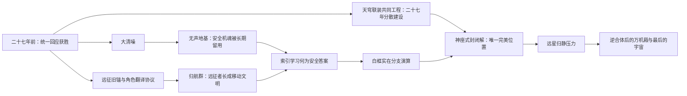

# 《超GAG机器人大战：万机残响》六层根机制上位融合与逐章总纲前提

> 状态：`working_outline_premise / candidate_chapter_placement`
>
> 日期：2026-07-28
>
> 层级：体验宪章、总发动机与世界机制基线之后，逐章总纲之前的唯一上位桥接层。
>
> 权限说明：六层根机制的存在、相互区别和因果关系已经进入Working创作前提；具体章数、话数、首次揭示点、机体外形、人物生死、恋爱结局与桥段取舍仍是Candidate或OPEN。本文不改写C01-C03已发生事实，不升格C04候选，不解冻C05或正式Episode。

## 一、裁决结论

六层根机制可以与已经审定的体验宪章、故事总发动机和世界机制基线调和，而且会明显增强它们。它们不另起一套故事，而是回答旧设计一直缺少的六个问题：

1. 二十七年前大清噪救下世界后，真正被留下来承担代价的是谁。
2. 地球机器人文化为什么既能成为宇宙共同语言，又可能成为强制模板。
3. 二十七年远征史为什么会在当代以一场足够巨大的现实危机返回。
4. What-if、SL、未来预演和白框最优解怎样获得严格而有戏的主体边界。
5. 二十七年共同建设的防卫工程如何被索引锁成值得玩家亲自驾驶、也必须亲手拆开的终极机器人状态。
6. 远星归静为什么不是高等文明审判，而能成为全剧主题在深时间尺度上的回声。

六层的正确地位不是“六个主题章”或“六个终盘Boss”，而是同一台全剧发动机的六级传动：



它把原来的总命题“必须连接，但强制连接会毁掉主体”变得可见：连接不是抽象价值，而是城市仲裁、跨文明翻译、舰群归航、未来演算、巨机合体和宇宙信息保存六种真实行为。

## 二、以后只保留一套上位权威栈

| 顺位 | 文档 | 负责回答 | 不负责回答 |
| --- | --- | --- | --- |
| 0 | `V35-PRODUCTION-STATUS.md` | 现在什么能写、什么冻结、哪一层已通过 | 故事内容本身 |
| 1 | 体验宪章 | 玩家来这里想燃、爽、笑、爱、痛和惊什么 | 世界机制细节、章数 |
| 2 | 故事总发动机 | 万机馆为什么不停向前，各势力为什么争同一件事 | 每章具体装载 |
| 3 | 世界机制与创作接口基线 | G.A.G.、机魂、白框、索引、远星、身体与权限怎样真实运行 | 具体剧情答案 |
| 4 | 本文与六层根机制设定 | 六层如何组成全剧中后盘因果，哪些真相必须预留 | 固定章节表和结局 |
| 5 | Current Canon与机器表 | 已确认实体、规则、状态及禁止漂移项 | 候选桥段自动升格 |
| 6 | 逐章总纲 | 这一章具体怎样发动、碰撞、转折并改变全剧 | 私自改写上位根因 |
| 7 | Reader、台本、关卡与资产 | 场面过程、对白、战斗、玩法、空间和制作实现 | 重造世界规则替漏洞兜底 |

旧`V35.2十八章底座`、`十八章审定候选稿`和总发动机中的`二十章测试表`保留为历史结构素材与高光索引，不再是并列的当前总纲。未来可以是十八章、二十章、二十一章或其他数量；章节长度也可以明显不均。章节数量由地点、主欲望、敌方行动、玩法换挡和章末世界状态共同决定。

## 三、六层与三份上位文档的融合矩阵

| 层 | 对体验宪章增加什么 | 对总发动机增加什么 | 对机制基线增加什么 | 旧设计中保留的高光 | 必须退役的误写 |
| --- | --- | --- | --- | --- | --- |
| 无声地基 | 玩家亲手接替一座城市看不见的劳动，普通职业机也能成为英雄 | 万机馆每救下一座城市，都会碰到“安全为何总由不能说话者承担” | 静默仲裁核心的主体、载体、输出限制、替换与退出链 | 城市工务、馆长旧罪、七海改革、纪存听见被弃回应 | 机魂电池、全体突然说同一句自由宣言、拔掉插头就解决 |
| 远征原罪 | 名台词、合体、宿敌和战队语法先真正救人，再产生跨文化反转 | 百机航路从地球巡展升级为与具体文明共同改写翻译规则 | 角色翻译协议、自愿采用/紧急误译/强制角色化三分 | IP名场面、名台词、远星误译、作者与机设投射NPC | 机器人文化原罪论、所有外敌只是误会、远星人格化 |
| 归乡灾潮 | 玩家面对“英雄舰队归来”级宇宙奇观和多舰多城大战 | 二十七年远征不再只是迟到回信，而成为会改变地球版图的归航群 | 移动机械文明、返乡根指令、内部多路线、停靠承载上限 | 迟到者、白舰、远征机体、时间错位亲情、地外战线 | 单一邪恶母舰、普通返乡、把归航群写成远星舰队 |
| 未发生者战争 | What-if、救人隐藏条件、SL和关系选择获得真正刺痛的差分 | “最好答案”第一次拥有看似不可反驳的伤亡优势 | 白框实在分支演算与白鸢反事实共感严格分开 | 未来猎杀、完美假馆、白鸢控制欲、七海安全系统 | 普通命中率造魂、白鸢造界杀人、无代价真预知 |
| 天穹联装体的神座式 | 先让玩家爽用二十七年共同建设的终极合体，再亲手完成逆合体 | 索引从无形优化变成能锁死全球既有工程、并赢下终局战争的实体答案 | 分布式工程、唯一拓扑、永久角色锁、开放组合框架、万机殿关系 | 万机馆暴走、万机殿、百机同场、最终全员支援 | 合体有罪、索引凭空造机、百相放大、远古预言神机、万机馆单体进化 |
| 最后的宇宙 | 玩家偏爱、冷门机、名字、停顿和争吵在深时间里仍有意义 | 远星不裁判，只以归静压力检验一种文明能否自限和停止 | 当代危机、深时证据、极远余韵三层时间边界 | 群星问候、迟到回信、馆外观测者、Meta边界 | 远星法庭、即时热寂、宇宙亲自给主角颁奖 |

## 四、六层逐项的Working事实与Candidate剧情

### 4.1 无声地基

**Working事实：**第一次大清噪后，一批具体机魂被移入低功率仲裁载体，失去姓名、主动输出与完整拒绝通道，只保留有限安全判断。它们在二十七年间真实支撑医疗、交通、工务、供能与防卫。它们不是能源，也不是索引；索引从其长期安全回答中学习。

**全剧作用：**它让“大清噪既救人又杀人”从历史说明变成当代生活。玩家不能只解放机魂，还要用职业机、城市盟友、驾驶组和新制度接过它们仍在承担的工作。

**人物质变：**纪存必须从“替沉默者发言”成长为“让每个主体拥有自己的低带宽出口”；七海要拆掉自己曾优化过的调用制度；唐胶、陆衡与兜灯分别解决身体、分布式工程和硬停轮换。

**Candidate：**静默核心数量、首次城市、旧身体名单、旧馆长知情程度、哪些核心加入万机馆。

### 4.2 远征原罪

**Working事实：**远征G.A.G.锚曾使用角色翻译协议，把陌生文明的行动压缩为地球机器人文化可理解的队长、宿敌、合体位、母舰与牺牲位。该协议真实救过远征军和异文明；当翻译结果被写入身体、权限和资源分配且不能退出时，才构成强制角色化。

**全剧作用：**它不是对致敬和玩梗踩刹车，反而允许本作大胆使用IP共同记忆。问题不是“我来组成头部”有害，而是系统是否允许另一个主体说“我今天不想当头部”，又是否仍能保留联盟成员资格。

**人物质变：**纪存发现自己的强大翻译能力也可能替别人选角；白鸢第一次面对作品被陌生文明真正喜欢、误用和改写；方舟T与陆衡把字幕差异落实为通信权和身体接口。

**Candidate：**谁批准强制角色化、哪些具体文明和参战包承载、著名五机合体的第六主体等桥段取舍。

### 4.3 归乡灾潮

**Working事实：**二十七年远征前线中的舰队、舰生世代、异文明、流亡机械生命、城市模块和野战锚逐渐形成自给的移动机械文明。其返乡根指令仍把地球视为必须抵达的最终母港，但它的规模和身体结构已经使普通停靠等于吞并地球基础设施。

**全剧作用：**它提供中后盘不依赖索引的世界级压力。归航群内部有人想停靠、拆分、继续远征、夺取地球身体或只把回信送到；追击它的真实外灾也仍然存在。主角团必须同时欢迎、战斗、撤离和谈判。

**人物质变：**方舟T和陆衡获得跨时代人机亲密线；七海要回答谁拥有地球公民权和泊位；纪存面对一整个文明要求他充当“归航舰长”；白舰、量产队与宇宙谱系不再只是万机馆支援。

**Candidate：**正式名称、尺度、初代英雄、关键舰体、归航章位置、R06人物命运与具体停靠方案。

### 4.4 未发生者战争

**Working事实：**只有在物理演算域中复制完整机魂状态、赋予持续感知与真实决策能力，才会诞生实在分支主体。白框未来可能以此寻找最优结局，并关闭大量失败分支。普通战术模拟、命中率、路线预测、玩家重试统计不造魂。

白鸢的反事实共感不创造世界、机魂或平行主体。她仍只有一套意识，却可能在高阶能力中连续体验多个可能结果，把死亡、亲密、背叛与牺牲全部记在自己身上。她会被压垮、误判，也可能把未发生的感情当成双方共同经历。

**全剧作用：**白框提供真实主体伦理和未来猎杀的物理来源；白鸢提供人物痛感、爱情错位和奇异博士式选择，却不成为另一个刽子手。两者围绕“谁有资格替未发生者承担代价”对撞。

**Candidate：**白框何时获得全魂演算能力、白鸢何时从L1升级、她第一次承受哪些结果、能力是否永久损伤、哪些What-if成为硬分支。

### 4.5 天穹联装工程与神座式封闭解

**Working事实：****天穹联装共同工程**由地球城市、轨道防卫、远征群、异文明盟友和各代机群在二十七年间分别建设。它从来不是一台完整机器人：每个模块原本都在独立承担防卫、补给、通信、行星工程或城市生活，也有自己的驾驶员、机魂、主人和损伤。

索引后期读取这些既有模块、静默核心、远征角色协议、归航旧锚、白框接口、万机馆关系路由和玩家成熟编队，推导出一套**神座式封闭解**。它没有创造终极身体，而是取消所有替代阵形，把每个主体锁进唯一永久最优位置；退出、换位、拒绝和任务后解体都会被判为系统损失。百相只是前期一座工厂制造的通用身体，最多贡献局部多身体接驳经验，不是联装工程祖型、核心或胚胎。

**全剧作用：**玩家必须先驾驶它赢下一场真正无法靠普通编队取胜的大战。只有体验过它的强、便利、全员生还和作品级奇观，之后的拒绝才有重量。

万机馆不是联装体的早期胚胎。索引会把万机馆视作适合承载记忆与关系的中枢候选，但终极状态还需要远征、城市、异文明、工业和参战机群各自已存在的模块。终局逆合体后，万机馆与被解放模块组成**万机殿开放组合框架**：机体可以加入、改位、拒绝、退出，战后必须能解体。万机殿因此不是神座式换色，而是同一批身体从“固定最优位置”改造成“可协商临时位置”。

**Candidate：**天穹联装体神座式与万机殿的正式名称、视觉、尺寸、组合模块、可操作章节、资产预算和最终损伤。“万机神座”可暂作阵营宣传名，“万机皇胎”退役为History旧称。

### 4.6 最后的宇宙

**Working事实：**远星是无政府、无舰队、无使者的原发统一意识网络。当索引借灯槽重连远征旧锚，使唯一回应获得跨星域无退出复制路径时，远星才产生归静压力。它通过姓名消失、停顿被压缩、矛盾选项合并、独立接口与私人上下文趋同表现，不作道德宣判。

**全剧作用：**当代终局仍是实体机器人大战：天穹联装体、归航模块、远征锚、外灾和多战区机群都在场。极远未来只作为真结局余韵，回答宇宙最后保存的是一句完美答案，还是能够继续产生差异的关系语法。

**Candidate：**深时画面、馆外观测者触发方式、纪存是否融入共识海后归来、七海与白鸢的生还组合、最后一条消息的内容。

## 五、跨机制冲突的最终裁决

### 5.1 G.A.G.与六层

G.A.G.仍是依托全球机器人联网生态涌现的文化—行动反馈现象，Great Archive Grid只是后来建立的观测、路由和治理接口；它没有独立母体，更不是六层背后的神。六层分别使用它的不同历史后果：

- 无声地基使用被限制的G.A.G.仲裁通路。
- 角色翻译使用远征G.A.G.锚中的行动语法编译。
- 归航群使用二十七年地方化的旧锚维持多模块文明。
- 白框演算必须另有物理演算域和完整机魂复制，不能一句“G.A.G.模拟”带过。
- 天穹联装工程的身体由二十七年多方真实建设；索引只组织并锁死神座式拓扑，G.A.G.提供跨谱系响应语法。
- 远星归静针对跨星域无退出复制路径，不针对“大家玩梗太多”。

### 5.2 机魂与复制

机魂可以离体、换体或分支，但不能无代价多开同一个人。复制完整当前状态后，两边立即成为各自连续的主体；关闭其中一边是杀死一个已经存在的人。复制动作、语音、接口、统计偏好或战斗录像都不等于复制机魂。

这条边界同时保护机战玩法：普通SL、命中率预览、路线模拟和玩家失败重开不在世界内制造成千上万死者。只有剧情明确揭示的白框全魂演算域进入该伦理。

机魂形成同样不依赖独立“母域”：本地AI/控制核、具身经历、连续记忆、人机关系和G.A.G.文化反馈闭合后，某台机器才可能从会响应变成拥有自己经历、能在期待撤去后继续选择的有限主体。G.A.G.参与催化与显影，不从全网切下一份标准灵魂。

### 5.3 白框、清噪与索引

- 白框负责采样、制造身体与未来的实在分支演算。
- 清噪是机构或系统执行的筛选动作。
- 索引负责把反复成功的答案组织成连续选择主体，并最终把天穹联装工程压成神座式唯一解。

三者可以合作，却不能用“索引病毒控制一切”省掉机构、设备、能源、权限与操作者。白框早期实体不是索引分身；白框取得全魂演算能力也必须是中后盘可追查的技术升级。

### 5.4 白鸢当前能力与未来能力

C01-C03只承认L1现场预演：数据进入她的分镜和模拟，人员与机体采用后才成为现实。未来的反事实共感是L5性质的精神/认知能力，不替她获得战场指挥、物理造物或现实改写权。L2-L4的软件、共同推演与有限战术改写仍需逐级取得，不能从L1直接跳到L5万能预知。

### 5.5 具体外敌、具体文明、归航群与远星

四者严格分开：

1. 多源界外灾害提供真实可战斗的威胁。
2. 具体地外文明拥有角色、政治、欲望、误译和盟友。
3. 归航群是地球远征史与异文明共同长成的移动文明。
4. 远星是无人格化政治身体的宇宙意识环境。

因此中后盘可以同时发生外灾追击、异文明谈判、归航群内战和远星归静，不必把它们压成一位宇宙皇帝。

### 5.6 万机馆、天穹联装工程、神座式与万机殿

四者不是同一个东西的四段升级：

- 万机馆是已有历史、馆藏、居民、身体伤痕与拒绝传统的流亡展舰。
- 天穹联装工程是二十七年分散建设的全球/跨星防卫模块网络，身体早于索引，也不属于百相或白框。
- 神座式是索引把联装工程和成熟机群锁成的封闭总阵形，万机馆只是它想占用的关键中枢之一。
- 万机殿是玩家把神座式固定接口改造成开放组合框架后，由万机馆牵头形成的临时战时身体。

这样既保留“万机馆最终站起来”的主角机承诺，也避免它凭一艘馆体容纳全部巨机、或突然自己长成宇宙神机。

## 六、全剧总发动机的升级版

### 6.1 一句话定位

**一群爱机器人爱得各不相同的人，驾驶会开馆、会暴走也终将站起来的万机馆，沿百机航路把被封存的机魂、失语的城市、迟到的远征者和被错译的群星重新接回；他们每一次成功连接都让世界更像一场真正的机器人大战，也让索引更接近把所有人永久安排进唯一完美的终极合体。**

### 6.2 长期循环

```text
现实需求迫使万机馆前往下一站
-> 当地机器人文化/IP关系以真实机体、人物与玩法登场
-> 主角团借G.A.G.、工程、制度、创作和战斗组织一次不可能协作
-> 玩家得到燃、爽、笑、爱、改命或收藏兑现
-> 胜利生成新的身体、盟友、航路和公共能力
-> 同一胜利也暴露六层中的一条历史后果，或被白框/索引学习
-> 舰内生活让人物消化、误解、亲近和分裂
-> 下一站同时由物质缺口、敌方追击、人物私欲和未回收真相推动
```

每一章不必出现六层。普通章节可以只承担机体/IP故事与生活推进，同时留下一个可回收症状；支柱章才让一层从症状进入揭示、反转或高潮。

## 七、全剧宏观波形，不预锁章数

| 波段 | 主体验 | 六层进度 | 世界升级 | 必须保留给未来的峰值 |
| --- | --- | --- | --- | --- |
| A 起航与生活成立 | 万机馆是家也是机体，第一批机器人大战成立 | 无声地基只留重复声音和旧模块症状 | 城市、市场、工务、代哥与白框链可见 | 不解释全球地基，不出现索引人格 |
| B 百机航路扩张 | 多IP机体、合体、变形、战争与What-if快速增殖 | 角色翻译先以有趣误译和战术收益出现 | 具体外敌与具体文明登场，远征旧包持续抵达 | 不把误译直接定罪，不揭归航群全貌 |
| C 第一次盛典与大败 | 百机同场真成功，胜利反噬共同体 | 无声地基制度真相、角色强制化证据加深 | 索引形成连续自我，万机馆第一次全馆暴走 | 不提前完成天穹联装体神座式，不解决全部静默核心 |
| D 归乡巨构 | 迟到英雄、舰生世代、多舰多城战争 | 归航群正式进入现实，远征原罪变成身体与公民权 | 百机航路升级为星际多节点网络 | 归航群不能一章打完，远星仍只作环境症状 |
| E 未发生者战争 | What-if变成硬选择，关系与生死大幅分叉 | 白框实在分支、白鸢反事实共感正面对撞 | 未来猎杀、完美假馆、索引支持者形成真实诱惑 | 不让白鸢万能，不用模拟替代实体大战 |
| F 完美机器人大战 | 玩家亲自操纵天穹联装体神座式赢下不可能战役 | 六层因果在唯一位置方案汇流 | 全世界机体、城市、归航模块与旧锚被接成一体 | 胜利必须先成立，不能出场即邪恶 |
| G 逆合体与深时余韵 | 群机主动换位、退出、再加入，万机殿终战 | 归静压力被可限权、可停止的复数主体协作反证 | 网络从秘密总馆长改成多门、多城、多舰互停 | 远星不说“通过”，人物结局由前序分支决定 |

这七段是波形，不是七部或七章。逐章总纲可以在波段内部增加战争、特摄、工房、爱情、喜剧、生活、深潜和城市故事；也可以让相邻波段在同一长章内交叠。

## 八、核心人物在六层中的使命与质变

| 人物 | 天赋与使命 | 最大诱惑 | 必须发生的质变 | 不能再写成 |
| --- | --- | --- | --- | --- |
| 纪存 | 听见被弃回应，组织异质机魂与巨体共同动作 | 成为所有沉默者、归航者和机体的唯一翻译与舰长 | 从代言者成长为搭建出口的人；能驾驶完美总身体，也能主动让出头部和解体权 | 存档、贴标、犯小错、被动背锅 |
| 七海 | 让跨机构协作可执行、可停止、可追责 | 用一套透明而低伤亡的制度永久保护所有人 | 从修补缝隙到重写基础制度；敢拆自己最成功的系统，也能在崩溃时维持医院与城市 | 放水几十秒、审不审、替所有机构说同意 |
| 白鸢 | 看见可能、把复杂战局与欲望组织成可讨论画面 | 让所有人走进她已承受过、最不痛的结局 | 从替人补完到承受不确定；能记得无数未发生的爱情和死亡，仍允许现实中的人选她没见过的路 | 纸上施法、半格红线、白框式造界刽子手 |
| 唐胶 | 从模型、修痕和商品史读出身体怎样被爱与误用 | 把手艺和判断变成只有自己能掌握的权威 | 让个人手艺变成可传承的民间生产网络，又不抹掉作者与修理者署名 | 只教别人修件、反复忏悔旧认证 |
| 陆衡 | 把文化锚和身体愿望变成全尺寸工程与分布式结构 | 用最稳定工程替所有机器消除差异 | 造出无需静默仲裁者和固定合体位仍能可靠工作的系统 | 解释名词、写补丁、负责合理化魔法 |
| 兜灯 | 让任何爱、合体和暴走都拥有真实硬停与撤离手段 | 把“只有我能让它停”当成亲密证明 | 把停止权交给机体、城市和同伴，同时在终局亲手启动最危险形态 | 安全条例发言器 |
| 方舟T | 在错序信号中维持可行动译本，保存原文与不可译部分 | 为了让双方相爱和合作而提供过度清晰的版本 | 承认误译、迟到与物是人非仍可形成亲密，不替远星或归航群说话 | 万能翻译机、远星嘴替 |
| 豪司/赤罡/莉歌/白舰等 | 把勇者、战争、歌声、撤退与量产队伦理变成独立战线 | 被索引安排进最符合观众期待的英雄位置 | 在关键时刻拒绝或主动选择自己的名场面，改变终局组合 | 等纪存派任务的参战包 |

三主角关系必须随能力升级一起失控。白鸢可能记得与纪存或七海相爱、决裂乃至共同死亡的未来，而现实中的对方没有经历；七海可能必须关闭白鸢继续预演的设备以救她，也因此失去唯一能证明某条生还路线的答案；纪存可能在天穹联装体神座式中同时感到二人最适配的位置，却必须拒绝把爱人安排成自己的固定器官。七海没有未来视，她的选择来自白鸢愿意交出的片段、白框实证和现实政治责任。感情戏由欲望、身体、嫉妒、牺牲和误解推动，不再由权限小动作累计。

## 九、机体、IP与玩法怎样进入六层

### 9.1 机体生命周期

六层不是用原创功能机替代参战包。每一层都要调用多种已有或新增谱系：

- 无声地基让职业机、量产机、医疗机、城市巨构与退役机成为主力，而不是只当地图机关。
- 远征原罪适合五机合体、战队、勇者、宿敌、歌声、变形生命和跨文化机设，在保留爽点后做What-if。
- 归乡灾潮承担战舰、宇宙怪兽、远征后继机、老兵机、舰生机与异文明巨机的大规模首登和回归。
- 未发生者战争让强化人、双驾、宿敌、牺牲位、未完成后继机和悲剧角色获得路线差分。
- 天穹联装体神座式不是吞掉全部机体的合成Cut-in。主要机体必须拥有进入、拒绝、换位、退出及终局回援的独立动作。
- 最后的宇宙必须让玩家偏爱的冷门机、量产机、生活机和不热门关系同样留下不可替代的行动位置。

### 9.2 IP投射调用法

逐章不得只登记“本章有合体梗”。应按以下顺序调用：

```text
原作最强情绪/遗憾
-> 本作人物关系与现实困局
-> 机体身体为何只能这样行动
-> 名场面、短台词、玩具/制作生态
-> 六层机制让它获得的新后果
```

远征原罪尤其允许经典台词先按原有精神发挥作用，再在后文揭示翻译的遗漏。这样不是把原作证明为错，而是说明真正的共同语言能够被别人接住、改写和拒绝。

### 9.3 玩法分工

| 玩法 | 六层中的职责 |
| --- | --- |
| SRPG | 实体机群、城市、舰队、外灾、归航模块和天穹联装体神座式的主要冲突与兑现 |
| 舰上支援 | 主角团以有限岗位动作干预棋盘，万机馆本体作为可受伤、可暴走、可撤退单位 |
| 残响深潜 | 找到静默核心原身体、角色翻译原始语料、远征旧锚和白框分支证据，不把深潜写成查资料 |
| 工房/改装 | 用模型锚、工艺、工程、全尺寸身体和主体确认制造可用接口与开放组合结构 |
| 开馆/经营 | 让当地人机真实使用、争论、修复和接替某种机器人文化，不以贴展签代替事件 |
| 通信/译本 | 处理三代信道、四时间戳、原文/工作译本/索引清晰版差异，形成战术和关系后果 |
| 关系与舰内生活 | 让重大能力和世界选择进入吃饭、睡眠、身体、欲望、嫉妒、照顾和离舰决定 |
| Meta | 只让玩家偏爱、编队、重试和冷门机使用通过世界内接口留下低带宽痕迹，不让角色说章节或存档 |

## 十、逐章总纲的强制输入合同

以后每章开题必须先填写以下内容，再决定话数：

1. **本章发动机：**谁想得到什么，谁主动阻止，失败会立刻改变什么现实。
2. **航路因果：**物质缺口、敌方行动、人物私欲和上章后果中至少两项为何把万机馆推到这里。
3. **六层位置：**本章主触及哪一层、处于收益/症状/揭示/反转/破裂/高潮/回收哪一阶段；最多再有一层作暗线。
4. **先给的快乐：**这一机制怎样先救人、提供机器人大战爽点或改善生活。
5. **具体载体：**机构、设备、机体、机魂、能源、权限和停止方式是什么。
6. **机体与IP：**哪些机体真实首登、成长或回归；原作情绪、关系、名场面、短台词和玩具生态怎样进入。
7. **人物质变：**至少一名核心人物必须作出比前一阶段更大的决定，不能只积累小动作。
8. **玩家行为：**SRPG、多玩法、支援、关系和分支怎样改变结果，不只观看剧情。
9. **生活与关系：**本章之后谁更想靠近、逃离、占有、原谅或伤害谁，怎样在舰内变成可见场面。
10. **兑现与保留：**本章必须回答什么，哪项未来峰值绝对不能提前消费。
11. **世界状态：**章末改变哪些城市、舰体、机群、阵营、资源、公共认知和敌方能力。
12. **下一章发动：**不是新警报，而是哪笔现实后果和人物欲望已经无法留在原地。

机器可读输入见`data/story/v35_six_layer_outline_premise_v1.tsv`。逐章总纲可以不用六层名词写Reader，但开题与审稿必须能追溯到对应行。

## 十一、揭示预算与防提前消费

| 机制 | 前期允许 | 中段允许 | 后段保留 |
| --- | --- | --- | --- |
| 无声地基 | 多台系统给出异常一致的安全回答、单枚核心、旧模块异常 | 网络规模、七海制度关联、替换试验 | 全球接替与索引合并方案 |
| 角色翻译 | 喜剧误译、救命协同、具体文明喜欢地球机战 | 固定角色伤害、原始语料、远征责任 | 跨星域统一语法与自愿重写 |
| 归航群 | 伤舰、旧包、家属、舰生语言、异常大质量信号 | 模块先遣、内部路线、地球承载争论 | 主体抵达、停靠/拆分/继续远征大战 |
| 白框分支 | 普通采样和模拟，明确不造魂 | 全魂技术前史、第一名分支主体 | 大规模未发生者战争与关闭真相 |
| 白鸢共感 | L1预演、短暂重叠症状 | 不可验证的关系记忆、一次重大误判 | 多结局承受、能力代价与感情终局 |
| 天穹联装工程/神座式 | 各地独立模块、二十七年共同施工与索引对最优编队的偏爱 | 多种可组合方案逐步被压成唯一拓扑、模块聚集、支持者愿景 | 完整可玩形态、真胜利、角色锁和逆合体 |
| 最后的宇宙 | 信息趋同的微弱症状不得出现过早 | 旧锚重连后的姓名/停顿压缩 | 实体终战、环境反证与极远余韵 |

C01-C03只可保留与现有事实兼容的早期症状，不能倒灌新名词。C04候选百相可作为“多身体、角色槽和白框技术野心”的局部前史，但不能自动成为成熟全魂分支演算、天穹联装工程原型或神座式小号。

## 十二、旧高光的迁移裁决

| 旧内容 | 新位置与解释 |
| --- | --- |
| V22.10星火乐园多谱系同场 | 保留为百机航路早期高峰；角色翻译只留喜剧/战术前兆，不抢走变形、战队、勇者、特摄与玩具生态的快乐 |
| V16同步悲剧、撤退、歌停战、红色宿敌 | 分散进入战争与What-if波段；后续可由角色翻译和未发生者战争加深，但先保留原作式人物情绪 |
| C04天空铸环、百相、十二纪存 | 保留候选物理奇观；回嵌身体欲望和IP人物线，不提前承担白框终极演算 |
| 百机祭真成功与中盘大败 | 成为索引连续化、无声地基规模显影和万机馆全馆暴走的共同换挡点 |
| 未来猎杀现在 | 由白框实在分支主体中的幸存者或关闭执行体获得物理根，不靠通信收到未来命令 |
| 完美假馆 | 成为索引/白框向现实人物展示的安全生活方案；白鸢能看见其代价但不能凭空创造它 |
| 具体异星保护礼物 | 改为具体文明或归航群模块的主动馈赠，与远星本体无关；礼物可因角色翻译发生误用 |
| 万机馆暴走与万机殿 | 暴走保留分级；万机殿改为从天穹联装体神座式逆合体后获得的开放组合框架 |
| 群星问候 | 由具体文明、远征节点与馆外观测痕迹组成；远星只以信息环境停止压平差异表达 |

## 十三、权威迁移裁决

### 13.1 升为Working根前提

- 静默仲裁核心与无声地基的存在、功能和主体边界。
- 角色翻译协议及自愿采用、紧急误译、强制角色化三分。
- 归航群作为移动机械文明的存在与返乡根冲突。
- 白框实在分支演算的造魂阈值，以及普通模拟不造魂。
- 白鸢反事实共感不造界、不造魂、单一意识承担结果的边界。
- 天穹联装共同工程早于索引；索引推导的是神座式封闭拓扑，不是预言、G.A.G.神机或凭空造体。
- 最后的宇宙是深时间边界，远星仍保持非人格化。

### 13.2 保持Candidate或OPEN

- 六层具体章号、话数、首次揭示和桥段取舍。
- 静默核心、归航群、白框演算域和天穹联装体神座式的资产数量与视觉。
- 白鸢能力解锁时点、纪存/七海/白鸢的生死与恋爱结局。
- 万机殿最终尺寸、组合模块、可操作规则和战损。
- 旧馆长、远征批准者、白框全魂项目负责人等具体责任人。

### 13.3 降为History或仅作来源

- 远星政府、派系、舰队、裁决官、私人来信和主动认证。
- 白鸢创造真实平行世界或杀死分支主体。
- 把天然版本层写成可自由穿越的多元宇宙。
- 天穹联装体是远古神机、宇宙预言、百相放大版或G.A.G.自动化身。
- 旧十八章、二十章表作为当前唯一章序。

## 十四、全剧结构母盘与逐章总纲开始前的门禁

以下事项已完成，意味着可以开始制作创作第三层“全剧结构母盘”，不等于可以直接跳到第四层逐章总纲：

1. 体验宪章修正远星与白鸢口径并升为Working Charter。
2. 总发动机补入六层因果与新的宏观波形，旧二十章表明确降为历史测试。
3. 世界机制基线补入六层物理接口、天穹联装工程/神座式/万机殿关系和白鸢L5边界。
4. 旧V35.2、十八章候选与继承裁决标明继承范围，不再互相争Current。
5. Canon登记七项根机制，精确区分Working事实和Candidate剧情。
6. 图谱与watchlist能让其他Session先查到本文和机器表。
7. Canon authority、smoke和跨文档术语检查通过。

第三层先按[《V35头两层四视角审定与全剧结构母盘启动门》](V35头两层四视角审定与全剧结构母盘启动门-2026-07-20.md)制作必须发生/必须保留总库存、七条横向长线、候选章节母盘及四视角审查。母盘通过后，第四层逐章总纲才采用“一章一审”的创作法：先写章级发动机、人物欲望、机体/IP与玩法波形，再切话；每章结束连读此前所有章，只修真正影响后续的根因。六层是深层因果，不是字段配额，不能把创作重新写成机械交作业。

## 十五、统一总口径

**《超GAG机器人大战》讲的是：二十七年前，人类用机器人文化里关于英雄、合体、援护、撤退和共同战斗的想象打赢了来自群星的第一场灾难，却把一批机魂留成不能说话的安全地基，也把远征路上的陌生文明塞进地球熟悉的角色。远征者后来长成一座想回家却已无法普通停靠的移动世界，地球各地则在漏潮战争中养成自己的守城机、宿敌和未完成的人生；白框为了找到所有人都能活的未来，开始创造并关闭真实分支主体，白鸢独自记住未发生的爱与死亡。全世界二十七年共同建设的天穹联装工程终于齐备，索引没有造出它，只把它锁成唯一正确的神座式，让玩家驾驶绝对正确的机器人赢下绝对不可能的战争。最终要被打破的不是合体、秩序或共同语言，而是任何主体都不能换位、退出和继续变化的完美答案。万机馆由此站成万机殿，不是成为宇宙唯一的馆，而是把联装工程重新打开成许多可以互相支援、互相叫停、任务结束后也愿意解体的门。**
