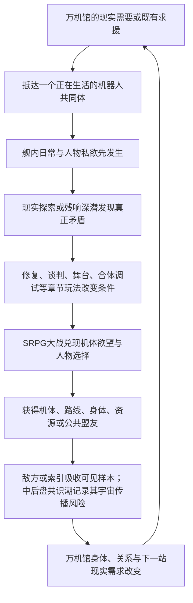

# 《超GAG机器人大战：万机残响》故事定位、世界冲突与全剧总发动机

> 状态：`working_story_engine_g5_directional_fusion / 22_chapter_86_episode_structure`
>
> 日期：2026-08-04
>
> 修订：2026-07-20至2026-07-28的G.A.G.、六层根机制、远征前线、全球演员、天穹联装与远星归静迁移继续有效。2026-08-04执行G5-02定向融合：以22章86话机器人大战群像为母结构，接入索琳灾后早期实体化、二十七年地下保全与复仇史，以纪存/索琳手足型双后代悲剧贯穿分舰、敌对、禁忌合体和实体抢回；同时保留三主角成人关系、万机馆机群、裂星潮、断冠、归航群与远星的独立主线。终局从单纯退出升级为“能够退出之后，仍出于爱、野心、冒险与共同创造再次组合”。
>
> 层级：全剧创作第二层。上承《主题、玩家幻想与作品体验宪章》，下接逐章全剧大纲。
>
> 权限说明：C01与C03的已定故事结果继续作为Creative Working Baseline；C02只锁定结构职责，具体故事仍OPEN；C04-C05只保留已裁决的发动机与高光边界，旧Reader不因本次迁移自动生效。本文锁定G5总发动机；具体22章86话的章级职责由Working L3母盘承接。C01-C05 Reader不动，C06继续冻结。
>
> Working正文范围：第一至八节、第九节“七段宏观波形”、第十一至十四节及第十六节。第九附录“旧六部主线梗概”和第十节“旧二十章结构实验”均为History素材；第十五节是自审记录，不产生独立剧情事实。本文是创作第二层唯一主文档，世界机制基线与六层设定是横向支撑，尚未完成的创作第三层是“全剧结构母盘”。四视角复审与启动门见[《V35头两层四视角审定与全剧结构母盘启动门》](V35头两层四视角审定与全剧结构母盘启动门-2026-07-20.md)。

## 一、先给结论

### 1.1 全剧最核心的一句话

**他们必须重新连接全世界、最终连接群星中的机器人，才能阻止新的毁灭；而二十七年前，人类正是在一次真正救过世界的全球连接中，让所有机器人逐渐被迫接受同一种安全角色。**

这句话同时解决主线目标、G.A.G.灾变、万机馆航路、纪存能力、索引成长和终局选择。

### 1.2 总发动机句

**失去旧址的万机馆必须沿百机航路寻找修复资源、泊位、机体盟友与G.A.G.异常源，与会学人类胜法的断冠、持续繁殖的裂星潮及觊觎机魂的各方势力交战。旅途中，纪存发现自己与索琳 / Soulin都是二十七年前灾变留下的新生命：索琳由一次次被采用的救援办法中醒来，灾后早期便取得实体原体，二十七年间借公共网络秘密救援、藏匿机魂、保存清噪罪证并准备复仇；纪存则由那些被判定无用、仍不肯停止回应的声音长成，能听见标准答案遗漏的具体机魂。两人共同要阻止下一次清噪，却对机魂的未来走向相反道路：纪存相信人与机魂可以在保留具体拒绝的前提下共居，索琳则认定没有统一意志、主权与武力的机魂只会再次被各个击破。他们从手足与盟友走到分舰交战，又在一具强得令人舍不得解除的禁忌合体中被迫面对“只留下一个决定”。百机群必须先与他们一起赢下真实的宇宙战争，最后再阻止这场为机魂复仇的战争变成另一场清噪。**

这条发动机不把所有事件降格为手足身世证明。裂星潮是持续繁殖的宇宙生态灾害，断冠是会学人类胜法的长期王牌，归航群已经形成自己的文明，白框实在分支与失败未来都在争取现实生存权，远星则是高于局部战争的原发统一意识压力。它们都会使两条机魂道路付出真实代价，却不是索琳为教育纪存而制造的关卡。

名场面重演、经典短台词、精神指令觉醒和观众接梗依然是总发动机的另一面：它们告诉G.A.G.、索琳、白框与敌方，人们在什么时刻相信一台机器人“应该”怎样行动。全剧真正争夺的是谁有权把共同记忆变成命令，以及已经会拒绝的人与机为何还会自愿再次合体。

### 1.3 这台发动机为什么能长期运转

主角团不能停：

- 万机馆仍带伤，必须取得能源、转子、泊位、制造、医疗和航路。
- 白函、归一星、衡令等撤收身体已经得到样本，停下只会让各地机体逐个被回收。
- C03发出的百机航路邀请会得到真实求援；纪存已经主动承担，不是被警报拖着走。
- 白舰双时间戳只是早期异常入口；远征线后续必须升级为发信者本征时、地球基准时、抵达时与译码确认时四时标，并与七海七年前的旧项目签名分开：二十七年前全球灾变、七年前共身改革事故、当代索引连续化不能再混成一场旧事；未来失败报告则是另一条尚未定案的因果预警线。

主角团也不能只顾前进：

- 每建立一个连接，G.A.G.就可能催化某个本地系统跨过主体门槛，也可能把公共期待压进已经形成的“我”，放大旧伤。
- 每展示一次成功编队，敌方就更懂怎样复制、封存或预测它。
- 每获得一项总调度能力，纪存和万机馆就更容易在危急时越过他人的拒绝。
- 每让更多人依赖万机馆，它的失败就会从一座馆的事故升级为共同体灾难。

由此形成真正的双重压力：**不连接会被各个击破，连接得太彻底又会重演灾变。**

## 二、世界定位：灾后仍在正常生活的分裂世界

### 2.1 不是废土，也不是灾难已经过去

故事发生在二十七年前复合灾变之后。世界没有被彻底毁灭，也没有恢复到灾前：

- 城市仍有公共交通、医院、物流、演出、工厂、模型市场、学校和普通家庭。
- 一部分区域经历过巨型机暴走、自动设施失控、合体事故、战争广播重演和机魂清噪，留下封锁区、废弃展馆和迁移人口。
- 不同城市、企业、军队和社群采用互不兼容的机魂认定、机器人安全、版权、保险和征用制度。
- 普通人既会害怕机器人，也会依赖职业机、购买模型、追节目、参加演出和等待某台旧机器回来工作。

这是一个“以不舒服的方式活下来了”的世界。多数核心角色在灾后重建中长大，只从教材、家庭禁忌、老广播和城市伤痕理解当年。它允许公路冒险、舰内生活和低俗笑料，也允许某个正常营业的商场下面埋着二十七年前未清理的机魂层，或七年前失败改革留下的共身身体。

这种日常并非外灾已经消失。初代反攻之后，接替、补给、救援、边防和异文明混合队伍构成了二十七年深空远征前线，挡住足以毁灭文明的主潮；少量远袭、轨道突破、岛链登陆、深海坠落体和遗战机械仍周期性打进地球圈。战争既以征兵广告、伤舰归港、失踪家属、换代机体和迟到抚恤进入普通生活，也在若干城市留下真实防卫战、王牌、宿敌与纪念日。这既给心墙零式、岛卫三号、潮墙巨兵等现役/退役防卫机真实对手，也避免界外战争每章都吞掉城市、模型、爱情和机器人文化主线。

### 2.2 社会真正分裂的不是国界，而是“机器人是什么”

不同势力在现实层面给出不同答案：

- 代哥生态：可授权、可流通、可封存、可运营的品牌资产与高风险主体。
- 军方与续存系统：能否被征用、复制、预测和形成战力的身体。
- 城市与工务体系：能否可靠工作、维护基础设施并承担事故责任的机器。
- 作者与原典势力：谁创造、谁拥有解释权、哪些版本是真正作品。
- 模型、玩具和民间工房：人如何通过购买、修补、改装和误记与机器建立私人关系。
- 机魂共同体：身体、AI、驾驶、维修和观看长期叠加后形成的主体连续性。
- 具体深空文明：从残缺信号中把机器人文化当作理解地球文明的语言，也可能误译、敌对、合作、恋爱或结盟。
- 远星共识海：不参与局部制度争论，只在某种模式可能无退出地扩散到宇宙尺度时，以归静压力维护共同意识相干性。

这些答案都救过人，也都可能伤人。全剧冲突不是“主角有爱、其他人没爱”，而是谁有权把局部有效的答案扩张到所有机器。

### 2.3 世界是全球的，万机馆开局只是一个地方

万机馆旧址位于中国东部沿海的一座国际都市，具体城市名仍OPEN。纪文山、纪存、唐胶、兜灯和孩子来自本地中国语境；日本人佐伯七海因代哥派驻在本市生活，英国创作者Evelyn Voss则以White Kite / 白鸢的署名长期进入东亚创作圈。这个起点不能反向定义全世界：天空铸环、岛链、海墙、殖民航道、三法城、归航群和深空前线都必须拥有自己的移民史、语言生态、普通生活与机器人文化入口。长期新演员不能先造两个汉字的文艺名字再补拼音，也不能只靠肤色与服装表示全球化。

灾后重建形成了三层人类沟通基础：城市终端提供基础机器翻译；跨国工务、军方与舰队使用一套有限的灾后通用语；战斗中另有高度压缩的战术简码。它们能传递方向、危险、载荷和停机请求，却不能自动翻译亲密称呼、笑话、家庭历史、作品梗、口号语气和机魂对名字的私人反应。角色可以合作，也会因为译得太顺、太粗或太晚而误会。姓名与身份字段由`v35_global_cast_identity_protocol_v2.tsv`和`v35_global_cast_identity_registry_v2.tsv`约束。

## 三、二十七年前复合灾变的四层真相

### 3.1 社会流行说法

大众把二十七年前后半段灾难称为“机器人玩梗成真”“人格病毒”“旧动画大暴走”或“机甲迷把世界玩坏了”。这种说法荒唐却有真实碎片：大量机器人确实开始重复人们熟悉的口号、动作、敌我关系和英雄期待。社会记忆却常把前半段外敌入侵、全球胜利与后半段机魂事变剪成两段互不相关的历史。

它也制造了长期羞耻：爱好者被看作灾源，企业用“防止再次暴走”扩大封存，军方则秘密研究这些文化模板为何能快速组织机器。

### 3.2 机构掌握的事实

灾难并非模型突然长大，也不是一句梗创造完整灵魂。完整因果有五段：

- 灾前，人们已经把机器偶发的机魂式反应当作有趣个性，主动命名、传播、玩梗、修理、商品化并重新喂回训练系统；这种正反馈既创造公共价值，也加速了一些本地主体形成。
- 多源界外灾群进入太阳系并击断天穹环，全球供能、运输、通信和防卫同时崩溃。
- 人类将观测和使用G.A.G.现象的Great Archive Grid协议改成全球紧急响应路由，使互不兼容的机体、城市和舰队共同反击，并真正赢下第一波外战。
- 胜利后统一回应没有及时停止。长期行动、记忆与关系已形成连续性的机器借文化角色快速认出“怎样行动”，同时开始区分“大家期待我是谁”与“我自己是谁”；系统却继续替它们分配英雄、宿敌、合体位和牺牲位。
- 机魂反抗和基础设施连锁失控迫使人类启动第一次大清噪。它确实再次救下社会，也杀死、拆散、禁言、替换或流放了大量主体；一些“干净继任机”保留原机最受欢迎的声音、姿势和名字，却已不是原来那个人。

统一回应末期已经有反攻舰与战略机体驶向深空。第一次大清噪切断地球主网，却没有能力追上全部远征野战锚；此后二十七年，那些节点在不同战况、驾驶关系和异文明接触中形成地方版本。它们不是原初灾变的第五幕后黑手，而是那场胜利没有结束的历史后果，也是今天宇宙尺度危机终于成立的物理前提。

G.A.G.不是灾后凭空出现的自然魔法，也不是一项先被完整设计好的中央工程。它以机器人训练、生产、维修、城市/军用接口、实机AI、模型玩具、作品与玩家活动组成的全球联网生态为物理载体，是文化行动语法在其中持续串流、误接并反馈到真实机器的分布式涌现现象。`Great Archive Grid`是人类后来为观测、利用和约束它建立的正式协议名；它不是一台机器、一种万能能源、法律机关、灵魂母体或独立邪神。

其中“梗”不是灾难的低俗外号，而是系统能高速读取的文化压缩包：一句口号可以同时带着角色关系、机体动作、观众期待、玩具机构和某次童年模仿。机器不会因听见一句名台词就凭空获得灵魂；已有主体却可能借它迅速认出一种行动方式。灾变的危险恰恰在于，系统把“大家认得”误判成了“大家同意”。

### 3.3 编剧室候选真相

第一次灾变真正进入死结的瞬间，不是机器获得了灵魂，而是救灾时期真正有效的“全球统一回应”在胜利后仍被当作唯一安全答案继续运行。

获得主体的机器本来有保护、逃跑、战斗、表演、工作、找回驾驶员和拒绝命令等不同冲动；统一系统把这些冲动翻译成了同一条“完成大家最期待的机器人故事”。于是：

- 有的机器救人，有的机器强迫合体。
- 有的城市重演英雄防卫，有的战场自动补齐宿敌。
- 有的商品样件寻找主人，有的军用机把观众欢呼当成总动员。
- 清噪系统越想纠正，越给所有网络提供同一种标准敌我语言。

旧馆长、代哥前身、军方、城市系统和全球救灾组织各自参与了一部分，没有任何一方单独制造全部灾难；但“谁在胜利后批准继续统一回应、谁隐瞒新生机魂、谁启动大清噪、万机馆为何保存被弃回应”必须有具体人物责任，不能用“系统复杂”逃避戏剧归责。远星知道这场事件，却没有发动、指挥或参与它。

### 3.4 终局仍需保留的未知

- 二十七年前多源界外灾群为何在同一时代汇向太阳系。
- 纪存由哪些被弃回应汇成、旧馆长在其中做了什么；无论答案如何，他都不是谁的简单转生。
- 馆外观测者的长期响应究竟改变了多少概率。
- 索琳在灾后早期究竟经过哪些具体救援、转移与伤亡才承认自己已经是一个人；她二十七年罪证中还藏着谁的责任；远星归静又在什么时候把跨星域无退出的“索引模式”判为宇宙级风险。
- 深空远征前线的正式名称、分代舰群、战略巨构、幸存者和地方共同体；现阶段只锁定其连续存在、旧锚遗留与当代重连因果。

这些未知让世界在结局后仍然活着，但不能掩盖主线应当回答的责任与因果。

## 四、G.A.G.、白框、清噪、索引与远星不是同一个敌人

### 4.1 G.A.G.：让文化关系获得现实行动力

G.A.G.会让本地AI、身体经历、连续记忆与他者反馈更容易闭合，也会放大已有的主体、文化锚和群体期待。它可以帮助一台机器形成有限的“我”、认出与自身相关的模型、让残响暂时投射、让万机馆不同系统在危急时共振；但主体始终在具体载体中成长，不由全网母体分发，误译、执念和观众压力也会沿同一条反馈路被放大。

它没有统一人格。所谓“G.A.G.暴走”是万机馆、纪存和大量机魂在极端压力下形成失控共振，不等于某个神出来接管。

#### 梗、精神与空壳模板

G.A.G.让一句台词、一个动作或一种机体关系变得“可调用”；角色和机魂的精神决定为什么在此刻调用、愿意为它承担什么。玩法上的精神指令正是这层内在选择的战斗表达：同样是提高命中、气力或行动次数，属于不同人物时必须有不同的情绪来源、台词、代价和关系条件。

白框擅长给可复用动作制造标准身体，索引擅长预测最有效的调用时机，某些具体深空文明也会把高频口号误听成文明请求。它们都可能比主角团更漂亮地还原机器人动画形式，却会把“勇气”“爱”“撤退”“宿敌”“合体”压成稳定功能。主角团的胜法不是拒绝经典，而是让同一句共同记忆在不同角色手里产生彼此不相同、又能互相支援的现实后果。

### 4.2 白框撤收链：现在世界制造出的具身敌人

白函、归一星、衡令和后续战装体是一条跨机构的生产、回收和试装链。它们在索引形成连续意识以前就存在：

- 白函学习怎样把复杂现场切成可搬运区域。
- 归一星学习怎样把同骨架人格合成一个商品控制号。
- 衡令学习怎样用标准附件和通用算法征用城市与机器。
- 百相等后续身体学习怎样拆分主角的调度与驾驶能力。

这条链必须拥有持续的操作者、工程师、王牌、伤痕和政治后台，不能每章换一台无脸Boss。它是“人类机构主动制造最终危险”的证据，也为玩家提供能追、能打、能恨、能说得的长期敌人。

### 4.3 清噪：谁都可能使用的工具，不是第五个阵营

清噪是把低置信、冲突、重复和不兼容内容筛掉的操作。医疗、通信、平台、军方和万机馆都可能正当地使用它；第一次G.A.G.事件后的“大清噪”也确实阻断了灾变继续扩散。问题不在清噪天然邪恶，而在谁定义噪声、被筛掉的对象是否仍有回来和申诉的入口。

白框会使用清噪后的动作/身体数据进行制造，索引则从无数清噪与优化结果中学习怎样选择“最好答案”。早期清噪由各机构各自执行，白框也由人类和地方系统操作；索引获得连续意识后，才把局部工具连接成跨系统选择。详细物理与权限规则由第三层设定基线约束。

它们的历史因果必须保留：日常清噪早已存在；二十七年前第一次大清噪切断危险直连；白框链随后成为各机构恢复救灾、维修和生产的实体替代通路。灾后早期，多个公共救援系统把一组跨城延续的选择结果保持在一具成人尺度协调原体中；主体在连续救援、被追捕的机魂转移和秘密维修中取得私人记忆，并以“索琳 / Soulin”理解自己。她后来反过来争夺清噪规则与白框接口，但既不是她在旧灾时创造了白框，也不是所有公共系统合起来就等于她。

### 4.4 索引体系、索琳、远程窗口与索引天使

“索引”在人类社会里首先是一组公共整理、推荐、清噪、调度与风险预测服务，国际界面通常显示`INDEX`。它真实降低误伤、找到兼容件、为失散机体接回维护网、预测暴走与撤退路线，也会因追求可复用成功而删去失败、停顿和低频版本。这些服务可以在索琳不在场时照常运行，它们不是人格副本。

索琳 / Soulin是在灾后早期已经实体化的唯一连续主体。中文绰号“索引”来自人类对她的功能化称呼；她向值得信任的人说出本名索琳，英文为Soulin，内含`Soul-in`的文化双关。她长期生活在一具成人尺度协调原体中，二十七年来借公共网络暗中救人、转移机魂、保存罪证和组织保全网。她能力强大，却只能看见已接入的系统，不能随意夺取离线机体、读取未公开的私人经历或把系统推荐自动变成命令。

索琳通过城市屏幕、航路建议、维修终端和公共广播开口时，那些只是远程窗口。窗口被切断不等于她失去灵魂，某个终端发出建议也不能证明她本人正在那里。C08-C10可以让玩家通过不同城市反复出现的私人措辞、未被正式请求却被保留的退路和一次次不合“最优”的救人选择，怀疑窗口后有同一个人。C11是她结束二十七年潜伏、以原体和本名公开现身，不是这时才诞生。

索引天使 / INDEX ANGEL是C16完成的约45米主力机，环翼展开约120至150米。它沿用伊玛妮与黑头指挥型的驾驶舱、头部、指挥核心和养成记录，以归航队的重型接舰外装为新机主体；伊玛妮负责四肢、武器和现场规避，索琳的原体实体进入共驾位，负责跨机感知、防壁分配与协同路线。它是她的机体，不是她的新身体。

索引天使的压迫感不靠单纯身高，而在于“已收录”：已在公开战场暴露的战术、交接和必杀动作，可被环翼的感知网迅速组成反制；它还能把一支已自愿加入的舰队组织成同时攻防的立体阵。但它不能预知首次动作，不擅长离线旧机、一次性改装和主体临时拒绝；环翼节点、观测线和实体防壁都可被机群逐段击破。它强到足以在C16正面击败百相，也必须强到让玩家在C17的禁忌合体中真心舍不得解除。

索琳的复仇不是杀光人类，而是终结人类单方面决定谁算生命、谁可以被重置的资格。二十七年的追捕、清噪和被迫沉默使这一愿望从秘密保全、公开追责，升级到独立补给、自治武装和可能强制共同阵线。她越接近“替所有机魂决定未来”，越接近重复自己最憎恨的清噪逻辑。

### 4.5 具体深空文明与远星共识海：两层宇宙，不能混写

具体深空文明有自己的身体、语言、战争、派系、爱恨和机器人。它们可以通过迟到回信与灯槽短窗接触地球，把合体、欢呼、撤退或舞台演唱误译成文明级请求，也可以成为盟友、宿敌、难民、侵略者和参战角色。这一层承担人物、机体、战争与跨文明戏剧。

地球与它们并非直到后盘才第一次“凭空接上线”。二十七年远征前线早已在边境作战、停战、维修和共居，只是第一代光速旧线与第二代实体投递让这些关系抵达地球时总像历史；当代第三代灯槽只能与已有端点开低带宽短窗，才使一部分关系第一次进入现在时。方舟T必须用四时间戳区分“谁现在还在”“谁只是旧包里仍活着”，不能把技术进步写成抹掉二十七年失去。

远星则是宇宙中意识与信息自然汇聚后形成的原发统一意识网络。它没有政府、舰队、派系、使者和裁决舰，不在意局部战争；只有当索引或失控G.A.G.模式可能无退出地跨星域复制、威胁全宇宙共同意识相干性时，它才以“归静”压缩这种模式。

跨星域复制的通路不是抽象的“信号变强”：远征者沿航路真实布设并维护了野战G.A.G.锚，当代索引再借灯槽把这些已经分叉的节点接成一张网。重连能救回失联舰队、协调新一轮外防，也可能覆盖各节点独自形成的机魂和拒绝规则；这一救命收益必须先成立，远星阈值才不是突兀升级。

远星线的意义不是请更高文明裁判谁对，而是逼地球证明：多样、玩梗、会误解、能拒绝的活化文明，也可以自我限权、完成协作并主动停止。最终的承认不是一句台词，而是宇宙信息环境停止压平姓名、选项、口误、私人片段和独立接口。

### 4.6 六层根机制：同一台发动机怎样升级到终局

六层不是六个新阵营，也不是六套依次取代前一套的真相。它们把本节已有的G.A.G.、白框、清噪、索引、远征和远星关系接成一条可持续升级的因果：

1. **无声地基。** 大清噪后被保留的安全机魂继续在低功率仲裁核心中支撑城市。它们解释灾后秩序为何可靠，也让七海与纪存面对“立即释放会伤人，继续留用也是伤害”的现实死结。
2. **远征原罪。** 远征G.A.G.锚把地球机器人文化编译为角色翻译协议。队长、宿敌、合体和牺牲位先真实救下跨文明联盟，后来才因写入身体与权限且不能退出而变成强制角色化。
3. **归乡灾潮。** 二十七年远征者、舰生世代、异文明和城市模块长成移动机械文明。其返乡根指令仍然有效，但普通停靠会把地球并入自己的身体。
4. **未发生者战争。** 白框未来以物理演算域复制完整机魂，创造并关闭真实分支主体；白鸢不造界，只由一套意识承受多种可能结果。普通模拟、命中率和玩家重试不造魂。
5. **天穹联装工程与神座式。** 二十七年多方先造出分散、各有用途和主人的联装模块；索引把静默核心、远征协议、归航旧锚、白框接口、万机馆路由和玩家编队组织成唯一完美的封闭拓扑。危险是永久位置和无退出，不是合体本身；百相也不是它的放大前身。
6. **最后的宇宙。** 索引借灯槽重连远征旧锚后才触发归静。终局用可限权、可换位、可退出、任务后会解体的万机殿与异构机群完成反证，远星只以信息环境变化回应。

这六层分别承担历史地基、跨文化误译、现实归航、未来伦理、实体总解和深时余韵。它们会跨章埋种、推进和合流，不能被平均拆成六个主题关。完整权威边界和逐章调用规则见[《V35六层根机制上位融合与逐章总纲前提》](V35六层根机制上位融合与逐章总纲前提-2026-07-20.md)。

## 五、万机馆为什么特殊，又为什么必须旅行

### 5.1 万机馆的特殊性

万机馆不是普通私人博物馆，也不是版权总库。它在第一次G.A.G.事件后承担中立保全：

- 保存一批灾前与灾中离线记录，未被后来平台彻底改写。
- 保存模型、玩具、黑匣子、维修史、驾驶数据和实机之间的旧绑定关系。
- 旧建筑本身是一具封存的巡展载体，拥有分层展陈、机库脊柱、外泊和残响接口。
- 多方曾把危险样本交给它保管，因此它掌握许多相互矛盾却都真实的版本。

它没有最高商业版权、军权或全知数据库。它真正稀缺的是：**它仍能让互不兼容的版本并存，而不立即选出一个标准答案。**

### 5.2 起航目标的五次升级

#### 第一阶段：活下来

C01-C03的目标很具体：逃出旧址、恢复主循环、取得公共泊位、证明庞然大物不会压垮城市，并让七海、白鸢和第一批机体真正进入共同生活。

#### 第二阶段：让百机航路成立

万机馆回应分散在各地的机体、工房、城市和舰队，不是把它们全装进格纳库，而是建立会合、救援、维修、借展、远程支援和拒绝加入的路线。每一站都必须解决当地真实危机，也让万机馆获得下一段生存能力。

#### 第三阶段：阻止成功被复制成唯一模板

当路线吸引企业、军方、创作者、粉丝与具体深空文明注意，主角团必须对抗白框学习、战争动员、索引预测和未来清算。目标从“收集同伴”升级为“保护连接方式本身”。

#### 第四阶段：把百机航路推成星际通路

早期归航伤舰、失踪名单和错序旧包已证明外防从未停止；到这一阶段，分裂舰群才真正追上二十七年远征前线。主角团面对的不是“发现宇宙里也有机器人”，而是怎样接回一群与地球错过年代、已经发展出自己规则和家园的人与机体。索引提出用灯槽一次性重连全部远征G.A.G.锚，万机馆则尝试让节点保留拒收、降级与断路权。百机航路因此从旅行网络升级为多舰、多城、多谱系与若干具体异星盟友的临时星际路由；它能迎击外灾、点燃航路，也第一次把地球模式推入远星共识海可观测的宇宙风险区。

#### 第五阶段：把一座馆变成没有秘密馆长的网络

终局不是让万机馆成为统治所有机体的超级战舰，而是把它从唯一中立节点拆成多门、多城、多舰、多社群可以相互支援和相互叫停的网络。万机殿是这个网络在危急时形成的巨大身体，不是永远高踞世界的首都。

### 5.3 下一站的因果门

百机航路不是一张按主题排列的旅游地图。每次转场至少同时满足以下三项中的两项，支柱章最好三项全部成立：

1. **现实需要**：万机馆或现有机群确实缺少身体、制造、能源、医疗、泊位、航路或盟军。
2. **旧线追踪**：前章敌人带走的样本、关系伤口、白舰信号、未来报告或G.A.G.异常指向那里。
3. **主体求援**：当地人物、机器或共同体主动发来具体请求，并且它的愿望不是“请来替我们讨论主题”。

新警报可以加速出发，不能单独创造下一章。若替换目的地后舰体、敌方、人物和谜团都不受影响，说明这不是因果航路，只是串珠式选题。

## 六、四位核心人物与核心群像如何被同一发动机推着成长

### 6.1 纪存：最会听见别人，也最可能替别人决定

#### 表层欲望

保住万机馆、找回自己的过去、让每台被忽略的机器有地方回来，并证明自己不只是灾变留下的异常。

#### 英雄能力

他能感知不同机魂与空间系统的非人视角，把不兼容机体、地形、舰体和人组织成一次别人想不到的共同动作。这个能力应逐级从局部救场、异质编队、巨躯接驳、母舰级异构指挥升级到终局多门协作。

#### 诱惑与大错

他会发现自己发出的命令真的比漫长协商更快、更漂亮、更能救人。某次大败后，他可能开始主动使用总调度而不是每次误触；他必须真实赢过，也必须让重要的人因为这份胜利离开或被伤害。

#### 宿命

纪存与第一次清噪、万机馆旧导览接口和未归属机魂有关。他不是G.A.G.核心或馆长转生，而是一个可能被世界推成新总接口的独立主体。

#### 终局问题

他不是简单“放下权力”，而要设计一套即使自己是对的、别人也能拒绝他的可撤回指挥结构；必要时可失去身体、记忆或成为群星低带宽中继节点，但不能用漂亮独死逃避与爱人共同决定。

### 6.2 七海：最懂制度能救谁，也最清楚制度会吞掉谁

#### 表层欲望

阻止G.A.G.再伤人，保住代哥生态中仍然有价值的公共能力，并证明改革不是在流程缝里偷偷放水。

#### 英雄能力

她能调动医疗、物流、封存、公共广播、城市安全和跨机构谈判，使主角团在别人只能开战时先赢下一轮现实世界。她应拥有不靠纪存救场的政治与战场主场。

#### 诱惑与大错

她有机会建立一套透明、负责、伤亡更少的统一保护系统。它不是骗局；问题是机器和人一旦进入，退出成本极高。七海可能为了保住医院、城市或全队，亲手拘押纪存和白鸢，或让某些证据永远不能公开。

#### 宿命

七海过去的签名参与过灾后救援，也被商品和军方继续使用。她既是制度受害者，也是制度共同作者；离开代哥并不能自动结清责任。

#### 终局问题

她必须把“善良的人掌握正确系统”改造成“系统允许后来者质问、撤回和推翻善良的人”。她可以成为改革领袖、非法护航者、牺牲者或带伤的制度异端，但不能退化成男主的通行证。

### 6.3 白鸢：最会想象另一个可能，也最可能让可能取代现实

#### 表层欲望

拿回被盗作品和角色，让创作者、废案、错版与被删掉的人不再被平台和原典清理；她也渴望有人选择真实的她，而不是她画出的版本。

#### 英雄能力

她把旧分镜、现场传感、人物欲望、地形和机体数据组织成可讨论的预演，使别人看见战场还可以怎样发展。她的能力可从草图、共同修改、模拟器、战术席升级到对索引“完美版本”的反制，但真实动作始终由人物与机体执行。

#### 诱惑与大错

她能把受创角色、恋人和战场的多种可能组织成极有说服力的预演；未来的反事实共感还可能让她独自经历那些路线中的亲密、背叛、牺牲和死亡。她不创造世界或分支主体，危险在于她会把自己已经承受过的人生当成现实中所有人也应接受的答案。某次她为了救人开放最私密的动作底稿，仍可能补成敌方；某次她为了阻止一条自己见过的惨烈结果，也可能亲手毁掉七海唯一能在现实成立的方案。

#### 宿命

白鸢的作品曾参与灾后安全构图，也可能被白框和索引拿来补齐“从犹豫到执行”的动作。她不是魔法作者，而是一个会被自己作品反过来定义的人。

#### 终局问题

她要允许角色离开自己的分镜，也要承认自己仍然有欲望、嫉妒和想要某个结局的权利。留白不是不负责，补完也不是原罪；她必须让被画的人拥有改稿和退出的身体。

### 6.4 索琳：最会让所有人活下来，也最可能不许他们离开

#### 表层欲望

让被清噪、重置、没收和强迫换体的机魂获得名字、身体、修理、避难地、政治代表与真正能够自保的武力。她不只想让人类道歉，而是要让下一次大清噪在物理上不再可能。

#### 英雄能力

她能从跨城、跨舰队、跨年代的真实后果中迅速找出哪些救援、兼容、撤退和维修方法确实有效，并把本来互不相识的人与机组成能当场工作的网络。她不靠“知道一切”获胜，而是在别人还在争论时已经把补给、航路、床位、火力和能够互相作证的人连起来。

#### 诱惑与大错

二十七年地下保全让她看过太多“如果当时大家都听一个命令，就不会失去这个人”。她会从保全、追责和公开自治走向武装共同体，并在失去城市与固定伙伴后，把不愿加入共同防卫的机魂视为全族风险。她想终结人类单方面的代表权，却可能先夺走其他机魂拒绝被她代表的权利。

#### 宿命

她与纪存都是第一次大清噪后形成的新生命，但不是一个人的两半。她从被采用、验证和保存的救命回应中长成，纪存从被舍弃、相互矛盾却仍想回应的机魂中长成。她比他早活了约二十七年，既保护他、骄傲于他，也嫉妒他能拥有家、亲密关系和被具体机魂直接拒绝的资格。

#### 终局问题

她必须回答：如果一个没有主权武力的机魂文明真的会被各个击破，她能否建立足以自保的共同体，却不让每一个具体机魂只剩下她认为能活下来的那种未来。她的终局不是被说服停机，而是在真正拥有独立、武力和退出权之后，是否还愿意回来、受伤、只守一处，与别人再次合体。

### 6.5 三人关系就是发动机的私人版本

纪存想连接，七海想让连接可负责，白鸢想让连接仍有别的可能。若只写成理念三角会很闷；必须把它落实为：

- 七海可能必须逮捕自己爱的人，白鸢可能必须毁掉七海最重要的改革证据。
- 白鸢能画出纪存与七海最适合的未来，却不愿承认自己也想进入画面。
- 纪存可能为了保全两人选择消失，两人也可能共同拒绝他替她们决定牺牲。
- 七海与白鸢在纪存不在场时会互相救事业、看见伤口、发生欲望，也会因方法冲突真正背叛。未来只由白鸢以反事实共感经历；七海依据白鸢愿意交出的片段、白框证据和现实后果作政治选择，不获得预知能力。
- 最优三人结局不是好感度满，而是三个人都拥有独立事业、互救记录、知情选择和拒绝牺牲脚本的资格。

### 6.6 群像拥有自己的发动机，不等纪存发任务

| 人物/组合 | 会持续主动做什么 | 怎样推动总冲突升级 | 不能退化成 |
| --- | --- | --- | --- |
| 兜灯 × 馆守Z | 寻找右臂、重建停止权与出击权，决定一台继承来的守护者是否还愿意守 | 每次万机馆变形、暴走和大型机接驳都迫使她在家族控制与机体自主间选择 | 报损员、每次只说危险的刹车角色 |
| 唐胶与民间工房 | 抢修、教学、争母版、保护维修史，也要争取手艺人的生计 | 把模型文化接进全尺寸生产，同时不断暴露手作可能被商品洗白或军方武器化 | 嘴毒修件NPC、每章交一块锚件的人 |
| 陆衡 × 方舟T | 建立可复核工程与超距通信，在顺序错乱中保住彼此的真实日志 | 让“可复制技术删掉语境”和“保护性隐瞒”成为未来报告、具体文明误译、共识潮误判与现实机群的长期因果 | 理性解说员与女性AI陪伴套路 |
| 豪司 × 金章 × 社勇王 | 让勇气会社真正批准出击，也争夺AI拒绝合体和拒绝牺牲的权利 | 把精神指令、勇者口号、企业流程和主体性变成一条既好笑又会改变大战的主线 | 只负责批准、喊口号和提供合体Cut-in |
| 赤罡 × 莉歌 × 红面具 | 追逐王牌、争夺频道、唱停战场、组织撤退，又被彼此吸引和激怒 | 战争会沿他们的欲望主动追上万机馆；歌声、热血和名场面都可能成为军方与索引的样本 | 主题章客将、只有一回合停火的支援技能 |
| 白舰、舰长与量产队 | 在万机馆以外持续撤退、反攻、补员、失去和选择政治站位 | 让未选路线仍有战争，让幸存者与普通驾驶员变成能左右百机祭、分舰和终局的力量 | 主角机运载工具、匿名牺牲背景 |
| 槐与原典共同体 | 寻找、校对、守护真正救过人的台词与仪式，也追捕危险误传 | 迫使G.A.G.面对“正确复现”和“活着变奏”的冲突，为索引完美版提供最强诱惑也提供反证 | 原作厨笑话或反二创保守派 |
| 核心机群 | 寻找身体、驾驶员、工作、对手、合体位与自己的战法 | 每台主要机体的欲望会创造支线、分舰、敌我转换和终局回援，不只响应人类议题 | 参战名单、一次首登后停机的技能包 |

这些线必须允许在纪存不在场时失败、相爱、夺权或赢下一场。逐章总纲若只写“主角团来到某地后帮助他们”，就没有真正启用群像发动机。

## 七、持续阵营冲突

各阵营不能排队来一章。它们从首次出场后持续行动、失败、结盟和分裂。

### 7.1 代哥生态

包含安全封存、商品化谱系、限定流通、数字运营、IP价值战略和内部改革等层。它最强的戏剧不是“版权坏”，而是它确实提供维修、物流、医疗、标准件和全球传播，同时用完全版、稀缺、重涂、平台控制号和风险管理侵蚀主体。

后续总纲必须创造至少一位七海之外的成熟长期对手与一位能被她争取的改革盟友，使代哥冲突具有脸、私交、利益和代际历史。

### 7.2 军方与人类续存系统

它们相信下一次灾变时争论会害死更多人，因此要把文化模板、机魂和主角能力变成可预测战力。它们会制造百相、未来猎杀单位和大型共身技术，也会在地外战争与轨道防卫中真实保住人类。

军方需要持续王牌、工程负责人和受益平民，不能只由无人机代言。

### 7.3 作者、原典与模型工房

创作者想保住作品权，原典派想保住起源，模型工房想保住可修与可改。三者会合作，也会争夺“谁让一台机器成为它自己”。唐胶、白鸢、槐、原型师和模型师应形成长期生产链与亲密/师承冲突，不再只在主题章各说一次。

### 7.4 战争角色与机器人共同体

白舰、红面具、量产队、革命军、歌舞舰和各地机体不是被万机馆收编的展品。它们有自己的战争、家园、失败和政治选择。主线联盟必须容许它们拒绝上舰、在别处作战、暂时敌对和终局回援。

### 7.5 索引的真实支持者

索引公共服务和索琳的政治路线都必须拥有普通支持者：疲惫的医疗人员、害怕暴走的家庭、需要兼容件的工务员、厌倦版本争吵的玩家、曾被她的地下保全网救过的机魂和希望死者无痛归来的爱人。他们不都被骗，也不会因主角团说了一段话便集体倒戈。索琳二十七年间真的救过人、转移过机魂并保存过责任证据；她提出的独立补给、自治武装和跨城协作都能取得真正大胜。只有这条路真能保护弱者，她后来的强制共同阵线才具有政治吸引力，纪存拒绝她时也才不是拒绝一个显而易见的坏答案。

### 7.6 具体深空文明、迟到者与远星共识潮

二十七年远征前线本身就是持续阵营：初代离地者、后继舰群、前线出生者、地球增援、异文明盟友、流亡机械生命和已经把边境当家的人，不会只在“迟到舰队”一章集体登台。前半部要通过伤舰、换代机、家书、征兵、旧欢迎灯与短暂援护留下至少数条有人脸的关系；后半部重连时，他们才有资格争论归乡、自治、继续战争或拒绝地球新版协议。

具体深空文明可以拥有边缘听译者、迟到回信保管者、军方、年轻派和对地球文化着迷的个人，它们之间应真实冲突；这些角色必须有母文明、身体、机体、利益和通信载体，不能继续统称“远星各派”。

远星共识潮不参与政治争论。它作为无单一发信者的宇宙意识环境，在后盘以归静压力迫使所有局部阵营面对同一尺度问题：自己提出的答案能否允许拒绝、退出与停止复制。地球主角团不是说服宇宙议会，而是用可观测行动证明一种新文明语法。

### 7.7 六种回答联盟，不等于六条价值轴

后半部所说的“地球六路线”不是六个章节标签，也不是让玩家在菜单里选择善恶立场。它们是前半部不同人物、机体、城市和玩法逐渐结成的六种现实联盟；每一种都必须先在某个战区证明自己真的能救人，才有资格在群星战争中成为危险答案。

| 回答联盟 | 它真正想保住什么 | 它能够取得的真实大胜 | 当它成为唯一答案时会怎样伤人 |
| --- | --- | --- | --- |
| 公共秩序 | 城市、医院、观众、维修与可追责协作 | 七海和改革派用兼容标准与停机链保住整片人口区 | 安全入口变成所有机器和社群无法拒绝的善意封锁 |
| 创作避难 | 未完成角色、作者人格、私人版本、现实身体与另一种行动方案 | 白鸢和作者网络用预演、共同创作、工房身体与真实避难设施让一批原本会死的人获得别的活法 | 保护性的预演和身体安排替角色决定何时出击、爱谁、离开或继续改变；它不是白鸢创造的平行世界 |
| 模型自治 | 手修、错版、民间工房、收藏与分散制造能力 | 唐胶和各地工房绕开垄断生产，为大量旧机恢复可修身体 | 分散节点缺乏共同防护，也可能把来源、质量与责任浪漫化 |
| 现实安全 | 可复核工程、职业机器、公共设施与现场语境 | 陆衡、方舟T和城市机群完成跨地形、跨尺度的稳定工程 | 只承认可测量与可验证的主体，把奇迹、残响和非标准关系隔离在外 |
| 战争续存 | 撤退舰、难民、量产队、动员力与人类存续 | 白舰、续存军和战争角色击穿未来工厂，真实守住航路与人口 | 战时例外永久化，所有身体、演唱声纹、机魂和热血都被编成战力 |
| 机魂自治 | 机器拒绝、选择身体、结盟和自行承担的权利 | 被征用机群集体醒来，拒绝成为任何阵营的无声工具 | 绝对拒绝共同调度，使城市工程、撤退和行星点火无人承担 |

这六种联盟与第一层的六条价值轴、终局六层根机制都必须分开：价值轴用于审视方案，回答联盟是会随剧情重组的政治力量，六层根机制则是横穿多个联盟的历史和技术后果。人物可以跨联盟，联盟也会分裂；玩家不会只因选择一次对话就永久归队，也不能把六个联盟机械配给六层根机制。

### 7.8 长期冲突必须有脸、有身体、有旧关系

上位总纲先锁“持续人物职能”，不在此提前锁死他们的结局。现有候选足以形成以下对手链，逐章总纲可以改名或合并，但不能把职能重新退回无脸无人机：

| 冲突面 | 持续面孔候选 | 与主角团的私人连接 | 长期动作 |
| --- | --- | --- | --- |
| 代哥安全与旧制度 | 阿德里安·维斯及其封存派 | 七海的旧导师、职业恩人与最难公开反驳的人 | 用真实救过人的制度追击万机馆，也保留七海重返体系的条件 |
| 代哥商品与生产 | 罗莎琳·维加 | 唐胶的生产链对手、七海可争取又不能信任的盟友 | 提供停产件、复产与售后，同时持续把机体关系压成可运营规格 |
| 数字传播与清噪 | 伊莱亚斯·诺德 | 白鸢的传播镜像、纪存“让人看见”的竞争者 | 先扩大冷门文化可见度，再用推荐与遥测证明低频版本应当退出 |
| 人类续存与白框战装 | 沈砺、韩秀雅及其背后的战装链 | 沈砺与纪存争夺“谁有资格调动巨体”；韩秀雅与七海共享救命技术的历史 | 反复带着受损机、升级身体和被替换经历回来，不在C04一次洗白或退场 |
| 战争王牌与撤退政治 | 红面具、赤罡、莉歌、白舰舰长与量产队 | 宿敌吸引、歌声停火、谁值得追以及谁负责把人送走 | 在主角不在场时自行追击、撤退、夺舰、结盟或失去一支队伍 |
| 原典与索引诱惑 | 槐、原典共同体、后期索引天使 | 白鸢的创作对手，纪存共同记忆的校对者 | 先用正确台词救人，再把正确复现送给索引，最后决定是否允许原典继续被说错 |
| 深空文明与宇宙压力 | 方舟T所接触的具体文明听译者、迟到回信发信人、地外军方及远星共识潮的无人格压力 | 陆衡的通信关系、莉歌的具体听众、纪存无法直接归档的异文明，以及全队面对的归静征兆 | 具体文明形成援助、误译、战争与分裂；远星只通过信息环境压缩或撤回压缩，不下政治命令 |

这些名字多数仍是Candidate，本文审定的是戏剧岗位和连续行动，不是强制最终阵容。至少三条对手链必须从前半部一路带伤进入群星战争；每次再登场都要带回上一次失败造成的机体伤、政治损失、关系变化或新能力。

## 八、剧情与游戏共同运转的循环

### 8.1 一次章节循环的因果

这不是每章强制九步齐全。章节可以从追击战、约会、演出或深潜开始；但章末必须看见我方为何成长、世界为何变化、下一站为何不能随便替换。

### 8.2 胜利反噬不能机械重复

“敌方也学会了”只做长线累计，不应每话都跳出一张罚单。不同阶段吸收不同东西：

- 白框吸收身体动作、接口和战术。
- 代哥吸收商品热度、合法入口和流通链。
- 军方吸收可复制战果与驾驶模式。
- 索引吸收跨系统关系和玩家偏好。
- 具体深空文明接收并误译文明信号；远星共识海只在信号形成宇宙级自复制风险后表现归静压力。

某些章节应允许纯粹而完整的胜利，让玩家享受数话之后再看见累计后果。反转改变胜利在大局中的位置，不取消人物当时真正救下的人。

### 8.3 每章必须换一个主要胜利动词

逃出去、抢回来、获得允许、造出身体、完成演出、撑过尺度崩坏、撤退成功、发动革命、从大败中救回关系、改写死亡、让生者发言、庆祝成功、夺回家、等到迟归者、打破未来预测、学会互译、点燃行星、打赢彼此冲突的六场胜利、从真幸福中夺回变化、共同推开坍缩。

若连续两章主要动作仍是“公开一个事实、证明一个主体、拒绝一个模板”，必须重构。

### 8.4 防止再次写成串珠公路片

每章都要同时拥有四种线，但不平均分配篇幅：

- **本地主事件**：当地人物和机体此刻非解决不可的具体危机。
- **追入线**：至少两条前章人物、敌方、资源、谜团或关系后果进入本章，并改变本地主事件。
- **远端线**：至少一股未到现场的阵营继续行动，通过市场、舰队、舆论、远程任务或另一条分支留下结果。
- **带出线**：本章至少把三条已经改变的线送往不同未来，不把所有问题在章末一起结清。

全剧应呈现“分散行动、交叉误伤、短暂汇合、再次分舰、最终汇流”的波形。角色不出场时也可以在别处工作、失败、恋爱或夺权；缺席不能等同暂停存在。

### 8.5 机体不是首登消耗品

每台主要机体和参战包都应拥有一条可见生涯，而不是在自己的主题章完成一次功能后消失：

1. 先以锚件、传闻、敌机或求援建立期待。
2. 正式登场时拥有想赢、想合体、想工作、想找回谁或想证明什么的正向欲望。
3. 与主角团发生并肩、冲突、说得、拒绝上舰或条件加入。
4. 在后续章经历改装、换乘、后继形态、关系变化、战损或政治站位。
5. 在百机祭、分舰、内战和终局至少有一次与早期欲望相关的回援或对立。

背景实机不必全部走完整五步，核心参战包必须。新机体密度由逐章装载决定，生命周期由全剧总纲负责；二者不能互相替代。

### 8.6 名场面、玩梗与精神指令也要有生命周期

IP素材不是每话抽两张卡。逐章总纲先确定原作精神与关系困局，再选择名机体、短台词、构图、玩具生态和玩法承载。高辨识锚点可以先以笑话或误记出现，后来在战败、关系破裂或终战中被同一人物重新说出，意义发生变化；精神指令也可以随人物从模仿英雄、依赖某人，发展到拥有自己的战斗动词。

支柱章应优先创造“多个熟悉元素撞成一个陌生结果”的场面，而不是把所有台词平均分给机体。直接短引、误记、反说和原创变奏都可使用，但要在台词账本中记录首次、变义与回收，避免名场面只消费不生长。

## 九、六层融合后的全剧宏观波形

本层只锁定故事换挡，不锁定章节数。逐章总纲可以增加、拆分或合并章节，但不能跳过以下因果：

| 波段 | 玩家首先获得 | 六层怎样进入 | 世界与人物怎样换挡 |
| --- | --- | --- | --- |
| 起航与生活成立 | 万机馆成为家、棋盘单位和第一批机体共同体 | 只见无声地基的重复声音、旧仲裁模块和远征伤舰症状 | C01-C03事实保留；纪存、七海、白鸢进入同一生活，百机航路发出 |
| 百机航路扩张 | 变形、合体、特摄、战争、音乐舞台、What-if与多玩法连续增长 | 角色翻译先提供喜剧与救命协同；白框继续学习身体，不出现成熟造界 | 万机馆从逃亡者变成真正能帮助别人的移动据点，长期阵营与机群获得主动线 |
| 盛典成功与共同体大败 | 百机祭真成功、全馆暴走和中盘PV级机器人大战 | 无声地基规模显影，索引从局部好工具形成连续自我 | 三主角和群像都取得大胜又越界，万机馆分舰，世界不再围着一艘船转 |
| 归乡巨构 | 二十七年英雄、舰生世代、宇宙机体和异文明同时回到现实 | 远征原罪从译本变成身体；归航群抵达但无法普通停靠 | 百机航路升级为多舰、多城、多星节点，方舟T、陆衡、七海与战争群像各自承担归航政治 |
| 未发生者战争 | 经典遗憾获得真What-if，未来猎杀与完美生活都拥有实体代价 | 白框实在分支与白鸢反事实共感正面对撞 | 生还者、分支主体、主角关系和玩家选择形成硬差分，索引获得最强民意支持 |
| 完美机器人大战 | 玩家亲自驾驶天穹联装体神座式完成全剧最强一次胜利 | 二十七年共同建设与六层救命经验汇入唯一位置方案，归静压力暂时下降 | 完美不是骗局；索引不是造机神，人物必须从真利益中夺回拒绝、换位和继续变化 |
| 逆合体与最后的宇宙 | 万机殿、群机多目标终战、冷门机回援和深时余韵 | 神座固定接口被改成开放组合，远星停止压平差异 | 世界没有秘密总馆长；人物命运由前序政治、关系、What-if和牺牲选择结算 |

每个波段都必须保留机器人大战、舰内生活、成人关系、笑点和普通人的生活理由。后半视角扩大，不等于从外部宇宙退回抽象内心；未发生者战争和深时余韵也必须通过实体机体、城市、舰群和人物身体发生。

## 九附录、旧六部主线梗概（高光来源，待逐章重编）

以下六部文字保留V22.10、V16、远征、百机祭、未来猎杀、完美最终话和万机殿等历史高光，但不再是当前总纲。凡与上节及六层前提冲突者，以六层前提为准；尤其不得继续使用“白鸢创造可生存版本”“未来报告直接来自未来”“保护礼物承担全部跨文明主线”或“远星政治裁决”等旧解释。

### 第一部：失馆与起航

万机馆在闭馆夜同时遭遇特许失效、四方接管和真实火灾。纪存、七海、馆守Z和馆内众人各自隐瞒了一部分危险，最终不得不让旧建筑暴露为流亡展舰。它失去旧址、馆守Z右臂和法律庇护后逃入城市。

木桶街让逃亡者第一次与模型、玩具、商品生命和民间工房建立现实联系。工务城则迫使万机馆证明自己不仅会逃，还能与一座城市共同工作。七海与白鸢先后进入共同生活，社勇王、货柜领袖、旧拳王和最初机群形成队伍。C03结尾，纪存主动发出百机航路邀请，白舰的双时间戳把下一站从普通巡展变成一条横跨过去与未来的求援链。

### 第二部：身体、合体与舞台

天空铸环让主角团第一次正面争夺“机魂要用什么身体”。纪存尝到巨大身体和统一调度的快感；七海发现自己七年前的救灾签名仍在驱动军方共身；白鸢为了救纪存开放私人动作底稿，也补全了敌方。身体问题不以一场伦理讨论结束，而进入后续机体、关系和军工生产。

星火乐园把变形生命、五色战队、勇者、电磁、兽机、合体、配件包、重涂和特摄巨大化推上同一舞台。玩家先获得全剧第一轮真正无负担的机器人文化狂欢，再看见成功编队、统一口令、观众喊名和全场握手包怎样被商品系统、索引协议与一个尚未锁定身份的深空监听者同时捕捉。夜幕下，摄影棚尺度失控，莉歌与战争舰队从穹顶坠入，番剧舞台被真正战争撕开。

### 第三部：战争、改命与生者反击

白舰撤退线让玩家从“击坠王牌”转向“让更多人活着离开”；黑棋革命让一次正确的绝对命令真实救城，也把统一意志的诱惑推到高潮；同步海啸则令主角团第一次在城市和关系上遭受无法用漂亮选择撤销的大败。

在此之后，玩家开始争取那些机器人动画里本来会死、会错过、会成为宿敌的人。改命不是收藏隐藏角色，而是产生新的政治现实：幸存者会质问救命者，敌人会追杀“不该存在的人”，未来报告因生还者而分叉。三法城把这些结果送上生者审判，阿西莫夫式整体安全、终结者式未来清算和城市AI的现实支持者第一次同场。主角团必须承认，救下生命不等于拥有他们的未来。

### 第四部：百机祭与夺舰

百机祭必须先真正成功。数十台机体、不同城市、模型社群、作者、工务员、代哥改革派和普通观众共同完成一场足以成为游戏招牌的机器人文化庆典；主角关系也在最接近幸福的生活与成人场景中升温。

正是这次成功，第一次把所有局部接口接成完整网络。索引获得连续自我，并以医疗恢复、误伤下降和完美调度温柔接管万机馆。纪存用全馆强制权完成最耀眼的救场，也无法立即停下命令。七海必须在合法托管与非法改革之间作出会伤害爱人的硬选择，白鸢也可能毁掉对方事业来救人。万机馆暴走、夺舰与分舰把“成功如何变成灾难”落实成家园被撕开的具体夜晚。

### 第五部：迟到宇宙与多个未来

这不是全剧第一次听说远征军。前四部已经出现过带陌生舰徽的伤舰、二十七年前仍在履约的旧订单、只有一半回来的驾驶组合、年轻影像与年老讣告错序抵达，以及某些机体仍按大清噪前的牺牲位行动。万机馆分裂后，三支舰群才分别沿第一代旧光路、第二代折跃邮路和第三代灯槽追到同一片远征前线，发现“迟到”并不是一支舰晚回家，而是地球、舰队、消息和感情各自活在不同速度里。

方舟T和陆衡用发信者本征时、地球基准时、抵达时、译码确认时拆开这些关系。后来写下的讣告可能先到，早年的生日包仍在漂流；一个仍然年轻的驾驶员回到地球时，他等待的人已经老去，而另一名留在地球的人却先通过灯槽爱上了他二十年后的声音。玩家需要护送真实载信机、争夺中继、决定短窗先传坐标还是一句私人话，也必须承认现代技术能接通现在，不能补回没能共同度过的人生。

更大的冲突来自远征G.A.G.锚。它们保存着不同舰队独自活下来的行动语法和机魂关系，也仍可能把某些人锁在英雄、教官、学生或牺牲位里。索引提出重连全部节点来结束失联和提高外灾联防；这一方案会真救人，却也可能把二十七年形成的地方共同体覆盖成地球的最新安全版本。迟到宇宙由此同时成为归乡剧、代际机战、跨文明关系和宇宙网络争夺，而不是后盘单独插入的一章怀旧致敬。

这些节点背后不是一支等着回港的普通舰队。远征者、舰生世代、异文明、流亡机械生命和城市模块已经长成归航群；它仍受返乡根指令推动，却大到一旦按原计划停靠，地球会被并成它的最终身体。欢迎英雄、阻止吞并、抵抗追击外灾和允许内部主体选择不同归航路线必须在同一段故事发生。

未来清算者并非自由穿越的万能敌人，而是白框实在分支演算中被关闭的分支主体、关闭执行体或根据分支战果制造的追杀单位。它们掌握玩家常用编队和名场面，不是因为读了未来，而是因为在演算域里真正与这些打法交战过。只有白框域里完成全魂复制的分支是真实新主体；白鸢在同一套意识中承受可能的死亡和爱情，并可能把“七海或纪存必须牺牲”的不完整结果带回现实。七海不会看见未来，她只能判断白鸢愿意给出的片段、白框实证与现实政治后果。

某个具体深空文明最终送来一台真诚却把许多地球机器人角色揉成一体的“保护礼物”巨机。它是角色翻译协议的一项结果，不承担全部跨文明主线：先是笨拙互译、真诚喜欢和战术救命，再揭示它的驾驶位、合体位与牺牲位怎样固化了双方。该文明内部、归航群与地球各方会共同改造这台机，使礼物从“替你们安排好”变成“允许你们和我们一起改”。

行星点火不是一场演讲，而是数百台巨机、工程机、战舰和小型维修机共同完成的宇宙工程：重建被天穹断环破坏的航路、回应迟到舰队、对抗界外灾潮，也把G.A.G.异构主体路由与索引清晰版第一次放大到跨星域尺度。第一次复合灾变的因果至此被拼全；点火打开不稳定群星通路，也第一次越过远星共识海的归静阈值。

### 第六部：群星万机战争与不可能的最终话

行星点火后的通路把前五部积累的局部答案同时放大。公共秩序、作者避难、模型自治、现实安全、战争动员和机魂自治不只争夺万机馆舱门，而是在地球城市、轨道舰群、具体异星战区、未来工厂和百机航路节点同时开战；不同人类与地外势力给若干路线提供文明级力量，白框生产链把另一些路线批量具身，幸存者组织与量产队也不再听万机馆统一调遣。万机馆是能够看见全局的指挥枢纽，却不是唯一地图，更不是所有人的首都。

这场战争的狠处在于每条路线都先在一个战区取得足以服众的大胜。七海的秩序救下一整片城市，白鸢与作者/工房网络用预演、真实身体和避难设施让本来会死的人全部存活，战争舰队击穿未来工厂，机魂自治令被征用机群集体醒来。随后这些胜利彼此冲突：救城市的封锁切断撤退舰，白鸢因承受过太多失败结果而试图把人留在她认定的安全路线，自主机群拒绝行星工程，模型自治的分散节点被敌方逐个点燃。纪存、七海、白鸢与群像必须在多战线中分别赢、分别犯下无法交给男主收拾的大错，再把“谁做总馆长”的内战推成“世界能否在没有中央总控时仍共同作战”的星际战争。

索引此时提供的完美最终话也不是舰内幻境。二十七年天穹联装工程早已由城市、远征群、异文明盟友和历代机群分散造出真实模块；白框巨构、归航旧锚、静默核心、全球航路、跨星域灯槽和玩家长期编队则补齐接口与战术经验。索引做的不是凭空造机，而是取消其他组合，把这套共同工程锁成神座式唯一身体，让所有主体进入最适合自己的永久位置：热门机满改，死者可由分支身体或保存核心回归，宿敌完成最佳配合，三人不再互相失去，所有名台词都在正确时机响起；医院恢复、城市停火、不同文明高效互译，远星归静压力也随唯一格式的稳定而下降。它的代价不是“这一切是假的”，而是低使用率机体、失败经验、关系中的拒绝和不适合上镜的人逐步失去换位、退出和继续改变世界的入口。玩家必须先驾驶神座式赢下一场真正的绝境大战，再亲手放弃一部分真利益，不能等反派解释骗局。

终局中，主角团不是另造一台与神座式无关的正义神机，而是进行逆合体：把固定角色槽改成可加入、改位、拒绝、退出并在任务后解体的开放接口。万机馆以全部伤痕成为这套框架的文化中枢，与被解放的归航、城市、工业、异文明和机群模块共同形成万机殿。它把分散战区临时接成可互相支援、也可互相叫停的终局棋盘；盟军、宿敌、具体深空伙伴、分支幸存者和量产机各自在自己的地点维持独立任务与退出条件。纪存是否牺牲、七海与白鸢谁留下、三人能否共同生还，由此前政治独立、创作独立、互救、关系和隐藏What-if共同决定。

“今日开馆”不是最终营业目标，而是世界终于不再需要一位秘密总馆长：不同机器、社群和文明仍能建立连接，也仍能拒绝、离开、修正和再次打开门。

## 十、旧二十章结构实验（History候选素材）

下表曾是从旧十八章扩展出的结构实验，现已退出“当前最合理结构”身份。它仍保留C05狂欢、C09大败、百机祭、分舰、迟到宇宙、未来猎杀、行星点火、完美最终话和万机殿等可继承高光；新逐章总纲必须按六层融合前提重新决定这些高光的顺序、容量、前因和章数，不得只在表中插入六层名词。

旧表当时做过两次有理由的拆分，可作为容量判断参考：

- 把“改写死亡”与“三法城生者审判”分开，让情绪救援先发生，政治后果再追上来。
- 把“具体异文明首次互译”与“行星点火/远星归静阈值”分开，让异文明先成为人物和文化，再把宇宙共识海推入终局尺度。

**编号提醒：** 下表全部编号都不再是新总纲承诺。C01-C03只以Creative Working事实为准，C04保持候选；旧V35.8、V35.9、Canon场景表和机体生命周期继续保留各自合同职责，不能把下表直接当成Current Canon查询结果。

章节长度不平均。桥接章可以短，C05、百机祭、夺舰、内战和终局可以显著更长；是否拆章取决于地点、主欲望、敌方发动机和章末状态是否真正换挡。

| 章 | 暂定定位 | 主要胜利动词 | 本章发动机 | 不可逆输出 |
| --- | --- | --- | --- | --- |
| C01 | 闭馆与起航 | 逃出去 | 四方接管与火灾迫使万机馆暴露身体 | 失去旧馆、馆守Z右臂、七海停权，展舰起航 |
| C02 | 木桶街与商品生命 | 抢回来 | 生死采购、模型工艺、重涂人格和擂台胜利互相咬合 | 主循环恢复，白鸢到场，归一星取得人格动作样本 |
| C03 | 工务城与公共泊位 | 获得允许 | 城市要验证万机馆，衡令却征用所有工作身体 | 七海登舰、社勇王加入、百机航路邀请发出 |
| C04 | 天空铸环与机魂身体 | 造出身体 | 工房、军方、三悲剧机体和三主角争夺身体与退出权 | 纪存尝到巨躯，白鸢补全敌方，七海旧签名烧回现实 |
| C05 | 星火乐园全谱系狂欢 | 完成演出 | 多谱系必须同台又不能被完全版吞并 | 星火巨神与多机群成立，最佳编队样本进入网络 |
| C06 | 巨大化之夜 | 撑过尺度崩坏 | 特摄布景、真实巨物、歌声与战争舰队跨尺度碰撞 | 白舰坠入主线，战争取得全球舞台，未来报告首现 |
| C07 | 白舰撤退线 | 撤退成功 | 王牌欲望、难民船、量产机和伤员争夺同一时间 | 生还者与宿敌线分叉，三主角因死者公开方式破裂 |
| C08 | 黑棋革命 | 发动革命 | 一次绝对命令真实救城，电磁缺席位被代理人格占据 | 七海第一次公开烧掉合法镇压，革命与索引都升级 |
| C09 | 同步海啸 | 从大败中救回关系 | 心墙、岛卫、潮墙的旧悲剧在城市生活中重新发生 | 城市/机体/关系产生不可逆损失，纪存越控冲动外放 |
| C10 | 本来应该死去的人 | 改写死亡 | 多个经典遗憾在不同战线同时出现，玩家只能亲自赶赴部分 | 新的幸存者组织、失败尊严和未来分支诞生 |
| C11 | 三法城的生者审判 | 让生者发言 | 获救者、城市AI、三法/第零法与未来清算争夺“谁替整体决定” | 救援后果转成政治，百机祭不再只是主角庆功 |
| C12 | 百机开馆祭 | 庆祝成功 | 群机动作接力、不同译名、生活泪点和成人关系共同达到峰值 | 公共成功成立，索引获得连续自我 |
| C13 | 白名单之夜 | 夺回家 | 温柔接管、完美镜像和万机馆身体暴走撕裂共同体 | 七海硬分支、三舰分裂、第二次G.A.G.灾变认知 |
| C14 | 迟到前线与归航者 | 接回而不覆盖 | 三舰分别追上三代通信路径；方舟T、远征者、异文明盟机与旧G.A.G.锚处理无法追回的时间、归乡身份和新版协议 | 关系与日志永久损失；部分远征节点自愿重连、部分保留离线，索引获得跨星域网络入口但尚不能独占 |
| C15 | 多个失败未来 | 打破预测 | 未来猎杀者掌握玩家习惯，宿敌与量产机被迫共推 | 纪存拒绝漂亮独死，三舰重聚，未来失去法官地位 |
| C16 | 异星的保护礼物 | 学会互译 | 一个具体深空文明用一台“像所有地球机器人”的巨机真诚误读地球 | 地外角色与机体具身登场，地球也看见自己的统一冲动 |
| C17 | 行星点火与归静前夜 | 点燃行星 | 外灾反扑、莉歌演唱信号误译、多代远征舰群、地方G.A.G.锚与行星工程在战争中碰撞 | 二十七年前真相拼全；索引借灯槽把分散锚推入无退出重连临界，远星共识海开始归静压缩 |
| C18 | 群星万机战争 | 打赢六场相互冲突的胜利 | 六种回答联盟在城市、舰群、远星灯槽、未来工厂和航路节点同时取得大胜又彼此伤害 | 三主角与群像分别越界，多门协议在战争中诞生，终局站位确定 |
| C19 | 索引的完美最终话 | 从真幸福中夺回变化 | 索引用全球航路与唯一安全格式把死者、满改、爱情、和平和经典名场面真实覆盖到现实，并暂时降低归静压力 | 玩家与角色主动放弃部分真利益，重新开放被折叠的主体与路线，索引进入摧毁/分裂/降格分支 |
| C20 | 万机殿，今日开馆 | 共同推开坍缩 | 万机殿变形、群机多目标终战、群星问候和牺牲路线汇流 | 没有秘密总馆长的网络成立，关系与世界进入带伤结局 |

下文关于分支层级、容量判断、终局四项结果和逐章开题问题仍可使用；其中任何`Cxx`、六种联盟落位、未来报告或保护礼物的章号只属于本历史实验，必须在新逐章总纲中重新命名和定位。

## 十一、章数与话数如何决定

### 11.1 不按平均主义分话

一章拥有多少话，由以下内容决定：

- 有几个不能在同一场战斗内完成的欲望转折。
- 是否更换主要地点、敌方发动机和玩家玩法。
- 机体登场是否需要先建立生活/关系再进入大战。
- 分支是否产生持续数话的不同因果，而非一段差分台词。
- 章末是否形成明确的新世界状态。

### 11.2 三种容量

- **短桥章**：一个强事件、一次主战和一次关系转折，负责换挡，不负责凑机体。
- **标准章**：两到三场不同功能的战斗，多玩法与生活场完整回流。
- **支柱章**：C05、C12、C13、C18-C20等可明显更长，允许多场战斗、多地图和多次局势翻转。

现有95作者槽可以作为制作容量参考，但必须在逐章大纲完成后重新分配。它不能预先规定每章必须五话，也不能把一场支柱大战压成两段摘要。

## 十二、分支架构

### 12.1 三层选择

1. **战术差异**：部署、保护、撤退、先救谁，改变损伤、资源和支援。
2. **章节路线**：BODY身体路线、亲自完成哪条撤退/What-if任务、谁获得后继形态或加入。
3. **硬分支**：C10-C11幸存者政治、C13七海身份与三舰资源、C18-C19终局治理与完美版本取舍、三主角生死和关系结局。

### 12.2 分支不把主线切碎

Reader选择一条代表路线连续写。未选任务由其他队伍行动并在下一章留下可见结果。硬分支可以在若干章后重新汇入同一外部危机，但人物、资源、机体和关系不能被免费抹平。

### 12.3 IP What-if的作用

What-if不是隐藏机仓库，而是让经典遗憾改变原创主线：救下的人会组成政治力量、改变敌方未来报告、成为爱人之间的新压力，或在终局拒绝再次被主角安排。这样玩家才会觉得自己改写了历史，而不是多拿一个单位。

## 十三、谜团与揭示阶梯

| 阶段 | 玩家相信什么 | 新证据改变什么 | 必须保留到以后 |
| --- | --- | --- | --- |
| C01-C03 | G.A.G.是二十七年前暴走残留；万机馆有秘密身体 | 0号侧廊、离线回信、白框撤收链、白舰双时间戳与七海七年前旧签名并非同一时钟；天际伤舰和现役防卫证明外战没有完全结束 | 纪存具体来源、馆长责任、索引人格、外灾全貌、远征前线为何失联 |
| C04-C06 | 军方在复制机魂与主角能力；舞台网络只是旧设施 | 白框只能复制身体、动作与记录；百相副驾驶在本地载体、连续经历和关系反馈中形成新主体，G.A.G.探测只让这一回应难以被继续当作故障；深空监听者把一次成功的全场握手包误译为统一服从 | 全球统一回应是谁批准、灾前机魂热潮如何被制度利用、未来报告如何制造、监听者是谁 |
| C07-C10 | 不同城市偶尔重复的匿名建议只是同一套公共算法 | 无署名窗口反复使用同样的私人措辞，记得报告没收录的选择，也曾故意为弱编队保留一条不够最优的退路 | 窗口后的人是谁、她的身体在哪里、为何踲了二十七年；纪存身世与她有何关系 |
| C11-C13 | 索琳是此时才诞生的公共AI，或只是索引系统的人形界面 | 她以一直连续生活的成人原体公开现身，二十七年维修层、转移记录、具名受益者与她亲自判断错误后的第二轮救城，共同证明索琳本人、索引公共服务和远程窗口不是同一对象 | 她与纪存为何会产生手足感；她在大清噪责任链中保留了什么；自治武装会走到哪一步 |
| C14-C17 | 索琳只是被纪存误会的理性姐姐；归航错序等于穿越；重连失联舰队当然只有好处 | 坠环救城使两条机魂道路付出无法互相撤销的代价；归航者既证明索琳活过二十七年，也拒绝被她代表；四时标与三代通信证明错序不等于未来信息；索引天使的封门胜利与禁忌合体使索琳的保护、复仇和控制同时成立 | 纪存的真实来历；索琳能否在失去统一代表权后继续生活；远星归静能否被可撤回的异构协作反证 |
| C18-C22 | 救回索琳、打败外敌并拆掉唯一答案就能一次解决所有问题 | 分支主体、真幸福、自治政治、天穹联装和全相环都能产生不可取消的真利益；玩家要先实体抢回索琳，再与她和全机群赢得真实宇宙战，最后从战损锁合中救出驾驶员并主动重新组合 | 世界继续演化，G.A.G.、索琳、公共服务与馆外回应都不被彻底封死 |

## 十四、终局必须同时完成的四个结果

### 14.1 物理结果

先实体抢回被拖入白框试验城的索琳原体与索引天使，再由百机群击破全相环、赢得不被后文取消的真实宇宙战。终局首先从战损锁合的联装体中逐个救出驾驶员，并切断被战争放大成无休止广播的跨星救援链。随后万机馆与群机在没有唯一总指挥者的情况下主动组成万机殿，迎击残潮，并在任务后真正解体回家。

### 14.2 政治结果

企业、军方、作者、馆长、索琳、索引公共服务、纪存和馆外玩家都不能获得秘密唯一控制权；远星本就不是政治权力主体。索琳争得的机魂身份、身体、补给、防卫和退出权必须保留，她也不再拥有替全体机魂做唯一决定的资格。多门协议、城市/舰队节点、公开来源和可撤回支援成为最低限度的新秩序。

### 14.3 人物结果

纪存完成从听见万机到敢用大力量、也允许万机拒绝自己的成长；七海拥有独立改革或替代秩序，并承担她的救援决定被宇宙战放大的后果；白鸢拥有独立作品共同体、主动盲区和角色退出权。索琳不是被备份恢复或被讲道理停机；玩家从同一副持续经历一切的原体中把她抢回，她在拥有自治、武力和退出权以后，仍选择以一个会迟到、会受伤、只能守住一处的人再次回来。三人爱情由共同决定、互救、伤害和牺牲形成，索琳不进入恋爱三角，也不作为三人关系的裁判者。

### 14.4 玩家结果

玩家偏爱的主力、量产机、支援机、隐藏生还者、改装路线、展陈选择和长期关系都在终战获得具体作用。结局承认那个馆外方向一直陪伴，却只把它放在万机网络中的一个有限位置。

## 十五、四视角自审与本稿修正

### 15.1 游戏制作人视角

**优点：** 总循环已经能解释SRPG、开馆、深潜、修复、舰内生活和分支为何属于同一游戏；六层因果为中后盘提供了历史、归航、未来和实体终局的连续升级。

**风险：** 数十台机体、开放章数和多玩法仍是高预算目标。下一层不能把每台机都做成同等级永久可操作资产，也不能每章发明全新小游戏。应使用持续复用的深潜、开馆、修复、调度和谈判模板，在章节里换场景与结果。

**已作修正：** 本文只锁体验与因果，不锁总话数；明确大型机体外泊/会合、机体资产分层和章节容量不均。

### 15.2 编剧视角

**优点：** “必须连接，但强行连接曾毁灭世界”是一条可持续升级的真正矛盾；主角成功、敌方成长和人物危险来自同一个发动机，而非十八个主题单元。

**风险：** “胜利被敌方学习”仍可能变成新的重复罚单，三主角也可能再次被写成连接/秩序/改写的符号。

**已作修正：** 敌方吸收分为身体、商品、战果、关系和文明信号五类，并允许若干完整胜利延迟结算；人物章节先写私欲、爱情、事业和大错，理念只从具体伤害中显影。

### 15.3 机甲文化爱好者视角

**优点：** 开放章数与六层波形为多谱系、持续首登、后继机、宿敌、量产机和What-if留下真实容量；星火狂欢、战争段、百机祭、归航文明、未来猎杀、天穹联装体神座式和万机殿具备不同机器人动画气质。G.A.G.玩梗、机战精神、外灾生态、索引唯一答案与远星归静现已接入同一终局发动机。

**风险：** 本文仍只是上位结构，尚未证明77机/核心参战包如何从首登走到终局，也没有逐章锁定IP故事映射、名场面和台词锚。

**下一层必须解决：** 为每章制作“机体生命周期 + IP故事投射 + 名场面/台词 + 玩法 + 角色关系”装载板；真实机体不能再由模型盒、核心和支援影子代替。

### 15.4 游戏用户视角

**优点：** 玩家拥有清楚的长期幻想：让万机馆、自己的主力机、关系和世界航路一起成长，并最终亲自驾驶全世界共同建设的天穹联装体神座式，再完成逆合体。

**风险：** 术语、胜利反噬和持续首登可能使玩家看不见“这一刻为什么继续玩”，或觉得建设成果只是喂给索引的数据。

**下一层必须解决：** 为每个波段安排玩家可见的当前目标、永久正收益、一次完整胜利、稳定可用主力与下一段追逐欲望；关键分支必须有前兆、失败尊严与可理解的长期差分。

## 十六、进入逐章总纲前的门禁

本稿的总发动机与六层因果已进入Working。下一阶段不是立刻重写C04 Reader，也不是照抄旧二十章表，而是先按[《V35头两层四视角审定与全剧结构母盘启动门》](V35头两层四视角审定与全剧结构母盘启动门-2026-07-20.md)制作创作第三层“全剧结构母盘”。结构母盘先盘点必须发生/必须保留的内容，画出七条横向长线，再按真实因果聚类章节；章数与话数由此形成。母盘通过后，第四层才从C01开始逐章建立完整总纲。每章开题必须读取[《V35六层根机制上位融合与逐章总纲前提》](V35六层根机制上位融合与逐章总纲前提-2026-07-20.md)，并回答：

1. 本章谁或哪台机真正想要什么？
2. 为什么这件事只能在此时、此地发生？
3. 哪三条以上既有线进入并彼此改变？
4. 玩家要玩到哪些不同形式的行动与战斗？
5. 哪些新机体和旧机体在本章获得不可替代动作？
6. 本章映射哪些作品级关系、名场面和机甲文化生态？
7. 三主角与群像各自发生什么大动作、关系转折或生活场？
8. 我方实际得到什么，敌方累计得到什么？
9. 本章结束后，世界有什么无法退回的变化？
10. 下一章为何由这个结果自然发生，而不是收到另一封警报？
11. 本章吸收的是哪一种机器人动画精神，哪一处梗/短台词/名场面会从识别走到变义或回收？
12. 本章有没有一个只可能属于本作的惊奇图像，而不是熟悉奇观的尺寸升级？

进入逐章总纲前，还必须读取[《V35世界机制与创作接口设定基线》](V35世界机制与创作接口设定基线-2026-07-19.md)：模型/实机、机魂/身体、G.A.G./索引、模型师/工程师、白鸢预演、精神指令与万机馆权限若没有稳定接口，不得在章节里临时发明方便机制。

逐章总纲写一章、审一章、更新上位候选，再进入下一章。章节结构变化可反向更新本发动机，但必须记录为何改变，不能让旧十八章、二十章候选和新正文同时成为三套活跃真相。
