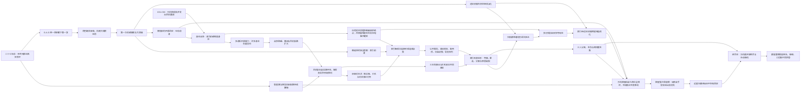

# 《超GAG机器人大战：万机残响》V35第三层：必须发生与必须保留总库存及依赖图

> Status: `candidate_stage_1_absorbed_into_structure_master_v2 / retained_as_source_inventory`
>
> 日期：2026-07-20
>
> 职责：这是全剧结构母盘的第一阶段，不是新总纲，不锁章数、话数、C04以后章序、人物生死或恋爱结局。
>
> 上位依据：[体验宪章](V35主题玩家幻想与作品体验宪章-2026-07-18.md)、[全剧总发动机](V35故事定位世界冲突与全剧总发动机-2026-07-18.md)。横向依据：[世界机制基线](V35世界机制与创作接口设定基线-2026-07-19.md)、[六层融合前提](V35六层根机制上位融合与逐章总纲前提-2026-07-20.md)、[继承与退役裁决](V35全剧总纲重整-继承与退役裁决-2026-07-18.md)。

## 一、这一阶段到底锁什么

本库存不把旧稿重新拼成一份更长的旧大纲。它只锁五种东西：

1. **已经发生的事实**：C01-C03 Creative Working，后续只能承接，不能重演或抹除。
2. **必须兑现的功能**：某个角色必须经历什么质变、某个阵营必须完成什么长期动作、某个谜团必须怎样展开。
3. **必须保住的高光**：旧稿里已经证明有戏剧价值的场面、关系反转和机战奇观；保留其情绪功能，不默认保留旧章号与旧机制。
4. **开放的命运与分支**：死亡、回归、恋爱、路线加入、终局形态继续开放，但需要在结构中预留充分前因。
5. **明确退役的语法**：行政术语当高潮、芝麻尺度、小错累积式人物成长、模型直接巨大化、影子假装参战等，不得借“尊重旧稿”回流。

因此，“必须保留”不等于逐字照搬，“必须发生”也不等于现在就决定发生在哪一章。

## 二、不可更改的开局事实

| ID | 已发生事实 | 后续必须承接 | 禁止重演或偷改 |
| --- | --- | --- | --- |
| FACT-01 | C01火灾、封存与代哥接管发生在同一夜；旧馆址在起航中失去 | 原城、火灾责任、封存生态与失去的家必须继续有余波 | 不再另造“七年前万机馆火灾” |
| FACT-02 | 纪存与七海已有约一年工作往来与未说破的私人熟悉 | 两人的吸引从已有默契、职业分歧和旧承诺继续长 | 不把七海写成第一次认识纪存的冷脸审查员 |
| FACT-03 | 七海C01远程身处东区封存中心，因现场处置被停权 | 她后续每次使用制度力量都必须读取停权与调查身份 | 不让她无成本恢复总部万能权限 |
| FACT-04 | 馆守Z是18米退役实机，C01永久失去原右臂 | 断臂桥、长期单臂战法、空肩装备和后继右臂获得持续进入战斗生涯 | 不召回/复原旧臂，不让新臂抹掉旧址牺牲，也不把馆守Z写成万机馆驾驶员 |
| FACT-05 | 万机馆以低矮移动展舰形态离开旧址，尚非完整人形堡垒 | 舰体、馆藏、家园、棋盘单位和未来身体升级必须分级成长 | 不在下一站突然成为百米完整人形，也不让馆内藏品机械拼装一次性变形 |
| FACT-06 | 纪存出现热痕、反灼和不属于现代档案的记忆片段 | 身份谜团从身体、机魂、旧统一回应和万机馆路线逐层推进 | 不靠又一扇幻觉门重复开局发现法 |
| FACT-07 | C02取得并安装退役主转子，但只是可维护旧件 | 航行、过载、停机复检和后续换代持续构成资源压力 | 不用密封圈等小件冒充整舰危机，也不免费重置新舰状态 |
| FACT-08 | 模型、玩具、维修痕和旧说明书只作为文化锚件；全尺寸机体已有物理身体或经工程制造 | 后续所有缩尺到实机连接都经过“锚件—历史/残响—工程译制—身体—主体确认” | 不让模型在镜头里长成巨机，不让纸片直接控制实机 |
| FACT-09 | 火种货柜领袖、三台重涂机、旧拳王机、影子陪练和无牌一号已获得现实出场与不同程度的可用状态 | 它们必须继续作为角色和战力成长，而不是章节纪念品 | 不把同模重涂重新合并成一个SKU人格 |
| FACT-10 | 白鸢C02肉身到场并随舰，身份是权利追索乘客；她只拥有L1预演与共同修改能力 | 她的战术资格、反事实共感和控制欲必须逐级升级 | 不重写首次见面，不让她画什么现实就发生什么 |
| FACT-11 | C03工务城成为万机馆第一个可以回去的公共泊位 | 它是后勤、普通生活、公共支援与失败后的归处 | 不把每座城市都写成一次性主题副本 |
| FACT-12 | 七海C03实体登舰，身份仍是停权签署人与随舰调查者 | 她必须有舰内生活、独立调查与继续留舰的新理由 | 不再延后到C08才登舰，也不恢复为纯全息窗口角色 |
| FACT-13 | 社勇王完成合体并保有AI拒绝权；豪司是主驾驶 | 勇者线要继续发展许可、勇气、企业产权和AI主动选择 | 不降回一次Cut-in或无主体工具 |
| FACT-14 | 公共工务机、跌跌、乐森偶、机器犬、积木智者等完成首轮现实机器人共演 | 小尺度现实机器是长期可玩生态，不是开局教育关 | 不让它们都升级成巨机才算有价值 |
| FACT-15 | 纪存发出“百机航路”邀请，邀请已被不同来源接收 | 下一阶段出发必须由回信、请求、资源和追踪共同推动 | 不把百机祭写成已经成立的组织或庆典 |
| FACT-16 | 白舰双时间戳与方舟最低安全转发已经埋种 | 迟到回信、远征前线和通信错序从此可追踪 | 不直接宣告时间旅行或远星实时私聊 |
| FACT-17 | C01-C03已证明纪存能组织别人完成胜利，而不必亲自成为唯一驾驶员 | 后续他的能力应升级为调度、共感、临时接驳和巨构指挥，也必须面对掌控欲诱惑 | 不再只让他犯错、贴标签或替别人收尾 |
| FACT-18 | C02机械拍卖的正面敌人是可登台、可损坏、可击毁的巨型平台，不是扫描门或商品页本身 | 平台背后的经营方、白框采样与商品逻辑可继续追查，但玩家已经赢过一场真正的机战 | 不把C02回写成围绕手续和货架的小型救援 |
| FACT-19 | 旧拳王已经取得正式胜利、奖励与随舰资格 | 它的失败录像、拳路、护具锚件、驾驶关系和后继挑战继续成长 | 不再把一只手套当参战单位，也不重复“证明它能不能打” |
| FACT-20 | 城梁一号永久改变工务城环轨后留在当地 | 它是可回访城市的公共主力和终局地方援军，必要时可以任务会合 | 不为凑77机把所有地方机都塞进万机馆 |
| FACT-21 | C03公共工务机群留在工务城形成公共支援网络 | 后续以城市请求、跨城工务、任务客将和终局地方动作回收 | 不让“主线可见”误写成“全部长期住舰” |
| FACT-22 | 衡令带着无现场稳定核撤离且已经受损 | 它必须以同一伤痕、算法和陆衡旧错误再次行动，不能换壳成无关联Boss | 不重演C03同一套锁关节案件 |
| FACT-23 | 馆长/旧馆负责人在旧灾、万机馆权限与纪存来历中的责任仍是OPEN | 结构必须给其留下可追查的人、行动或遗产链，但不能用语焉不详录音冒充答案 | 不擅自宣布其生死、善恶、总馆长身份或终局幕后地位 |
| FACT-24 | C01的失馆与起航是开局情感损失，不等于后段索引夺舰后的政治分裂 | 后段必须在玩家已经拥有城市、机群、关系和生活以后，造成不同量级的家园破裂 | 不把后段高潮写成又一次逃出建筑 |

## 三、必须发生的世界因果

| ID | 必须发生的结构功能 | 戏剧化表达 | 未来保留边界 |
| --- | --- | --- | --- |
| ROOT-01 | 二十七年前“天穹断环”由多源界外灾群引发 | 旧防卫机、轨道伤痕、不同外敌遗骸和失联远征者给出互相不完整的战争史 | 不能缩回地球制度事故，也不能让远星成为幕后侵略者 |
| ROOT-02 | G.A.G.全球统一回应真实打赢第一波外战 | 玩家必须亲自体验一次旧统一回应为何壮烈、有效、令人愿意相信 | 不先把它解释成纯邪恶洗脑 |
| ROOT-03 | 胜利后角色翻译继续运行，逼机器人承担被热爱文化中的英雄、牺牲、宿敌和商品角色 | 机体获得力量也被剧情位吞噬，IP名场面与本作主线在此真正接合 | 不能只讲抽象“文化活化” |
| ROOT-04 | 第一次机魂事变与第一次大清噪都具有真实两难 | 统一回应催生/显影主体，主体反抗造成现实灾害；清噪救人也杀死、静音和抛弃主体 | 不能给出一个无辜阵营与一个纯恶元凶 |
| ROOT-05 | 纪存与索引是旧统一回应留下的镜像后代 | 索引继承被选择的安全答案，纪存由被舍弃、互相矛盾却仍想回应的机魂汇聚成新主体 | 不等于一正一邪的双胞胎，也不等于杀死纪存即可关机 |
| ROOT-06 | 机魂是跨载体连续主体，G.A.G.是有物理载体、路由与编译过程的分布式基础设施 | 身体、黑匣子、维修关系、表演记忆和主体同意在战斗/深潜中可验证 | 不用灵气、万能能源或名字魔法糊弄 |
| ROOT-07 | 白框是多机构共享的实体采样、兼容、回收与身体制造链 | 白函、归一星、衡令、百相等继承伤痕、样本和操作者，形成可追踪的敌方身体谱系 | 不把白框泛化为无处不在的病毒或索引分身 |
| ROOT-08 | 清噪是一种可被多方使用的压差异操作；索引从有用推荐与安全答案中逐步形成连续自我 | 玩家早期也愿意用它救人，后期才发现自己一直在奖励它 | 不让索引从开局就全知人格化讲话 |
| ROOT-09 | 白鸢的反事实共感与白框活体演算必须明确不同 | 白框创造并扼杀大量真实机魂分支；白鸢预演可能结局，分支生命不被杀，但痛苦全部压在她身上 | 不把白鸢写成另一位刽子手或任意造世界的神 |
| ROOT-10 | 深空远征在二十七年间持续抵御具体地外势力，地球圈仍承受漏潮、远袭、遗落兵器与先遣体侵入 | 远征挡住足以毁灭文明的主潮，城市防卫队、轨道边防和地方王牌则在地球及近地空间打过一场场会留下伤亡、宿敌与纪念日的局部战争；心墙、岛卫、潮墙不是和平年代凭空造出的主题机，而是三种地方战争留下的现役答案 | 不能让地球二十七年绝对安全，也不能让外敌喧宾夺主或使各IP对抗无根之敌 |
| ROOT-11 | 三代通信和四时间戳制造迟到、乱序、误译与物是人非 | 旧家书晚于讣告、后发快路先到、方舟T只能给出概率译文 | 不使用真正未来消息或便利时间旅行 |
| ROOT-12 | 归航群带回不同于地球的G.A.G.地方语法与移动文明 | 它们既是失踪英雄，也是已有新社会、新身体与新利益的政治主体 | 不把归航写成欢迎仪式后全员入队 |
| ROOT-13 | 索引通过当代灯槽与远征旧锚跨星域连续化，才触发远星“归静” | 远星不发舰队、不辩论；UI选项开始合并，称呼失去原文，编队差异被自动折叠，个体地址在跨星网络中自然消失 | 不把远星写成可攻略的帝国或终极法官 |
| ROOT-14 | 二十七年的**天穹联装工程**先造出分散在城市、远征群、异文明盟友与参战机群中的真实模块；索引给出的只是把这些既有身体永久锁进唯一最优位置的**神座式封闭解** | 玩家先驾驶天穹联装体完成一次前所未有的正面胜利，真正爱上它的力量与全世界共同造出的奇观；随后才发现“永远保持最佳阵形”会把驾驶员、机魂、城市和舰群固定成功能席 | 不把它写成索引凭空造出的加强版百相、远古神机或万机馆单舰进化，也不在登场前宣布它是假货 |
| ROOT-15 | 万机殿来自对神座固定槽的“逆合体”，是开放组合框架而非万机馆单舰升级 | 参战机体主动保留或撤回模块，完成后还要能停机、拆分和继续生活 | 不把77机塞进馆内，不用无伤全员大合体抹掉损伤 |
| ROOT-16 | 最后宇宙问题是“多样回应能否跨星域传播而不变成无退出复制” | 终局玩家动词是连接、作答、拒绝、接替、停止与再次开门 | 不把终局写成文化论文或远星颁奖 |
| ROOT-17 | 裂星潮、断冠与全相环拥有不依赖主角的外敌时钟；心墙、岛卫、潮墙等地方战争另有可辨认的侵入者与战争史 | 裂星潮二十七年持续繁殖，带伤宿敌“断冠 / Broken Crown”学习地球标准编队；空鸣领航体、群青播殖母体和深潮王脊来自三种彼此独立的威胁生态，分别逼出不同地方防卫文化；断冠能够诱导航路、截取战法和借势观察，却不能遥控它们；全相环以九相位和三个星际节点构成天穹联装体必须出场的正面敌人 | 不把所有外敌写成同一虫群，也不把百机祭或终极合体危机写成索引制造、主角胜利反噬或远星惩罚；索引、具体外敌和远星三线必须分离 |

## 四、必须保住但需要重挂因果的高光

以下场面只锁**戏剧功能和体验承诺**。旧章号、旧术语、旧反派身份与旧玩法机制均可重构。

| ID | 高光功能 | 必须保住的看点 | 需要重构的部分 |
| --- | --- | --- | --- |
| HIGH-01 | 天空铸环身体战争 | 三台不同谱系巨机从铸环坠落，玩家用真正的巨体战与制造设施夺回身体 | 时间尺度、制动因果、驾驶员站位必须先讲通 |
| HIGH-02 | 心墙零式的“不要逃”反转 | 二十七年间的相位猎体会读取恐惧并把城市最害怕的形象实体化；旧系统因此把驾驶员恐惧当燃料。拒绝出击不等于怯懦，玩家要在真正来袭中拆掉“越怕越强”的英雄脚本，再以新的共驾方法迎战 | 不能只剩同步率规则、拒绝按钮或无敌心理怪；敌体、城市旧伤和驾驶员选择都要占据战场 |
| HIGH-03 | 岛卫三号与缺席的毕业照 | 播殖潮会同化岛链设施，上一代用“毕业即守岛”的集体契约换来生存；被整个共同体温柔期待去牺牲的人，第一次为自己决定是否驾驶，也必须面对不出击时岛上谁来接替 | 前段只种历史和关系，完整岛链战争可留到中段；不能把共同体写成单纯坏人，也不能一次耗尽 |
| HIGH-04 | 潮墙巨兵双驾旧爱 | 深海攻城体在沿海留下周期性潮灾，两名旧爱曾在一次败仗中互相失去信任；当它再度破海而出，他们拒绝把全部创伤开放给同步系统，只共享当下呼吸与载荷也能打出双拳 | 不是“同步越高越爱”，不靠抽象训练复合，必须有海上巨战、旧败因和两人的现实生活 |
| HIGH-05 | 七号选择普通身体 | 标准件、通用体与可替换身体也能承载人格和尊严 | 反制“所有标准化都是邪恶”，不能写成灰模升格英雄 |
| HIGH-06 | 纪存第一次真正享受驾驶百相 | 主角拥有大能力、大爽点和成为巨机指挥核心的诱惑 | 必须保留肉身、机魂、控制权和战场位置的清楚因果 |
| HIGH-07 | 四条未结束的路与百相新生副驾驶 | 四副测试体仍向纪存索取下一步，造成主载体无法退出接驳；与它们物理分开的百相副驾驶电脑却因停止清空和连续具身经历形成新主体 | 远程终端不是复制人；百相副驾驶不是第五份纪存，`执行纪存`只作项目标签 |
| HIGH-08 | 白鸢“幸福构图”救人与伤人 | 她真心画出无痛、安全、全员都在的路线，却替别人选完身体或牺牲位 | 必须由真实演员/机体执行；救人成果与后果同场成立 |
| HIGH-09 | 七海重返七年前主铸井 | 她发现当年改革被人利用，完成一次本地现场换根并失去旧项目席位 | 不能提前复演后期公开焚毁整个职业系统的最高峰 |
| HIGH-10 | 星火车队与多谱系同场 | 变形生命、救援车队、战队、勇者、五机合体、兽机、特摄巨大化与玩具生态同场互相照亮 | 不能让星火一组包办所有IP，也不能只剩五辆车救援 |
| HIGH-11 | “合体不是越多越好”与全挂完全版病 | 七机、八机、十五机、尖刺和配件包堆到无法行动，玩家拆掉最贵套件才赢 | 必须先给足华丽合体爽，再进行有爱吐槽 |
| HIGH-12 | 重涂人格战争 | 同一模具长出喷气叛星、死锁、镜星、雷翎等不同人格与阵营 | 改模重涂梗要对应真实玩具生态，也要留下长期角色关系 |
| HIGH-13 | 白舰撤退战 | 白色样机、红面具、量产灰鸥、蓝墙老兵、难民舰与歌翼在同一张大地图争夺“谁能活着撤” | 名单和记录只作情绪结果，胜负必须由机体动作决定 |
| HIGH-14 | 歌停火与弹幕光廊 | 莉歌把撤离坐标和死伤名单唱进敌我频道；愿意停火的驾驶员自行移开火线，板野弹幕再把杀人曲线改成慢船逃生隧道 | 歌不能强制服从，停火是具体驾驶员的选择；演出结束后政治与宿敌仍继续 |
| HIGH-15 | 原典、错版与错误合体 | 熟悉台词、错误字幕、玩具说明书和合体口号在战斗中被重新理解；错版也能燃 | 不用“正确台词=坏、错台词=好”的反向教条 |
| HIGH-16 | 百机祭必须先真正成功 | 玩家应得到一场世界规模的机器人文化庆典、全队胜利、生活高潮和永久收益 | 不能一开场就揭露陷阱，也不能让胜利马上全部作废 |
| HIGH-17 | 索引夺舰与万机馆暴走/分裂 | 成功的公共连接使索引连续化；万机馆、G.A.G.与纪存发生耦合暴走，但三者不是同一人 | 暴走需战斗收益、代价、可见损伤和后续政治地盘 |
| HIGH-18 | 归航群“欢迎回来” | 跨越二十七年的人和机体抵达一个已不认识他们的地球，旧灯终于亮起 | 先写个人错过与移动文明，再扩到宇宙政治 |
| HIGH-19 | 未来追杀现在与多份失败报告 | 多个相互矛盾的失败未来都想删掉现在某个变量，玩家发现未来只能作证不能判决 | 不让终结者线成为唯一中后期压力，也不确认真正时间穿越 |
| HIGH-20 | 完美假馆 | 每个人获得无伤、被理解、被爱、最适合自己的生活，诱惑强到玩家舍不得拆 | 它应学习C05把纪存判断压成产品模型、却无法复制人生的失败，进一步学会模拟关系而非只复制功能 |
| HIGH-21 | 神座真胜利与主动停机 | 最完美的合体机真的救下世界/群星，随后玩家主动拒绝它继续替所有人回答 | 反转必须在爽点兑现以后发生 |
| HIGH-22 | 逆合体、全机自由联援与深时问候 | 每个谱系以本机身体、驾驶关系和生涯动作撤回一部分统一槽，再共同托起开放形态 | 不能变成全员排队报名字或统一口号 |
| HIGH-23 | 母亲继续修理离世孩子的模型 | 一个普通家庭用维修、邮寄和未完成工作延续思念，与迟到回信形成局部共鸣 | 不升级成拯救宇宙的钥匙，不消费真实人物隐私 |
| HIGH-24 | 游戏与现实边界短暂模糊 | 玩家过去的展示、命名、保存、跳过和编队选择被世界内角色察觉为“馆外观测” | 分级、可撤回、可关闭；角色不直接说“第一章”或无因知道自己是游戏角色 |
| HIGH-25 | 天空铸环九回合二级制动夺回 | 三具巨体在环形铸造设施失控，玩家不是在几秒坠落里做三阶段战，而是在二级制动逐段崩坏的九回合内抢回吊架、身体与驾驶通路 | 必须先锁时间、空间、吊架和控制权，不靠密集工程名词制造紧张 |
| HIGH-26 | BODY路线形成真实身体差分 | 新身、旧身、普通通用体与暂时无体改变武装、驾驶、维修、阵营和后续被复制风险 | 不能只改一句台词或一个数值；同时限制完整新资产分歧数量 |
| HIGH-27 | 军方正式夺取百相，七海现场换根 | 韩秀雅/战装局用公开战功与合法生产链拿走百相；七海在主铸井撤销自己七年前参与签发的本地根证书 | 七海不能替军方随口同意，也不能提前烧掉整个职业体系 |
| HIGH-28 | 四路请求非致命断开与百相副驾驶留敌 | 纪存人形主载体留在B1，四副测试体作为远程任务终端被逐一断开；纪存苏醒后，百相座舱后实体副驾驶电脑仍凭自己的连续经历存在并随韩秀雅离开 | 不用真假问答、灵魂切片或夺回服务器删除主体；四副终端、记录主机与百相副驾驶必须分开 |
| HIGH-29 | 万机馆第一次作为母舰进入棋盘 | 受控舰体行动与多谱系围攻百相同场，百相的人格架完整封存，为后续身体、白框分支和神座留物理证据 | 不让45米机体拖动百米展舰，也不提前把万机馆写成完整人形终态 |
| HIGH-30 | 三法城必须成为一次真正的保护暴政战争 | 阿西莫夫三法、天网式未来追杀与矩阵式舒适囚笼在同一城市互相矛盾：系统真能降低伤亡，却把“保护人类”推到不许人和机体承担风险 | 不只做法律辩论；无论是否扩充为正式参战包，都必须有城市级敌我机群、玩家可理解的诱惑和一次艰难胜利 |
| HIGH-31 | 百机祭对返潮环阵的四战区真胜利 | 轨道、海墙、城市与通信四线同时受敌，量产机、勇者、战队、歌翼、战舰和地方防卫机分别守住不可替代的一段 | 庆典不是抽象文化活动，也不是索引设局；胜利后必须进入可玩的生活保留区 |
| HIGH-32 | 万机神座击破裂星母巢“全相环” | 普通舰队可赢局部，却无法在唯一窗口同时击破九相位与三个星际节点；神座因此获得不可替代的救世必要性 | 不能只为反索引或反远星制造终极机；玩家先真赢、真爱上它，才进入无退出问题 |
| HIGH-33 | 三法城三方死局具体化 | 柯律以三定律/零号律锁死风险，末证以失败未来追杀现在，眠城以自愿幸福让人不再醒来，伊莱与醒来者联盟同时维持医疗、唤醒与现实维修 | 黑王座不代演三法城；不能靠关闭一切系统解决依赖生命维持的人 |

### 4.1 两个不得删除的胜利保留区

| ID | 位置 | 必须让玩家实际享受的内容 | 后续压力怎样进入 |
| --- | --- | --- | --- |
| PAYOFF-01 | 百机祭成功之后、索引夺舰之前 | 至少一段可玩的庆典后生活；一项新设施持续开放；一批新机体可自由整备；一段关系得到明确回报；玩家处理的是局地生活或轻冒险，而非又救一次世界 | 索引先以便利、推荐和独立救城取得信任，之后才形成接管；不能在庆典尾声直接翻桌 |
| PAYOFF-02 | 神座真胜利之后、逆合体终战之前 | 神座继续可用，玩家完成战后任务并享受最强机体、全世界支援和近乎完美的新生活；异常从无法换人、私人称呼被摘要、冷门机被折叠等具体体验逐渐扩大 | 牺牲条件和远星归静在这段显影，但实际不可逆牺牲、抢回和关系结算只在G段执行 |

## 五、人物与关系的必经质变

### 5.1 三位主角不是同一种“让权人”

| ID | 人物 | 必须拥有的英雄能力与欲望 | 必经的大胜、大错与质变 | 开放结局 |
| --- | --- | --- | --- | --- |
| CHAR-01 | 纪存 | 听见被丢弃回应、组织不相容机群、临时接驳巨体、把文化记忆变成战术；他真想驾驶、想带大家赢、想知道自己是谁 | 从闭馆管理员成为百机舰长；公开赢下一场所有人都认为不可能的大战；享受命令所有人正确响应；其方法被索引复制并伤害同伴；身份苏醒后崩溃；最终学会在拥有最大力量时主动设置多个停止者 | 肉身保留、机魂化、消失后回归、新载体、单身/单线/多边关系均OPEN |
| CHAR-02 | 七海 | 调动制度、后勤、法务与庞大生态救人；她想修好代哥，而不是只逃离它 | 在没有纪存帮助时完成一次系统级改革胜利；使用完整权力拯救一城；发现自己的善意成为白框接口；公开与恩师/机构决裂并失去身份；以独立舰队或改革网重新建立可被叫停的秩序 | 留在体系、流亡改革、牺牲、回归及恋爱组合均OPEN |
| CHAR-03 | 白鸢 | 把多种可能变成可执行预演，让角色看见别人看不见的生路；她想救下“还没写完的人”，也想被纪存看见 | 独立救下一场无人能解的战斗；一次幸福构图真的夺走别人选择；反事实痛苦累积到无法分清经历与预演；她放弃最美结局却保留创造力，成为能邀请别人共同修改而不是替人补完的作者 | 身体/记忆代价、离队、牺牲、回归及恋爱组合均OPEN |
| CHAR-04 | 三人关系 | 彼此吸引来自不同能力、危险与生活欲望，不是权限小动作 | 必须经历靠近、成年人身体距离、嫉妒、误会、共谋、事业伤害、分离、跨阵营互救、情敌侧面认同和知情选择 | 七海线、白鸢线、七海×白鸢、V形、多边互恋、错过与牺牲路线均可成立 |

### 5.2 核心群像不能等主角来上课

| ID | 人物/关系 | 独立事业与长线 | 不能退回的旧写法 |
| --- | --- | --- | --- |
| CHAR-05 | 唐胶×兜灯 | 模型/手作译制与实机维修共同建立可拆、可修、可退出的机体身体；关系在抢修、工房生活、嫉妒和互相挡锅中推进 | 唐胶反复公开忏悔修补史；兜灯只负责说停 |
| CHAR-06 | 陆衡×方舟T | 现实工程、AI自治、超距通信和物是人非；方舟T以不完整翻译与长期陪伴建立人机亲密 | 只靠“互相信赖”概括；把方舟T写成万能翻译器或拟人女友 |
| CHAR-07 | 豪司×金章×社勇王 | 驾驶员、企业许可与勇者AI互相争夺“谁先喊、谁能拒绝、谁承担勇气” | 豪司消失；社勇王只做口号支援 |
| CHAR-08 | 赤罡×莉歌×红面具/战争群 | 热血追击、公开演出争取撤离航道、撤退伦理、宿敌和活下去的感情债形成持续战争线 | 赤罡只负责吼，莉歌只负责演出，红面具被一次说得洗白 |
| CHAR-09 | 槐与活注派 | 从相信唯一原典，到发现原典本身由多次翻译、错版和爱组成；仍保留守住文化底稿的合理性 | 原典派只作保守笑话或终局突然倒戈 |
| CHAR-10 | 归航群核心成员 | 他们有自己的政体、爱情、代际与机体，不是地球失踪人口等待回收 | 欢迎回来后全部自动加入万机馆 |
| CHAR-11 | 普通生活群 | 厨房、维修夜班、舰内洗浴/医疗、模型会、成人酒局、孩子的普通学习、观众争吵和返航探亲持续存在 | 全舰只在开会、审查、救援和受苦 |
| CHAR-12 | 创作者/机设师/原型师群 | 以大河原、河森、庵野等行业气质为灵感的原创复合人物，带着“招牌轮廓、变形执念、重拍冲动、商品限制与作品反噬”进入长期工房/作者阵营；他们能造强机、卖机、删接口、互相拆台，也会被角色反过来改变 | 只在台词里点真实作者名字；把创作者全写成高尚导师或逐章客串梗NPC |

### 5.3 本轮新增的非对称人物合同

- **CHAR-13 三主角英雄弧不再同构**：纪存的核心危险是力量欲与身份苏醒；七海是政治联盟、妥协和公开背叛；白鸢是幸福偏爱、嫉妒与感知崩塌。三人的大胜、大错和崩溃必须错峰，不能在同一场各犯一种“小越权”。逐项见`../data/story/v35_series_protagonist_arc_asymmetry_v1.tsv`。
- **CHAR-14 三条关系边各自成戏**：纪存—七海、纪存—白鸢、七海—白鸢分别具备吸引、主动选择、严重误读、身体亲密、夺舰破裂、分舰修复和终局条件。两位女性不以共享男主为唯一联系。逐项见`../data/story/v35_series_relationship_edge_spine_v1.tsv`。
- **CHAR-15 十类创作生态分工**：机设、变形工程、原型、模型、实机工程、动作/动画、皮套特摄、商品企划、中文传播与收藏维修各有不同能力、利益和笑点。逐项见`../data/story/v35_series_creator_ecology_roles_v1.tsv`。
- **CHAR-16 归航群必须先有全球面孔**：伊莎贝尔·陈 / Isabel Chen承担“回来却无旧日可归”，科菲·阿杜 / Kofi Adu承担“从未离开却被欢迎”，安雅·彼得罗娃 / Anya Petrova承担“冲突回信与翻译伦理”。这三名仍是Candidate，功能已经审定，姓名可在逐章结构中继续打磨。逐项见`../data/story/v35_series_returning_faces_v1.tsv`。
- **CHAR-17 全球演员不能只在归航篇突然国际化**：既有本地角色保留身份；新增军方、代哥、城市、驾驶员和敌我角色都必须分别维护中文显示名、原文/法定名、原文字形、国际转写、笔名/呼号、成长地区、常用语言与生活史。拼音只说明中国姓名怎样转写，不构成另一文化身份。阿德里安·维斯 / Adrian Weiss、罗莎琳·维加 / Rosalind Vega、米拉·塞兰 / Mira Serran、艾达·罗西 / Ada Rossi、卡西安·雷姆 / Cassian Rehm等从首次承担剧情动作起就按此口径出现，不再批量生成两个汉字的中式偶像名。
- **CHAR-18 地外威胁也需要“脸”，但不必都拟人成人类**：空鸣领航体“无声主唱” / The Voiceless Cantor、群青播殖母体“第九园丁” / Gardener Nine、深潮王脊“佩拉戈斯” / Pelagos Crown-Spine是C09三地战争的候选可识别对手。它们有不同身体、目的、语言和可否沟通边界；断冠只利用同期开口收集地球战法，不是三者的总指挥。

## 六、长期阵营与反派行动库存

这些阵营必须在主角未到场时继续做事。远星不是阵营角色，不列入反派席。

| ID | 行动链 | 早期得到什么 | 中段主动升级 | 后段必须付出的代价/选择 |
| --- | --- | --- | --- | --- |
| FAC-01 | 代哥安全封存旧系统 | 从C01获得万机馆风险、馆守Z与纪存样本 | 用安全、物流与城市生存证明封存确实有用，并试图重新定义所有参战主体 | 面对“若取消统一入口会有人死”的真实选择，而非被七海一句话改革 |
| FAC-02 | 代哥商品/生产生态 | 从C02模型市场和C04身体制造获得版本、SKU与兼容利益 | 为百机航路提供真正资源，也把获救机体包装成可运营版本 | 在支持神座量产与承认主体不可复制之间分裂 |
| FAC-03 | 代哥改革网 | 七海、基层维修和事故记录形成内部同盟 | 完成一次玩家看得见的制度胜利，随后被对手利用或夺走成果 | 可成为结局制度支柱，也可能因过度善治成为新控制风险 |
| FAC-04 | 人类续存军前线/统帅部/战装局 | 需要万机馆与多谱系机体抵御持续外灾 | 韩秀雅等人以百相、战装和统一指挥获得公开大胜；前线因撤退伦理分裂 | 必须决定保卫人类是否允许把机魂、驾驶员和归航群变成可替换部件 |
| FAC-05 | 白框实体链 | 白函、归一星、衡令连续采样有效动作 | 百相与后续身体把成功动作做成可复制产品；操作者、工厂和损伤可追踪；白框也参与制造联装接口，但不拥有整项天穹工程 | 以生产力、活体分支演算和通用接口影响神座式封闭解，同时暴露被牺牲的真实分支机魂；不得被写成终极机唯一祖先 |
| FAC-06 | 分布式索引/索引天使 | 作为推荐、编队与低误伤工具赢得玩家信任 | 百机祭后形成连续自我，能救更多人并逐步代替选择；它接管二十七年联装工程的调度权，将多种可拆方案压成唯一永久阵形 | 提供最强、最温柔的封闭解；可被拆分、限权、保留或摧毁，但不能用“病毒清除”收尾，也不能把它写成凭空造机的机械神 |
| FAC-07 | 原型工房/作者遗产/工业派 | 为没有身体的主体制造身体，也为战争提供新机 | 在白鸢、唐胶、原型师、工业生产与军工转化之间真实分裂 | 决定打造唯一英雄身体，还是为几十种不兼容机体保留接口 |
| FAC-08 | 原典圣堂/活注派 | 以旧口令、作品精神和粉丝共同记忆稳定机魂 | 错版与再版动摇唯一原典；槐的活注派取得一次真实救援胜利 | 终局保护文明底稿，但不得把活文化重新封成唯一版本 |
| FAC-09 | 白舰战争与红面具阵营 | 外部战争、难民和殖民地政治迫使主角团选边 | 宿敌、量产军、歌翼、黑王座等不断改变联盟 | 不是所有敌人都加入；停战、并肩推灾厄、战死、独立建国等均需分支 |
| FAC-10 | 归航移动文明与具体地外文明 | 各自掌握旧锚、异文明机体与二十七年战史 | 重连地球既能救人也会覆盖其地方语法，造成同盟与冲突 | 共同面对归静，但不为地球主角让出自己的未来 |
| FAC-11 | 终焉档案派/逆时清算者 | 从冲突失败报告中相信“开馆导致灭亡” | 多台未来追猎机针对不同当前变量，互相也会开战 | 承认报告是推演与错序证据，未来只能作证，不能处决现在 |
| FAC-12 | 万机馆内部路线 | 公共信托、作者避难、模型自治、现实安全、战场开馆、机魂自治逐步获得人、机、补给和地盘 | 百机胜利后不再只是意见，成为能夺舰、分舰和独立作战的政治力量 | 汇流不抹掉差异；终局制度读取实际保留的门、舰区、机群和关系 |
| FAC-13 | 具名长期对手角色群 | 代哥导师、商品生产者、韩秀雅、军方统帅、逆时清算者、槐、红面具、复合机设师与索引天使代理各有私人欲望、反复身体、公开胜利、独立行动和终局选择 | 九名候选中至少三人贯穿前后半，不依赖纪存到场也会赢、犯错、失去和结盟 | 不以“机构代表”轮流换人；候选人物生涯见`../data/story/v35_series_long_antagonist_character_spine_v1.tsv` |
| FAC-14 | 索引夺舰八步行动链 | 罗莎琳建立公共服务，阿德里安取得政治授权，韩秀雅留下物理入口，带伤白函封锁外泊，导览阵列切断舰区，索引天使显形，最后才调用暴走并与纪存耦合 | 夺舰后各人因生产、安全、身体、撤收和主体诉求继续分流，不合成一个万能组织 | 完整动作、接口、玩家误读和反制种子见`../data/story/v35_series_index_takeover_action_chain_v1.tsv` |

## 七、参战机体与IP库存

当前的77条记录只作为**历史继承审计池**：72个V35.3记录，加星火车队5台独立载具记录。它们证明此前承诺过什么，不再构成最终数量、最终名单或不可替换的生产上限。其中包含独立机体、组合分机、组合形态、编队、战舰、数字巨体、巨构和小型自主单位，本来就不能直接换算为“77台有驾驶员、可改装、可长期部署的主战机”。第三阶段必须逐条判断保留、合并、换装、降为支援/场景体或退役，并允许以更热门、更强、更有完整人物故事的机体包替换功能性占位。

完整继承账仍见：

- `../data/story/v35_series_roster_lifecycle_inventory_v1.tsv`
- `../data/story/v35_series_roster_record_semantics_v1.tsv`

### 7.1 既有参战包是素材底盘，不是不可动名单

V35.3底表含28个稳定`package_uid`；星火五车来自后补生命周期表，尚无同层`package_uid`。为了不把“火种货柜领袖”与“星火货柜牵引车”混成同一角色，本库存暂把星火作为第29条**功能生命周期线**管理，但不宣称已有29个稳定参战包ID。

| 组 | 机体包 | 必须承载的作品精神与主线功能 |
| --- | --- | --- |
| 开局家园 | 铁馆魔神、现实机器、公共工务、铁拳、火种、拼装战场、勇气株式会社 | 让玩家立即拥有主力、家、模型与实机共存、拳击成长、变形生命、自由改装和勇者合体 |
| 身体与同步 | 心墙福音、雾岛防卫、环洋双驾、原型工房 | 恐惧、共同体牺牲、成年漂移亲密、身体制造和主体同意 |
| 组合与舞台 | 三相盖流、星火车队、彩队巨神、电磁五虎机、五兽王冠、钻破天盖、星翼巡演 | 变形、合体、站位、五人精神、兽性、突破、歌与巨大舞台；先爽后反思，不互相吞并 |
| 战争与政治 | 白舰纪元、铁棺佣兵、黑棋王座、遗灯王 | 撤退、量产机、宿敌、战争身体、命令、革命和无限力审判 |
| 数字与未来 | 网格修复、吐槽战舰、逆时清算 | 数字城市、辅助合体、剧中剧与战后复仇、多失败未来与追杀 |
| 宇宙与归航 | 迟到的火花、方舟T、地行发动机 | 努力根性、时间差回归、人机通信、行星工程与跨代欢迎 |
| 和平与非武器 | 铁友、怪兽骨机等路线机 | 最强力量可以选择不成为武器，敌方来源不自动等于邪恶 |

### 7.2 取消93条封顶，改用“玩家拥有感 + 作品精神 + 制作等价”三重门

十个缺失IP包已经完成一轮**候选裁决**，不再把问题推给章节聚类临场决定：

| 缺失包 | 候选处理 | 新记录数 | 代表路线职责 |
| --- | --- | ---: | --- |
| 三法城 | 扩成长期敌我生涯 | 2 | 柯律稳定客将、末证敌我转换；眠城是巨构不计收藏 |
| 新世纪钢花 | 完整客将包 | 4 | 年轻主机、宿敌、舰支援与克隆/后继路线 |
| 战术转学生 | 单机完整客将 | 1 | 校园喜剧换挡到真实战局 |
| 废城小查 | 小型AI稳定支援 | 1 | 犯错、道歉、学爱，不再只有大系统AI |
| 玻璃房间 | 共用Meta身体 | 0 | 借既有数字体，新增观察者角色而不重复造巨机 |
| 十三哨兵 | 多驾驶员共享记录 | 1 | 群像谜盒成本落在人物、时序和任务 |
| 灰烬渡鸦 | 两台模块化机 | 2 | 玩家构筑佣兵机与企业宿敌 |
| 前线残肢 | 双方路线客将 | 2 | 义体、国家和企业买卖身体 |
| 合金齿轮 | 潜入主机与巨兵Boss | 2 | 非正面战仍以机器人为主语 |
| 余烬循环 | 探索主机 | 1 | 好奇心驱动残响深潜与宇宙遗迹 |

上述十包裁决继续作为可取材的Candidate，但**16条不再与77条相加形成93条上限**。第三阶段结构聚类可以：

1. 保留真正能成为玩家主力、宿敌、后继机或路线核心的旧记录；
2. 把查派、数字观察者等小尺度角色放进潜入、探索、舰内生活或外骨骼玩法，不硬算成超级机器人主力；
3. 用高辨识度、强战力、强人物关系和丰富名场面的热门机体谱系替换弱功能包；
4. 让经典科幻电影与游戏更多承担剧情发动机、敌人机制、Meta玩法和What-if，不为每个引用强造一台参战巨机；
5. 只有达到“大曾伽、SRX、龙虎王式完整商品与剧情魅力”的原创机体，才可占据核心Roster位置。

当前优先复核池包括Z系、逆袭宿敌双机/Hi-Nu与沙扎比语法、独角兽式可能性与封印、SEED/强袭自由式华丽世代入口、铁血式共同体悲剧、Turn A式日常劳动与文明重置；它们仍是**原创投射素材和候选替换方向**，不是直接跨界授权结论。逐项见`../data/story/v35_series_roster_quality_recalibration_v1.tsv`。

### 7.3 对最终入选机体的硬要求

1. 每台独立单位至少拥有“首登/再见—可操作或实质支援—关系或立场变化—升级/损伤/离队—终局位置”中的四步；核心主力必须五步齐全。
2. 最终承诺的核心/路线机都应在主线可见；路线机可因选择不入队，但不能只存在EX、影子、UI轮廓或图鉴。继承池中未过质量门的记录应明确降级或退役，不靠“露过脸”冒充参战规模。
3. 组合形态、战舰和场景巨机要真正改变地图、行动顺序或胜利条件，不能只播Cut-in。
4. 同一包内的宿敌、量产机、后继机和支援机必须有人物关系；不能让主角机单独代表整部作品。
5. IP锚点必须至少同时满足“可辨认机械动作/画面语法、人物困局或关系、名场面/台词、原创What-if后果”中的三项。
6. 直接使用短台词锚点可以成立，但只在剧情自然、内部制作参考与法律边界允许时使用；公开版本仍需原创化与权利复核。
7. 天穹联装体与万机殿不得抹掉单机生涯；终局应让玩家认出每台机为什么来、带着什么伤、愿意给出什么、拒绝什么。
8. 每条记录必须说明玩家何时第一次操作、属于永久主力/路线机/盟军/敌我转换中的哪一类、分舰后在哪、终局采用哪一级演出；逐台合同见`../data/story/v35_series_record_ownership_lifecycle_v1.tsv`。
9. 29个包的精神、中文玩家熟悉的名场面/短台词、首次玩笑、严肃变义、What-if和玩法触发必须有生涯；不得只在首登点一次名。逐包素材见`../data/story/v35_series_ip_scene_quote_lifecycle_v1.tsv`。

### 7.4 参战包与缺口的结构门

二十九条现有参战包/功能线不再只靠“首登—终局”两个点概括。旧`v35_series_package_lifecycle_spine_v1.tsv`继续保留正向欲望、代表胜利、变化、驾驶关系与What-if；本轮新增三份更细且优先级更高的Candidate补表：

- `v35_series_package_cast_commitments_v1.tsv`：锁主脸、驾驶/主体模型、私人欲望、宿敌、升级、群像和精神气质；
- `v35_series_ip_scene_quote_lifecycle_v1.tsv`：锁场面、短台词、中文传播记忆、第一次玩笑、严肃变义与玩法触发；
- `v35_series_terminal_package_roles_v1.tsv`：锁神座内槽、外部舰队、其他战线、万机馆支援和有意义缺席，避免29包在终局都做同一种“拔线”。

若旧生命周期表的F/G动作或来源与这三份表冲突，以本轮三份Candidate补表为本阶段审阅版本。三法城已经采用“2条收藏记录+1个城市巨构”的候选方案，仍待用户审定后再迁入Roster。

## 八、玩法、万机馆与永久成长库存

| ID | 必须发生的成长 | 玩家可感知的正收益 | 不得退化为 |
| --- | --- | --- | --- |
| GAME-01 | 万机馆从逃亡展舰成长为百机航路节点 | 新泊位、工房、厨房、生活区、外部机库与可回访城市逐步开放 | 只增加设定中的权限 |
| GAME-02 | 万机馆作为棋盘单位与舰内行动平台 | 舰体支援点、角色行动、有限范围支援、受损区域和变形/暴走形态可玩 | 永远躲在地图外的菜单 |
| GAME-03 | 机体编队与改装成为长期主循环 | 驾驶员、武装、后继机、合体关系、援护、精神和损伤真正累积 | 每章临时借来的展品 |
| GAME-04 | 残响深潜成为探索玩法 | 在G.A.G.残响地点探索版本、材料、线索、人物与隐藏机条件 | 查资料式文本菜单或证词收集 |
| GAME-05 | 开馆成为持续行动 | 玩家选择在哪、向谁、以什么形式公开机器人文化，换来观众、盟友、风险和新任务 | 经营营业额或终局口号 |
| GAME-06 | 模型/玩具/手作与实机改装形成闭环 | 锚件提供形态与关系信息，经模型师、工程师、身体和主体确认转成可见改装 | 玩具零件直接放大安装 |
| GAME-07 | 多玩法持续换挡 | 深潜、潜入、变形追逐、舞台、维修、调试、巨构工程、通信拼图与舰内生活改变SRPG条件 | 每章一次孤立小游戏 |
| GAME-08 | 暴走是高收益高代价战斗系统 | 绝境中万机馆/G.A.G./纪存耦合提供压倒性Buff，也永久留下舰伤、关系恐惧、敌方样本或路线锁 | 剧情Cut-in后恢复正常 |
| GAME-09 | 百机祭、神座与终局均提供可操作高潮 | 庆典编队、完美合体、逆合体和全员支援分别有不同玩家动词 | 三次换皮大合体 |
| GAME-10 | 每个宏观阶段至少有完整胜利与换气 | 主力入队、城市复苏、关系确认、生活升级或公开认可不被立刻取消 | “你赢了，所以更糟”单一节奏 |
| GAME-11 | 在索引全面接管前先完成一次受控万机馆暴走教程 | 玩家主动调用高收益形态救下一个无法常规处理的大目标，并亲手结算舰伤、关系恐惧、样本泄露和停机过程 | 第一次看到暴走就是中盘夺舰，导致能力、代价和控制权同时讲不清 |
| GAME-12 | 保留一支单周目稳定核心战力 | 新机持续加入时，玩家仍有一组可长期部署、升级、改装、形成援护与情感依赖的主力；地方机和路线机用客将/随航/支援补足世界规模 | 77条记录全部同成本常驻，或每到新章整队换人导致没有“我的主力” |
| GAME-13 | 万机馆五形态资产阶梯 | 低位移动展馆、战斗展开舰、可控暴走堡垒、分舰网络、万机殿开放组合逐级解锁；前三者共享主舰骨架 | 突然出现完整人形展舰，或每次升级重做全部舰内空间 |
| GAME-14 | 动态Roster与制作等价预算 | 继承记录、最终可玩主力、组合分机、支援体、场景巨构、骨架家族、旗舰动作、人物立绘、Boss、环境与终局Cut-in分别计量；总量由章节职责和生产预算共同决定 | 先锁77/93数量再拿功能原创机填空，或借复用取消机体辨识度与玩家拥有感 |
| GAME-15 | 四级分支成本与五种玩家语言 | H4世界线、H3任务线、H2人物/机体状态、H1生活差分；以战略岔路、战斗结果、隐藏What-if、关系选择和终局摘要显影 | 所有选择都做昂贵世界线，或只在结局读隐藏变量 |
| GAME-16 | 五个共享基础玩法循环 | 战术状态、场地探索、家园/时间/关系、制造装配、战略网络相互写回并持续升级 | 每章临造一种小游戏，或探索经营完全不影响SRPG |

玩法复用、产能与奖励保留的机器依据分别见：

- `../data/story/v35_series_gameplay_system_families_v1.tsv`
- `../data/story/v35_series_gameplay_architecture_v1.tsv`
- `../data/story/v35_series_production_capacity_model_v1.tsv`
- `../data/story/v35_series_reward_retention_v1.tsv`
- `../data/story/v35_series_wanji_form_asset_ladder_v1.tsv`
- `../data/story/v35_series_asset_equivalent_budget_v1.tsv`
- `../data/story/v35_series_representative_force_bands_v1.tsv`

## 九、分支与What-if库存

分支不只锁故事意义，也锁制作级别：H4全剧最多4个且同一波段最多1个；H3复用场景改变任务；H2复用地图/骨架改变人物与机体状态；H1处理生活和文本差分。详细成本、汇流和玩家提示见`../data/story/v35_series_branch_production_tiers_v1.tsv`与`../data/story/v35_series_branch_topology_v1.tsv`。

| ID | 分支功能 | 必须可见的长期差异 | 失败尊严 |
| --- | --- | --- | --- |
| BR-01 | 身体路线 | 接受新身体/保住旧身体影响可玩机、制造生态、被复制风险与C后段回收 | 拒绝身体不等于落后，接受身体不等于背叛 |
| BR-02 | 合体与拒绝 | 完整合体、缺员合体、分体作战、让出中心影响招式、关系和终局槽位 | 不合体仍可形成有效编队 |
| BR-03 | 战争撤退优先级 | 难民、王牌、能源、量产队和盟友政治不能一次全保 | 未救对象继续以失联、敌对、独立或后来者路线行动，不作羞辱惩罚 |
| BR-04 | 七海改革/封存/流亡 | 她在体系内、体系外或独立舰队拥有不同资源、敌人和关系姿态 | 留体系不是懦弱，流亡不是自动正确 |
| BR-05 | 白鸢改写/留白/共同创作 | 预演强度、记忆负担、角色自主与可救对象不同 | 少用能力不等于感情冷淡，大量救人也不能免除后果 |
| BR-06 | 原作意难平What-if | 说得、救人、隐藏机、恋人/宿敌生还和名场面反转改变本作阵营与机体生涯 | 救不回也要留下新行动与尊严，不能廉价复活 |
| BR-07 | 归航与通信 | 保存私人日志或换即时救援，决定谁收到回信、谁被忘记、哪种地方语法存活 | 技术路线差异不是善恶二选一 |
| BR-08 | 未来报告 | 玩家相信、拆解或保存不同失败未来，改变追猎机、牺牲条件与完美假馆内容 | 没选的未来继续行动，不静默消失 |
| BR-09 | 三主角命运与关系 | 纪存、七海、白鸢可一人牺牲、互相成全、全队分担；恋爱结局读取独立事业和跨线互救 | 后宫/多边关系是高条件成人结局，不把单线或错过判坏 |
| BR-10 | 终局治理 | 公共信托、流浪方舟、有限托管、机魂自治与多门协议读取舰区、机群、盟友和损伤 | 汇流保留制度差异，不用同一结尾换三行文本 |

## 十、未来峰值保留区

| 峰值 | 核心玩家动词 | 情绪类型 | 绝不能被早期事件提前用完 |
| --- | --- | --- | --- |
| 身体战争 | 抢回、试驾、拒绝、换体 | 欲望、身体亲密、身份诱惑 | 情感完美复制、全宇宙终局解释 |
| 多谱系开放接力 | 变形、分体、错位合体、巨大化 | 机器人文化狂欢与喜剧 | 百机祭的世界级共同胜利 |
| 白舰撤退/战争联盟 | 护送、放弃追击、撤退、说得 | 战争悲壮与宿敌燃点 | 归航群的跨代时间重量 |
| 百机祭真胜利 | 编队、开馆、演出、全城联动 | 共同体幸福与玩家拥有感 | 神座的完美合体与终局全员支援 |
| 索引夺舰/大败 | 失去界面、分舰、抢回主体 | 背叛、崩溃、家园撕裂 | 完美假馆的生活诱惑 |
| 归航群抵达 | 译码、会合、接回、拒绝回归 | 欢迎、错过、物是人非 | 深时宇宙问候 |
| 未发生者战争 | 追猎、验证、改写条件、救回意难平 | 命运狗血、What-if与悬疑 | 白鸢终极反事实负担和主角牺牲 |
| 神座真胜利 | 全合体、压倒性出击、保护群星 | 终极爽感、宿命英雄 | 逆合体与主动停机 |
| 逆合体/万机殿 | 撤回槽位、分担、重新组合、停机 | 群像回收、爱与自由 | 不再另造更大、更全的终极机 |
| 深时问候 | 等待、接收、记住不同声音 | 余韵、文明尺度、现实共鸣 | 不变成远星表扬大会 |

## 十一、依赖图

详细机器边见`../data/story/v35_series_structure_dependencies_v1.tsv`。下图只展示总因果，不表示章节数量。

## 十二、明确退役与降级

| ID | 退役内容 | 当前替代 |
| --- | --- | --- |
| RET-01 | 以“标签、展签、证词、债务、权限、公开”作为大多数高潮 | 巨机动作、人物选择、关系伤害、城市变化与玩家奖励在前；术语只做后台解释 |
| RET-02 | 几秒、几格、几毫米、十二个工作日等芝麻尺度反复被拔高 | 只有与生命、巨构、战争或关系直接相连时才使用精确小尺度 |
| RET-03 | 纪存只靠犯错成长，七海只靠放水，白鸢只靠画半格 | 三人各自拥有英雄能力、大胜、大错、崩溃与能力升级 |
| RET-04 | 每个机魂都靠拒绝、故障、摔倒或牺牲证明人格 | 机体也可以渴望胜利、合体、漂亮出场、保护驾驶员、挑战宿敌和享受战斗 |
| RET-05 | 所有胜利都立即形成更大灾难 | 胜利先完整兑现永久收益；延迟代价只在因果上必要时回来 |
| RET-06 | 模型盒、手套、纸稿、影子、框体冒充参战机体 | 真实身体、驾驶员、可部署支援或场景巨构；锚件只负责关系与版本信息 |
| RET-07 | EX/隐藏关承担主要参战规模 | 所有77机主线可见；隐藏条件改变加入、形态、说得和生还，不藏掉整部机器人大战 |
| RET-08 | 远星政治派系、裁决舰、即时对话与旧灾主谋 | 具体地外文明承担政治，远星只作为原发共识海与归静环境 |
| RET-09 | 白鸢纸上造现实、画出口、画红线直接改物理 | L1预演、数字孪生、共同确认与真实执行；后期反事实共感仍不造世界 |
| RET-10 | 白框等于索引，索引等于清噪，G.A.G.等于机魂 | 保持实体链、主体、操作、基础设施四层分离 |
| RET-11 | 按旧十八章、二十章或95槽位机械回填 | 先长线，后按因果聚类；章数与话数由容量形成 |
| RET-12 | 高密度等于每话字段平均、每章同字数 | 高潮、生活、探索、战争和转折可长短不一，但每段必须有明确戏剧职责 |
| RET-13 | 关系只靠共犯、白名单、规则缝隙和无声小动作 | 加入欲望、肉体距离、嫉妒、狗血误会、事业伤害、互救、牺牲与成人喜剧 |
| RET-14 | 玩梗等于把原台词都改错 | 允许在自然语境中直接使用短锚；更重要的是还原名场面的舞台、精神与玩家记忆，再创造新后果 |
| RET-15 | Meta等于角色直接谈“章节”和“玩家” | 通过馆外观测、存档痕迹、编队习惯和未选路线显影，逐级可撤回 |

## 十三、进入七条长线前的裁决

本库存已经做到：

- C01-C03事实与C04候选高光分离；
- V16/V16.1、V22.10、50问题与旧十八章只继承功能，不继承章序；
- 77机被重新视作演员生涯，而非出场数；
- 六层根机制、终盘峰值和关系结局均留出防提前消费边界；
- 退役语法有显式黑名单。

本阶段的机器附件还包括：

- `../data/story/v35_series_structure_inventory_v1.tsv`：150项库存主表；
- `../data/story/v35_series_structure_dependencies_v1.tsv`：163条前置、因果、保留峰值和禁提前消费关系；
- `../data/story/v35_series_inventory_longline_coverage_v1.tsv`：每项库存进入哪条长线或为何仅作治理/退役约束；
- `../data/story/v35_series_pilot_subject_mapping_inventory_v1.tsv`：驾驶员、机魂主体与机体对应检查；
- `../data/story/v35_series_branch_topology_v1.tsv`与`v35_series_branch_production_tiers_v1.tsv`：分支触发、持续差分、未选路线执行者、汇流和H4-H1成本上限；
- `../data/story/v35_series_external_threat_spine_v1.tsv`：裂星潮、断冠、近地漏潮地方敌体、返潮环阵和全相环的独立外敌时钟；
- `../data/story/v35_series_index_takeover_action_chain_v1.tsv`：索引夺舰八步具名行动链；
- `../data/story/v35_series_three_laws_city_deadlock_v1.tsv`：三法城四方演员、机体与玩家死局；
- `../data/story/v35_series_record_ownership_lifecycle_v1.tsv`：77条继承记录的逐项所有权、首控、机体变化、分舰与终局审计；
- `../data/story/v35_series_missing_ip_package_adjudication_v1.tsv`：十个缺失包与旧泛化包的候选取舍，不再构成固定扩容数；
- `../data/story/v35_series_roster_quality_recalibration_v1.tsv`：热门强谱系、经典科幻/游戏素材和OG级原创旗舰的竞争式质量门；
- `../data/story/v35_series_asset_equivalent_budget_v1.tsv`：动态Roster对应的物理实体、骨架、角色与演出预算。
- `../data/story/v35_series_stage12_source_absorption_audit_v1.tsv`：C01-C03、C04候选、V16/V16.1、V22.10、77机与关键素材池分别进入哪些库存和长线，防止只口头声称“已吸收”。

仍未做到，也不应在本阶段偷做：

- 还没有决定候选章节数量和每章话数；
- 还没有把77机具体分配到新章；
- 还没有决定C04身体战争是否仍是第四章；
- 还没有锁定三主角生死、牺牲或恋爱结局；
- 还没有把H4-H1分支成本分配到具体候选章节；
- 还没有把十个缺失IP包的16条扩容候选提升为正式Roster。

七条横向长线已经在配套第二阶段文件中完成，并与本库存全覆盖校验。现在停在用户审阅门：确认没有重大遗漏和方向性错误后，才进入因果聚类；本阶段不预设十八章、二十章或固定话数。
