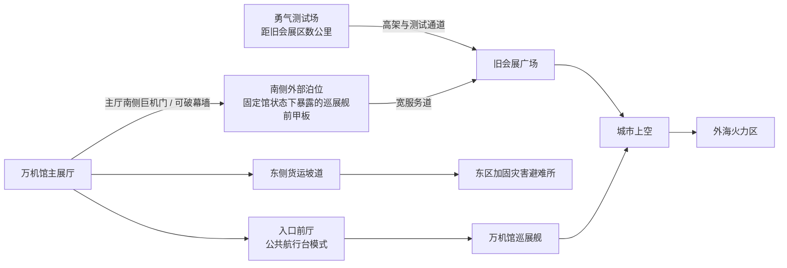

# C01《闭馆以后，万机出击》物理因果与人物站位板

> Status: `layer4_physical_board_candidate / based_on_user_approved_story`
>
> 日期：2026-07-26
>
> 本板只校验时间、位置、尺度、控制权、信息来源与动作可行性。它不向故事增加机关，也不要求正文解释工程细节。

## 一、时间边界

| 时段 | 发生事项 | 物理要求 |
| --- | --- | --- |
| 19:30至20:15左右 | 最后导览、勇拳公开测试、纪存与七海通话 | 万机馆仍为正常开放状态；豪司与勇拳在附近测试场 |
| 20:15后不久 | 海防警报、BREAKER钻地进入旧会展区 | 公共频道和城市屏幕同步警报；地下震动早于敌体破土 |
| 随后约二十分钟 | 东侧撤离、少量小体漏入、馆守Z解除停机、E02首战 | 博物馆观众先进入封闭消防通道，普通人不作为巨机棋盘单位；但最后应急车辆、消防架桥机和东侧出口仍在收尾，馆守Z起身后需要护到防爆门关闭 |
| 紧接E02 | 勇拳赶到、E03双机战、BREAKER二阶段 | E02和E03是同一夜同一战场的前后半段，没有维修空档 |
| 防空封锁维持期间的紧急准备 | 馆守Z退回外部泊位、纪存由导览席回馆、兜灯现场收机、断开市政管线、锁定馆藏、撤空外部机位、巡展臂与推进骨架接入、前厅切回公共航行台 | 城市边缘炮火和勇拳以数次拦截持续压住飞行核心；馆守Z以裂盾保护最后作业，准备时间由外部战斗争取，不进行临时造舰或复杂改造 |
| 当夜稍晚 | 万机馆升空、外海空战、BREAKER击毁 | 城市已开放外海航路，母舰把主战场带离居民区 |
| 战后至破晓 | 机况检查、勇拳回收、被打断饭约的短通讯、转子故障求援、赵梅从木桶街回应、采样机取件 | 万机馆以低功率继续航行；主循环转子持续高温并出现异常震动，停机后能否再次启动无法保证 |

具体分钟数不进入正文。时间板只保证豪司能从近场测试地赶到、巡展臂能以原接口快速接入、万机馆不会在一秒内从建筑变成飞舰；E03结束到E04起航之间始终有外部炮火和勇拳压制，不出现Boss悬停等待半小时的空档。

## 二、空间与移动关系

### 尺度分区

- **人类与小型机器人：** 主展厅安全走道、货运坡道、入口前厅公共航行台、货运升降台与东区加固灾害避难所。切入巨机棋盘前，普通观众已离开露天战区。
- **8至10米职业机：** 货运坡道外侧与街口，不进入主展厅深处。
- **17至29米巨机：** 主厅南侧巨机门、南侧外部泊位、旧会展广场与舰首外部甲板。南侧泊位就是巡展舰停航后仍暴露在地面的前甲板；馆守Z通过宽服务道往返，不穿行人用走廊，升空时也不需要从地面泊位瞬移到舰首。
- **百余米巡展舰：** 原馆址上方、城市空中走廊与外海空域。

人类不会在巨机脚下边跑边聊天；最后应急车辆、消防架桥机和东侧出口可以在巨机战初段作为非可控地图状态，不把平民逐格放进战棋。舰内人物也不会同时出现在舰外战场。

## 三、控制权与信息来源

| 对象 | 控制者/行动主体 | 能做什么 | 不能做什么 | 纪存怎样知道 |
| --- | --- | --- | --- | --- |
| 馆守Z身体 | 旧守护者的同一机魂人格 | 自主站立、移动、战斗、决定过载右拳 | 被纪存直接驾驶；被轮式终端遥控 | 视线、重心、通讯与长期相处形成的判断 |
| 馆守Z物理限位和整备 | 兜灯 | 解除展示限位、应急直连展示回路下保留的主动力、报告老化冷却只够支撑本次连续出动、装巡展臂 | 替馆守Z决定是否牺牲右臂 | 仪表与现场检查 |
| 导览席 | 纪存 | 看道路和人员、向馆守Z与友军报方向、组织协战 | 操纵四肢、读取敌方思想、把自己注入机体 | 现场视野与城市公开数据 |
| 轮式导览终端 | 馆守Z机魂通过馆内网络使用的远端外壳 | 走到观众身边、显示资料、说话 | 独立生成第二人格；终端损坏后让机魂死亡 | 同一句话由胸前扬声器续接；本章压坏的是在用外壳，备用终端随馆但要等飞行稳定后才能接入 |
| 勇拳 | 荒川豪司驾驶 | 移动、近战、承受并回送冲击、短时推进 | 独自破甲；章末归万机馆所有 | 豪司公开测试与实战通讯 |
| 万机馆巡展舰 | 自动航行系统执行推力、转向、配平与姿态稳定；纪存选择净空航路并组织友军；唐胶与兜灯现场操作并保留停机权 | 自身离地、有限转向、以近防炮驱离贴舰小型目标、调取巡展装备 | 由馆守Z抬起；由纪存手动逐台控制推进器；用近防炮击伤Boss；现场拼装成人形；自动解释G.A.G. | 旧照片中的巡展舰与近防炮、前厅切换、路线杆选择、自动离港反馈与肉眼变化 |
| 城市航路与火力 | 城市应急指挥 | 清空通道、划出外海火力区、远程支援 | 由七海个人批准或接管万机馆 | 公共应急频道 |
| 七海的停机令与航路情报 | 七海本人 | 确认撤离与机况后撤回自己签发的命令；叠合城市公开净空航路、防空禁射区和代哥交通卫星图 | 替城市、军方或企业批准起飞或调动炮火 | 她本人操作记录、危机联络室画面和纪存终端收到的两层地图 |
| BREAKER与突入体群 | BREAKER有自主核心；小体在E02各自行动，E03首次受核心脉冲统一调动 | BREAKER地面突入、飞行、发脉冲；小体在E02只能扑击、游荡和围堵附近目标，E03后才能让路、包夹和同步转向 | E02小体配合Boss或排成队形；读取人物记忆；远程控制万机馆 | 公开雷达、目视与战斗行为；E03红孔收缩与街区/外海同类转向同时发生 |

## 四、人物站位

| 人物 | E01 | E02 | E03 | E04与战后 |
| --- | --- | --- | --- | --- |
| 纪存 | 馆内导览；与七海远程通话 | 带人走东侧坡道，随后进入馆守Z胸前导览席 | 始终在导览席内完成地面协战；飞行核心升空后随馆守Z回到外部泊位，在检修平台降下后退出导览席并经服务舱门回主厅 | 在入口前厅公共航行台选择离城航路、组织友军，自动系统负责推力、转向与配平；终战从航行台通讯，不同时坐在馆守Z内；随舰离城 |
| 七海 | 东区滨海塔楼预约餐厅 | 返回东区封存中心危机联络室，远程撤回本人命令 | 仍在危机联络室，仅查看城市公开应急图与代哥交通卫星图 | 远程叠合净空航路与禁射区；战后回预约餐厅看见已经撤掉主菜的空桌；留城 |
| 旧守护者 | 轮式终端在人群脚边，巨体半跪 | 终端外壳被横梁砸中后由胸前扬声器续话，机魂以馆守Z巨体主控系统为物理载体 | 自主操纵馆守Z；纪存在同一胸部区域的独立导览席 | 馆守Z位于前甲板；飞行稳定后，兜灯将库存备用轮式终端接入馆内网络；声音经舰内通讯转播不等于机魂进入万机馆 |
| 兜灯 | 馆守Z右侧维修架 | 留在机体维修位并开启导览席 | 通过机况台报告右臂限制；馆守Z回泊位后随检修平台亲自检查右肩，平台收回后进入舰内 | 在外部泊位接入巡展臂和推进骨架，终战从舰内整备席决定是否允许单次点火 |
| 唐胶 | 模型病院与导览路线 | 送回小满模型，封防火帘，再前往主厅 | 留在馆内安全维修区，不进入导览席或巨机战场 | 与兜灯完成巡展臂外部标记后回舰内；随舰 |
| 豪司 | 勇气测试场 | 测试结束，被要求等待回收 | 从测试场沿高架驾驶勇拳赶到广场，全程在驾驶舱 | 伴随万机馆短时空战；战后进入企业回收艇，留城 |
| 小满、阿澄、老余与观众 | 馆内参观 | 经坡道和封闭消防通道撤入东区加固灾害避难所；馆守Z起身前已离开露天战区 | 只通过避难所直播墙观看，不进入战场；最后应急车辆与消防架桥机仍在馆外收尾 | 从避难所直播墙看万机馆升空；不随舰 |
| 跌跌、机器犬 | 馆内小舞台 | 协助门和走失者后随馆员回到安全区 | 不参与巨机伤害 | 藏进货运升降台后被正式计入随舰名单；终战留在舰内 |

## 五、馆守Z与右臂因果

1. 馆守Z开场两臂均在，右臂外甲尚未完全复位，但具备一次火箭拳发射能力。
2. E02首战只使用双臂和退役重盾，不发生断臂。
3. E03中，兜灯确认：正常发射可能回收，过载发射会烧毁肩部回收机构。
4. 馆守Z自行决定过载，整条右前臂作为火箭拳发射。
5. BREAKER从正面夹住飞行前臂；勇拳从同一运动方向打中其尾部，将它继续向敌胸推进。
6. 右前臂贯穿黑甲后彻底报废，肩内回收机构也被炸毁；残片随黑甲落回封锁广场，馆守Z只剩烧损的右肩接口。
7. 馆守Z用左臂把开裂的重盾带回南侧外部泊位；盾继续保护离港作业，并在终战承受馆守Z与勇拳归舰冲击后彻底破裂。
8. E04接入的是万机馆原有全尺寸装卸/救援臂。它能放锚、牵引和稳定，不能握拳，也不等于修复原右臂。
9. 尾声白色采样机取得的是原右拳/前臂的残片。它撤离时，断裂支撑座刮落采样机夹爪内侧一枚指节大小的白色衬片；次日城市清障记录只确认“未知白色复合材料”，后续章节可以据此做材质匹配与来源推断，但不能倒写成C01出现过一具完整采样机残骸。

右臂损失换来一次明确Boss破甲，不是事故惩罚；巡展臂装提供新玩法，但保留寻找或重造战斗右臂的长期欲望。

## 六、BREAKER因果

1. BREAKER先在近海遭防线炮火拦截，地面黑甲因此已有少量外伤，但仍成功钻入地下。E01雷达同时显示十余接触点，大部分仍被海防挡在城外。
2. 它沿旧会展区地下接近万机馆，钻地和破防撞出的缺口让少量同类小体漏入旧会展区与相连街区。这些小体在E02依然各自行动，没有通过BREAKER获得队形或战术。
3. E02破土后，BREAKER无视附近能源站和更近的拦截炮位，持续朝万机馆推进；小体则扑向附近火光、应急车辆、出口或机器。两种行为并列在画面中，让玩家看懂它们还不是一支队伍。
4. 馆守Z将其挡在广场；E03两机连续攻击它准备钻地时张开的中央红裂口。红裂是地面壳的攻击/钻地通道，不是核心本体的红孔。
5. BREAKER用双爪夹住飞拳的几秒里，核心从胸腔缩向上背。勇拳补击后，飞拳贯穿的是刚刚腾空的中央通道，撕毁承担钻地、重甲与近战的外壳。
6. 飞行核心从破开的上背升空并展开薄翼。它在壳内一直存在，也确实舍弃了已被击毁的地面壳，不是临时生成或无伤复活。
7. 飞行核心的中央红孔首次收缩时，E02留在旧会展街区的幸存小体与外海同类同时停顿、让出核心航线、朝万机馆转向。这是它们首次受统一脉冲调动，之后才会让路、包夹和同步追舰。
8. E04核心被左拳击毁后，突入体群失去统一转向，被城市防空、勇拳和万机馆有限近防炮清除。

这条因果不需要“同一套动作反制”“学习算法”或额外控制设施。

## 七、万机馆离地因果

1. 入口的第六次巡展照片已经证明万机馆过去以巡展舰形态活动；照片不负责说明具体停航年份。
2. 固定展馆并非在E04现场变出一艘船；主展厅、穹顶和两侧展廊原本就是巡展舰上层结构，长期固定后才被当作普通建筑使用。
3. 入口前厅在巡展时期就是供馆员和观众共同使用的公共航行台；万机馆固定后，它被改作售票、导览和失物招领区。紧急离港只是恢复原功能，不会突然出现另一间舰桥。
4. BREAKER三次扑向万机馆、航行系统开始向馆内终端报告状态后，纪存决定把战场带到外海，并确认`紧急离港`。
5. 长期被当成展馆应急发电机的设备，本来就是巡展舰航行炉。固定展馆期间，它经历过维护和局部换装，平时只维持消防、照明和馆藏保护的低功率输出；定期应急测试使其没有彻底停死。路线杆只给航行命令，不负责凭空供能。
6. 唐胶与兜灯先断开市政水、电、排污，固定馆藏并撤空南侧机位；馆守Z从广场沿宽服务道退回南侧泊位。纪存由检修平台退出导览席，兜灯完成右肩实地检查；巡展臂与推进骨架接入后，检修平台和外部桥架全部收回。勇拳与城市防空持续拦截，馆守Z以裂盾保护最后作业。
7. 前厅从导览区切回公共航行台。兜灯把航行炉从馆舍应急输出切到离港功率；屋檐近防炮恢复，只能驱离小型贴舰目标。七海把净空航路与禁射区传给纪存，不批准起飞。
8. 纪存选择东侧离城航路后，舰身用自身动力压断一次性支撑座离开固定结构。自动航行系统负责推力、转向与离地配平；纪存不靠人力压舵扶起百米舰身。画面只表现支撑断裂、外围门厅脱离、主展厅随舰身升起与舰艏露出。南侧外部泊位随舰体升起，成为舰首前甲板。
9. 普通地基、外围玻璃门厅和接入城市管网的附属结构可以留在地面；主展厅、主要馆藏、入口前厅公共航行台和巡展装备随舰。
10. 起飞后外围门厅、市政连接和承托支撑均已破坏，万机馆无法原样恢复成原先那栋公共建筑；终战后主循环转子温度不降、舰腹出现不规则震动。当前低功率飞行仍能维持，但停机后能否再次启动无法保证，因此它需要重载泊位完成停靠与第一次全尺寸检查。
11. 万机馆航行与近防能力均有限：近防炮不能伤害Boss，裂盾与推进骨架已报废，巡展臂也经不起下一场同等强度战斗。
12. 万机馆先把舰体尺寸、转子温度与震动记录、接口图和唐胶的技术联系方式放进全域维修请求。赵梅据此从木桶街回应：当地有能承载万机馆的重载泊位，也有一具九米级新转子正在测试，但是否兼容必须落地复测。唐胶确认她是已故徒弟的母亲，也确认她不会拿不存在的修理条件招呼人，因此木桶街成为合理且可见的首站。

万机馆本章没有显露独立人格，也不进入G.A.G.暴走。它的“回答”表现为旧舰体恢复应急功能，深层原因留待后文。

## 八、E04终战站位与动作

### 开战位置

- 纪存、唐胶、兜灯、跌跌和机器犬在万机馆内部；
- 馆守Z在舰首外甲板，旧守护者仍在机体胸腔；推进骨架尚未接入，因此它不能离舰飞行；
- 豪司在勇拳驾驶舱；勇拳完成高空压制后已落在舰首另一侧并由固定夹扣住，只保留一次短程离舰能力；
- 七海在代哥东区封存中心危机联络室远程；
- 观众已经位于东区加固灾害避难所；
- BREAKER核心位于城市上空；E02街区幸存小体和E01由海防压在外海的同类均已被脉冲同步，小体存量、组织态和已发生的地图破坏从E03直接继承；

### 六步动作

1. 万机馆沿清空航路升空；自动航行系统纠正离地偏载，纪存选择朝外海的航向并组织友军。
2. 突入体群压近，近防炮驱离小型贴舰目标；馆守Z留在舰首，用巡展臂处理近身敌体；裂盾继续保护前厅与甲板。
3. BREAKER合翼俯冲入口前厅的公共航行台，勇拳在舰外迎击，以拳甲承受并回送冲击。
4. BREAKER被抛高后，兜灯允许推进骨架单次点火；馆守Z从舰首直线发射。
5. 勇拳从侧后方补击，让飞行核心停在馆守Z冲线上；馆守Z以左拳击穿中央红孔。
6. 推进骨架熄火后，勇拳托住馆守Z左肩并修正落点，两台机体一起落上放平的裂盾；盾完全破裂，两机安全归舰。

不存在馆守Z拖舰、45米机体拉百米舰体、人物在巨机手臂内部行走或同一人物同时位于舰桥和驾驶舱的问题。

## 九、为什么不能用更简单办法

| 问题 | 看似简单的办法 | 不成立原因 |
| --- | --- | --- |
| 为什么不全员直接撤馆 | 把门关上，让城市防卫队打 | BREAKER无视近处目标继续追馆，留下会把飞行核心与增援引回居民区 |
| 为什么要馆守Z出击 | 等更多正规防卫机 | 近海防线已经被地面壳突破，少量小体正压住应急撤离线；现场只有馆守Z能同时挡住29米敌体和东侧出口的攻击方向 |
| 为什么纪存进导览席 | 用普通通讯即可 | 巨体视角、周边路线和现场人群需要在同一界面判断；他仍不控制四肢 |
| 为什么勇拳必须加入 | 馆守Z单独发射右拳 | BREAKER能夹住飞拳，缺少第二股同方向冲击便无法贯穿 |
| 为什么万机馆必须升空 | 让馆守Z自己追飞行核心 | 馆守Z失去右臂且没有常态飞行能力；万机馆又是敌方目标，必须把它带出城市，并在终战提供仅够一次出击的推进骨架 |
| 为什么升空后不直接恢复固定馆 | 打完再回去，继续营业 | 紧急离港已破坏外围门厅、市政连接和承托结构，原馆状态不能靠一次降落恢复 |
| 为什么去木桶街 | 随便找一处空地停靠 | 万机馆转子持续高温并异常震动，停机后能否再启动未知；普通空地无法承载百米舰体或完成全尺寸检查。木桶街在收到求援后提供重载泊位和尺寸接近的测试转子，且由唐胶可信的故交赵梅负责接应 |

## 十、章末物理状态

| 对象 | C01结束状态 |
| --- | --- |
| 纪存 | 位于万机馆前厅公共航行台；近场理解机体意图的天赋已显露，真相未明 |
| 七海 | 留在城市接受对撤令的内部调查；与纪存私人联系保留 |
| 唐胶、兜灯 | 随舰；分别负责模型/手修适配与馆守Z实机整备 |
| 旧守护者/馆守Z | 同一主体；原右前臂毁损并留在封锁广场；巡展臂装可用；正式主力 |
| 万机馆 | 恢复巡展舰形态；主展厅和主要馆藏随舰；可可靠抵达一站，不是人形 |
| 荒川豪司/勇拳 | 完成两场协战；由企业回收，暂不入队 |
| 跌跌、机器犬 | 随舰，承担后续小尺度探索 |
| 消防架桥机 | 留在城市消防体系，无强制新增战损 |
| BREAKER | 地面壳与飞行核心均被击毁；残余群失去指挥 |
| 白色采样机 | 带走右臂残片，所属与目的未知；撤离时从夹爪内侧被刮落的白色衬片由城市登记为未知材料 |
| 原馆区 | 一次性支撑座、市政连接和外围门厅已破坏；馆守Z原右臂仍有部分残骸留在封锁广场，万机馆无法原样恢复固定馆状态 |
| 万机馆主循环转子 | 持续高温并伴随异常震动；当前低功率飞行可维持，停机后能否再次安全启动未知；更严重的主轴损伤留待C02靠泊后确认 |
| 下一站 | 木桶街；目标是重载泊位、全尺寸转子检查、测试转子适配与巡展臂维修 |

## 十一、否决清单

- 不让旧守护者、馆守Z与万机馆被写成同一个身体。
- 不让纪存驾驶馆守Z四肢，或让七海授权她无权决定的城市/军方事项。
- 不让社勇王模型、普通玩具或纸面资料直接放大成实机。
- 不让人类、小机、18米巨机和百米巡展舰在同一操作尺度同步行动。
- 不用毫米位移、关节错拍、状态灯或新装置名解释胜负。
- 不恢复白函Boss、陆衡随舰、三类载荷选择、36小时倒计时、右臂当桥或万机馆人形变形。
