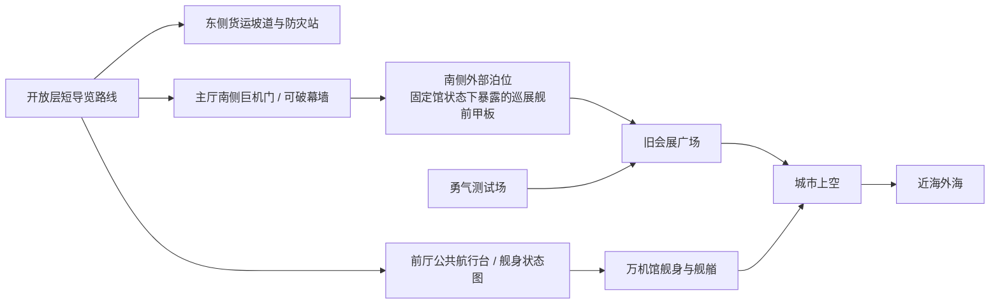
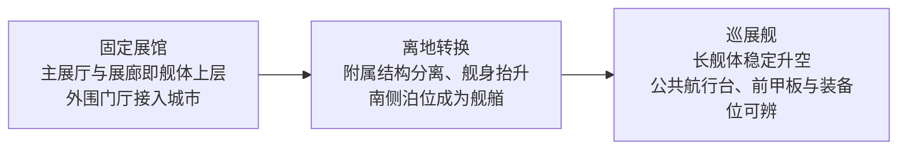
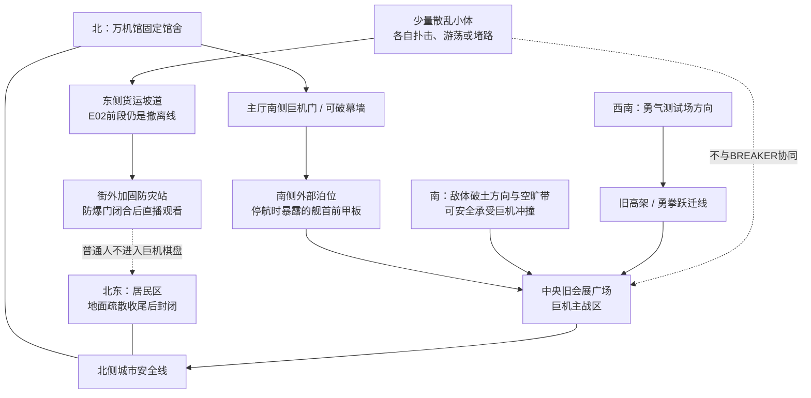
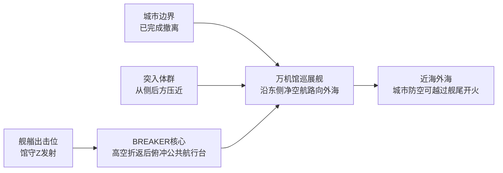
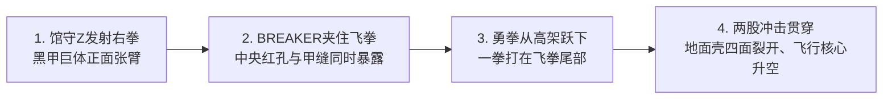
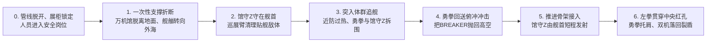
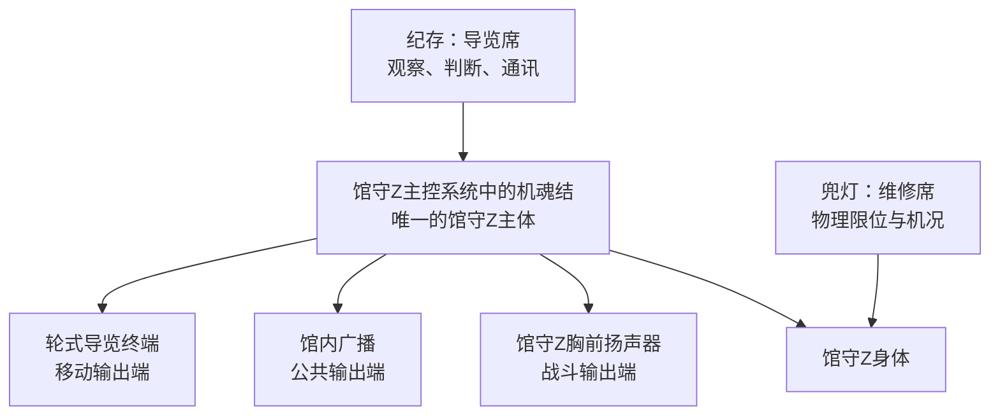

# C01《闭馆以后，万机出击》章级预生产模型

> Status: `layer4_preproduction_candidate / based_on_user_approved_story`
>
> 日期：2026-07-26
>
> 作用：锁定C01究竟有哪些人物、机体、敌人、空间、控制链和可见大动作。完整总纲只能调用本模型中的关键项；出现新因果实体时必须先回到这里。

## 一、负载与最小上下文

### 负载裁决

C01属于重量章，原因有四项：

- 18米馆守Z、17米级勇拳、29米BREAKER与百米级万机馆同章；
- 馆守Z从展品恢复战斗、万机馆从固定展馆恢复巡展舰；
- 敌人存在地面重甲与飞行核心两阶段；少量小型同类会在E02散乱漏入，E03才首次受核心统一指挥；
- 巨机战、母舰升空、人物远程通讯和城市撤离交叉。

因此必须有尺度轮廓、空间灰盒、控制链、战斗阶段图与关键奇观板。预演只验证能否看懂和摆下，不生产正式美术。

### 本轮加载

- L1体验宪章、L2总发动机、L3 C01切片与章间因果；
- C01用户审定故事、章级对齐卡和C02继承包；
- Current Canon中的纪存、七海、旧守护者、馆守Z、豪司、勇拳、万机馆、BREAKER；
- 万机馆空间、机体尺寸、外敌命名、机魂/G.A.G.稳定边界；
- C01双盲审与主笔完成审计中已经确认的高光功能。

### 有意不加载

- 旧C01 Reader、Runtime、Graybox中的回合数、行政机关和载荷Bundle；
- 白函、断臂桥、36小时窗口、皇影与零号捷径；
- C02以后机体与人物的精确战斗实现；
- 全部77机和IP素材池。C01只使用馆守Z、勇拳、职业小机与万机馆的已选投射。

## 二、人物本章状态

| 人物 | 开场欲望与位置 | 有限认知与误判 | 主动动作 | 拒绝线 | 章末变化 |
| --- | --- | --- | --- | --- | --- |
| 纪存 | 完成最后导览，送走观众，赴七海的饭约；在馆内 | 知道馆守Z有机魂，不知道旧守护者就是同一人格；以为路线杆只是旧馆长习惯 | 组织撤离、进入导览席、读出馆守Z动作、组织双机协战；提出把万机馆与敌群带出城市，在前厅航行台选择净空航路并组织友军 | 不让观众或馆藏成为证明万机馆价值的牺牲品；不能越过自动航行系统直接操纵百米舰体姿态 | 成为第七次巡展的实际组织者；首次证明自己的核心能力是理解机体意图与组织协战，仍不知道自身真相 |
| 佐伯七海 | 完成闭馆前最后公务并赴约；在东区封存中心附近 | 知道停机令属于自己，不知道万机馆还能恢复巡展舰身体 | 从预约晚餐转入危机联络室，撤回本人停机令；叠合城市公开净空航路、防空禁射区与代哥交通卫星图 | 不冒充军方、城市或代哥全系统的授权人；不把转发情报说成批准起飞 | 留城受调查，私人频道和下次饭约保留 |
| 旧守护者 | 完成最后一次导览并保护观众；机魂以馆守Z巨体主控系统为物理载体 | 知道万机馆曾能巡展，不知道今夜是否还能回应 | 借轮式终端陪伴观众；终端外壳被毁后从胸前继续说话；自主操纵馆守Z战斗 | 不把纪存当驾驶员，也不放弃仍在危险中的人 | 从展厅管理员重新成为战友；备用轮式终端在飞行稳定后接入馆内网络 |
| 兜灯 | 让馆守Z在不自毁的前提下站起来；维修架 | 知道展示回路下仍保留可应急直连的主动力，但老化冷却最多支撑本次连续出动 | 解除物理限位、连接主动力、报告右臂只能过载一次、改接巡展臂装 | 不接受把临时装备伪装成完整修复 | 随舰，开始照顾一个真实缺臂但仍能战斗的馆守Z |
| 唐胶 | 保住模型病院和待取藏品；馆内 | 知道木桶街生态与旧人，不知道万机馆会升空 | 送回小满模型、封防火帘、断开市政管线、固定馆藏并协助接入巡展臂；战后在全域求援中留下自己的技术联系方式 | 不拿孩子、收藏者或坏件来证明自己的专业 | 随舰；赵梅因故交和求援信息回应，木桶街成为现实可行的急修目的地 |
| 赵梅 | 在木桶街合作社处理夜间求援；本章仅以远程语音出现 | 从公开求援中知道舰体尺寸、转子异常和唐胶的联系方式；还不知道转子内部已经发生何种损伤 | 回应求援，提供重载泊位和一具尺寸接近的测试转子线索，要求落地后再量接口 | 不承诺转子必然兼容，也不替物主决定用途 | 与唐胶的故交线被重新接通；学习史与亡子往事保留到C02展开 |
| 荒川豪司 | 想让勇拳真正出拳而不是只测停车；附近测试场 | 知道企业会处分，不知道馆守Z是否愿意协战 | 两次申请待命、签回收卡后反向解除运输架、驾驶勇拳加入双拳战 | 不把勇气只留在产品报告里 | 首战成立但被企业回收，正式勇者驾驶欲望进入后续 |
| 小满、阿澄、老余及观众 | 完成最后参观并安全离馆 | 只知道万机馆将闭馆，不知道它会起航 | 观看、提问、撤离；小满带走修好的模型，老余以旧记忆确认馆守Z | 不成为跟随主角流亡的儿童队伍 | 留在城市，成为万机馆首胜的观看者与未来观众 |

## 三、机体、舰体与敌人

| 单位 | 驾驶/机魂/控制 | 尺度与职责 | 本章大动作 | 明确限制 | 章末 |
| --- | --- | --- | --- | --- | --- |
| 馆守Z | 馆守Z机魂自主控制身体；纪存只提供导航与协同；兜灯控制物理限位与维修 | 18米退役超级机器人；正面主力与保护者 | 撞墙出馆、扯盾挡炮、盾拍BREAKER、过载右前臂破甲、裂盾掩护离港、巡展臂守舰、推进骨架单次点火、左拳贯穿裸露核心 | 不能拖动万机馆；失去右前臂后不能自行飞行；推进骨架只支持终战一次直线出击；巡展臂不能打拳 | 右前臂毁损，装巡展臂，推进骨架报废，随舰 |
| 勇拳试作机 | 豪司驾驶；无已知独立机魂；企业持有 | 约17米高机动有人试验机；协战与冲击回送 | 接下测试重块、越黄线出击、沿高架连击、把储存冲击补在飞拳尾部、持续掩护离港、回送Boss俯冲并托住馆守Z归舰 | 不能单独打穿黑甲；短时推进；战后不能留队 | 企业回收，首战数据与处分保留 |
| 消防架桥机 | 城市消防驾驶组 | 8至10米职业机；撤离与环境控制 | 展开整块桥板压住燃烧通道 | 不与BREAKER正面战斗；不转为万机馆主力 | 留在城市 |
| 跌跌、机器犬 | 小型自主程序与现场人类确认 | 现实机器尺度；狭窄空间与撤离辅助 | 跌跌用背壳卡门；机器犬找回老余 | 不冒充巨机输出或新机魂证明 | 随舰，仍是小型伙伴 |
| 万机馆巡展舰 | 自动航行系统执行推力、转向、配平与姿态稳定；纪存选择航路并组织友军；唐胶/兜灯负责现场操作与停机；不是单人驾驶 | 高约35至45米、长约130至160米；移动基地与母舰 | 航行炉从展馆应急供电转入离港功率、前厅切回公共航行台、舰身带着主展厅离地、自动配平、有限航向变化、近防炮驱离贴舰小型目标、投放巡展装备 | 不做人形变形；不由馆守Z拖起；纪存不能手动逐台控制推进器；近防炮不能伤害Boss；不具备战列舰级火力或无限格纳库 | 第七次巡展启动；主循环转子持续高温且伴随异常震动，当前低功率飞行可维持，停机后能否再安全启动无法保证；急需重载泊位、全尺寸检修与兼容转子 |
| BREAKER | 外敌自主主体；地面壳与飞行核心同一主体 | 地面壳近29米；核心本体十余米、翼展近50米；Boss | 钻地突入、重甲冲撞、红光冲击、受夹击时把核心缩向上背、破甲展翼、脉冲调动增援、俯冲公共航行台 | 地面壳笨重且胸前开口会暴露；飞行核心失去重甲后依赖速度与增援 | 被击毁，真正追逐原因未明 |
| 小型突入体群 | E02以前各自行动；E03起才受BREAKER脉冲统一调动 | 地面与空战杂兵；E02制造撤离并行压力，E03以后追舰、包围与遮蔽核心 | E01先作为大多被挡在城外的接触点出现；E02少量沿BREAKER造成的缺口漏入，分别扑击消防车、围堵出口或在街区游荡；E03幸存小体与外海同类随脉冲第一次同步转向；E04贴近舰体 | E02不得配合Boss、形成队形或共享战术；核心被干扰或击毁后失去统一指挥 | 大部被击落；残余失去方向 |
| 无标志白色采样机 | 未知机构远程或内置程序；本章不解释 | 小型回收机；尾声暗线 | 从积水中捡起右拳残片并收纳离开；断裂支撑刮落其夹爪内侧一枚拇指大的白色衬片 | 不战斗、不说话、不揭示幕后身份；遗留衬片不能直接证明采样机身份 | 带走第一份实物样本；城市清理组次日只登记到“不明白色复合材料” |

## 四、六条控制与能力链

### 4.1 旧守护者与馆守Z

```text
馆守Z巨体主控系统中的机魂载体
-> 轮式导览终端 / 馆内广播 / 胸前扬声器
-> 同一个旧守护者在不同输出端说话
-> 兜灯解除物理限位 + 七海撤回本人停机令
-> 馆守Z机体由旧守护者自主行动
```

终端被压不等于机魂转移或复制。损坏的是可更换输出外壳；器材库中的备用轮式终端要到航行稳定后才能重新接入馆内网络。纪存也没有进入馆守Z灵魂，只是坐进导览席。

### 4.2 纪存的导览席协战

```text
馆守Z视线、重心与现场路线
-> 纪存凭日常导览经验理解意图
-> 通过通讯把方向和时机说给豪司/城市边缘火力
-> 各驾驶员与机体自行接受并执行
```

纪存不能按下按钮控制馆守Z四肢，也不能读取敌人思想。

### 4.3 七海撤锁

```text
七海本人过去签发的停机令
-> 危机联络室确认馆内人员已离开主厅并进入封闭消防通道，兜灯仍在现场
-> 东侧最后应急车辆与撤离线仍在收尾
-> 七海撤回自己的命令
-> 馆守Z动力限制解除
-> 馆守Z起身后先护住东侧撤离线
-> 七海进入内部调查
```

这是一个普通人能理解的电子授权行为，不创造实体U盾、根证书或全系统万能权限。

### 4.4 勇拳冲击回送

```text
拳甲承受外部冲击
-> 可见蓄力环逐节压入
-> 豪司选择何时出拳
-> 蓄力环弹回，把已有冲击与当前拳力一起送出
```

没有先承受冲击便不能凭空蓄力；E03的最终回送来自此前连续碰撞和跃下冲击。

### 4.5 BREAKER两阶段

```text
地面重甲保护核心并承担钻地/冲撞
-> 钻地破防造成缺口，少量同类在E02各自漏入；它们与地面壳没有协同
-> 飞拳被双爪夹住时，核心从胸腔缩向上背
-> 馆守Z飞拳与勇拳接力击穿已经腾空的中央通道
-> 地面壳破裂，飞行核心从上背展翼
-> 核心脉冲第一次把E02幸存小体与外海同类调成统一行动
-> 击毁核心后群体失去统一方向
```

地面壳胸前的红裂是钻地与攻击时张开的装甲通道，飞行态中央红孔才长在核心本体上。两阶段共享赤红收缩这一视觉识别，不是同一个物理孔洞。

### 4.6 万机馆恢复巡展舰

```text
第六次巡展照片中的巡展舰、历经换装的近防炮与仍被保养的路线杆
-> BREAKER持续追逐万机馆，航行系统向馆内终端报告仍可工作
-> 纪存决定带战场离开城市并确认紧急离港
-> 前厅由导览区切回公共航行台
-> 长期作为展馆应急电源使用的航行炉转入离港功率
-> 装具与人员清场完成，馆守Z以裂盾掩护最后作业
-> 舰身自身动力解除长期固定，带着主展厅离开地面
-> 自动航行系统负责推力、转向与配平，纪存只选择净空航路并组织友军
-> 屋檐近防炮恢复，只驱离贴舰小型目标
```

航行炉在万机馆固定为展馆后，一直以低功率承担停电时的消防、照明和馆藏保护。路线杆不是能源，也不是直接驱动百米舰体的方向盘；纪存只用它选择城市已经清空的航路，自动航行系统负责把航向转换成推力、舵面和配平动作。

馆守Z的推进骨架只负责一次直线发射。终战后由勇拳托住它的左肩、修正落点，两机一起落上裂盾；不使用锚索追敌，也不预挂回收索。巡展臂只承担装卸、抓取和贴舰清理。

终战后，万机馆主循环转子的温度不再回落，舰腹同时出现不规则震动。兜灯只能确认当前低功率飞行尚可维持，无法保证停机后转子还能重新启动；更严重的主轴损伤留到C02靠泊后再确认。万机馆因此向全域发出简短的紧急维修请求，内含舰体尺寸、当前震动记录、接口图和唐胶的技术联系方式。

赵梅从木桶街回应请求：当地重载泊位能容纳万机馆，还有一具九米级新转子正在试车，但她不替物主承诺可以使用，兼容性也必须落地实测。唐胶说明她是自己已故徒弟的母亲，并以对她做事方式的了解确认这不是空头招揽。木桶街因此同时满足“先安全停舰”和“转子可能有解”两个现实条件。

这不是馆藏拼装、G.A.G.凭空造舰或馆守Z拖起建筑。G.A.G.的深层作用留在后台；玩家只看见旧身体在危机和选择中重新回应。

## 五、空间与尺度灰盒

### 5.1 只保留五个主空间

1. **开放层短导览路线：** 主展厅、模型病院、驾驶舱廊和中庭远景，同一套展馆资产。
2. **东侧货运坡道与防灾站：** 观众沿坡道离馆后进入街外加固防灾站；E02前段少量小体会袭扰消防车和出口，撤离线完成收尾后由防灾站直播屏承接后续观看，不让群众停在巨机近战区。
3. **旧会展广场与南侧前甲板泊位：** 主厅南侧巨机门/可破幕墙面向广场；门外的宽服务道先经过南侧外部泊位，再进入广场。这个泊位不是另一个场景，而是巡展舰停航后仍暴露在地面的前甲板，固定馆状态下兼作18米机体位；整馆升空时它自然成为舰艏甲板。
4. **勇气测试场：** E01直播和E03豪司出击的复用场景，不与主战场同图操作。
5. **巡展舰与外海空域：** E04使用前厅公共航行台、舰艏与空战地图三个视角，不展示复杂内部机械；馆守Z在最终发射前始终留在舰艏，城市防空只以地图边缘火力存在。

### 5.2 连接关系



### 5.3 尺度判断

| 主体 | 约束 |
| --- | --- |
| 跌跌、机器犬与人 | 只在撤离阶段活动；巨机SRPG开始后普通人不作为棋盘单位，撤离线以消防架桥机、出口与街区危险状态表示 |
| 消防架桥机 | 低于馆守Z膝部，桥板横向存在感大于身体 |
| 勇拳、馆守Z | 约17与18米，可以并肩协战 |
| BREAKER地面壳 | 近29米，对馆守Z形成明确体型压制，但不是数倍巨兽 |
| BREAKER飞行核心 | 身体更小、翼展近50米，视觉优势由速度和宽翼构成 |
| 万机馆 | 舰长约130至160米，任何单台巨机不能抬起；馆守Z从舰首出击而非站在整舰内部 |

固定馆的外围门厅、市政连接和承托支撑会在紧急离港中破坏。万机馆之后仍可飞回城市上空，但无法在没有巨构泊位和检修支持的情况下恢复原来的固定博物馆状态。

## 六、可用大动作词库

### 馆守Z

- 撞开已经开裂的展墙，整机从展台进入雨夜；
- 从展厅扯下退役重盾，转身挡住赤红冲击；
- 把重盾横拍在BREAKER脸上；
- 发射过载右拳，拳头在敌胸前被夹住；
- 从舰首以推进骨架直射云层；
- 用左拳贯穿BREAKER中央红孔。

馆守Z在E04前半不能离舰飞行。它可以站在舰首阻挡贴近甲板的敌体、使用巡展臂抓取相邻目标；推进骨架只提供一次离舰直冲。击破后由勇拳协助修正落点，两机以裂盾作为缓冲面归舰。

### 勇拳

- 接住测试重块，再把冲击原路打回；
- 挣开运输架，越过测试场黄线；
- 沿断裂高架跃迁连击；
- 从高处坠下，把拳甲储存的冲击补在馆守Z飞拳尾部。

### BREAKER

- 以钻头形态撞穿近海高架并沿地下突入；
- 从街道破土，站成黑甲巨体；
- 外壳四面裂开，飞行核心展开薄翼；
- 在万机馆上空发出脉冲，令增援群同时转向；
- 合翼成赤红长矛俯冲入口前厅公共航行台。

### 万机馆

- 公共供水、供电和消防软管依次自动闭合，舰外连接臂脱开；
- 展柜和馆藏固定扣转为航行状态，留舰人员进入有安全带的岗位；
- 地面裂开，一次性承托支撑折断，固定展馆整体抬升；
- 舰身带着主展厅升起，自动系统将偏载舰体扶正并转向；
- 巡展装备依次从真实装备位脱离并送到舰首；
- 馆守Z从舰首发射、击破后由勇拳协助落回裂盾。

## 七、资产与复用

| 资产 | 等级 | 处理 |
| --- | --- | --- |
| 万机馆开放层、模型病院、中庭 | reuse/T2补景 | 同一场景组承担导览、撤离和馆守Z起身；用未开放区剪影制造厚度 |
| 馆守Z四态 | T3 | 半跪展品、双臂重盾、缺臂、巡展臂装；共享主体Rig |
| 勇拳测试/实战态 | T2 | 同一机体，运输架和蓄力环为状态差分 |
| BREAKER两阶段 | T3 | 两套Boss轮廓共享中央红孔视觉核心 |
| 小型突入体群 | T1/T2 | 复用同一基础轮廓制作散乱移动、扑击、受击和同步转向；故事不锁精确数量，L6必须测试与建筑、Boss轮廓的遮挡 |
| 万机馆三态 | T3 | 固定展馆、离地转换、巡展舰；不增加半人形或复杂内部折叠态 |
| 消防架桥机 | T2 | 后续职业机/工务城可复用，不为C01造普通武装 |
| 巡展重盾、黄色巡展臂、推进骨架 | T2 | 既是E01展品，也是E02-E04战斗装备，必须完成前后回收 |
| 东侧坡道、相连街区与旧会展广场 | T2 | 人尺度撤离与巨机SRPG分段操作，但共享同一可滚动街区资产和破坏态；道路、出口与建筑属于棋盘本体 |
| 封锁广场战后状态 | reuse/T1补景 | 复用旧会展广场，增加积水、断裂支撑和遗落右前臂残骸；断裂支撑另从采样机夹爪内侧刮落一枚可被城市清理组登记的白色衬片 |
| 外海空战图 | T2 | 后续近地防卫、母舰战和外敌再临可复用 |
| 路线杆、巡展照片、预约餐厅空位 | T1 | 分别承担航行台伏笔、巡展回收与关系余味 |
| 白色采样机 | T1/T2 | 只需清楚轮廓与收纳动作；后续若成为战斗单位再升级资产 |

## 八、低精度视觉预演

以下只锁定相对尺度、空间方向和高潮动作，不是正式美术设定，也不规定镜头秒数。

### 8.1 多尺度轮廓板

| 轮廓 | 参考尺度 | 同场规则 |
| --- | --- | --- |
| 人 | 约1.7米 | 只在安全区、驾驶舱或撤离段出现，不站在巨机近战区 |
| 消防架桥机 | 8至10米 | 身高约到馆守Z腰部，展开后的桥板比本体更醒目 |
| BREAKER飞行核心 | 本体约12米、翼展近50米 | 本体不靠身高压迫，靠横贯画面的翼展和速度压迫 |
| 勇拳 | 约17米 | 可与馆守Z同框并肩，轮廓更轻、更前倾 |
| 馆守Z | 18米 | 地面战视觉基准 |
| BREAKER地面壳 | 近29米 | 比馆守Z高约一个上身，能在近战中形成清楚压制 |
| 万机馆巡展舰 | 高约35至45米、长约130至160米 | 以舰长占画面；馆守Z只能从舰首甲板出击，不能抬舰 |

```text
高度示意（非等比）：

人     架桥机       核心本体      勇拳  馆守Z       BREAKER壳        万机馆舰体高度
|       |             |            |      |              |                    |
1.7m   8-10m          ~12m         17m    18m            ~29m                35-45m

万机馆舰长 130-160m  >>>>>>>>>>>>>>>>>>>>>>>>>>>>>>>>>>>>>>>>>>>>>>>>>>>>>>>>>>>>
BREAKER核心翼展 ~50m                   <<<<<<<<<<<<<<<<<<<<<<<
```

判断结果：勇拳与馆守Z适合双机协战；BREAKER地面壳足以形成Boss体型差；飞行核心与万机馆的对抗靠翼展、速度和对公共航行台的俯冲威胁成立，不靠把核心继续放大。

### 8.2 万机馆三态轮廓



转换画面只要求三个大变化：**离开地面、建筑轮廓收束、舰艏朝向外海**。馆藏不逐件参与折叠，室内不展示一厘米一级的机械位移。

### 8.3 双战场灰盒

**旧会展广场：E02至E03地面战**



- E02前段目标：让消防架桥机和最后的应急车辆通过东侧撤离线。少量小体各自制造压力；地图不显示精确Canon数量，也不让它们与BREAKER共享行动。
- E02主战目标：馆守Z在中央广场挡住由南向北逼近的BREAKER，同时不让散乱小体切断东侧撤离线；撤离收尾后，东侧出口转为已封闭的安全边界。
- E03主目标：在广场识破并击穿重甲；飞行核心显形后，以一幅清楚群体画面表现散乱小体第一次同步，高架只承担勇拳的一次大跃迁，不做复杂迷宫。
- 地图持续保持两个易懂方向：**北侧是万机馆与居民区，东侧撤离线必须先守住，南侧才是可以放开打的空地**。

**外海空域：E04母舰战**



- 第一阶段由玩家选择万机馆航向与支援对象，自动系统执行移动和转向；有限近防只处理贴舰小目标，馆守Z留在舰艏，勇拳离舰机动。
- 第二阶段只让玩家处理BREAKER对公共航行台的一次俯冲。
- 城市、外海和舰艏是三个清楚方向，不在同一阶段加入内部走廊战。

### 8.4 E03双拳破甲四拍



无对白检查：只看四张图，也能理解“第一拳被接住，第二台机把它继续打进去”，不需要解释细小关节、受力角或多段权限。

### 8.5 E04升空与终战六拍



无对白检查：六张图能够依次读出“馆变舰、取装备、敌压舰、友军救场、主角机发射、Boss击破”。若后续演出需要新装置才能让其中一拍成立，应先退回预生产模型，而不是在梗概中临时命名。

### 8.6 旧守护者控制链图



纪存到旧守护者的箭头代表沟通，不代表灵魂注入或肢体控制；三个说话端也不是三份人格。

## 九、退役与阻断

以下项目不得进入C01新导演板和总纲：

- 白函或代哥无人机作为主敌；
- 四方接管、消防锁回写、移动风险编号；
- 断臂桥、载荷二选一、档案主库牺牲；
- 陆衡登场或随舰；
- 36小时死亡倒计时；
- 0号侧廊、迟到回信、错序箭头必显；
- 馆藏逐件参与舰体变形；
- 纪存驾驶馆守Z四肢；
- 巡展臂装能打拳或无损替代原右臂；
- 资料卡承担旧守护者同体、BREAKER二阶段或万机馆升空的首次解释。

## 十、预生产结论

当前故事不需要新增专有设施。所有主因果可以由五个主空间、七类战斗主体、六条控制链和一组前后复用的巡展装备完成。可进入`章节导演板 / 战斗预案 / 物理板`，但三板只能选择、排列或否决本模型中的项，不能再创造关键装置。
