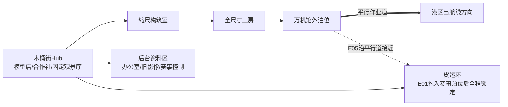
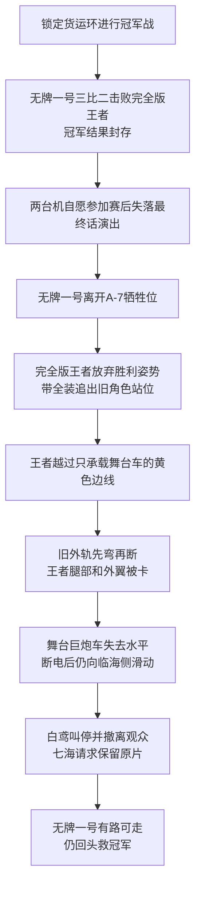
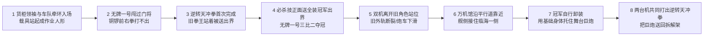

# C02《木桶街，万机初开：最后一届木桶杯》物理因果与人物站位板

> Status: `targeted_repair_v11 / locked_final_and_postshow_rescue`
>
> 日期：2026-08-05
>
> 本板只验证时间、空间、尺寸、控制权、信息来源和大动作。它可以否决高光，不能创造新装置替高光辩护。

## 一、固定输入

- 万机馆长约130至160米，C01留下的应急余量在进入木桶街泊位后耗尽；靠泊检查才确认旧转子主轴受热弯曲、外壳变形。木桶街没有九米级高速转子的整件校直和动平衡设备。万机馆只能在泊缆内挪正，不能完成前往工务城的水空段。
- C01紧急离港未经七海或资产权利方批准。城市应急部门事后只把在舰人员登记为临时保全人：可停泊、保命、做必要维修、借出可归还设备和接收替换件；不可出售、抵押、拆分馆藏、独立参加商业赛事或签长期保险。
- 木桶街泊位只能托住舰体并提供普通岸电，赛事结束后要让给搬迁；船台位于可沿平行作业道移动的连续重载托架上。火种货柜领袖只能牵引有托架、重载道、泊缆或陆路支撑的巨构，不能直接拉舰壳或全程拖航万机馆。
- 馆守Z高18米，原右前臂已毁，黄色巡展臂只能抓取、固定和搬运。
- 无牌一号16米、完全版王者20米、旧拳王17米、火种货柜领袖14米、重涂飞行队约13米。
- 货运环外径约260米，有效赛道宽约45米；它不是能被一台18米机体抬起的小型舞台。
- 货运环由地面车队在E01拖入赛事泊位，落下支脚后全程锁定。临海外侧的旧舞台轨只允许舞台运输车通过，黄色边线之外禁止巨机进入。
- 大型循环转子约九米直径，连运输架约三层楼高，只够让万机馆安全飞到工务城。
- 七海始终远程；白鸢E02实体到场；陆衡始终远程；赵梅留在木桶街。
- 跌跌和机器犬随舰抵达，保持现实尺度；E03只进入已经停机并落下实体支撑的低位检查道。
- 机体主体自行控制身体。玩家操作代表战术提案和机体响应，不等于纪存遥控四肢。

## 二、三尺度轮廓

```text
约260米  ┌─────────────────── 货运环 ───────────────────┐
          │ 外圈赛道  中央检修架/冠军转子  临海外侧旧舞台轨/炮车 │
          └──────────────────────────────────────────────┘

130-160米      ┌────────────── 万机馆巡展舰 ──────────────┐
               └────────────────────────────────────────┘

14-20米             [货柜领袖] [无牌一号] [馆守Z] [完全版王者]
```

尺度裁决：

- 万机馆可以用舰侧宽面承接货运环临海一侧，不能把整座圆环抬离地面支脚。
- 馆守Z只能固定一段连接桥，不能用单臂拉回整环。
- 货柜领袖只能协助牵引万机馆沿港区平行作业道和陆路移动，不能把百米舰拖过开阔水空段。
- 飞行队只处理高空侦察、碎片与拖拽炮车的卡索，不承担环体重量。

## 三、主要空间与连接



### 空间使用边界

| 空间 | 允许 | 禁止 |
| --- | --- | --- |
| Hub | 人物ADV、模型生态、赵梅分派、赛事观看 | 18米机体在店街高速战斗 |
| 缩尺构筑室 | 模型装配、动作概念测试、玩家选方案 | 制造或吊装全尺寸部件 |
| 全尺寸工房 | 16至20米机体整备、制造对应件、台架和实机测试 | 让塑料件直接放大、维修整艘万机馆 |
| 外泊位 | 百米舰检修、拆借舰侧推进模块、转子安装 | 万机馆原地高速掉头或驶入店街 |
| 货运环 | 资格战、半决赛、三比二冠军战、赛后演出和终局支撑战 | 让普通观众留在赛道；让人类在巨机脚下作战；整座环边移动边比赛 |
| 临海外侧旧舞台轨 | 舞台运输车按预设路线进入；事故后成为炮车下滑与王者被卡的局部战场 | 巨机在黄线外活动；把它写成承载整座货运环的主结构 |
| 后台资料区 | 授权痕、旧影像和三层资料调查 | 用终端资料直接改变巨机身体 |

## 四、时间与人物移动

| 节点 | 纪存/唐胶/兜灯 | 赵梅 | 白鸢 | 七海 | 陆衡 |
| --- | --- | --- | --- | --- | --- |
| E01抵达 | 随舰进入外泊和Hub | 在泊位接人，随后回合作社 | 收到侵权提示，在前往木桶街途中 | 原城调查席，私人通讯 | 工务城，尚未接入 |
| E02构筑 | 构筑室与全尺寸工房；纪存居中介绍首次通话 | 分派工房与资料 | 下午实体到达，先撤下侵权宣传，再与七海互报姓名 | 远程查赛事与原片，先确认有无人受伤 | 由赵梅邀请远程会诊 |
| E03调查/半决赛 | 后台资料区与货运环 | 全程在场，决定公开到什么程度 | 对照旧分镜和实机痕迹 | 提供可核对的旧文件 | 只在工程终检窗口出现 |
| E04冠军战/演出 | 冠军战时在固定观景厅和赛事组织席；事故发生后纪存与白鸢协助观众撤向Hub，唐胶和兜灯回岗位 | 固定观景厅与赛事组织席，负责本地叫停和撤离 | 与纪存同在固定观景厅，叫停演出并协助撤离 | 远程观看公开赛事画面并请求保存事故原片 | 不参与关系争执 |
| E05救场/交割 | 纪存回舰桥调度；唐胶/兜灯各在岗位 | 地面调度与转子交割区 | 万机馆观察/支援席，战后准备登舰 | 远程提供独立镜像方法并核对登舰记录，不操作本地设备 | 救场后进行机体与转子终检 |

白鸢从E01途中到E02下午抵达，至少经过一昼夜。七海和陆衡都没有实体出现在木桶街，也没有隔空操作当地设备。

跌跌和机器犬在E01、E02随万机馆停靠并作为Hub可见成员存在；E03由兜灯带到全尺寸工房的安全侧。跌跌进入腰髋下方的低位检查道，机器犬留在外侧牵引信号线。无牌一号落下实体支撑、机械锁定并确认停机以前，两台小机器人不得进入。

## 五、控制权总表

| 对象 | 直接控制者 | 其他人能做什么 | 不能做什么 |
| --- | --- | --- | --- |
| 无牌一号 | 无牌一号机魂控制身体；历代出资修复者共同持有身体，合作社托管维护 | 玩家/纪存提战术；兜灯停机；工房安装已测试部件；共同维护人交接长期迁移责任 | 杂鱼港或纪存遥控动作；赵梅替它决定参赛与去向；把自主参赛视为身体可被任意带走 |
| 完全版王者 | 完全版王者机魂控制身体；旧承包商持有并维护身体 | 杂鱼港按本届赛事使用权编排节目并解锁装备安全固定；玩家与其对战 | 胶价王逐动作操纵；赞助方替它卸装；用旧作权利覆盖机体本人同意 |
| 旧拳王 | 旧拳王机魂控制身体；旧武斗馆持有身体并负责维护和训练记录 | 玩家提战术；武斗馆设非致命规则并可交接随舰维护责任 | 手套成为驾驶员；唐胶用录像控制它；万机馆未经交接直接带走身体 |
| 火种货柜领袖 | 货柜领袖机魂 | 工程席给牵引点和有支撑面的路线；玩家提任务 | 物流系统夺取身体；全程拖航百米舰；跨越无轨道水空段 |
| 万机馆 | 自动航行系统执行；纪存组织；岗位成员操作；赵梅合作社承担木桶街外部担保 | 货柜领袖与地面牵引提供外力；临时保全组可借出可归还设备、接收必要维修件 | 纪存直接控制所有推进器；馆守Z驾驶万机馆；临时保全组出售抵押馆藏、独立参赛或替新机签长期保险 |
| 馆守Z | 馆守Z机魂 | 兜灯解除或执行停机；纪存提协同 | 纪存控制四肢；巡展臂当右拳 |
| 舞台巨炮运输车 | 演出控制席负责运输车、烟光与紧急断电；巨炮没有机魂，两台机体也没有炮体控制权 | 安全席可断电；地方工程车可固定底盘；工作人员可卸走烟光弹箱；两台机体可实体托举和推动 | 巨炮自行产生意志；七海远程夺控；断电后继续发射；胶价王隔空操纵炮车撞人 |
| 货运环 | E01落下支脚后由赛事管理席维持锁定 | 地面作业队可检查支脚、封闭局部区域和修复外轨 | 胶价王让整环边移动边比赛；一台机体让整环悬空 |

“停止”必须在演出中分开表达：冠军战在三比二时自然结束；白鸢叫停的是赛后演出；安全席切断的是舞台烟光和运输车动力；自主机体本人或其维护组执行本体紧急停机。安全席没有一个能让所有机魂同时僵住的总按钮。

## 六、模型到实机的物理链

### 四个相邻但不同的工作面

1. 玩家在缩尺模型上选择动作轮廓和装备关系。
2. 唐胶说明“为什么这样装”和“希望机体怎样打”。
3. 陆衡与本地工程员把方案改成能制造的全尺寸结构；不能放大的部分被明确删除或替换。
4. 工房用不同材料制造、测试，兜灯完成实机安装，无牌一号再实际使用。

缩尺模型和全尺寸部件在画面中必须有明显尺寸、材料和工作空间差异。镜头可以做“相同轮廓匹配”的转场，但不能让玩家误以为同一块零件突然变大。

### 为什么唐胶、陆衡和兜灯都需要

- 唐胶回答：这个改法想表达什么动作、保留什么个人痕迹。
- 陆衡与本地工程员回答：怎样换成全尺寸材料、驱动和安全范围。
- 兜灯回答：眼前这台具体机体能否装、何时必须停。

任何一个人都不能独自完成全部链条。赵梅不进入技术席，她负责让正确的人和资料碰面。

## 七、赵梅学习史的证据链

### E01只露出“不是天生会”

- 合作社前台仍夹着一张她早期填错型号、后来重新贴正的旧单。
- 维修分派图上每个领域都有不同负责人的名字，赵梅的名字在“联系、分派、复核”栏，而不在所有技术栏。

### E02让玩家操作她的方法

- 一个简短分派交互要求玩家把三个问题分别送给模型师、全尺寸工程员和物主确认。
- 赵梅会坦白一项自己不知道的缩写，并当场联系旧客户，不假装懂。

### E03公开完整来源

- 儿子原笔记：专业缩写多，只有他本人能快速读懂。
- 赵梅早期复印页：用日常词逐项补注，有改错和问号。
- 合作社维修页：多人署名的图文步骤，能让后来者复做。

三层资料与无牌一号腰髋上的旧工号互相印证。赵梅只需用几句普通话说明自己先学会对订单、再学会问人、后来才学会分派；不朗读一生，也不把儿子的死变成宇宙答案。

### E05回收

最后一批维修件继续寄出。旧工作账号后面加的是赵梅现在的联系电话，说明事业被接续但没有假装原来的人还在。

## 八、两台机体旧身份的证据链

身份不能由白鸢一句“我认出来了”单独成立。至少四项独立证据互证：

1. 完全版王者用旧编号呼叫无牌一号。
2. 两台全尺寸身体保留被刮掉或覆盖的旧宣传机授权痕。
3. 白鸢原始分镜画有无牌一号接住冲击、收拳蓄势却没有打出最后一拳的动作，以及完全版王者的最终炮位。
4. 合作社维修记录与儿子旧工号证明无牌一号的底盘来源和后续改造。

旧动画没有真实发生。真实存在的是宣传机身体、反复排练、观众期待、维修和角色编号。玩家在C02只需明白“这些经历让机器熟悉旧角色”，不需要先知道完整机魂机制。

## 九、赛事与货运环为什么必须发生

### 基础赛事

- 冠军取得大型转子。
- 完成整届赛事，木桶街取得原定搬迁款。
- 这两项在追加复播以前已经成立，避免所有人被一份临时合同强迫犯傻。

### 追加复播

- 胶价王追加积压运单和新址设备资金，条件是完成没播出的最终话。
- 两台机体知道旧身份后都主动同意进入决赛，冲突不只来自商业胁迫。
- 无牌一号有权中途离开旧牺牲位置；完全版王者也有权继续追求自己认可的结局。

### 为什么赛后演出仍会造成事故

- 货运环在E01被拖入赛事泊位后已经落下支脚，冠军战期间从未移动。
- 失落最终话需要一台装在运输车上的舞台巨炮沿临海外轨入场；外轨原本只承担舞台车和轻型设备。
- E03赛前检查与E04演出开场都拍清黄色边线：巨机不得进入外轨。
- 无牌一号离开A-7牺牲位后，完全版王者带全装主动越线追上；外轨承受的重量远超用途，先弯再断。
- 舞台巨炮在断电后不再发射，但炮车已经失去水平，会在重力下继续滑动。危机来自老化设施、清楚越界和真实重量，不来自新技术或炮体觉醒。

## 十、E01至E03因果

### E01报名与资格赛

1. 万机馆用完最后的靠泊余量后，兜灯才确认旧转子主轴被烤弯、本地没有整件校直设备；馆守Z十八米本体留在外泊位，注意力转到B1备用轮式终端随她检查。港区图同时证明万机馆不能直航、货柜领袖只能牵引有地面托架支撑的船台、泊位也不能长期占用。
2. 奖品转子与接口同代，本体完好但需要C03校正。转子归杂鱼港所有；对方已经用“冠军取得转子”交换赛事赞助、直播订单与搬迁款，拒绝赛前出售或外借。万机馆也没有现金、抵押和商业保险改写交易，赛后泊位必须腾空，不能再逐一等待并游说不确定的冠军。
3. 报名台拒绝万机馆作为商业参赛主体；城市事故后的临时保全证明只能支撑必要维修。赵梅合作社承担本地赛事和现有保险担保，无牌一号代表自己走到报名线并保留奖品处分权。
4. 纪存征得舰内同伴同意，拆借赛后必须复装的舰侧推进模块；代价是万机馆失去独立横移。该设备属于万机馆，不是馆守Z在C01报废的右臂推进骨架。
5. 无牌一号确认若获胜便让合作社限定代管转子、用于万机馆维修，然后在九十秒内突破两台门将。它在铜锣前打不出最后一拳，只能用肩头撞响；完全版王者以旧编号呼叫它，留下身份疑问。

### E02构筑、重涂小品与指导

1. 玩家在缩尺模型上选择一项训练支援意图；唐胶说动作，陆衡和工程组只确认实机能否安全练习，不替机体创造招式。
2. 全尺寸工房布置通用防摔架、试验锤和停机线，兜灯负责测试，无牌一号自行试招。
3. 模型店用同一飞行骨架盒做出红、蓝、黄三种商品角色；外场三台同骨架实机分别执行高速巡查、低速护航和远距警戒。三台各有机魂，只是共享生产骨架，不参加木桶杯签位。
4. 四席已经确定：完全版王者为卫冕冠军，旧拳王为挑战者种子，坞工杰克是地方优胜者，无牌一号取得E01公开席。签表把旧拳王与无牌一号排进半决赛，王者迎战坞工杰克。
5. 旧拳王在不计分指导战中逼出“接住、蓄势”的半招，给它取名“逆转天冲拳”；无牌一号仍无法踏出和出拳。
6. 白鸢实体抵达，确认赛事宣传擅用了自己的旧分镜；纪存将她正式介绍给七海，两人此前不认识，只先核对人员安全与原始画面。

### E03调查与半决赛

1. 赵梅允许查看遮掉物主隐私的三层资料。
2. 无牌一号停机并落下实体支撑后，跌跌把相机送入低位检查道，机器犬在外侧牵引信号线；取得的旧授权痕、分镜、机体动作和维修工号互证旧身份。
3. 两台机体看完资料后都主动选择进入决赛。
4. 完全版王者先在另一场半决赛击败坞工杰克；随后无牌一号与旧拳王按E02公开签表正式交手。旧拳王不白送重击，无牌一号主动抢进拳距，接住真正的一拳，踏出两步，以首次完成的逆转天冲拳把旧拳王送出界。
5. 普通观众进入固定观景厅；货运环保持锁定，中央检修架里的冠军转子维持低速空转，临海外侧旧舞台轨等待赛后演出。

## 十一、E04冠军战与赛后事故因果



白鸢的预演被推翻，是因为两台机体都没有按原分镜行动，不是因为出现神秘干扰。七海只能发起事故原片保全请求并提供独立镜像办法；执行停演、断电和撤离的是白鸢、赵梅与木桶街本地操作员。她不能远程切电、夺台或操纵木桶街设备。

## 十二、E05救场因果与三态灰盒

### 状态A：赛事锁定

```text
              [固定观景厅]
                    |
[万机馆泊位] ---- [货运环：锁定]
                    ◎ 中央检修架 / 冠军转子
                    └ 临海外侧旧舞台轨 / 炮车
```

### 状态B：旧外轨断裂

```text
[万机馆泊位] ===================== 平行作业道
                       [货运环：仍在原位]
                         \__ 王者被卡 / 炮车下滑
                    观众由固定厅撤向Hub
```

### 状态C：多机救场

```text
       飞行队：侦察 / 挡碎片 / 断卡索
                         \
[万机馆] --舰侧--> [锁定货运环  \___ 临海事故侧]
     ^                    ^      ^
货柜领袖牵引         旧拳王清外装  馆守Z压连接桥
```

救场顺序只保留一个当前目标：

1. 红色高速机标出仍在变形的外缘后过热退出低空；蓝色护航机挡开碎片并护送工程车；黄色远射机等待固定索先承重，再打断拖拽炮车的两条卡索。
2. 货柜领袖与地面车队牵引承载万机馆的船台托架，让它沿平行作业道靠近。
3. 万机馆只接住临海一侧，地面支脚仍承担另一侧；馆守Z固定一段断桥，旧拳王清理卡住王者的外装，坞工杰克与工程车固定炮车底盘。
4. 胶价王拒绝把事故剪成牺牲宣传，开放赛事自救设备；旧承包商当值维护员确认事故拆离，完全版王者本人决定卸装。
5. 完全版王者主动卸去外翼、双盾、背炮和头冠，用基础身体托住无动力舞台巨炮；无牌一号接住炮车回落的冲击，两台机共同完成逆转天冲拳，把炮车送回临海拆解架。工程车随即固定底盘，人员卸走烟光弹箱，吊机整件移走。
6. 裁判重申E04三比二赛果。救场不换分，也不重赛；无牌一号以既定冠军身份处分转子。

这一顺序避免SRPG同时要求玩家追踪所有问题。每个阶段只显示当前目标和下一项威胁。

### 赛后转子交付链

1. 地面支撑车接过临海侧临时负荷，万机馆退出支点；受损舞台区继续封闭。工程组确认中央检修架、奖品转子和原运输架未受事故损伤后，检修架才停止低速空转。
2. 无牌一号再次确认奖品交给赵梅合作社限定代管、用于万机馆维修；杂鱼港、裁判和合作社完成交割，万机馆临时保全组只确认接收安装和维护，不取得转卖权。
3. 万机馆旧转子彻底停机、断开，由B1维修轨整件移到旁侧锁架，空出主循环安装位；旧件随舰带往工务城修复。
4. 港口龙门吊把九米奖品转子连原运输架卸到重载通道，火种货柜领袖牵引到万机馆泊位。
5. 泊位吊机把运输架送上万机馆B1大型货运升降台，再运到已经空出的安装位；不由巨机徒手搬运。
6. 陆衡远程复核，木桶街全尺寸工程员加工一次性连接件，兜灯负责安装检查和第一次低功率试转。
7. 整段用掉大半天；低功率试转不计航行窗口，陆衡只批准一次升到航行功率后的连续运行，不能跳过C03校正或中途停机后再次升功率。

## 十三、为什么不能用更简单的办法

| 简单办法 | 为什么不成立 |
| --- | --- |
| 用剩余动力直接飞去工务城 | 最后一次靠泊修正已经耗尽应急余量；现有动力只能在泊缆内挪正，无法通过途中必须自行跨越的开阔水面与升空段 |
| 让货柜领袖把万机馆一路拖过去 | 它能借重载道、泊缆和陆路支撑牵引巨构，不能在没有轨道与支撑面的水空段拖航百米舰；章末也只护送港区与陆路段 |
| 留在木桶街等赛事或下一具转子 | 泊位只供普通岸电，不能带动旧舰主循环；赛事后还要让给整街搬迁。等待下一次流通会失去基本散热、馆藏恒温和合法泊位 |
| 直接购买或借用转子 | 杂鱼港拥有转子并已把它绑定为赛事交换条件，拒绝赛前另售或外借；万机馆也没有现金、抵押与商业保险改写交易 |
| 让万机馆直接报名或拿馆藏担保 | 在舰人员只有事故后的临时保全权；报名台拒绝待移交资产参加商业赛事，必须由合作社担保无牌一号本人出赛，馆藏不能出售或抵押 |
| 在木桶街修好旧转子 | 损坏是九米级主轴整体受热弯曲和外壳变形，不是可替换小件；木桶街没有整件吊出、校直和高速动平衡设备，必须带到工务城处理 |
| 等新转子生产 | 万机馆当前身体不能长期离开大型泊位，木桶街也正搬迁；生产周期超出安全窗口 |
| 馆守Z参赛 | 兜灯确认单臂状态和巡展臂无法承受冠军赛；它只能在终局做固定支点 |
| 把模型零件装到无牌一号 | 材料、尺寸、驱动均不成立；必须另造全尺寸对应件 |
| 取消赛后最终话演出 | 这是事故发生前最简单的安全方案，也是白鸢一开始的主张；两台机体在看完旧资料后仍主动同意演出，胶价王也承诺使用无动力舞台设施和固定观景厅。真正错误不是“想演最终话”，而是主办方放任老化外轨继续服役、两台巨机又主动越过了已标出的安全边界 |
| 事故后重新发射烟光弹 | 没有必要；全程保持断电，由工程机固定炮身、人员卸走弹箱、吊机移出 |
| 白鸢画一条正确路线 | 她只能根据现有资料提出短期可能，机体可以拒绝且现实会变化 |
| 七海宣布合同无效 | 她不掌握木桶街或杂鱼港权限；基础赛事和机体自愿仍然成立 |
| E04立刻断电 | 本地安全席确实断电，舞台巨炮不能再发射烟光，运输车也失去主动驱动；但外轨已经断裂，炮车仍会因重力下滑，被卡住的王者仍需实体救场 |
| 让无牌一号直接离场 | 内侧出口仍可走，所以无牌一号的留下才是选择；它若离开，被旧外轨卡住的完全版王者会被无动力炮车撞落，临海事故侧也会继续受力 |
| 七海远程保存或控制全部画面 | 她没有木桶街设备权限，只能以调查身份发起公开保全并提供独立镜像方法；赵梅和本地操作员决定执行 |
| 万机馆直接托起圆环 | 尺度和受力不成立；货柜领袖只能牵引船台托架让它沿平行道靠近，舰体只能承接一侧，另一侧仍靠地面轨道 |

## 十四、章末精确站位

| 对象 | C02结束位置与状态 |
| --- | --- |
| 纪存、唐胶、兜灯、跌跌、机器犬 | 万机馆内，准备前往工务城 |
| 七海 | 原城调查席，尚未登舰；与纪存分歧未解 |
| 白鸢 | 万机馆内临时乘员位，实体随舰 |
| 赵梅与合作社 | 木桶街新址搬迁链中；继续接件和寄件 |
| 陆衡 | 工务城，等待万机馆到场校正 |
| 无牌一号 | 与共同维护人完成维修册、备件和泊位钥匙交接后进入万机馆中型泊位；万机馆不取得身体所有权；保留名称、玩家构筑接口、离舰与拒绝出战权 |
| 旧拳王 | 旧武斗馆取下退役保管牌并交接训练记录后进入另一中型泊位；万机馆不取得身体所有权；红牵引带随身 |
| 馆守Z | 万机馆外部/舰首泊位，仍缺真正右前臂 |
| 火种货柜领袖 | 护送港区与陆路段；万机馆用新转子自行通过水空段；抵达后进入百机航路 |
| 完全版王者 | 木桶街/杂鱼港竞赛维护区，自主决定下一场和装备 |
| 重涂飞行队 | 木桶街地方回援位 |
| 坞工杰克 | 木桶街地方赛事维修位，继续作为共享骨架参赛机 |
| 万机馆热损旧转子 | B1旁侧锁架，随舰前往工务城修复 |
| 大型循环转子 | 由合作社限定代管并已装入万机馆；临时保全组只有使用维护权；只批准一次航行功率连续运行，尚未完成C03校正 |
| 货运环 | 仍锁在木桶街赛事泊位，临海外侧旧舞台轨严重受损，环体主体和中央检修架可维修 |

## 十五、关键奇观八格预演



每格只允许一个主动作。正式总纲若要在任一格同时加入第二套Boss、第二座场景或一串微型机关，必须先删减而不是扩写说明。

## 十六、预演验收

- 三尺度轮廓可以一眼说明谁能托住什么。
- 货运环赛事锁定、旧外轨断裂、救场后三态有同一地图来源，不临时换场。
- 模型构筑和全尺寸制造分处两个工作面，转场可以相似但物件不能混同。
- E04没有普通观众滞留，E05没有人类棋子在巨机脚下跑动。
- 终局八个大动作均可由远景、地图事件或一次Cut-in表达，不依赖厘米级工程说明。
- 若完整总纲出现新空间、新控制权或新装置，必须先回到本板；物理板不得在审稿阶段替正文补答案。
