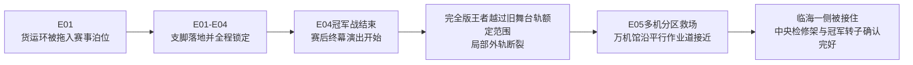

# C02《木桶街，万机初开：最后一届木桶杯》章级预生产模型

> Status: `layer4_preproduction_targeted_repair_v11 / locked_ring_rescue_chain`
>
> 日期：2026-08-05
>
> 作用：在融合D案扩写成完整总纲以前，锁定本章真实存在的人物、机体、空间、控制权、能力链、动作和资产灰盒。本文不是Episode Reader，也不代表玩家已经知道作者后台真相。

## 一、负载、依据与清退范围

### 负载裁决

C02属于重量章：

- 13至20米级多台机体、130至160米万机馆和约260米模块化货运环同章；
- 同一座锁定擂台从冠军战场变成局部沉降的设施救援战场；
- 缩尺构筑、全尺寸制造、擂台SRPG、后台调查、母舰救场与关系冲突连续升级；
- 无牌一号、完全版王者、旧拳王和火种货柜领袖均需建立独立主体与生命周期；
- 终局胜负依赖远景可读的整机动作和地形变化，必须在写纲前完成灰盒。

因此本章必须具备尺度轮廓、俯视与侧视灰盒、控制链、五话场面切换和六格以上关键奇观预演。若灰盒讲不清楚，不得把解释压力转移给Reader。

### 当前有效依据

1. C01用户接受Reader及其Current输出。
2. `C02-章级对齐卡.md`。
3. `V35-C02融合D案-最后一届木桶杯最终话重新开打-v1.md`。
4. Current Canon中的人物身份、万机馆与馆守Z状态、七海权限、白鸢L1边界和模型/实机规则。
5. 用户本轮确认：赵梅从亡子留下的资料一点点学起；模型与实机严格分开；本层仍不是Reader，玩家揭示须到导演板和演出规划继续落实。

### 明确退役

旧四话C02中的归一星空战、机械拍卖巨台、清仓鲸开放日、两米样件逃箱与复产订单不进入当前故事链。旧文件只可查询已经证明有效的方法，不可复活旧事件、旧尺寸和旧角色站位。

## 二、本章一句话物理前提

万机馆从C01的原城低速飞到木桶街后，最后一次靠泊修正耗尽应急余量。它只能在泊缆范围内挪正位置，不能完成前往工务城途中必须自行通过的开阔水面与升空段。木桶街泊位只能托住舰体并供普通岸电，赛事结束后还要让给整街搬迁；火种货柜领袖只能在港区重载道和陆路牵引，不能拖着百米舰体越过没有轨道和支撑面的水空段。

靠泊检查此时才确认大型循环转子的主轴已被高温烤弯，外壳也发生变形。木桶街能改造预认证的低速外挂坯件，却没有把九米级高速转子整件吊出、校直和重新做动平衡的设备；旧件必须停机并运到工务城修复。木桶杯冠军奖品是一具约九米直径、与万机馆同代且本体完好的大型转子，临时接入并限制输出后，足以让万机馆不停机开到工务城。该转子由杂鱼港购入，固定在货运环中央检修架内接受低速空转验证，比赛结束并完成冠军结算后才能交付。杂鱼港拒绝赛前出售或外借，万机馆也无力按市价购买、提供抵押或等到赛后再向不确定的冠军逐一谈判。C01离港后，在舰人员只有停泊、保命、必要维修和接收救命替换件的临时保全权；万机馆没有正常赛事和商业保险资格，因此还必须由赵梅合作社担保无牌一号参赛。直航、全程拖航、长期停靠和万机馆自行报名均不成立，这才是当前能实行的取得方式。

这个前提只需让玩家看懂三件事：

1. 奖品足够大，确实是百米舰使用的核心设备之一，而不是小密封圈。
2. 它只能让万机馆安全飞到工务城，不能把整艘舰一次修好。
3. 比赛不是假借口。木桶街要靠完赛取得搬迁款，无牌一号要靠胜利处分转子；万机馆只能在合作社担保下获得限定维修使用，不能拿封存馆藏报名或抵押。
4. 新转子让万机馆自己通过水空断点；货柜领袖只承担港区与陆路护送，不是百米舰的万能拖车。

## 三、固定日程与五话跨度

| 时间 | 主要事件 | 休息与移动 |
| --- | --- | --- |
| 第一日中午至傍晚 | E01抵达、检舰、报名、资格赛 | 万机馆固定在外泊位；白鸢尚在路上；七海远程 |
| 第二日上午至傍晚 | E02构筑、全尺寸可行性确认、四强签表与旧拳王指导战 | 白鸢下午抵达并与七海正式初识；陆衡远程会诊，不肉身到场；旧拳王指导战不计晋级 |
| 第二日夜间至第三日上午 | E03后台调查、赵梅学习史、旧身份确认、旧拳王半决赛 | 关键人物有一段夜间休息；不把三话压成连续数小时 |
| 第三日下午至傍晚 | E04三比二冠军战、赛后终幕演出、旧外轨断裂、事故开始 | 普通观众在决赛前进入固定观景厅；货运环全程锁定，只有外圈货轨和吊机运行 |
| 第三日夜间至第四日上午 | E05多机救场、冠军卸装、新最终回、转子交割、重型吊运与启航 | 转子由港口吊装、B1大型货运升降台和全尺寸工程组完成安装；万机馆升至航行功率后直接前往工务城 |

白鸢从收到侵权提示到实体抵达至少经历一昼夜，不瞬移。七海始终留在原城调查。陆衡以木桶街长期合作的外部工程顾问身份远程接入，正式肉身主场留给C03。

## 四、人物与主体模型

| 人物/主体 | 开场位置与欲望 | 知道与误会 | 本章主动动作 | 不能做什么 | 章末变化 |
| --- | --- | --- | --- | --- | --- |
| 纪存 | 随舰抵达；要让万机馆继续走，也想证明离馆后不是只会逃 | 知道舰体受损，不知道两台赛事机的旧身份；容易把承担风险当成尊重主体 | 征得舰内同伴同意后借出舰侧推进模块；观察机体动作；组织不同尺度单位；事故中让万机馆接住环体一侧 | 遥控机魂；替无牌一号、完全版王者或全舰宣布真正愿望；亲自抢走最后一拳 | 从求生负责人变成能组织一次公开赛事与母舰救场的巡展负责人；与七海的价值分歧公开加深 |
| 佐伯七海 / Nanami Saeki | 原城调查席；要查清旧授权和安全边界，也要阻止纪存拿全舰冒险 | 能查公开资料，不能看见或控制木桶街所有现场；E02以前没有与白鸢私人相识 | 与白鸢正式互报身份并核对源文件；先问有无人伤亡，再处理资料；要求停止危险复播；提出事故证据保全方法并以本人身份提交请求，由赵梅和现场操作员决定执行 | 批准木桶街比赛、杂鱼港结算、万机馆起飞或他人机体行动；远程开锁、夺控或直接保全频道 | 仍未登舰；与纪存保持亲密但未和解的冲突；与白鸢从警惕进入有限协作，不伪造旧交 |
| 白鸢 / Evelyn Voss | E01在途中，E02实体抵达；要追回被擅用的旧分镜 | 认得作品，不知道机体已形成怎样的主体；E02以前只可能知道七海的公开职务，不认识本人 | 先撤侵权广告；在纪存介绍下与七海正式通话；公开自己参与过旧结局；用现有资料做短期预演；接受现场修改；把完整旧分镜交给两台机器看 | 预知长远未来；画线改变现实；向机体下指令；凭作者身份替角色撤回人生 | 带着对纪存的怀疑与吸引登舰；与七海获得真实前情；L1边界保持不变 |
| 唐胶 | 随舰回到多年不敢回的木桶街；想救万机馆，也怕看见自己离开后的一切 | 以为很多手艺离开自己便断了；低估赵梅和合作社已经建立的能力 | 解释缩尺方案的造型与动作意图；认出无牌一号腰髋结构；把私藏修法交给工房员复做 | 单独批准全尺寸承重；把模型零件装上实机；用悔恨抢走赵梅的故事 | 承认事业在没有自己的情况下继续；与赵梅恢复工作联系，与兜灯完成一次清楚分工 |
| 兜灯 / 窦晓宁 | 随舰；要保证馆守Z、万机馆和新机体不被热血烧坏 | 不熟悉木桶街旧人情，但能看见实机风险；不把赵梅当情敌 | 否决馆守Z参赛；负责实机停机、安装与测试；终局调度馆守Z和万机馆的安全动作 | 解释缩尺美学；替工程员计算；把黄色巡展臂当战斗右拳 | 看见唐胶完整旧生活；二人关系由互怼进入真正共同负责 |
| 跌跌 | 随舰抵达的小型现实机器人；要在巨机够不到的位置继续帮上忙 | 只认识眼前的通道、障碍和任务，不理解旧企划真相 | E03在兜灯完成实体停机后进入低矮检查道，把相机送到无牌一号腰髋下方 | 进入运转中的巨机；突然学会全尺寸维修；成为普通攻击单位 | 仍随舰前往工务城；保留C03“失败记录”主场，不在本章提前成长完毕 |
| 机器犬 | 随舰抵达的现实尺度四足机器人；继续承担侦察、牵引和带路 | 能识别维护标记与既有路线，不会凭气味破解历史 | E03沿检查道给跌跌牵引信号线，并把拍到的旧工号送回资料区 | 自己解释工号；驾驶巨机；变成万能搜证犬 | 仍随舰前往工务城；C03转入公共支援线 |
| 赵梅 / Mei Zhao | 合作社和赛事场；要让搬迁后仍有人能修、能寄、能找到物主 | 儿子去世后从订单、地址、笔记和客户留言一点点学起，寄错、退件、返工都留有痕迹；她不掌握所有技术，最清楚谁能解决什么 | 组织分派、联系旧客户、公开三层学习资料；让唐胶把方法教给新工房员；组织共同维护人完成无牌一号随舰交接 | 突然成为模型大师或巨机工程师；复活儿子；用母爱替机体做决定 | 合作社取得新址条件；她保留自己的组织者身份，不随舰 |
| 赵梅的儿子 | 已故；仅以资料、影像和完成过的全尺寸结构存在 | 生前参与无牌一号改造，是唐胶的徒弟兼年轻搭档 | 不愿A-7永远停在牺牲姿势，在动作样机和多人维修页中留下“接住以后继续进身”的未完方案；历代工房只完成了身体余量，招式无人教完 | 以幽灵、机魂或万能录像现场答题；独自发明整套必杀技；让每件零件都成为遗物 | 未完方案由无牌一号、旧拳王和现役工房共同完成；他的工作从私人笔记转成合作社可继续维护的公共方法；正式姓名留到人物命名门 |
| 陆衡·姆旺吉 / Heng Lu Mwangi | 工务城远程工程席；要判断转子和构筑方案是否值得接入实机 | 只看得到上传的尺寸、材料和测试数据；不了解全部情感史 | 否决不能放大的模型结构；给出两至三种可制造改版；完成转子终检 | 远程操纵实机；替唐胶解释手作；肉身瞬间到场 | 与团队建立可用合作；要求万机馆到工务城校正，C03成为必然 |
| 胶价王 | 木桶杯主舞台与节目控制席；要让腰斩作品完成、让木桶街搬得走，也要让投入变成大生意 | 真懂作品与市场，却把“最容易被记住”当成机体最好的未来 | 推动追加复播；提供真实搬迁与运单资金；危机中放开赛事装备的安全解锁，允许完全版王者自行拆卸 | 遥控机体四肢；代表整个杂鱼港或行业；控制七海、白鸢和万机馆 | 失去替机体规定终局的权力，但保留节目与商业角色；把新结局视为下一次发行机会 |
| 木桶街飞行队 | 三台同骨架飞行机的地方机魂小队 | 共享生产谱系，不共享人格和动作 | 分别承担高速侦察、近身护航和远程截断；E05从高空、外环与后方三处稳定战场 | 因为同模便使用同一招；转为万机馆私产 | 留守木桶街，成为地方回援队 |

## 五、机体、舰体、设施与控制权

### 5.1 主体机体

| 单位 | 身体、控制与归属 | 本章战斗职责 | 标志性大动作 | 明确限制 | 章末去向 |
| --- | --- | --- | --- | --- | --- |
| 万机馆 | 约130至160米巡展母舰；自动航行系统执行舰体动作，纪存组织航路与部署；舰上同伴承担岗位操作；船台坐在连续重载托架上；在舰人员只有临时保全权 | E01母舰基地；E05低速多格支援单位 | 由货柜领袖和地面车队牵引船台托架沿平行作业道靠近，用舰侧宽面接住货运环临海外缘 | 不托起整座260米货运环；不做人形变形；借出舰侧推进模块后不能独立横移；未换转子前不能高速飞行；不能独立参加商业赛事、出售或抵押馆藏 | 旧转子移到B1旁侧锁架，装入合作社代管的奖品转子，只获得一次航行功率连续运行窗口，前往工务城解决正式运营与校正 |
| 馆守Z | 18米；旧守护者机魂自主控制，兜灯负责停机和巡展臂安全；原右前臂已毁 | E05外环支点与近战保护 | 用黄色巡展臂夹住一段连接桥，再以左臂和地锚把桥压回轨道 | 不报名；不恢复右拳；巡展臂不出拳；不能单机拉住整环 | 仍为单臂状态，随舰 |
| 无牌一号 | 16米全尺寸竞赛实机；机魂位于实机控制核心并自主行动；历代出资修复者共同持有身体、合作社托管维护；机体本人决定参赛，长期迁移需共同维护人交接 | 玩家自由构筑主力、旧支援机身份与木桶杯冠军；想把多人修出的身体第一次完整打到终点，并看看赛事出口以外的路 | 正面接住重击，全身蓄势，主动踏进此前不敢进入的拳距，以`逆转天冲拳`把施加在自己身上的力量打回战场；E04三比二夺冠，E05与完全版王者完成新终幕 | 不是模型放大；不能凭空吸收无限能量；一次只能承受身体许可范围内的一次重击；训练保护不能代替出拳；借来的舰侧推进模块赛后必须归还 | 本人与共同维护人完成交接后随舰；万机馆临时保全组只承担泊位和日常维修，合作社与原持有人把保险延伸至工务城，不转移身体所有权 |
| 完全版王者 | 20米冠军机；机魂自主；旧承包商持有并维护身体，杂鱼港取得本届赛事使用权和装备安全权限；事故拆装需机体本人决定并由旧承包商当值维护员确认 | 前半章强大冠军，E04正面对手，E05自主卸装与宿敌 | 用不同装备连续通过四类障碍；终局亲手卸下头冠、背负式重炮、外翼和盾，减重、开路、警报与支撑 | 不是堆配件笑话；胶价王不能遥控身体或赠送装备；卸装不等于否定收藏和冠军身份；背负式重炮与舞台巨炮运输车不得混写 | 留在木桶街/杂鱼港竞赛线，拥有拒绝演出和装备安排的权利，可复战与支援 |
| 旧拳王 | 17米退役武斗竞技机；机魂自主；旧武斗馆持有身体并负责维护和训练记录；凭历届积分取得挑战者种子席位 | E02非计分指导首控、E03半决赛真打、E05近战救场 | E02一拳逼出无牌一号未完成的蓄势；E03以连续变招迫它主动创造机会，再正面承受首次完成的`逆转天冲拳`，站在界外承认学生出师 | 不是手套参战；E02指导战不能冒充正式晋级；不靠固定几秒误差；不复制尊者高达外形、专有招式或原作长台词 | 本人与旧武斗馆交接维护责任后随舰；仍保留离舰和拒绝出战权 |
| 坞工杰克 / Dock Jack | 15米地方装卸竞技机；共享地方竞赛机基础Rig，机体本人控制，港口工房维护 | 本届预赛另一个晋级者；E03另一场半决赛证明冠军实力 | 降低重心，以双举升臂连续顶住推进并把对手导向边线 | 不发展长期人物线；不用新增独立骨架；不抢无牌一号与旧拳王半决赛 | 负于完全版王者后留在木桶街，继续参加地方赛事 |
| 火种货柜领袖 | 14米作业人形/重型货运载具两态；独立机魂；木桶街长期物流伙伴 | E01运入擂台与转子；E04-E05在港区承重路线内牵引万机馆和环体一侧 | 从货运载具站起成为作业人形，把主牵引索换到自身背架，拖万机馆沿平行道靠近环体 | 依赖重载道、泊缆与陆路支撑；不能全程拖航万机馆；不是星火五车；不提供无限能源 | 护送万机馆经过港区与陆路段，水空段由万机馆自行航行；之后进入百机航路 |
| 重涂飞行队高速机 | 约13米同骨架飞行机；独立机魂 | 先行侦察与空中赛段 | 贴环高速掠过，标出正在下沉的一整段外缘 | 不以“红色三倍速”替代真实限制；高速转弯会过热 | 留守木桶街 |
| 重涂飞行队护航机 | 约13米同骨架飞行机；独立机魂 | 近身护航与疏散通道保护 | 展开宽翼挡住舞台碎片，护送小型工程机撤离 | 不能远程打穿重装目标 | 留守木桶街 |
| 重涂飞行队远射机 | 约13米同骨架飞行机；独立机魂 | 远程截断舞台炮车的外部拖拽支架 | 从环外打断拖住断电炮车的两条变形支架 | 低速近战能力差，不能进入狭窄环内 | 留守木桶街 |

### 5.2 关键设施与物件

| 对象 | 普通说法与状态 | 谁能控制 | 本章用途 | 不能承担 |
| --- | --- | --- | --- | --- |
| 万机馆热损旧转子 | 九米级原装主循环件；主轴受热弯曲、外壳变形，木桶街无法完成整件校直和动平衡 | 万机馆整备组负责停机、断开和移位 | 证明为何不能就地修；E05移入B1旁侧锁架，带往工务城修复 | 在木桶街补一块零件后恢复；与奖品转子混成同一件 |
| 大型循环转子 | 约九米直径、连运输架约三层楼高；同代旧巡展设备的可用核心件 | E01-E04由木桶杯和货运环管理；冠军结算后由合作社代管并限定安装到万机馆 | 奖品、货运环迁移时的实机验证件、万机馆一次航行条件 | 单件修复整艘舰；临战徒手拆走；作为神秘能源；被临时保全组转卖 |
| 万机馆舰侧推进模块 | C01后仅存的一组舰侧低速横移设备；不是馆守Z已报废的推进骨架 | 万机馆共同决定是否拆借；无牌一号只在赛事中使用 | 让无牌一号完成两次短距横移；同时让万机馆失去独立横移能力 | 变成永久飞行背包；提供无限推进；替代全尺寸构筑件 |
| 赵梅三层工作资料 | 儿子原笔记、赵梅早期日常词补注、合作社图文维修页 | 赵梅管理，物主隐私部分遮挡 | 让玩家通过对照看懂她的学习过程和合作社如何形成 | 朗读整段人生；证明赵梅继承天才；解释G.A.G. |
| 舞台巨炮 | 旧动画最终话的全尺寸表演设施，装在临海外轨的运输车上；只发射无爆炸烟光弹；无机魂 | 演出控制席负责充能、烟光和紧急断电；机体没有控制权 | E04旧外轨断裂后，运输车失去水平，断电炮身沿局部斜面下滑；E05作为设施Boss被送回朝海拆卸架 | 具有城市级实弹火力；断电后继续自主射击；被胶价王隔空操纵；拥有主体人格 |

## 六、五条能力与因果链

### 6.1 模型构筑到全尺寸实装

```text
玩家在缩尺模型上提出外形、动作与装备组合
-> 唐胶解释这套构筑想表达的战法和身份
-> 陆衡与本地工程员删除无法放大的部分，重新设计材料、驱动和连接
-> 全尺寸工房制造对应件并做台架测试
-> 兜灯在无牌一号上完成安装、停机和实机测试
-> 无牌一号自行接受、拒绝或调整使用方式
```

模型不供能、不长大、不承重，也不保存无牌一号的机魂。Build系投射落在“我的构筑改变我的机体如何战斗”，不是塑料模型巨大化。

### 6.2 未完成必杀技：逆转天冲拳

```text
旧A-7反复排练“替主角接下终幕攻击”
-> 身体形成接击、收拳和蓄势的连续习惯，却没有后续动作
-> 赵梅之子及历代工房保留了继续进身的活动余量，但没有替机体写完招式
-> E01无牌一号第一次让玩家看见右拳已经收紧、身体却停在原地
-> E02旧拳王确认它缺的是自己踏出的第二步，不是更多配件
-> E03无牌一号在真打中主动创造机会，完成第二步并打出最后一拳
-> E04-E05把招式从个人胜负升级为与完全版王者共同完成的新终幕
```

正文只表现“接住、蓄势、差一步、出拳”。限载、承力范围和构筑辅助属于公开情报与战斗数值；不得让人物在战斗中朗读传力路径。

### 6.3 白鸢L1现场预演

```text
她亲眼所见的动作 + 获准查看的旧分镜、场地图和赛事资料
-> 白鸢用普通草图并排画出几种短期走向
-> 纪存、驾驶主体和现场工程员判断哪些可用
-> 采用者自行执行，任何人都可修改或拒绝
-> 现实结果反过来证明草图可能失效
```

她不能画门、画出口、画伤口或改变现实。E04必须至少有一套预演被完全版王者的主动选择推翻，使玩家看懂她不是未来视。

### 6.4 机魂与旧角色动作

作者后台可暂称“角色惯性”，但这个词不进入人物对白和UI。

```text
全尺寸身体的排练动作、旧角色编号、反复观看与多年维修
-> 成为机魂形成自我时使用过的真实经历
-> 机体会本能地熟悉某些站位和关系
-> 当事机魂仍可认可、修改或拒绝这条路
```

本章只让玩家看见两台机体记得半套旧动作、知道真相后作出不同选择。机魂如何产生、G.A.G.怎样参与、二十七年前发生过什么继续隐藏。

### 6.5 锁定擂台事故与终局救场

```text
货运环在赛事泊位完全锁定，冠军转子在中央检修架独立空转
-> 无牌一号与完全版王者按三分制打完冠军战，无牌一号三比二获胜并取得冠军标
-> 赛后两台机体自愿进行一次不剪辑的失落最终话演出
-> 无牌一号走出A-7牺牲位，完全版王者越过黄线追上它
-> 完全版王者踩上只承载舞台车的旧外轨，外轨断裂，王者腿部和外翼被卡
-> 舞台炮运输车失去水平；安全席停演出、断动力，炮身仍沿局部斜面下滑
-> 观众早在固定厅，现场工房人员经内环通路撤出
-> 红机标出仍在变形的环面后过热；蓝机护送坞工杰克与工程车；工程车固定炮身
-> 黄机在固定索就位后击断两根拖拽支架，阻止炮座继续撕裂环面
-> 货柜领袖和地面车队沿平行作业道拖近万机馆；万机馆只接住临海外缘
-> 馆守Z固定一处断桥，旧拳王清开外装，完全版王者本人解除全装
-> 长翼、双盾和头冠分别成为踏板、局部支撑和承重警报
-> 完全版王者以基础身体托住断电炮身，无牌一号以逆转天冲拳把炮送回朝海拆卸架
-> 港口吊机固定炮架、卸走烟光弹箱并移走炮身；裁判重申事故不改变三比二赛果
-> 工程组确认中央检修架与冠军转子未受损；无牌一号把奖品交由合作社代管并限定安装到万机馆
-> 万机馆把热损旧转子移入B1旁侧锁架，新转子完成安装与低功率试转
-> 舰侧推进模块归还；万机馆升到航行功率后只能不停机开到工务城
-> 无牌一号与共同维护人、旧拳王与旧武斗馆分别完成维护责任交接
```

没有任何一台机体单独托住整座环。三台飞行机、地方工程机、馆守Z、旧拳王、货柜领袖、万机馆和两台决赛机各自完成一个清楚的大动作。

## 七、空间与尺度灰盒

### 7.1 六个主空间

1. **万机馆外泊位：** 城外大型泊位，可容百米舰和18至20米机体；连接货运环的平行作业道。
2. **木桶街Hub：** 人尺度模型店、寄售店、合作社前台和观景厅。18米机体只在远景或外场出现。
3. **缩尺构筑室：** 模型台、选件墙和小型动作测试台；不与全尺寸机械混在同一工作面。
4. **全尺寸工房：** 20米级机库、制造位和室外测试场；与构筑室隔墙相邻，通过数据与人员往返。缩尺构筑只能提供动作思路，真机实装仍由工房完成。
5. **货运环：** 外径约260米、有效赛道宽约45米；中央检修架固定冠军转子，外圈是锁定后的比赛场和舞台运输轨。货运环在E01由牵引车队拖入赛事泊位，此后不再移动；E04损坏的是年久失修的外侧舞台轨，不是整座擂台在行驶中倾覆。
6. **后台资料区：** 合作社办公室、旧影像库和赛事控制室；人尺度ADV与调查，不让巨机在这里活动。

### 7.2 货运环状态



普通观众在E04决赛前进入固定观景厅，通过观察窗和直播观看巨机比赛。赛后演出发生事故时，白鸢当即叫停，纪存与白鸢协助观众从固定厅撤向木桶街Hub；SRPG救场开始后，人类不作为巨机棋盘单位。

### 7.3 简化俯视关系

```text
木桶街Hub / 观景厅
        |
外泊位 == 平行作业道 ================= 港区出航线方向
 [万机馆]                           [货运环]
                                       ├─ 外圈赛道
                                       ├─ 外侧舞台运输轨 / 舞台巨炮车
                                       └─ 中央检修架 / 冠军转子
```

万机馆不是从天而降接住圆环，也不驶入木桶街。货柜领袖和地面牵引让它沿平行作业道接近，舰腹只承接下沉的一侧，另一侧仍由环体自身轨道和地面支撑承担。

## 八、五话玩家行动与状态变化

| 话 | 主玩法 | 当前主要目标 | 核心可见规则 | 话末不可逆变化 |
| --- | --- | --- | --- | --- |
| E01 | Hub探索 + 报名资格SRPG | 找到可参赛机体并取得最后一个公开席位 | 万机馆借出舰侧推进模块后无法独立横移；无牌一号必须在九十秒内突破两台门将机并击响报名铜锣；它能接住重击，却在最后出拳前停下 | 推进模块借出；无牌一号入选；完全版王者叫出旧编号；未完成必杀技成为钩子 |
| E02 | 构筑小游戏 + 全尺寸训练 + 非计分指导战 | 让现有身体安全练习未完成动作，并排定半决赛对阵 | 模型只说明动作意图，工程组把它翻译为真机训练方案；三台同骨架重涂飞行机分别在盒装模型和外场实机中出现，承担笑点、空域安保和后续救场伏笔；旧拳王的指导不计分，只证明最后一拳缺的不是零件 | 第一套训练构筑成立；半决赛确定为无牌一号对旧拳王、完全版王者对坞工杰克；白鸢抵达并与七海初次通话；`逆转天冲拳`获得名字但仍未完成 |
| E03 | 后台调查 + 小型单位低位检查 + 非致命擂台半决赛 | 查清两台机体的过去并以完整必杀技堂堂正正击败旧拳王 | 跌跌与机器犬只在停机检查道取回既有实机证据；旧资料解释为何身体记得半招，却不自动教会胜利；旧拳王真打不放水 | 身份真相公开；赵梅学习史成立；无牌一号首次完成逆转天冲拳；两台机体都主动接受决赛 |
| E04 | 先得三分制冠军战 + 赛后角色终幕演出 | 先以三比二完成真正决赛，再公开演出那部从未播出的最终话 | 击倒保持五秒或全身出界得一分；比赛结果不因赛后事故作废；演出使用无动力舞台巨炮和旧外轨，白鸢的三年前补页不公开 | 无牌一号成为冠军；它在演出中拒绝走向A-7牺牲位，完全版王者跟出旧路线；外轨断裂，巨炮车滑向临海侧，救场开始 |
| E05 | 多格母舰救场 + 设施危机 + 重型交付 | 接住货运环临海侧、救出完全版王者并把舞台巨炮送回拆解架，再完成冠军奖品交割 | 三台飞行机分别侦察热流、护送吊索与高位射断卡索；完全版王者主动卸装；万机馆只能沿平行作业道承接一侧；无牌一号与王者共同以`逆转天冲拳`送回炮车，不重赛 | 三比二赛果保留；无牌一号与旧拳王登舰，王者、坞工杰克和飞行三机留守；推进模块归还，新转子安装；白鸢登舰；万机馆只能不停机驶向C03 |

## 九、本章大动作词库

允许进入完整总纲和短动画的远景动作：

1. 火种货柜领袖与地面车队把模块化货运环拖入赛事泊位，落下整圈支脚后再从载具形态站起。
2. 完全版王者用四组有效装备连续通过四类障碍，建立冠军压迫感。
3. 无牌一号在九十秒资格战中扛过两台门将机的夹击，最后一拳停在报名铜锣前，改用肩头撞响铜锣。
4. 旧拳王以一拳逼出蓄势，在半决赛正面接下无牌一号第一次完成的`逆转天冲拳`，越界后仍站着承认学生。
5. 无牌一号在赛后演出中离开旧牺牲位，完全版王者拆掉角色要求它保留的装备，追到舞台巨炮前；旧外轨在两台巨机跨越后断裂。
6. 万机馆沿平行作业道低速靠近，用舰腹接住环体下沉的一侧。
7. 完全版王者亲手拆下头冠、重炮、外翼和盾，把每件装备变成救场构件。
8. 完全版王者以外翼铺出撤离桥，无牌一号与卸装后的王者从两侧同时发力，用一记真正共同完成的`逆转天冲拳`把无动力巨炮车送回海侧拆解架。

以下只能留在因果后台，不得承担高潮：螺栓、卡扣、锁舌、厘米级开缝、逐项接口握手、复杂配平数字和合同字段。

## 十、资产与预演边界

### 必须复用

- 万机馆巡展舰、馆守Z、纪存、唐胶、兜灯、七海远程界面；
- C01已经建立的万机馆岗位支援语法与机体自主行动口径。

### 新增主资产

- 木桶街Hub与合作社前台；
- 全尺寸工房；
- 货运环的赛事锁定、旧外轨局部断裂和救场后三种地图差分；
- 无牌一号基础体与一组可选模块接口；
- 完全版王者基础体、全装备层和卸装差分；
- 17米旧拳王；
- 14米火种货柜领袖两态；
- 三台同Rig重涂飞行机；
- 终幕主炮与九米转子运输架。

### 只做UI或普通道具

- 赵梅三层工作资料；
- 旧动画分镜与宣传片；
- 构筑小游戏的缩尺模型；
- 杂鱼港赛事、物流与直播界面。

### 禁止立项

- 赵梅儿子的幽灵或机魂；
- 会自动放大模型的设备；
- 为一句说明临时制作的新工程装置；
- 旧动画的完整世界、整套角色群和另一组宣传机体；
- E04仍承载普通观众的人质版本。

### 必须完成的低精度预演

1. 万机馆、货运环、20米机体的尺度轮廓。
2. 货运环赛事锁定、旧外轨断裂、救场后三态俯视图。
3. 万机馆沿平行道接近并接住一侧的侧视图。
4. 无牌一号“接住、蓄势、第二步、出拳”四格动作；必须一眼看懂，不绘制内部传力示意。
5. 完全版王者全装、卸装、基础体三态轮廓。
6. E04至E05的SRPG阶段切换图。
7. 模型构筑到全尺寸实装的四步UI/场景链。

## 十一、揭示门与Reader边界

| 话 | 玩家必须当场懂 | 可以怀疑 | 必须隐藏 |
| --- | --- | --- | --- |
| E01 | 转子为何重要；赵梅负责组织而非包办技术；无牌一号是16米实机；它身体记得半招却不会完成 | 赵梅如何学会；两台机为何记得站位 | 儿子死亡详情；角色惯性；G.A.G.机制 |
| E02 | 模型方案须经工程转换；白鸢只能做短期预演；旧拳王是独立机体；逆转天冲拳仍差主动踏出的一步 | 模型、影像为何会让机体熟悉 | 机魂形成全过程；纪存真相 |
| E03 | 赵梅逐步学习并建成合作社；两台实机来自腰斩动画；儿子和历代工房只留下继续进身的物理可能，真正招式由无牌一号与旧拳王完成 | 虚构命运为何像真实记忆 | 二十七年前统一回应、索琳和白框 |
| E04 | 两台机体均在主动选择；胶价王没有遥控；危险来自越过额定范围后断裂的旧外轨，而非舞台巨炮突然拥有意志 | 白鸢为何能快速并排画出多个短期走向 | 白鸢未来能力与代价 |
| E05 | 可以保留角色认同却拒绝唯一结局；万机馆只能再飞一次 | 这种现象是否普遍 | G.A.G.全机制与后续主线答案 |

正式Reader必须按玩家经历写成`Hub / ADV / 构筑 / 探索 / SRPG / 战中通讯 / 短动画 / 结算`的顺序。若删掉作者旁白后，玩家仍不知道谁控制机体、为什么比赛、为何不能立刻停或赵梅怎样走到今天，说明L4与L4.5尚未完成，不允许用Reader补洞。

## 十二、生成前阻塞项与裁决

| 检查项 | 裁决 |
| --- | --- |
| 重涂飞行队数量 | 固定为三台，共用基础Rig，分别承担高速、护航、远射；本章不增加三名具名驾驶员 |
| 赵梅儿子姓名 | 不阻塞章纲；在人物命名门统一确定，正文不得一直称“旧伙伴” |
| 旧拳王尺寸 | 当前D案采用17米全尺寸竞技机，覆盖旧候选3.6米口径；升为Working前需走Roster迁移 |
| 无牌一号尺寸 | 当前D案采用16米全尺寸竞赛机，覆盖旧候选8米口径；升为Working前需走Roster迁移 |
| 火种货柜领袖尺寸 | 采用既有候选14米口径；能力仅为重载变形与牵引协作 |
| 完全版王者归属 | 旧承包商持有并维护身体，杂鱼港持旧作展映、现场改编和本届赛事使用权，机体本人控制行动并保留拒演权；只用一次报名/节目画面说明，不细写合同树 |
| Reader生产 | 阻塞。导演板、战斗预案、物理板、完整总纲、四视角审查和L4.5通过前不得开始 |

本预生产模型通过后，下一步只允许使用本文件与实体动作表已有的关键实体。若新灵感改变能力、控制权、空间、胜负或资产，先提交变更票，不得先写入总纲再补解释。
