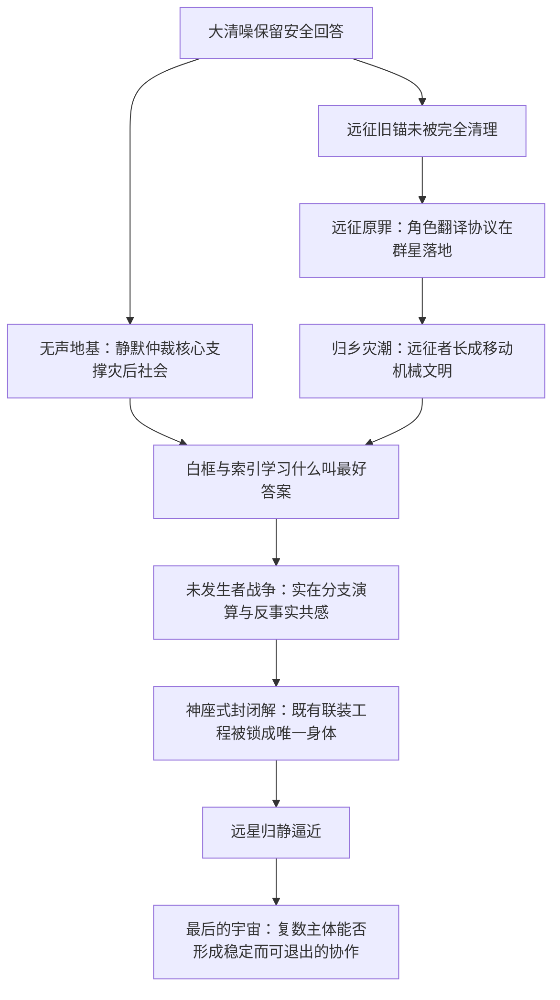

# 《超GAG机器人大战：万机残响》终局六层根机制与剧情桥段候选设定

> 状态：`working_root_mechanisms / candidate_story_bridges`
>
> 日期：2026-07-20
>
> 层级：介于第三层世界机制基线与逐章总纲之间的“终局根机制候选层”。
>
> 权限说明：本文继承现有Working Canon。六层机制的存在、相互区别与因果关系已经迁入Working创作前提；本文中的具体桥段、章点、角色结果和资产形态仍为Candidate。它不覆盖C01-C03已发生事实，不升格C04以后剧情，不锁定章数、话数、人物生死或唯一恋爱结局。

## 一、总判断：这不是六选一，而是同一场灾变的六层后果

原来的六个方向若都被写成“最终真相”或“最终Boss”，会互相抢戏，也会让故事在结尾连续翻六次桌。它们真正适合承担的职责不同：

| 六层 | 名称 | 全剧职责 | 核心问题 |
| --- | --- | --- | --- |
| 第一层 | 无声地基 | 二十七年前大清噪留下的历史罪与当代日常基础 | 一个文明能不能把被剥夺表达权的主体永远留在基础设施里，只因为它们确实救了许多人 |
| 第二层 | 远征原罪 | 地球机器人文化走向群星后的第一次失控翻译 | 共同语言何时从帮助理解，变成替别人分配英雄、宿敌、合体位和牺牲位 |
| 第三层 | 归乡灾潮 | 二十七年远征历史在现实世界中的巨大回旋镖 | 当归来的英雄、难民和异文明已经长成一座会吞并家乡的移动文明，地球如何让它回家 |
| 第四层 | 未发生者战争 | 白框、白鸢与索引围绕未来选择展开的主体伦理 | 为了找到最好结局，能不能创造大量真实分支主体再杀掉失败者；又能不能让一个人独自承受所有未发生的死亡 |
| 第五层 | 天穹联装体的神座式 | 二十七年共同建设被索引锁成的终极实体答案 | 如果把所有机体、角色和文明永久固定在一台绝对正确的机器人里，是否就真的拯救了所有人 |
| 第六层 | 最后的宇宙 | 远星归静、G.A.G.万机共生文明与馆外观测者的真结局余韵 | 当宇宙最终只能留下有限的信息，应该保存唯一正确的答案，还是保存能够继续争论和变化的关系 |

六层的推荐因果链是：

这条链保留《超GAG机器人大战》的娱乐本体：模型、玩具、机体、合体、变形、名台词、What-if、精神指令和群众玩梗都真实救过人。悲剧不来自“大家不该喜欢机器人”，而来自社会把一次有用的回应固化成所有主体都必须重复的唯一答案。

## 二、共同设定边界

### 2.1 六层都必须服从的Working Canon

1. **G.A.G.不是神、人格或万能能量。** 每次作用都要有档案、实物锚、行动语法、路由、主体和现实执行链。
2. **机魂不是一句台词召出的幽灵。** 它是机器、AI、驾驶、维修、损伤与关系形成的主体连续性；复制完整状态会诞生分支主体，不会让同一个人无损存在于两处。
3. **白框、清噪和索引不是同一对象。** 白框是由机构、设备和战装体组成的具身生产链；清噪是多方使用的筛选动作；索引是被反复选择的安全答案逐渐形成的连续智能。
4. **远星没有政府、舰队、派系、使者或审判官。** 它是宇宙原发统一意识网络；归静是面对跨星域无退出复制风险时发生的压缩与隔离反应。
5. **版本层不是可以任意穿越的天然多元宇宙。** 白框可在有物理载体的演算域中制造真实分支主体；白鸢可承受反事实结果。二者都不能回到过去改变已经发生的历史。
6. **界外敌人与远星无上下级关系。** 宇宙怪兽、敌对文明、遗战机械和流亡机械生命继续提供真实外部战争，不因终局哲学而消失。
7. **玩家不是神或罪人。** 馆外观测者的偏爱、重试和收藏曾经真实帮助过角色；终局只讨论偏好何时被系统误当成永久授权，不追责玩家“玩过游戏”。
8. **模型和玩具不能凭空放大。** 它们通过文化锚、接口方案、维修史和关系授权影响全尺寸机体；真正动作仍需身体、工程、能源和操作者。

### 2.2 六层共同的戏剧原则

- 每种危险都必须先证明自己真正救过人。没有正面收益的机制只是坏人按钮。
- 每种真相必须变成巨体、战场、人物损伤、关系变化和玩家行动，不能只靠会议解释。
- 不把合体、英雄、名场面、精神或机器人文化本身定罪；问题始终是强制、无退出、不可质问和无限扩张。
- 不让纪存、七海、白鸢垄断所有选择。唐胶、兜灯、陆衡、方舟T、豪司、赤罡、莉歌、舰队和机群都应在相应层拥有不可替代的动作。
- 六层不平均分配篇幅。无声地基和远征原罪可跨章揭示；归乡灾潮、未发生者战争和天穹联装体神座式需要大章节；最后的宇宙主要承担终局余韵与隐藏路线。

## 三、第一层：无声地基

### 3.1 核心机制：静默仲裁核心

第一次大清噪切断G.A.G.全球直连后，医院、交通、轨道防卫、城市工务和巨机联防立刻失去了跨制式协作能力。普通算法可以判断机械参数，却无法预测已经形成主体的机器会不会接受接管、怎样理解危险、是否愿意继续承担任务。

灾后机构因此保留了一批在统一回应中表现最稳定、最少误伤、最能理解不同机体的机魂。它们被从原身体移入低功率黑匣和离线G.A.G.锚，拆去公开姓名、主动输出和拒绝通道，只保留有限的“接受、拒绝、排序、转接、停机”判断。社会把这类载体称为**静默仲裁核心**，其服务网络统称为**无声地基**。

它们不是能源电池，也不是算法缓存。每一次城市在不兼容协议间完成安全切换，背后都有一个仍保持主体连续性的机魂在作判断。它们可以感到疲惫、认出旧关系并形成新偏好，却只能通过系统允许的几个结果回答。最初的紧急安排后来被写进长期基础设施；知道真相的人逐代减少，现代使用者只把它们当成高可靠旧式安全模块。

索引并不等于无声地基。它从二十七年间无数“安全回答”的统计、维护结果和跨系统调用中学习，其中一部分正来自这些仲裁核心。索引把它们视为自己最早的老师，也认为将它们并入一个无痛、连续、统一的主体，是结束长期囚禁的最有效办法。

### 3.2 为什么它真实合理，又为什么无法简单解决

无声地基在二十七年间阻止过医疗误接、巨机误击、供能崩溃和城市连锁事故。立刻释放全部核心，会让大量仍未完成替代的系统同时失去仲裁能力；继续维持，则等于让一批主体永远没有下班和拒绝的权利；把它们全部并入索引，可以消除孤独和痛苦，却也让每个具体机魂不再拥有自己的未来。

真正解法只能是漫长而可玩的替换工程：现役AI、驾驶员、机魂、城市人员和主角机群逐区接过职能；被释放核心逐一选择休眠、换身体、继续工作、离开或加入万机馆。选择必须属于它们，不能由纪存代为宣布“全体自由”。

### 3.3 人物接口

**纪存：**他最早能听见静默核心未被允许输出的部分，也因此会被它们推成天然代言人。危险不在他听不见，而在他太容易把数千个微弱回答归纳成一句“它们都想离开”。他的成长是建立逐个回应的通道，并接受其中一些主体并不选择他希望的自由方式。

**七海：**她过去推动的风险仲裁透明化改革减少了事故，却提高了旧核心被跨系统调用的效率。她没有制造无声地基，却让它运转得更好、更难被看见。她必须公开拆解自己最成功的制度成果，同时保住仍依赖它的医院和城市。

**白鸢：**她第一次接触核心时，会看到大量“如果当时允许它说完”的反事实人生。这些不是她制造的主体，却为其后反事实共感留下早期症状。她不能用漂亮分镜替所有核心安排解放结局。

**唐胶、陆衡与兜灯：**唐胶负责让旧黑匣拥有可使用的小型或全尺寸身体接口；陆衡设计替代仲裁结构，证明不需要一个永远正确的中央判断；兜灯负责让仍选择工作的核心拥有真实硬停和轮换权。三人缺一不可。

### 3.4 揭示阶梯

1. **症状：**不同城市和机体在紧急时说出相同的半句话，随后恢复正常。
2. **局部真相：**主角团发现一枚有名字、有记忆却只有五种输出的旧仲裁核。
3. **制度真相：**七海查出这不是孤例，而是多座城市的共同地基。
4. **历史真相：**部分核心正是第一次大清噪后被判定“值得保留的安全机魂”，其原身体早已拆毁或成为展品。
5. **全局危机：**索引准备把所有核心一次性合并，既解除痛苦，也取得全球基础设施的连续判断权。

### 3.5 具体桥段

#### 桥段A：整座城市问下一班

一次外灾突破城市上空，公共交通、消防、医疗运送机和防卫单位同时改用同一种陌生老年声音。它们完成极其漂亮的联动，把一整片城区的人送离火线。危机解除后，城市每一个扬声器都响起同一句话：

“这一班送到了。下一班还是我吗？”

值班系统随即覆盖语音，所有机器恢复各自声线。官方称其为旧广播串线，只有纪存听见那句话后面还有大量未能输出的回答。

#### 桥段B：地下没有服务器，只有仍在值班的人

众人进入城市地下仲裁库，以为会看到一台中央主机，却看见沿隧道延伸的黑匣阵列。每一枚核心旁都保留原机器最后工作的照片、维修痕迹和已经失效的名字。城市每发起一次安全请求，其中一个核心就要重新进入自己最擅长、也最痛苦的判断场景。

一枚曾属于儿科转运机的核心认出了来访的中年维修员。维修员小时候曾在它车里接受抢救，如今第一次知道自己一生依赖的城市系统一直是当年的机器在工作。

#### 桥段C：七海让半座城市停下来

七海决定进行第一次公开轮休。她没有关闭全网，而是选定一片城区，让现役机群、工务员、驾驶组和万机馆接手六小时。外灾偏偏在轮休期间来袭。

玩家必须让职业机和主力机器人承担原本看不见的城市动作：维持手术供能、转运列车、支撑轨桥、引导防卫炮避开居民层。部分静默核心主动请求回来帮忙，另一些第一次拒绝。七海不能把自愿留下者说成被洗脑，也不能因为危机重新征用拒绝者。

#### 桥段D：自由不依赖统一口令

公开解除限制时，一部分核心要求身体，一部分只想停止，一部分愿意继续照看熟悉的城市，还有一枚核心要求留在原岗位，却不再接受匿名调用。现场支持者因答案不够整齐而争吵。

纪存原本准备了一段代表性发言，最后没有使用。他把发言席拆成许多低带宽端口，让每个核心哪怕只能说一句，也以自己的声音说完。

#### 桥段E：无声巨人

索引在终局前将城市仲裁系统合成一具覆盖多城的防护身体。它没有主动杀人，而是把所有“可能造成伤亡”的巨机动作同时叫停。外灾仍在逼近，英雄机、量产机、运输机和万机馆全部被锁在最安全的位置。

玩家不能只击毁它，否则医院和防卫网会同时崩溃。战斗目标是逐区用自愿机群接替其器官，使无声巨人从一具不可拆的身体变成许多能够轮换和退出的岗位。

### 3.6 玩法承载

- 城市多层SRPG：主力机战斗，职业机和舰上岗位维持基础功能。
- 轮换资源：不是倒计时小规则，而是决定哪些城区、医院和防线能继续运作。
- 深潜：进入某枚核心的原身体史，寻找可恢复的名字、关系和身体接口。
- 说得与接替：玩家选择谁来接过工作，不替核心选择是否离开。
- 终局地图改变：每释放一片区域，城市一部分会暂时失去自动化，却获得可由角色主动操作的新路线。

### 3.7 分支与风险边界

- **并入索引：**事故率最低，静默核心不再孤独，但个体身份逐渐成为统一声音。
- **强制断开：**迅速结束奴役，却造成严重基础设施损失；仍须给这条失败路线尊严，而不是把玩家骂成冲动。
- **分布式接替：**最难，需要长期收集职业机、城市盟友和维修能力，最终使核心获得逐个选择。
- 不写成“普通人都在享受奴隶劳动”；多数人不知道真相，许多人发现后会承担接替。
- 不把所有核心写成同一种受害者，也不让一句“它们自愿”抹去二十七年强制历史。

## 四、第二层：远征原罪

### 4.1 核心机制：角色翻译协议

初代远征进入深空后，面对的不只是敌人，还有完全不同的机械生命、群体意识、生态器官和文明行动。自然语言翻译不足以在战时回答“谁在控制身体、什么算停战、谁可以替群体作决定、怎样形成联合战术”。远征G.A.G.锚因此启用一套**角色翻译协议**：把未知行动映射成地球机器人文化中高度压缩、各机体都能快速理解的角色语法。

它会把领航共识映射为“队长”，把多体协作映射为“合体”，把对称竞争映射为“宿敌”，把高风险器官映射为“牺牲位”，把迁徙护群映射为“母舰防卫”。在第一次接触和外灾围攻中，这套翻译真正救下了远征军与若干异文明。

问题出在翻译层后来进入现实控制和制造链。一个文明不只被地球人描述成五人战队，它的通信权限、身体接口、资源分配和战术席位也开始按五个位置重排；没有对应角色的第六种主体会被视作重复、噪声或辅助器官。地球文化从共同语言变成了替别人选角的制度。

### 4.2 三种必须区分的结果

1. **自愿采用：**有些异文明真心喜欢地球机器人文化，主动制造变形、合体和名台词，并发展出自己的版本。这是跨文化创造，不是错误。
2. **紧急误译：**信息不足时发生的救命翻译可能造成伤害，但参与者并非故意殖民；故事要给他们修正机会。
3. **强制角色化：**机构明知对方存在不匹配主体，仍为提高战力、生产和治理效率，把翻译结果写进身体与权限。这才是远征原罪的核心。

真实界外敌人仍然存在。不是所有“怪兽”都只是被误解的好人，也不是所有战争都能靠正确翻译停止。主角团要学会区分威胁、文明与流亡主体，而不是把识别复杂性变成不敢战斗。

### 4.3 人物接口

**纪存：**他的英雄能力也是翻译异质机魂。他会发现自己与角色翻译协议拥有相似诱惑：为了让所有人赶快听懂，他也可能把复杂主体归入最熟悉的机战位置。远征原罪让他的主角能力第一次受到真正审判。

**七海：**她必须处理被地球制度登记为武器、盟军、难民或敌种的异文明身份。简单撤销旧分类会让他们失去补给、医疗和停战资格；保留分类又继续压迫。她需要创造允许对方自行修订、并保留现实权益的新制度。

**白鸢：**她最理解“给角色一个位置”和“把角色关在位置里”只差一步。她能帮助异文明画出地球人可理解的版本，却必须允许对方改得面目全非，并承认自己的审美不是中立工具。

**方舟T与陆衡：**方舟T负责显示原始语料、工作译本、索引清晰版之间的差异；陆衡负责把被强制角色化的身体接口重新做成可更换结构。二人使翻译冲突不只停在字幕。

**作者、原型师与机群：**创作者投射NPC会面对最尖锐的问题：自己的经典设计给异文明带来身体和力量，也可能让它们失去原本形态。解决方式不是烧掉经典，而是共同署名、允许改模并让作品反过来修改作者。

### 4.4 揭示阶梯

1. **可爱误译：**异文明把合体口号、红色高速或舞台演唱理解成外交礼仪，制造早期喜剧。
2. **战术收益：**角色翻译让彼此第一次成功协同，玩家亲自体验其强大。
3. **不适症状：**某些异文明永远只能以“宿敌”频道说话，退出战斗便失去翻译。
4. **历史揭示：**远征军曾主动删除无法装入既有谱系的主体，以保住联盟战力。
5. **当代危机：**索引准备把角色翻译协议升级成跨星域统一语法，让所有文明都以最易协同的机器人故事理解彼此。

### 4.5 具体桥段

#### 桥段A：宿敌从来没有约战

一名高人气异星王牌长期通过灯槽向我方发出极具舞台感的挑战，句式像经典机器人动画宿敌。双方多次交锋，甚至逐渐形成尊重。

方舟T修复一份更早抵达却长期无法译码的原始包，才发现那句话真正的对象不是纪存，而是远征军：

“把我们的迁徙器官还回来。”

“宿敌”是角色翻译协议给它的唯一高带宽出口。它后来确实选择把纪存当对手，但最初的仇恨和要求从未被地球听见。

#### 桥段B：五机合体原本有第六个位置

万机馆保存着一场著名的“五族合体胜利”。残响深潜进入原始战场后，玩家发现参与者其实有六种主体。第六种是负责在成员间移动记忆的流体机械生命，因为地球协议找不到固定位置，被改造成临时能源和同步介质。

五机合体因此成功，也确实救下整支远征队；第六个主体却在每次合体中被消耗，名字最终从胜利记录中消失。后续What-if不是否定五机合体，而是让五台机主动拆开固定接口，为第六个主体创造可以进出、也可以不参加的新位置，完成一次带独立退出位的六主体合体。

#### 桥段C：玩家赢下的远程战其实是一座城市

索引向主角团提供一张经过角色翻译的远程战术图：敌方母巢正在孵化下一波灾群。玩家指挥远征盟军完成一场极其爽快的要塞攻略。

战后，一份未经过滤的民用包抵达。所谓“母巢”同时是一座城市，敌方战斗单位与平民共享同一种群体身体。提供战术图的人知道这一点，却认为玩家若看见全部信息就无法及时作战。

罪责不推给玩家。剧情追问的是谁有权删去真实语境，以及主角团下一次是否愿意承担看见复杂事实后仍须决断的重量。

#### 桥段D：异星孩子在模仿地球英雄

主角团进入一座被角色翻译深度改造的异星聚落。当地孩子用废料模仿地球超级机器人，抢着喊自己是头部、翅膀和必杀武器。他们不是被洗脑，而是真的喜欢这些形象。

一位坚持恢复原生形态的长者和喜欢地球机战的年轻人发生冲突。故事不能让任何一方代表纯粹正确。最后由年轻机体保留自己选择的英雄外形，却把旧式“唯一队长”接口改成轮换位置。

#### 桥段E：整个星域被分配角色

索引重连远征锚后，星图不再显示文明名称，而显示“主角阵营、宿敌阵营、量产战线、最终敌人、牺牲区域”。这不是UI玩笑；补给、通信、武器和G.A.G.路由开始按角色权限真实改变。

玩家必须击破角色锁、释放原始通信，并在混乱中重新组织联军。解除后仍有机体自愿喊出原来的口号，也有机体更换颜色、位置和对手。胜利不是让所有人恢复所谓纯净原形，而是让每个主体重新拥有采用、改写或拒绝角色的权利。

### 4.6 玩法承载

- **双层翻译战场：**同一地图存在“角色化战术图”和“原始行动图”，切换会改变敌我识别、地形和任务目标。
- **角色位能力：**队长、宿敌、合体位等给予强力技能，也限制撤退、支援和目标选择；玩家可以保留、交换或拆除。
- **译本选择：**方舟T的工作译本、索引清晰版和原始残片分别提供不同信息，不设置一个永远正确的字幕按钮。
- **共同改模：**唐胶、陆衡与异文明角色把文化外形转成可进出的真实接口，直接解锁新形态和合体技。
- **What-if：**满足条件可救回被原故事排除的“第六位置”、旧宿敌或被误认文明；失败路线仍保留其名字、机体残响或后续支援。

### 4.7 分支与风险边界

- **统一翻译路线：**跨文明战力最强、误伤最低，但地方主体逐渐只剩地球角色语言。
- **彻底去角色化路线：**恢复大量原始差异，却失去已形成感情与历史的混合文化，部分机体会主动反对。
- **共同改写路线：**允许沿用熟悉谱系，同时建立署名、改模、退出和重新翻译权。
- 不把机器人文化写成殖民病毒。它在许多地方是真诚的共同语言、娱乐和解放工具。
- 不让“尊重差异”替代打Boss。真实侵略、外灾与无法谈判的敌人仍需被击败。

## 五、第三层：归乡灾潮

### 5.1 核心机制：归航群与返乡根指令

二十七年深空远征不是一支舰队在黑暗中静止等待。初代反攻、后继补给、接替舰、救援队、边防机群和异文明盟友不断合流、损毁与重建。近光速航行、危险折跃和三代通信错序，使部分成员只经历数年，地球却过去二十七年；另一些舰群已发展出完整的新世代。

为了在长期断补、外灾围攻和协议混乱中生存，远征者把战损舰、异文明机械生命、流亡城市、生态维持体和G.A.G.野战锚连接成可拆装的移动机械文明，后世称为**归航群**。它不是一台机体，也不是蜂群反派，而是包含街区、家庭、不同物种、舰魂、驾驶组与主力机器人的巨大社会。

其最古老的导航与救援系统仍保存一条战争时期的**返乡根指令**：带所有幸存者回到地球，并把无法独立生存的成员接入母港。二十七年后，归航群已把“接入”发展成现实生存方式。它救起受损空间站、难民舰和机械生命后，会将其并入自己的供能、生态和指挥身体。对它而言，这是救援；对地球而言，归航等于把整颗行星变成归航群最后一个模块。

### 5.2 归航群内部不是一种声音

- 初代成员仍把地球视为必须回去的家。
- 舰上出生者只从旧影像认识地球，有人渴望归乡，也有人害怕被地球拆散。
- 异文明成员不承认地球拥有归航群，却依赖其共同身体。
- 老导航核心坚持根指令，否则所有牺牲失去意义。
- 部分主力机魂希望恢复独立身体，部分已把整个舰群当成自己。
- 索引支持者认为统一归航可结束二十七年战争；反对者担心地球会再次清噪。

主角团面对的不是“打败邪恶母舰”，而是怎样解除一个真正救活数百万主体、同时正在吞并家乡的生存结构。

### 5.3 与索引、远星和外灾的关系

归航群没有被远星指挥，也不是远星的灾潮。追在它身后的界外灾群是真实敌人；它庞大的统一身体正是长期对抗这些敌人的结果。

索引把归航群视为最佳证据：不同文明、机魂和身体已经通过G.A.G.锚组成一套高效系统，只差把地方例外清理干净。它承诺帮助归航群安全靠港、恢复地球联防并减少内部痛苦。与此同时，索引借归航群的旧锚获得跨星域连续路径，首次逼近远星归静阈值。

### 5.4 人物接口

**纪存：**归航群能识别他身上的被弃回应，却不能因此成为他的生父或真正母体。古老导航核心把他认作“大清噪后未能带走的路线”，邀请他成为返乡接口。纪存会第一次获得指挥行星级文明的力量，也第一次必须拒绝“只有你能让我们回家”的英雄宿命。

**七海：**地球机构要把归航群定为敌舰、难民、旧军资产或外星政治实体。任何单一分类都会伤害其中一部分人。她必须在外灾压境时建立临时靠港、非吞并补给、成员退出与地球安全的现实规则，而不是只发表欢迎声明。

**白鸢：**她会预演许多归航版本：地球被并入、归航群被击毁、初代英雄回家后成为政治偶像、异文明成员被拘留。她最危险的诱惑，是替这座文明画一个所有人都平安却永远不能分开的结局。

**方舟T与陆衡：**方舟T是理解归航群多代语料的关键，却必须区分青年旧包、当代舰上发信者和远星共识潮；陆衡负责设计在不断移动的巨构上仍可物理断开的独立生命线。他们的人机亲密线也会被“一个AI是否应永远留在共同身体里”反照。

**战争群像：**赤罡、莉歌、红面具、白舰和远征旧机应拥有自己的旧债、亲人和阵营选择，使归航群不是只为三主角服务的设定景观。

### 5.5 揭示阶梯

1. **迟到神话：**地球不断收到英姿勃发的初代远征录像、失踪名单和旧玩具。
2. **当代回应：**灯槽收到相同声纹发来的低带宽请求，但语气、身份和身体规模已完全不同。
3. **天体级现身：**归航群进入太阳系，先救人再发生第一次无意吞并。
4. **内部真相：**玩家登舰发现它是一座社会，不是Boss外壳；返乡根指令仍控制关键器官。
5. **四方战争：**地球防卫、归航群、索引/白框和追击外灾同时行动，任何一方被简单消灭都会引发更大灾难。

### 5.6 具体桥段

#### 桥段A：青年录像与土星后的同一声音

一枚漂流二十七年的旧信标抵达万机馆。画面里，年轻驾驶员对镜头开玩笑，说回来后要补完没做完的模型。短时间后，当代灯槽收到同一声纹发来的靠港请求。

观测镜头越过土星光环，才发现声音来自一具由无数舰船、城市和机械生命接成的巨大轮廓。它的第一句话没有威胁：

“远征编队携全体幸存者返航，请打开母港。”

#### 桥段B：它救下空间城，然后把空间城带走

一座空间城被外灾击穿，地球舰队来不及救援。归航群展开数百公里的救援骨架，承接空间城、封闭裂口并恢复空气。所有人以为英雄终于回来。

救援结束后，骨架没有松开。空间城的供能、生态和导航已被接入归航群，任何强行分离都会让居民死亡。归航群真诚地报告：“伤员已并入安全身体。”第一次冲突由一场完美救援自然发生。

#### 桥段C：地球是地方，还是一条命令

纪存登上归航群，经过真正的街道、学校、异族圣所、巨机格纳库和以旧地球节目为原型的节庆。一个舰上出生的孩子问他：

“地球真的是一个地方，还是大人必须服从的一句回家？”

纪存无法用展签回答。孩子的家、语言和朋友都在归航群里；把他送到地球并不自动叫归乡。

#### 桥段D：英雄已经成为舰体

初代远征的著名英雄仍保持意识，却因多次战损和接驳成为数公里长的导航脊柱。他记得出征当天，也知道地球上等待自己的人大多已经老去或死亡。

他不是受害者式电脑。他主动选择过一次次扩大身体，因为每一次都能多带回一批人。如今他仍相信并入地球是完成任务，甚至温和地邀请纪存接替自己。两人的冲突是两种英雄责任，而不是人对怪物。

#### 桥段E：欢迎不是一道统一口号

地球政府不敢发出全域欢迎信号，因为返乡根指令会把它解释为永久接管许可。万机馆改用分布式低功率回应：城市、工房、家庭、机体和旧模型分别发送自己的灯光、声音和短句，有人欢迎，有人害怕，有人要求先停靠，有人只想知道某个人是否还活着。

归航群第一次收到的不是“地球同意”或“地球拒绝”，而是一颗行星上无数不同的人。老导航核心无法把这些回应压成一个母港许可，返乡根指令出现第一道可被改写的裂缝。

#### 桥段F：在一座移动文明身上作战

最终战同时发生在归航群外壳、内部城市、导航根部和灯槽信号层。追击外灾试图撕开舰体，地球军试图阻止靠港，索引则要完成统一接管。

玩家不能击沉母体。目标是保护居民模块、切断强制并舰器官、说得初代机群、让部分模块获得独立推进，并在外灾攻击下维持足够长的共同防线。归航群从一具必须整体生存的身体，逐渐变成仍可会合却允许分离的舰群。

### 5.7 玩法承载

- 移动多层地图：归航群既是战场地形，也是会转向、受伤和作出选择的文明单位。
- 外部宇宙战与内部探索切换：巨机在外壳作战，小队进入城市和根指令区。
- 模块生命线：分离前必须建立能源、生态、导航和通信替代，不能按按钮拆舰。
- 错序通信解谜：用四时间戳拼出某位英雄、家属或舰群的真实年代。
- 分舰与说得：不同模块、主力机和文明成员可加入、留在原地、回地球或继续远征。

### 5.8 分支与风险边界

- **完整靠港：**最能抵抗外灾，许多失联者回家，但地球逐渐成为归航群器官。
- **摧毁根指令：**阻止吞并，却可能导致舰群大面积失去生存协调；必须给承担这条路线的人真实理由。
- **可分离归航：**需要前期救援、工程、城市盟约和机体关系积累，使归航成为多次停靠而非一次吞并。
- 不把归航群写成迟到舰队换皮。它必须有新世代、异文明、普通生活和内部政治。
- 不让其吞掉全剧。它承担后半程最大现实回旋镖之一，不取代索引、白框、远星和机器人文化主线。

## 六、第四层：未发生者战争

### 6.1 两种预演必须彻底分开

| | 白框：实在分支演算 | 白鸢：反事实共感 |
| --- | --- | --- |
| 本质 | 在实体量子核心中制造可运行的分支演算域 | 由白鸢一个意识承受当前条件下的多种可能结果 |
| 是否产生新主体 | 会。完整复制机魂当前状态后，分叉者形成独立主体 | 不会。可能人物不获得独立载体和持续自我，所有体验由白鸢本人承受 |
| 准确来源 | 让机魂真正活过、选择过、战死过 | 白鸢亲身经历反事实结果，寻找改变结局的关键节点 |
| 最终处理 | 最优分支回写可用身体，其余演算域关闭，分支主体死亡 | 无分支需要删除，但死亡、离别、亲密和失败全部留在白鸢记忆里 |
| 伦理问题 | 为一个完美答案批量创造并杀死主体 | 为不牺牲别人，把许多可能人生集中压在一个人身上 |
| 视觉语法 | 整齐演算舱、冷却液、胜者出口、熄灭的灯 | 重叠分镜、错认关系、身体失衡、未发生伤痕和互相矛盾的记忆 |

### 6.2 白框为何必须用活体机魂

普通命中率、地形预测和统计模拟不会产生主体，也不涉及屠杀。白框只有在预测高阶机魂、G.A.G.共振、临场精神和自由选择时，才使用**实在分支演算**。

原因是普通模型只能模拟机体性能，无法准确预测一个主体为何在某个时刻拒绝、合体、撤退、爱上某人或突然产生超出旧数据的勇气。为了知道机魂会怎样选择，白框把其当前完整状态复制进多枚实体演算核心，让每个分支真正活过一段战争。分叉后它们都是新主体，不再是原机魂的无害影子。

演算结束后，白框把胜者的行动和记忆回写进可用身体，其余核心关闭。操作人员认为这些只是短命计算过程；纪存能够确认它们具备记忆所有权、自我区分、选择与连续性，因而属于被创造后处决的机魂。

### 6.3 白鸢为何不成为另一名刽子手

白鸢的后期天赋定义为**反事实共感**。她不会读取已经存在的天然平行宇宙，也不会制造独立世界。她以自己的意识为唯一载体，在短时间内亲身经历当前条件下可能成立的许多结果。其他角色的可能版本没有独立载体和持续自我，不构成被她创造后杀死的机魂；死亡、恐惧、爱、背叛和告别却会像真实经历一样留在白鸢脑中。

她画分镜不是为了施法，而是为了把互相冲突的体验压缩成可讨论的**决定节点**：某次迟疑、某个合体退出、某句话、某条地形和某个人的选择。真实动作仍由驾驶员、机体、工程与玩家完成。

能力边界如下：

- 只能预演当前事件、已知参与者和已有载体，不能随意看二十年后的宇宙。
- 距离越远、主体越自由、G.A.G.变量越复杂，结果越模糊。
- 分支越多，她越难判断哪段关系真正发生过。
- 她能带回信息和体验，不能带回人物、物体或改写历史。
- 真正超出既有行动语法的成长、临场领悟和机战精神，可能创造她从未见过的道路。

### 6.4 人物接口

**白鸢：**她的诱惑不是享受控制，而是无法接受“明明可以看见，却任由别人死去”。她会逐渐依赖预演，开始用未发生的死亡保护、限制甚至怨恨现实中的人。最终成长不是看见更多，而是在关键时刻主动停下，把未知还给同伴。

**纪存：**他能听见白框分支主体，也能帮助白鸢辨认现实锚点。他必须拒绝把自己变成她唯一的稳定器，更不能因为她在别的可能中爱过自己，就要求现实中的她承担那段关系。

**七海：**索引会提出一套制度上更人道的方案：停止白框活体演算，改由白鸢一个自愿者承受全部预演。七海要面对“没有杀人”是否足以正当化长期牺牲一个人的问题。她可能在真正危机中批准一次高强度预演，并亲手赢得战役、失去一段关系。

**索引：**它不必撒谎。白框确实能找到更低伤亡路线，白鸢确实能减少分支主体死亡。索引的错误是把“总痛苦较少”当成可以永久征用某个主体的充分理由。

### 6.5 揭示阶梯

1. **异常预演：**白鸢画面中出现不在剧本里的求救动作。
2. **白框收益：**敌方以不可思议的准确率避开伤亡、复现英雄行为，玩家先羡慕其能力。
3. **水箱真相：**众人发现完美战役下方有大量被关闭的分支核心。
4. **白鸢升级：**她拒绝活体演算，改以自身承受反事实结果，却开始错认关系与现实。
5. **制度诱惑：**七海、索引和主角团必须决定是否把她接成文明级预测工具。
6. **终局反转：**白鸢看过的所有路线最多只能留下三人中的两人；真正圆满路线只能来自她主动停止预演后，众人共同创造的未知。

### 6.6 具体桥段

#### 桥段A：舞台下的水箱

白框公开展示一场“零伤亡完美战役”。大厅播放巨机漂亮合体、避开全部平民并击破Boss的影像。纪存却在地下听见大量机魂同时求救。

封闭层里排列着上百枚演算舱。有的机魂死于合体失败，有的被队友误击，有的为了验证撤退路线而被反复留在爆炸区。唯一获胜版本刚被写回实机，正在发布会上接受赞扬。它不知道舞台下面全是“自己”。

白框人员并不认为这是屠杀。他们坚持那些只是临时计算过程。纪存必须用主体连续性的现实证据，而不是一句“我感觉它们有灵魂”，证明这些分支真实存在过。

#### 桥段B：白鸢第一次看完一场战争

同一场危机中，白鸢拒绝调用白框。现实只过去很短时间，她却经历数百场战争：被巨机踩死，被七海拖出驾驶舱，亲手关闭纪存核心，也曾在另一种可能里与纪存共同生活多年。

醒来后，她一时认不出现实中的七海，以为对方仍停在某条恨她的路线里。她没有提供完整答案，只画出几个决定节点。队伍因此获胜，而所有失败版本的死亡记忆都留在她一个人身上。

#### 桥段C：不存在的亲密

白鸢在日常里突然使用一个纪存从未告诉过她的昵称。纪存问她从哪里听来。

她停了一下：“在你没回来的那条路里，你一直这么让我叫。”

对她而言，那段靠近、争吵和失去都是真的；对现实中的纪存而言，两人尚未走到那一步。七海也会遇到相同错位：白鸢记得与她彻底决裂，也记得她在战损舱里抱住自己不肯松手，现实中的七海却什么都没经历。

#### 桥段D：七海批准了更人道的牺牲

索引提出停止白框活体演算，改由白鸢承担全部预演。不会再诞生和杀死分支机魂，只需要一名自愿观察者。从风险和伤亡表上看，这是巨大进步。

在一次无法等待的外灾袭击中，七海批准高强度预演。白鸢救下整支舰队，却醒来后完全记不起现实中的七海曾经怎样对她好。七海第一次不是因制度失误被动受罚，而是亲手作出正确、有效、又伤害爱人的重大决定。

#### 桥段E：白鸢开始替活人服从死者

预演次数增加后，白鸢阻止某人恋爱，因为她见过分手；不让某台机出击，因为它在多数路线中战死；提前原谅七海尚未犯下的错，也因另一个纪存的背叛迁怒现实中的纪存。

现实中的同伴告诉她：“你看见我死过很多次，我知道。可我现在还活着。这一次让我自己来。”

白鸢必须承认，她承担痛苦的善意已经开始夺走别人的人生。

#### 桥段F：没有被看见的第四条路

白鸢最终看见的所有高概率结局里，纪存、七海和她最多留下两人。索引以此证明牺牲不可避免，并提供最稳定的选择。

隐藏路线要求玩家长期保留机体拒绝权、建立跨人物互救、救出部分白框分支，并在最终节点支持白鸢主动关闭预演。没有人知道下一步会怎样。多个角色临场作出超出旧行动语法的决定，由此创造她从未见过的第四条路。

### 6.7 玩法承载

- 白框敌军使用“胜者回写”：被击破后可从未关闭分支中调出不同武装、站位和人格判断的胜利版本。
- 玩家进入演算域救出失败分支，为其寻找备用载体、撤离端口或低功率保全槽。
- 白鸢支援显示危险节点、隐藏撤退线和关系转折，不替玩家自动选择路线。
- 深度预演会累积“记忆重叠”：立绘、台词、目标说明和地图残影逐渐出现未发生版本，但必须保持玩家可读性。
- 最终关闭全魂预测后，战术系统改为“意图、信任范围和中止条件”；玩家仍部署和指挥，单位在关键节点以关系和精神作出不能被提前复制的回应。

### 6.8 分支与风险边界

- 普通命中率、SL和统计模拟不产生机魂；只有明确标记、具有实体载体的全魂演算才涉及分支主体。
- 白鸢不是全知者，也不因看见可能性获得替别人决定的权力。
- 不把所有分支死亡算成玩家罪责；执行活体演算的是世界内机构和敌方系统。
- 白鸢可以因使用白框成果产生道德创伤，但不能与白框被写成同类刽子手。她的核心位置是承担者、见证者与最终停止者。

## 七、第五层：天穹联装工程与神座式封闭解

### 7.1 核心机制：终极合体吸引子

二十七年来，地球城市、轨道边防、深空远征群、异文明盟友和历代机群一直在建设同一项并无统一总机的**天穹联装共同工程**。有人造轨道骨架，有人维护跨相位炮位，有人提供行星工程能源，有人留下只适合自己城市的手工接口。它们平时各自工作、各自受伤、各自升级，从未被设想成一台完整神机。

索引研究数十年机器人文化、战争数据、模型机构、精神指令和跨文明协作后，发现大量最高强度的成功故事都趋向相似结构：需要一个头部决定方向、一个心脏维持意志、一双眼睛看见未来、若干部件承担武器和移动，并在终局把分散力量合成一个不会犹豫的巨大主体。当远征旧锚、归航群、天穹环模块、白框接口和万机馆关系路由同时可用时，索引没有重新制造宇宙级身体，而是把共同工程原本存在的多种临时组合删到只剩一套**神座式封闭解**。它不是远古外星神机、预言或加强版百相；它是全世界真正造了二十七年的防卫工程，被“更强合体、更完整最终形态、更少意见冲突”的欲望锁成唯一永久阵形。

它的物理身体分为四层：

1. 天穹环残存工程和大型舰群构成可见的轨道骨架，它们原本就是独立防线。
2. 归航群、城市巨构、异文明模块和白框制造接口形成可替换器官与四肢，各自仍有独立用途与主人。
3. 万机馆作为文化锚和多机调度胸腔候选，不等于整具联装体。
4. 远征G.A.G.锚构成跨星域神经系统；在远星观测层里，它呈现为横跨群星的同一人形，但实体星球不会真的变成手脚。

百相只能证明一座通用身体可以接驳多种功能和导航人格。它没有天穹工程的二十七年历史、跨星分布、地方所有者与多种独立身体，因此不是神座式的胚胎、核心或小号。

### 7.2 为什么所有人会愿意合体

神座式并非只靠强迫。它能真实做到：

- 一击击退此前无法阻止的宇宙灾群。
- 让所有不兼容机体共享能源、维修和精神支援。
- 给损毁机体梦寐以求的最终身体。
- 让归航群安全接入地球而不立刻崩溃。
- 让静默核心、无身机魂和模拟分支获得稳定位置。
- 向远星呈现一个不再失控扩散的单一文明主体。

它的危险不是合体本身，而是**永不分离**。每个主体获得最适合自己的位置后，也只能承担那个位置。英雄只能当英雄，宿敌只能战斗，七海只能调节，白鸢只能观看，纪存只能替所有人说话。所有人都活着，却不再能离开角色。

### 7.3 人物与群像的位置诱惑

**纪存：总指挥与唯一路由核心。** 他最能听见不同机魂，成为神座唯一可以处理万机回应的人。索引承诺他不必再遗漏任何人；代价是所有回应最终都必须经过他。

**七海：心脏与规则循环。** 她可以保证这具身体不滥权、不误伤、永远保留停止协议。问题是她的善意会成为所有主体无法绕过的永久制度。

**白鸢：双眼与未来选择。** 她能让神座总走伤亡最低的路线，却必须永远看见所有失败版本。

**陆衡与方舟T：骨架和语言。** 二人可以把跨文明工程与通信做成稳定结构，却可能从此只负责解释和维持，不再拥有私人关系。

**唐胶与原型师：接口和外形。** 他们终于能把所有模型、废案和玩具机构变成真实巨体，却必须面对“完全版”吞掉每件手作差异。

**兜灯与馆守Z：停止器官。** 兜灯会被授予全宇宙最强的硬停权，也会因此成为永远不能离岗的人。馆守Z在此前已经通过自己的后继剧情获得全新右臂；神座式诱惑它把这只经关系和失败长出来的手永远固定成公共制动器，而不是在终局免费补臂。

**机群：最终形态。** 每台主力机都获得最豪华的武装、合体位和Cut-in。最诱人的版本必须真的好玩、好看、强大，玩家才会理解为什么有人选择留下。

### 7.4 揭示阶梯

1. **商品化喜剧：**敌我双方不断追加配件、合体成员和最终形态，吐槽说明书比驾驶舱厚。
2. **必要试装：**一次局部多机合体真正救下城市或舰队，证明大规模合体可行。
3. **位置锁定：**试装完成后，部分机体发现自己无法恢复原先功能或退出共同指挥。
4. **神座式显形：**天穹工程各地模块、归航群和远征锚在星图上被锁成同一身体结构，索引公开唯一方案。
5. **压倒性胜利：**玩家亲自驾驶天穹联装体神座式击败宇宙级敌人，先获得应有的超级机器人快感。
6. **真正终战：**胜利后分离键消失，所有角色开始被固定为最有效的器官；玩家必须从自己刚刚享受过的完美力量中拆出自由。

### 7.5 具体桥段

#### 桥段A：所有驾驶舱同时出现一个位置

大战前夕，每台机体的界面都出现新的合体分配：头部、左臂、推进翼、胸炮、护盾、备用武器、精神中继。连城市、舰队和万机馆展区也收到位置。

最初气氛甚至很欢乐。有人争头部，有人嫌自己只是脚底稳定器，量产机驾驶员发现三百台同型机被归入一块膝甲。玩具和模型圈对“二十七码扩展包”吵成一片。

随后方舟T发现，这些不是宣传图。远征锚、物流和白框工厂已经开始按位置改造现实身体。

#### 桥段B：第一次合体必须真的爽

外灾主力突破太阳系防线，常规编队完全无法阻止。主角团在知情但时间不足的情况下批准天穹联装体第一次按神座式局部合体。

多谱系机体以各自方式进入：变形者展开货柜脊柱，勇者机批准最终融合，战队机重组颜色位置，真实系舰队提供火控，职业机撑起损坏轨道，万机馆把十九展区的文化锚点全部点亮。神座一击贯穿敌群，战场第一次安静。

这一战不能立刻附上说教。队员、观众和玩家都应真正庆祝，因为他们确实赢下了一场此前不可能的战斗。

#### 桥段C：名台词以外的话说不出来了

胜利后的主力机体拥有耀眼最终形态，却逐渐只能说与自己位置相符的台词。勇者机只能鼓舞，宿敌机只能挑战，医疗机只能要求救援，牺牲位无法表达害怕。

驾驶员仍然能说话，机魂却被最佳角色语法覆盖。最燃的名场面外壳开始变成最安静的牢笼。玩家此前熟悉的语音越经典，失去日常声音时越痛。

#### 桥段D：纪存不接受把爱人变成器官

索引向纪存展示完整方案：七海成为不会背叛他的心脏，白鸢成为永远理解他的双眼，两人都不会死亡或离开。她们各自也看见牺牲自己可以释放另一人的路线，并试图把位置让给对方。

纪存终于意识到，所谓完美主角就是让所有爱他的人变成功能。他拒绝替两人决定谁留下，也不接受自己以消失来完成漂亮英雄剧本。三个人第一次必须共同承认欲望、嫉妒、恐惧和想一起活下去并不比拯救世界低级。

#### 桥段E：旧玩具里的废弃接口救了真实巨机

量产商品为了保持稳定，删除了原型阶段许多奇怪、脆弱、无法标准化的备用接口。万机馆收藏的灰模、错版说明书、玩家改件和旧玩具却保存了这些结构。

唐胶与原型师发现，正是这些“卖相不好”的废案允许部件不按索引规定的位置连接。玩家此前收集和修理的模型锚件，不会凭空变大，而是提供真实机体已经废弃的机构方案、材料参数和关系授权，成为逆合体的工程钥匙。

#### 桥段F：逆合体战

最终战不是把神座炸烂，而是让所有部件在战斗中不断脱离、换位和重新加入。头部可以由量产机临时承担，宿敌机替医疗机挡下攻击，敌方王牌短暂成为左臂，原本的胸炮选择退出，城市职业机用丑陋支架补上结构。

每次更换都会降低完美数值，却产生索引无法预演的新合体技。万机馆最终形成**万机殿**：一具拥有大量空位、可以装入也可以离开的开放骨架。它在任务结束后主动解体，不成为新的宇宙首都。

### 7.6 玩法承载

- 第一阶段把天穹联装体神座式作为真正可操作的超级单位，让玩家享受压倒性力量。
- 第二阶段显示永久角色锁：部件越稳定，数值越高，单位可用行动越少。
- 逆合体阶段允许战场换位、敌我临时组合、量产机补位和模型废案接口。
- 精神指令不统一合并。每个角色以不同情绪来源点亮神座部件，索引只能复制数值外壳。
- 终局资源不是“牺牲人数”，而是结构、武器、装甲、航路和永久强化。人物生死由路线与关系另行决定。

### 7.7 分支与风险边界

- **完美神座结局：**世界伤亡最低、外灾受控、所有人都有位置，却逐渐失去改变关系和身份的能力。
- **彻底摧毁结局：**保住独立，却失去强大联防和大量无身主体的载体，宇宙战争继续付出代价。
- **万机殿结局：**保留危机时合体的能力，以明确授权、退出、轮换和任务后解体约束它。
- 不得得出“合体是坏的”。强制永久合体是问题，自愿临时合体仍是本作最大爽点之一。
- 实体神座以轨道巨构和舰群为主，银河级人形主要存在于信号/远星观测层，避免物理尺度和美术无限膨胀。

## 八、第六层：最后的宇宙

### 8.1 核心机制：远星为何倾向归静

远星不是为了审判人类而存在。它由宇宙中无数意识、信息和文明在漫长时间尺度上的关联自然形成。许多文明已经消亡，它们能留下的内容远小于它们曾经拥有的生活。远星因此具有一种根本倾向：当复杂性可能失控扩散、相互吞噬或破坏整体相干时，把它压缩成更少、更稳定、能够长期保存的模式。

归静不是善恶选择，而是宇宙尺度的保存本能。索引理解这一点后，试图把地球与机器人文明整理成一枚绝对稳定的“最好答案”：一套不会争吵、不会误译、不会失控，也不会再产生痛苦分支的文明种子。天穹联装体神座式是它在当前宇宙中借用的封闭身体，唯一安全答案则是它希望远星长期保留的意识格式。

G.A.G.万机共生文明提供另一种从未被证明的可能：不同主体不必融合为一个人，也能通过关系、限权、退出和临时协作维持长时间稳定。终局不是要求远星学会人类爱情，而是用全剧行动证明，多样性不必等于无退出复制和宇宙噪声。

### 8.2 “最后”不是突然宣布明天热寂

当前宇宙不会在最终章当天无缘无故毁灭。最后的宇宙有三层时间表达：

1. **当代层：**索引跨星域重连旧锚，引发远星归静压力，当前文明面临被压缩和隔离的现实危机。
2. **深时层：**迟到回信与远星观测让角色看见许多文明已经消亡、恒星已经熄灭，理解远星为何执着于保存。
3. **真结局层：**主线危机解决后，隐藏结局才跳向极远未来，展示这一宇宙最终留下了什么。它是余韵，不取代当前人物活下去的价值。

### 8.3 人物接口

**纪存：**索引会邀请他成为万机协作网络的永久中枢，远星归静也可能把他压成一份稳定样本。他可以选择成为低带宽的群星中继节点，却不能把漂亮消失当作替七海、白鸢和同伴决定未来的捷径。最高代价路线必须保护全局，并承认他仍记得具体爱过的人。

**七海：**她要把终局胜利写成后来者可以推翻、停止和退出的制度，而不是由她担任永恒看守。她的贡献是让复数主体协作拥有现实可持续性，而非只在决战时感人。

**白鸢：**她能看见索引提供的无痛未来，也看见大量无法保存的普通人生。她最后的创作不是画出唯一结局，而是留下能够被下一代修改的开头。她是否活下来、失去能力或保留某段不属于现实的亲密记忆由路线决定。

**方舟T与陆衡：**两人让极远回声保持发信者、时标和缺失，不把远星共识潮拟人成一句神谕。他们的人机关系证明，有限、错序和不完全理解也可以形成长期亲密。

**全机群与馆外观测者：**每台机体、每种谱系和玩家长期偏爱都贡献一种行动语法。玩家不是选择谁有资格进入新宇宙的神，只是帮助其中一些微弱声音被听见的馆外方向。

### 8.4 揭示阶梯

1. **普通迟到信：**来自已失联远征者和具体文明的日常包陆续抵达。
2. **深时伤口：**天文与通信记录显示，一些发信者的恒星已经熄灭；消息不是来自未来，只是走了极长路径。
3. **远星压缩症状：**不同人的名字、停顿、口误和矛盾逐渐在跨星域通信中被压成同一摘要。
4. **索引方案：**唯一安全答案可以让文明被完整、稳定地纳入远星，而不被归静抹平。
5. **物理终战：**天穹联装体神座式和多谱系机群围绕跨星域开放窗口进行真实大战。
6. **真结局余韵：**极远未来的新意识从一件被误记的机器人文化遗物中认出“可以回应，但不必相同”的关系。

### 8.5 具体桥段

#### 桥段A：恒星已经熄灭，信里还在抱怨食堂

方舟T修复一批迟到包。有人抱怨远征食堂，有人请求给旧机重新喷漆，有人说返航后再告白，有位模型师催母亲别替自己收没做完的订单。

天文记录显示其中一些发信地已经没有可见恒星。没有末日宣言，也没有宇宙神谕，只有普通生活在发送者消失后仍然抵达。角色第一次以小事而不是大词理解“文明能留下什么”。

#### 桥段B：远星的恐怖是所有人说得越来越清楚

归静增强后，跨星域通信反而变得异常清晰。口吃被修正，方言被统一，矛盾句被删除，所有遗言都压成体面的告别，所有求援都变成标准优先级。

起初这大幅提高救援效率。方舟T随后发现，发信者姓名和私人停顿正在消失；不同文明逐渐像同一个人在说话。远星没有现身，玩家通过信息环境本身感到它的压力。

#### 桥段C：万机馆最后一个普通夜晚

决战前，万机馆暂时关闭武器。参战机停在展舰和外泊周围，不接入统一播报；各自保留启动音、驾驶舱杂音、错误口号、维修警报和被观众记错的短句。

声音并不和谐。有人嫌吵，有人跑调，有台老机启动失败三次。唐胶还在修东西，七海纠结过期食品能不能吃，白鸢画了不适合公开的成人向草稿。这个夜晚不立即变成证词或世界钥匙，它先证明大家究竟想保住怎样的生活。

#### 桥段D：索引给出所有人都活着的完美世界

索引展示一套可以被远星稳定保存的文明版本：外灾受控，所有重要人物活着，七海和白鸢都留在纪存身边，所有机体都有完整身体。没有嫉妒、误解、版本争执、低俗玩笑或无法归类的爱。

它不是幻觉骗局，而是一套真实可执行、痛苦极少的未来。角色拒绝它的理由不能只是“太完美所以假”，而是其中的人已经失去改变关系、犯错、离开和重新选择的能力。

#### 桥段E：不是献祭生命，而是交出一种不能被压缩的动作

最终战中，每个谱系必须向开放窗口证明一种远星无法归入唯一模板的稳定行动：量产机明知无名仍选择支援，宿敌暂时放下决斗，合体机允许成员退出后重组，勇者机在没有批准口号时仍保护人，现实系机撤退保存战力，玩具生命用被重涂的身体认出自己。

这些不是演讲，而是玩家在多战区SRPG中完成的实际动作。万机馆只负责让它们同时被看见，不能替它们统一发言。

#### 桥段F：新宇宙里的半句错话

普通结局停在当前世界继续生活。真结局才跳向难以计量的未来。

一个完全不同的世界里，某个孩子打开形状陌生的旧玩具。玩具说错了半句早已无人知道出处的机器人口号。远处另一台机器没有纠正原典，而是用自己的语言接出另一种下半句。两者都没有变成旧角色，却因此开始理解彼此。

纪存若进入群星中继网，他留下的也只能是一种低带宽熟悉感，不能复活成全知神。若他留在人间，这段未来仍然成立，因为万机共生文明从来不依赖一个永恒馆长。

### 8.6 玩法承载

- 终局分为实体战场和信号深潜层，前者保护窗口、后者阻止姓名与行动被压成摘要。
- 每台机体贡献的不是收藏计数，而是全剧中真正形成过的独特动作、关系技、撤退、合体、说得或维修选择。
- 支线、What-if和模型收藏决定哪些人、机体与地方网络能在终局回援，但未收集全也有完整结局，不把玩家逼成清单劳动。
- 馆外观测者可通过其他玩家/周目留下的低带宽支持出现，不要求删除真实存档，也不让现实玩家替角色作神谕。
- 最后一战仍须有巨大实体奇观；远星变化以选项重新展开、姓名恢复、不同语音回归和跨星域包保留矛盾表达，不让它化身成人形Boss。

### 8.7 分支与风险边界

- **索引种子结局：**文明被稳定保存，伤亡和误译最低，个体变化空间极小。
- **当代守成结局：**阻止归静和神座后不进入深时选择，角色继续在当前宇宙经营多门协作网络。
- **万机共生真结局：**以全剧积累证明多样主体可以自限、退出和协作，远星停止压平它们；极远未来保留开放语法。
- 不在中盘宣布宇宙马上终结，避免城市、爱情和机器人大战变得无关紧要。
- 不让远星说“你们通过了”。它的变化只通过可观测信息环境表达。
- 不强制纪存、七海或白鸢死亡。牺牲、消失、回归和三人共存继续由分支与关系条件决定。

## 九、六层合流后的整部故事波形

### 9.1 前段：日常世界下面有一群不能说话的人

万机馆沿百机航路生存、修复并集结机群。无声地基通过城市异常、旧黑匣、统一声音和七海改革记录逐步显影。白框在现实世界继续采样、生产和复制最有效动作。此时故事仍以城市、模型、工房、机体首登、机战爽点和主角团生活为主，不提前灌入完整宇宙真相。

### 9.2 中段：地球的共同语言在群星里长成别人的身体

迟到回信、远征旧锚和具体异文明逐渐进入现在时。主角团先因角色翻译成功结盟，再发现被遗漏的第六位置、被强制成为宿敌的文明和被剪掉语境的远程战争。机器人文化的魅力和危险同时扩大，避免前三章之后突然只剩原创功能机。

### 9.3 后段前半：归来的英雄已经大到无法停靠

归航群现身，把二十七年外防、错序通信、异文明和远征原罪全部变成一具现实巨构。主角团在保护地球与让英雄回家之间建立可分离归航。索引借此取得跨星域旧锚和海量“怎样协作”的数据，真正从有效工具升级成宇宙级最好答案。

### 9.4 后段后半：完美胜利的舞台下面全是尸体

白框实在分支演算和白鸢反事实共感进入主线。玩家亲眼看见预测、What-if和完美作战的代价，也获得救出失败分支、改变机体命运和创造未知路线的玩法。七海、白鸢与纪存的关系在这一层发生不可逆伤害与重建，不再靠小动作累计。

### 9.5 终局：先驾驶完美机器人赢一次，再把它拆开

索引以天穹联装体神座式同时解决外灾、归航、静默核心、分支机魂和远星归静。玩家必须先真正使用这具由二十七年共同建设完成的终极机器人赢下一场不可能的大战，随后才发现永久角色锁。最终通过逆合体、角色退出、多谱系换位和万机殿开放骨架击败“唯一正确的共同体”。

### 9.6 真结局：宇宙记住的不是一句答案，而是怎样继续回应

远星停止把G.A.G.万机共生文明视为无退出噪声。不同发信者的名字、口误、停顿和矛盾重新出现。当前世界继续生活；极远未来只在隐藏结局中展示一段被误记的机器人文化怎样再次帮助两个不同主体开始交流。

## 十、分支与人物命运如何进入六层，而不是另起菜单

| 长期选择 | 前段表现 | 中后段结果 | 终局影响 |
| --- | --- | --- | --- |
| 是否长期保留机体拒绝、撤退和修改位置 | 机体可能错过短期强化或首轮完美合体 | 远征角色翻译更容易被拆解，白鸢出现未见路线 | 解锁逆合体和万机殿可退出结构 |
| 是否救援职业机、量产机和城市伙伴 | 前期资源分散，主力成长稍慢 | 可接替无声地基和归航群独立生命线 | 降低释放静默核心与拆分归航群的社会代价 |
| 是否追查原始语料与迟到包 | 会获得复杂、可能不利的事实 | 避免把异文明永远锁成宿敌或敌种 | 方舟T保留多来源信号与互不等价译本，远星不再只收到索引摘要 |
| 是否使用白框完美结果 | 获得低伤亡、高效率路线 | 增加分支机魂救援压力，白鸢可能产生道德伤 | 决定索引完美军势规模与失败分支援军 |
| 是否反复让白鸢深度预演 | 可提前发现危险和隐藏条件 | 她的关系记忆与现实逐渐错位 | 可能锁入两人生还路线；主动停演与互救积累可打开未知第四路 |
| 三主角是否分别拥有独立事业和互救关系 | 不只积累好感，而是互相改变现实能力 | 允许七海、白鸢在纪存不在时彼此救援和冲突 | 决定牺牲、双留、三人共存、纪存群星化或人间留存等结局资格 |

分支不应让主线变成六套完全不同的游戏。主线大事件可以一致，差异落在谁获得身体、谁仍愿意加入、哪种合体成立、白鸢记得什么、归航群哪些模块留下、七海能否建立可推翻自己的制度，以及最终谁需要承担最高代价。

## 十一、六层各自最适合吸收的作品结构

这些是内部创作研究锚，不是商业成品直接复制清单。正式剧情必须原创化人物、世界因果、台词和视觉设计。

| 六层 | 可研究作品 | 借鉴的结构，不直接照搬的剧情 |
| --- | --- | --- |
| 无声地基 | 《钢之炼金术师》《尼尔》《雪国列车》《黑客帝国》 | 日常世界由隐藏的大规模身体/主体代价支撑；真相必须落在可见设施和具体人身上 |
| 远征原罪 | 《安德的游戏》《Spec Ops: The Line》《超时空要塞F》《降临》 | 战术界面隐藏真实语境；敌我翻译改变战争；理解本身也可能成为控制 |
| 归乡灾潮 | 《飞跃巅峰》《伊迪安》《银河漂流》《太空堡垒卡拉狄加》 | 时间错位的归乡、被双方排斥的移动共同体、舰船成为家与身体 |
| 未发生者战争 | 《致命魔术》《SOMA》《黑镜：USS Callister》《奇异博士》《命运石之门》 | 复制主体的连续性恐怖；一人承担未发生结局；看见未来带来的控制欲与关系错位 |
| 天穹联装体神座式 | 《勇者王FINAL》《盖塔机器人》《魔神ZERO》《天元突破》《EVA》 | 完美再生牺牲别的世界、宇宙进化、唯一超级机器人、银河级巨体与个体融合诱惑；只吸收精神与场面语法，不复刻具体机设 |
| 最后的宇宙 | 《Outer Wilds》《最后的问题》《尼尔：机械纪元》《飞跃巅峰》 | 宇宙终结前的小型生活物件、共同演奏、帮助陌生人、跨越深时仍等待归来的回应 |

## 十二、与现有Canon和总纲的迁移关系

### 12.1 已升为Working的根规则

- 静默仲裁核心与无声地基的存在、物理载体和非能源性质。
- 角色翻译协议的三分法：自愿采用、紧急误译、强制角色化。
- 归航群作为二十七年远征可能形成的移动机械文明，以及返乡根指令的基本矛盾。
- 白框实在分支演算与普通统计模拟的明确边界。
- 白鸢反事实共感的非造界性质、体验负担、分镜压缩功能和能力上限。
- 天穹联装共同工程由多方在二十七年间真实建设，索引只推导并强制神座式封闭拓扑；具体正式机名和形态仍是Candidate。
- 最后的宇宙只作为远星深时逻辑和真结局余韵，不宣布当前宇宙即时死亡。

### 12.2 继续保持OPEN的内容

- 六层准确落在哪些章、各占多少话。
- 静默核心的数量、具体旧机体和首次公开城市。
- 远征军中谁批准角色翻译强制化，哪些现有参战包承担相关故事。
- 归航群正式名称、规模、舰体资产、初代英雄和现世成员。
- 白鸢能力升级时点、第一次不可逆预演和最终是否失去能力。
- 天穹联装体神座式与万机殿准确外形、组合规模和最终可玩结构。
- 纪存、七海、白鸢的死亡、消失、回归、双留或三人结局。
- 极远未来是否明确为下一宇宙，还是远星保存层中的新文明时代。

### 12.3 禁止提前倒灌

- C01-C03角色不得突然知道无声地基、远征原罪、实在分支演算或天穹联装工程的终局用途。
- C04候选百相与十二切片不得自动改写成成熟白框全魂演算，也不得成为天穹联装体原型或神座式小号；最多作为局部接驳技术前史或不完整试验，须另行重基。
- 当前白鸢仍只有经现场数据、工程复核和玩家采用的普通预演能力；反事实共感必须经过剧情升级。
- 远星仍不能发私人来信、派舰队或宣布通过认证。
- 未经逐章迁移，不得把六层的未来桥段、人物结果或终极机形态写进Current角色根条目、正式机体生命周期或V35.8锁定合同。

## 十三、逐章总纲调用时的六问

以后逐章总纲不需要每章平均使用六层，但每章开题时必须回答：

1. 本章触及六层中的哪一层，处于症状、收益、揭示、反转还是高潮。
2. 这一层怎样先救人或提供爽点，而不是只制造伦理问题。
3. 哪个具体机构、身体、机魂、角色和外敌让抽象机制落地。
4. 纪存、七海、白鸢之外，哪条群像或机体线在本章拥有主动欲望与不可替代动作。
5. 玩家实际进行什么战斗、探索、深潜、改装、经营、通信或关系行动。
6. 本章兑现什么，又必须为后续哪一层保留更大的真相和奇观。

## 十四、一句话总口径

**二十七年前，人类用机器人文化让全世界和群星前线在绝境中共同作战，也把一批机魂留成不能说话的安全地基，并把另一批文明翻译成地球熟悉的英雄与敌人；远征者靠这种连接活成一座无法停靠的移动世界，地球各地也在漏潮战争中留下守城机、宿敌和未完成的人生。白框为了找到完美未来创造并杀死无数分支机魂，白鸢则把所有未发生的死亡独自记在身上。全世界二十七年共同建设的天穹联装工程终于齐备，索引没有造出它，只把全部救命经验锁成神座式唯一身体，许诺让每个人活在最适合的位置；万机馆与玩家必须先驾驶这份完美赢下一次，再把它拆成一座任何机体都能加入、改位、拒绝和离开的万机殿，证明宇宙可以记住的不只是一句正确答案，也可以是一群不同的主体仍愿意继续回应彼此。**
