# 已定美术与资产图册

2026-10-26增补。状态来自逐图采用或交接记录；图片保留原字节。先读[美术评审入口](../04-美术风格与已定资产.md)。

“已确定”只覆盖所列源设计；授权派生、父源背景、旧画法样例和反例分别标明。模型、完整变形、动作、声音与运行没有在此获得新验收。

| 状态 | 用法 |
| --- | --- |
| confirmed_source_design | 明确采用的具体源图或确认交接中的固定源 |
| authorized_derived_support / authorized_derived_support_not_individually_accepted | 沿已定母稿制作的授权派生，未逐图确认 |
| parent_context_only | 辅助识别来源，不替换最新三视 |
| style_reference / approved_style_language_example / user_confirmed_tactics_target | 画法、用途或特定盘面靶图，不授予所有图中机体身份资格 |
| style_example_not_current_identity | 视觉参考页中的旧样例，当前角色外形按本图册对应新母稿 |
| negative_comparison_not_adopted | 明确反例，不作为正向目标 |
| confirmed_scoped_parent_not_runtime_acceptance / confirmed_nonseparable_frame_anchor | 原有有限范围母稿/整帧锚，不扩大为运行资产 |

## 风格与靶图

**上图范围：**视觉总参考原页面中的实际图片；画风参考与主体身份采用分别判断；状态：`user_confirmed_tactics_target`。

| 图稿 | 状态 | 确认范围与来源 |
| --- | --- | --- |
| [series_style_storyframe_v23a_kinetic_cel.png](../../docs/superpowers/specs/production/art-direction-v0.3/art-delivery/review/series_style_storyframe_v23a_kinetic_cel.png) | `approved_style_language_example` | 画法示范，旧人物/机体外形不覆盖10月已定源；[原记录](../../docs/superpowers/specs/data/canon/character_mecha_art_locks.tsv)；CML128 |
| [series_style_storyframe_v23b_archive_offset.png](../../docs/superpowers/specs/production/art-direction-v0.3/art-delivery/review/series_style_storyframe_v23b_archive_offset.png) | `approved_style_language_example` | 画法示范，旧人物/机体外形不覆盖10月已定源；[原记录](../../docs/superpowers/specs/data/canon/character_mecha_art_locks.tsv)；CML128 |
| [01-kinetic-cel-storyframe-v23a.png](../../docs/superpowers/specs/work-packages/2026-10-02-chao-gag-linked-operation-candidate/v5完整整改计划-20261008/existing-style/01-kinetic-cel-storyframe-v23a.png) | `style_example_not_current_identity` | 视觉总参考原页面中的实际图片；画风参考与主体身份采用分别判断；[原记录](../../docs/superpowers/specs/work-packages/2026-10-02-chao-gag-linked-operation-candidate/v5完整整改计划-20261008/给Astra的视觉总参考.html)；CML128 |
| [02-archive-offset-storyframe-v23b.png](../../docs/superpowers/specs/work-packages/2026-10-02-chao-gag-linked-operation-candidate/v5完整整改计划-20261008/existing-style/02-archive-offset-storyframe-v23b.png) | `style_example_not_current_identity` | 视觉总参考原页面中的实际图片；画风参考与主体身份采用分别判断；[原记录](../../docs/superpowers/specs/work-packages/2026-10-02-chao-gag-linked-operation-candidate/v5完整整改计划-20261008/给Astra的视觉总参考.html)；CML128 |
| [03-matte-gouache-storyframe-v23c.png](../../docs/superpowers/specs/work-packages/2026-10-02-chao-gag-linked-operation-candidate/v5完整整改计划-20261008/existing-style/03-matte-gouache-storyframe-v23c.png) | `style_example_not_current_identity` | 视觉总参考原页面中的实际图片；画风参考与主体身份采用分别判断；[原记录](../../docs/superpowers/specs/work-packages/2026-10-02-chao-gag-linked-operation-candidate/v5完整整改计划-20261008/给Astra的视觉总参考.html)；CML128 |
| [04-guardian-z-standard-v1.png](../../docs/superpowers/specs/work-packages/2026-10-02-chao-gag-linked-operation-candidate/v5完整整改计划-20261008/existing-style/04-guardian-z-standard-v1.png) | `style_example_not_current_identity` | 视觉总参考原页面中的实际图片；画风参考与主体身份采用分别判断；[原记录](../../docs/superpowers/specs/work-packages/2026-10-02-chao-gag-linked-operation-candidate/v5完整整改计划-20261008/给Astra的视觉总参考.html)；CML128 |
| [05-guardian-z-q-runtime-v1.png](../../docs/superpowers/specs/work-packages/2026-10-02-chao-gag-linked-operation-candidate/v5完整整改计划-20261008/existing-style/05-guardian-z-q-runtime-v1.png) | `style_example_not_current_identity` | 视觉总参考原页面中的实际图片；画风参考与主体身份采用分别判断；[原记录](../../docs/superpowers/specs/work-packages/2026-10-02-chao-gag-linked-operation-candidate/v5完整整改计划-20261008/给Astra的视觉总参考.html)；CML128 |
| [06-jicun-standard-v1.png](../../docs/superpowers/specs/work-packages/2026-10-02-chao-gag-linked-operation-candidate/v5完整整改计划-20261008/existing-style/06-jicun-standard-v1.png) | `style_example_not_current_identity` | 视觉总参考原页面中的实际图片；画风参考与主体身份采用分别判断；[原记录](../../docs/superpowers/specs/work-packages/2026-10-02-chao-gag-linked-operation-candidate/v5完整整改计划-20261008/给Astra的视觉总参考.html)；CML128 |
| [07-jicun-q-runtime-v1.png](../../docs/superpowers/specs/work-packages/2026-10-02-chao-gag-linked-operation-candidate/v5完整整改计划-20261008/existing-style/07-jicun-q-runtime-v1.png) | `style_example_not_current_identity` | 视觉总参考原页面中的实际图片；画风参考与主体身份采用分别判断；[原记录](../../docs/superpowers/specs/work-packages/2026-10-02-chao-gag-linked-operation-candidate/v5完整整改计划-20261008/给Astra的视觉总参考.html)；CML128 |
| [08-guardian-z-v21-hybrid-front.png](../../docs/superpowers/specs/work-packages/2026-10-02-chao-gag-linked-operation-candidate/v5完整整改计划-20261008/existing-style/08-guardian-z-v21-hybrid-front.png) | `style_example_not_current_identity` | 视觉总参考原页面中的实际图片；画风参考与主体身份采用分别判断；[原记录](../../docs/superpowers/specs/work-packages/2026-10-02-chao-gag-linked-operation-candidate/v5完整整改计划-20261008/给Astra的视觉总参考.html)；CML128 |
| [09-guardian-z-series-v22.png](../../docs/superpowers/specs/work-packages/2026-10-02-chao-gag-linked-operation-candidate/v5完整整改计划-20261008/existing-style/09-guardian-z-series-v22.png) | `style_example_not_current_identity` | 视觉总参考原页面中的实际图片；画风参考与主体身份采用分别判断；[原记录](../../docs/superpowers/specs/work-packages/2026-10-02-chao-gag-linked-operation-candidate/v5完整整改计划-20261008/给Astra的视觉总参考.html)；CML128 |
| [10-guardian-z-q-series-v22.png](../../docs/superpowers/specs/work-packages/2026-10-02-chao-gag-linked-operation-candidate/v5完整整改计划-20261008/existing-style/10-guardian-z-q-series-v22.png) | `style_example_not_current_identity` | 视觉总参考原页面中的实际图片；画风参考与主体身份采用分别判断；[原记录](../../docs/superpowers/specs/work-packages/2026-10-02-chao-gag-linked-operation-candidate/v5完整整改计划-20261008/给Astra的视觉总参考.html)；CML128 |
| [11-halfq-mecha-master-ready.png](../../docs/superpowers/specs/work-packages/2026-10-02-chao-gag-linked-operation-candidate/v5完整整改计划-20261008/existing-style/11-halfq-mecha-master-ready.png) | `style_example_not_current_identity` | 视觉总参考原页面中的实际图片；画风参考与主体身份采用分别判断；[原记录](../../docs/superpowers/specs/work-packages/2026-10-02-chao-gag-linked-operation-candidate/v5完整整改计划-20261008/给Astra的视觉总参考.html)；CML128 |
| [12-halfq-character-duty.png](../../docs/superpowers/specs/work-packages/2026-10-02-chao-gag-linked-operation-candidate/v5完整整改计划-20261008/existing-style/12-halfq-character-duty.png) | `style_example_not_current_identity` | 视觉总参考原页面中的实际图片；画风参考与主体身份采用分别判断；[原记录](../../docs/superpowers/specs/work-packages/2026-10-02-chao-gag-linked-operation-candidate/v5完整整改计划-20261008/给Astra的视觉总参考.html)；CML128 |
| [13-tactical-city-preview-v3.png](../../docs/superpowers/specs/work-packages/2026-10-02-chao-gag-linked-operation-candidate/v5完整整改计划-20261008/existing-style/13-tactical-city-preview-v3.png) | `style_example_not_current_identity` | 视觉总参考原页面中的实际图片；画风参考与主体身份采用分别判断；[原记录](../../docs/superpowers/specs/work-packages/2026-10-02-chao-gag-linked-operation-candidate/v5完整整改计划-20261008/给Astra的视觉总参考.html)；CML128 |
| [14-guardian-z-sprite-user-accepted.png](../../docs/superpowers/specs/work-packages/2026-10-02-chao-gag-linked-operation-candidate/v5完整整改计划-20261008/existing-style/14-guardian-z-sprite-user-accepted.png) | `style_example_not_current_identity` | 视觉总参考原页面中的实际图片；画风参考与主体身份采用分别判断；[原记录](../../docs/superpowers/specs/work-packages/2026-10-02-chao-gag-linked-operation-candidate/v5完整整改计划-20261008/给Astra的视觉总参考.html)；CML128 |
| [15-cutscene-dual-fist.png](../../docs/superpowers/specs/work-packages/2026-10-02-chao-gag-linked-operation-candidate/v5完整整改计划-20261008/existing-style/15-cutscene-dual-fist.png) | `style_example_not_current_identity` | 视觉总参考原页面中的实际图片；画风参考与主体身份采用分别判断；[原记录](../../docs/superpowers/specs/work-packages/2026-10-02-chao-gag-linked-operation-candidate/v5完整整改计划-20261008/给Astra的视觉总参考.html)；CML128 |
| [01-battlefield.jpg](../../docs/superpowers/specs/work-packages/2026-10-02-chao-gag-linked-operation-candidate/v5完整整改计划-20261008/target-look-hardcore-deprecated/01-battlefield.jpg) | `negative_comparison_not_adopted` | 视觉总参考原页面中的实际图片；画风参考与主体身份采用分别判断；[原记录](../../docs/superpowers/specs/work-packages/2026-10-02-chao-gag-linked-operation-candidate/v5完整整改计划-20261008/给Astra的视觉总参考.html)；CML128 |
| [02-mech-hero.jpg](../../docs/superpowers/specs/work-packages/2026-10-02-chao-gag-linked-operation-candidate/v5完整整改计划-20261008/target-look-hardcore-deprecated/02-mech-hero.jpg) | `negative_comparison_not_adopted` | 视觉总参考原页面中的实际图片；画风参考与主体身份采用分别判断；[原记录](../../docs/superpowers/specs/work-packages/2026-10-02-chao-gag-linked-operation-candidate/v5完整整改计划-20261008/给Astra的视觉总参考.html)；CML128 |
| [03-combat-readout.jpg](../../docs/superpowers/specs/work-packages/2026-10-02-chao-gag-linked-operation-candidate/v5完整整改计划-20261008/target-look-hardcore-deprecated/03-combat-readout.jpg) | `negative_comparison_not_adopted` | 视觉总参考原页面中的实际图片；画风参考与主体身份采用分别判断；[原记录](../../docs/superpowers/specs/work-packages/2026-10-02-chao-gag-linked-operation-candidate/v5完整整改计划-20261008/给Astra的视觉总参考.html)；CML128 |
| [01-battlefield.jpg](../../docs/superpowers/specs/work-packages/2026-10-02-chao-gag-linked-operation-candidate/v5完整整改计划-20261008/target-look/01-battlefield.jpg) | `style_reference` | 视觉总参考原页面中的实际图片；画风参考与主体身份采用分别判断；[原记录](../../docs/superpowers/specs/work-packages/2026-10-02-chao-gag-linked-operation-candidate/v5完整整改计划-20261008/给Astra的视觉总参考.html)；CML128 |
| [02-mech-hero.jpg](../../docs/superpowers/specs/work-packages/2026-10-02-chao-gag-linked-operation-candidate/v5完整整改计划-20261008/target-look/02-mech-hero.jpg) | `style_reference` | 视觉总参考原页面中的实际图片；画风参考与主体身份采用分别判断；[原记录](../../docs/superpowers/specs/work-packages/2026-10-02-chao-gag-linked-operation-candidate/v5完整整改计划-20261008/给Astra的视觉总参考.html)；CML128 |
| [03-combat-readout.jpg](../../docs/superpowers/specs/work-packages/2026-10-02-chao-gag-linked-operation-candidate/v5完整整改计划-20261008/target-look/03-combat-readout.jpg) | `style_reference` | 视觉总参考原页面中的实际图片；画风参考与主体身份采用分别判断；[原记录](../../docs/superpowers/specs/work-packages/2026-10-02-chao-gag-linked-operation-candidate/v5完整整改计划-20261008/给Astra的视觉总参考.html)；CML128 |
| [04-pilot-portrait.jpg](../../docs/superpowers/specs/work-packages/2026-10-02-chao-gag-linked-operation-candidate/v5完整整改计划-20261008/target-look/04-pilot-portrait.jpg) | `style_reference` | 视觉总参考原页面中的实际图片；画风参考与主体身份采用分别判断；[原记录](../../docs/superpowers/specs/work-packages/2026-10-02-chao-gag-linked-operation-candidate/v5完整整改计划-20261008/给Astra的视觉总参考.html)；CML128 |
| [05-pilot-mech.jpg](../../docs/superpowers/specs/work-packages/2026-10-02-chao-gag-linked-operation-candidate/v5完整整改计划-20261008/target-look/05-pilot-mech.jpg) | `style_reference` | 视觉总参考原页面中的实际图片；画风参考与主体身份采用分别判断；[原记录](../../docs/superpowers/specs/work-packages/2026-10-02-chao-gag-linked-operation-candidate/v5完整整改计划-20261008/给Astra的视觉总参考.html)；CML128 |
| [06-pilot-strong-portrait.jpg](../../docs/superpowers/specs/work-packages/2026-10-02-chao-gag-linked-operation-candidate/v5完整整改计划-20261008/target-look/06-pilot-strong-portrait.jpg) | `style_reference` | 视觉总参考原页面中的实际图片；画风参考与主体身份采用分别判断；[原记录](../../docs/superpowers/specs/work-packages/2026-10-02-chao-gag-linked-operation-candidate/v5完整整改计划-20261008/给Astra的视觉总参考.html)；CML128 |
| [07-pilot-mech-strong-kv.jpg](../../docs/superpowers/specs/work-packages/2026-10-02-chao-gag-linked-operation-candidate/v5完整整改计划-20261008/target-look/07-pilot-mech-strong-kv.jpg) | `style_reference` | 视觉总参考原页面中的实际图片；画风参考与主体身份采用分别判断；[原记录](../../docs/superpowers/specs/work-packages/2026-10-02-chao-gag-linked-operation-candidate/v5完整整改计划-20261008/给Astra的视觉总参考.html)；CML128 |
| [08-memphis-pilot.jpg](../../docs/superpowers/specs/work-packages/2026-10-02-chao-gag-linked-operation-candidate/v5完整整改计划-20261008/target-look/08-memphis-pilot.jpg) | `style_reference` | 视觉总参考原页面中的实际图片；画风参考与主体身份采用分别判断；[原记录](../../docs/superpowers/specs/work-packages/2026-10-02-chao-gag-linked-operation-candidate/v5完整整改计划-20261008/给Astra的视觉总参考.html)；CML128 |
| [09-memphis-pilot-mech.jpg](../../docs/superpowers/specs/work-packages/2026-10-02-chao-gag-linked-operation-candidate/v5完整整改计划-20261008/target-look/09-memphis-pilot-mech.jpg) | `style_reference` | 视觉总参考原页面中的实际图片；画风参考与主体身份采用分别判断；[原记录](../../docs/superpowers/specs/work-packages/2026-10-02-chao-gag-linked-operation-candidate/v5完整整改计划-20261008/给Astra的视觉总参考.html)；CML128 |
| [10-cutin-flash.jpg](../../docs/superpowers/specs/work-packages/2026-10-02-chao-gag-linked-operation-candidate/v5完整整改计划-20261008/target-look/10-cutin-flash.jpg) | `style_reference` | 视觉总参考原页面中的实际图片；画风参考与主体身份采用分别判断；[原记录](../../docs/superpowers/specs/work-packages/2026-10-02-chao-gag-linked-operation-candidate/v5完整整改计划-20261008/给Astra的视觉总参考.html)；CML128 |
| [11-tactics-calm.jpg](../../docs/superpowers/specs/work-packages/2026-10-02-chao-gag-linked-operation-candidate/v5完整整改计划-20261008/target-look/11-tactics-calm.jpg) | `style_reference` | 视觉总参考原页面中的实际图片；画风参考与主体身份采用分别判断；[原记录](../../docs/superpowers/specs/work-packages/2026-10-02-chao-gag-linked-operation-candidate/v5完整整改计划-20261008/给Astra的视觉总参考.html)；CML128 |
| [11-tactics-user-accepted.png](../../docs/superpowers/specs/work-packages/2026-10-02-chao-gag-linked-operation-candidate/v5完整整改计划-20261008/target-look/11-tactics-user-accepted.png) | `user_confirmed_tactics_target` | 视觉总参考原页面中的实际图片；画风参考与主体身份采用分别判断；[原记录](../../docs/superpowers/specs/work-packages/2026-10-02-chao-gag-linked-operation-candidate/v5完整整改计划-20261008/给Astra的视觉总参考.html)；CML128 |
| [11b-tactics-too-itb-deprecated.png](../../docs/superpowers/specs/work-packages/2026-10-02-chao-gag-linked-operation-candidate/v5完整整改计划-20261008/target-look/11b-tactics-too-itb-deprecated.png) | `negative_comparison_not_adopted` | 视觉总参考原页面中的实际图片；画风参考与主体身份采用分别判断；[原记录](../../docs/superpowers/specs/work-packages/2026-10-02-chao-gag-linked-operation-candidate/v5完整整改计划-20261008/给Astra的视觉总参考.html)；CML128 |
| [11c-tactics-guofeng-wrong-for-gongwu.jpg](../../docs/superpowers/specs/work-packages/2026-10-02-chao-gag-linked-operation-candidate/v5完整整改计划-20261008/target-look/11c-tactics-guofeng-wrong-for-gongwu.jpg) | `negative_comparison_not_adopted` | 视觉总参考原页面中的实际图片；画风参考与主体身份采用分别判断；[原记录](../../docs/superpowers/specs/work-packages/2026-10-02-chao-gag-linked-operation-candidate/v5完整整改计划-20261008/给Astra的视觉总参考.html)；CML128 |

## 纪存

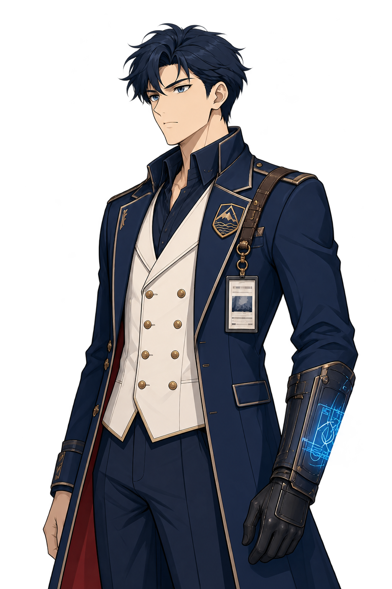

**上图范围：**纪存 · 人物立绘母稿；状态：`confirmed_source_design`。

| 图稿 | 状态 | 确认范围与来源 |
| --- | --- | --- |
| [H01-jicun-dialogue-r1.png](../../captures/20261014-full-direction/review/20261016-internal-upgrade/samples/H01-jicun-dialogue-r1.png) | `confirmed_source_design` | 纪存 · 人物立绘母稿；[原记录](../../captures/20261014-full-direction/review/20261016-internal-upgrade/confirmed-design-handoff-20261023.json)；CML132 |
| [H01-jicun-focused-speaking-r1.png](../../captures/20261014-full-direction/review/20261016-internal-upgrade/samples/H01-jicun-focused-speaking-r1.png) | `confirmed_source_design` | 纪存 · 专注调度；[原记录](../../captures/20261014-full-direction/review/20261016-internal-upgrade/confirmed-design-handoff-20261023.json)；CML132 |

## 白鸢

**上图范围：**白鸢 · 人物立绘母稿；状态：`confirmed_source_design`。

| 图稿 | 状态 | 确认范围与来源 |
| --- | --- | --- |
| [H02-baiyuan-concentrating-r2.png](../../captures/20261014-full-direction/review/20261016-internal-upgrade/samples/H02-baiyuan-concentrating-r2.png) | `confirmed_source_design` | 白鸢 · 认真推演；[原记录](../../captures/20261014-full-direction/review/20261016-internal-upgrade/confirmed-design-handoff-20261023.json)；CML132 |
| [H02-baiyuan-dialogue-r2-anatomy.png](../../captures/20261014-full-direction/review/20261016-internal-upgrade/samples/H02-baiyuan-dialogue-r2-anatomy.png) | `confirmed_source_design` | 白鸢 · 人物立绘母稿；[原记录](../../captures/20261014-full-direction/review/20261016-internal-upgrade/confirmed-design-handoff-20261023.json)；CML132 |

## 七海

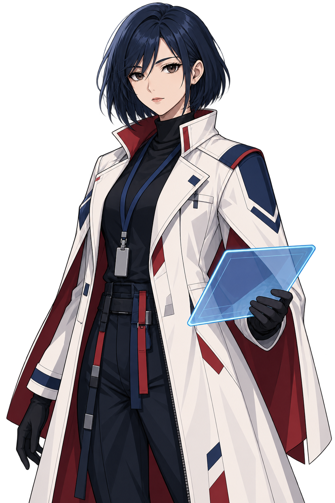

**上图范围：**七海 · 人物立绘母稿；状态：`confirmed_source_design`。

| 图稿 | 状态 | 确认范围与来源 |
| --- | --- | --- |
| [H03-qihai-dialogue-v1.png](../../captures/20261014-full-direction/review/20261016-internal-upgrade/samples/H03-qihai-dialogue-v1.png) | `confirmed_source_design` | 七海 · 人物立绘母稿；[原记录](../../captures/20261014-full-direction/review/20261016-internal-upgrade/confirmed-design-handoff-20261023.json)；CML132 |
| [H03-qihai-firm-speaking-r1.png](../../captures/20261014-full-direction/review/20261016-internal-upgrade/samples/H03-qihai-firm-speaking-r1.png) | `confirmed_source_design` | 七海 · 坚定交涉；[原记录](../../captures/20261014-full-direction/review/20261016-internal-upgrade/confirmed-design-handoff-20261023.json)；CML132 |

## 兜灯

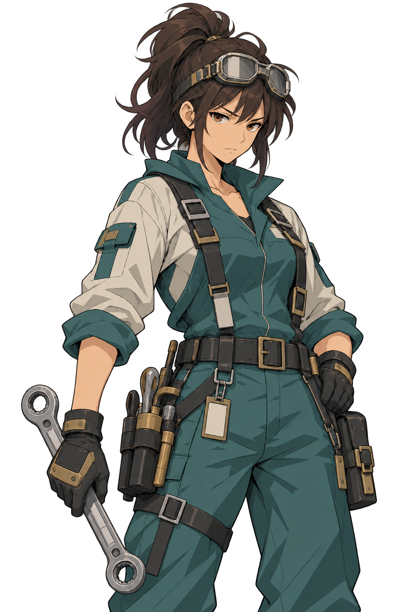

**上图范围：**兜灯 · 人物配色母稿；状态：`confirmed_source_design`。

| 图稿 | 状态 | 确认范围与来源 |
| --- | --- | --- |
| [H04-doudeng-explaining-r1.png](../../captures/20261014-full-direction/review/20261016-internal-upgrade/samples/H04-doudeng-explaining-r1.png) | `confirmed_source_design` | 兜灯 · 说明维修；[原记录](../../captures/20261014-full-direction/review/20261016-internal-upgrade/confirmed-design-handoff-20261023.json)；CML132 |
| [H04-doudeng-palette-r3.png](../../captures/20261014-full-direction/review/20261016-internal-upgrade/samples/H04-doudeng-palette-r3.png) | `confirmed_source_design` | 兜灯 · 人物配色母稿；[原记录](../../captures/20261014-full-direction/review/20261016-internal-upgrade/confirmed-design-handoff-20261023.json)；CML132 |

## 唐胶

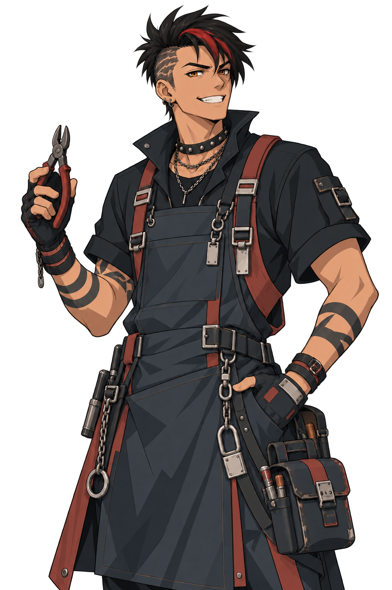

**上图范围：**唐胶 · 人物配色母稿；状态：`confirmed_source_design`。

| 图稿 | 状态 | 确认范围与来源 |
| --- | --- | --- |
| [H07-tangjiao-palette-r3.png](../../captures/20261014-full-direction/review/20261016-internal-upgrade/samples/H07-tangjiao-palette-r3.png) | `confirmed_source_design` | 唐胶 · 人物配色母稿；[原记录](../../captures/20261014-full-direction/review/20261016-internal-upgrade/confirmed-design-handoff-20261023.json)；CML132 |
| [H07-tangjiao-serious-r1.png](../../captures/20261014-full-direction/review/20261016-internal-upgrade/samples/H07-tangjiao-serious-r1.png) | `confirmed_source_design` | 唐胶 · 认真检查；[原记录](../../captures/20261014-full-direction/review/20261016-internal-upgrade/confirmed-design-handoff-20261023.json)；CML132 |

## 胶价王

**上图范围：**胶价王 · 人物配色母稿；状态：`confirmed_source_design`。

| 图稿 | 状态 | 确认范围与来源 |
| --- | --- | --- |
| [H09-jiaojia-palette-r3.png](../../captures/20261014-full-direction/review/20261016-internal-upgrade/samples/H09-jiaojia-palette-r3.png) | `confirmed_source_design` | 胶价王 · 人物配色母稿；[原记录](../../captures/20261014-full-direction/review/20261016-internal-upgrade/confirmed-design-handoff-20261023.json)；CML132 |
| [H09-jiaojia-surprised-r1.png](../../captures/20261014-full-direction/review/20261016-internal-upgrade/samples/H09-jiaojia-surprised-r1.png) | `confirmed_source_design` | 胶价王 · 措手不及；[原记录](../../captures/20261014-full-direction/review/20261016-internal-upgrade/confirmed-design-handoff-20261023.json)；CML132 |

## 社勇王

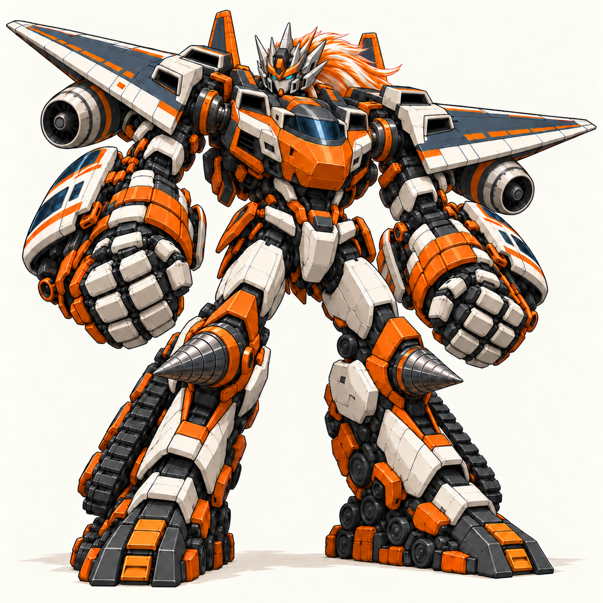

**上图范围：**社勇王整机正面；最终整体比例、巨拳、胸机鼻、头冠、主翼、膝钻及腿足外观的首要基准；状态：`confirmed_source_design`。

| 图稿 | 状态 | 确认范围与来源 |
| --- | --- | --- |
| [M04-backpack-fold-map-r12.png](../../captures/20261014-full-direction/review/20261016-internal-upgrade/samples/M04-backpack-fold-map-r12.png) | `confirmed_source_design` | 三阶段保留两格栅和双鳍；下模块从后下方翻出并对齐上模块，补齐单体与背包的来源。；[原记录](../../captures/20261014-full-direction/review/20261016-internal-upgrade/confirmed-design-handoff-20261023.json)；CML132 |
| [M04-bomber-backpack-assembly-r12.png](../../captures/20261014-full-direction/review/20261016-internal-upgrade/samples/M04-bomber-backpack-assembly-r12.png) | `confirmed_source_design` | 轰炸机装配与肩翼让位；胸/背/翼架独立分件，翼架与核心肩关节分别活动；[原记录](../../captures/20261014-full-direction/review/20261016-internal-upgrade/confirmed-design-handoff-20261023.json)；CML132 |
| [M04-bomber-master-r8.png](../../captures/20261014-full-direction/review/20261016-internal-upgrade/samples/M04-bomber-master-r8.png) | `confirmed_source_design` | 轰炸机单体；完整机鼻/舱窗、双主翼、双发动机、两片竖翼与独立翼根；[原记录](../../captures/20261014-full-direction/review/20261016-internal-upgrade/confirmed-design-handoff-20261023.json)；CML132 |
| [M04-front-backpack-fins-r7.png](../../captures/20261014-full-direction/review/20261016-internal-upgrade/samples/M04-front-backpack-fins-r7.png) | `confirmed_source_design` | 社勇王整机正面；最终整体比例、巨拳、胸机鼻、头冠、主翼、膝钻及腿足外观的首要基准；[原记录](../../captures/20261014-full-direction/review/20261016-internal-upgrade/confirmed-design-handoff-20261023.json)；CML132 |
| [M04-rear-exhaust-corrected-r6b.png](../../captures/20261014-full-direction/review/20261016-internal-upgrade/samples/M04-rear-exhaust-corrected-r6b.png) | `confirmed_source_design` | 社勇王背面；中置上下双格栅背包、双竖翼、后腿橙脊板与后跟；[原记录](../../captures/20261014-full-direction/review/20261016-internal-upgrade/confirmed-design-handoff-20261023.json)；CML132 |
| [M04-side-body-reviewed-r6d.png](../../captures/20261014-full-direction/review/20261016-internal-upgrade/samples/M04-side-body-reviewed-r6d.png) | `confirmed_source_design` | 社勇王侧面；肩甲侧向造型、发动机轴向、腿前后履带与足跟；[原记录](../../captures/20261014-full-direction/review/20261016-internal-upgrade/confirmed-design-handoff-20261023.json)；CML132 |

## 勇拳

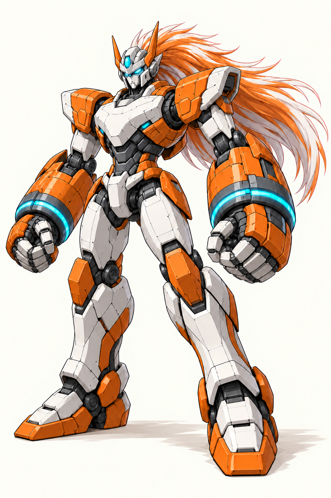

**上图范围：**勇拳单体形象；完整核心的主要造型与色块；胸口标识仍需和图6统一；状态：`confirmed_source_design`。

| 图稿 | 状态 | 确认范围与来源 |
| --- | --- | --- |
| [F09-bomber-mask-loading-r9b.png](../../captures/20261014-full-direction/review/20261016-internal-upgrade/samples/F09-bomber-mask-loading-r9b.png) | `confirmed_source_design` | 面罩加载与拳甲强化；轰炸机内置面罩加载到原头；拳甲强化属于完整核心；[原记录](../../captures/20261014-full-direction/review/20261016-internal-upgrade/confirmed-design-handoff-20261023.json)；CML132 |
| [F09-brave-core-master-r2.png](../../captures/20261014-full-direction/review/20261016-internal-upgrade/samples/F09-brave-core-master-r2.png) | `confirmed_source_design` | 勇拳单体形象；完整核心的主要造型与色块；胸口标识仍需和图6统一；[原记录](../../captures/20261014-full-direction/review/20261016-internal-upgrade/confirmed-design-handoff-20261023.json)；CML132 |
| [F09-core-views-r8.png](../../captures/20261014-full-direction/review/20261016-internal-upgrade/samples/F09-core-views-r8.png) | `confirmed_source_design` | 勇拳三视设计；同一个完整人形核心的正侧背、原头和长发、原四肢与关节；[原记录](../../captures/20261014-full-direction/review/20261016-internal-upgrade/confirmed-design-handoff-20261023.json)；CML132 |

## 钻探机与腿部组件

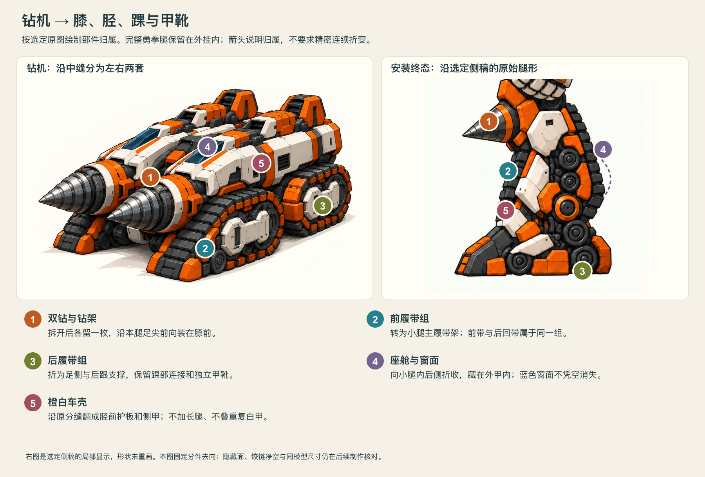

**上图范围：**五组编号在钻机和选定侧腿局部对应；前履带转小腿、后组入足跟、座舱折内后、白甲翻胫前。右图不重画腿，保持源图比例。；状态：`confirmed_source_design`。

| 图稿 | 状态 | 确认范围与来源 |
| --- | --- | --- |
| [F11-component-routing-r12.png](../../captures/20261014-full-direction/review/20261016-internal-upgrade/F11-component-routing-r12.png) | `confirmed_source_design` | 五组编号在钻机和选定侧腿局部对应；前履带转小腿、后组入足跟、座舱折内后、白甲翻胫前。右图不重画腿，保持源图比例。；[原记录](../../captures/20261014-full-direction/review/20261016-internal-upgrade/confirmed-design-handoff-20261023.json)；CML132 |
| [F11-component-routing-r12.svg](../../captures/20261014-full-direction/review/20261016-internal-upgrade/F11-component-routing-r12.svg) | `confirmed_source_design` | 五组编号在钻机和选定侧腿局部对应；前履带转小腿、后组入足跟、座舱折内后、白甲翻胫前。右图不重画腿，保持源图比例。；[原记录](../../captures/20261014-full-direction/review/20261016-internal-upgrade/confirmed-design-handoff-20261023.json)；CML132 |
| [F11-drill-master-r8.png](../../captures/20261014-full-direction/review/20261016-internal-upgrade/samples/F11-drill-master-r8.png) | `confirmed_source_design` | 钻探机单体；一车双模块、双钻、每半分组履带和白甲/橙架；[原记录](../../captures/20261014-full-direction/review/20261016-internal-upgrade/confirmed-design-handoff-20261023.json)；CML132 |

## 海底列车与臂壳

| 图稿 | 状态 | 确认范围与来源 |
| --- | --- | --- |
| [F12-shell-state-framework-r12.png](../../captures/20261014-full-direction/review/20261016-internal-upgrade/F12-shell-state-framework-r12.png) | `confirmed_source_design` | 同一核心前臂不动，两壳收近/打开，小翼贴回原壳；说明腕环原位置与遮挡，非精密机械剖面。；[原记录](../../captures/20261014-full-direction/review/20261016-internal-upgrade/confirmed-design-handoff-20261023.json)；CML132 |
| [F12-shell-state-framework-r12.svg](../../captures/20261014-full-direction/review/20261016-internal-upgrade/F12-shell-state-framework-r12.svg) | `confirmed_source_design` | 同一核心前臂不动，两壳收近/打开，小翼贴回原壳；说明腕环原位置与遮挡，非精密机械剖面。；[原记录](../../captures/20261014-full-direction/review/20261016-internal-upgrade/confirmed-design-handoff-20261023.json)；CML132 |
| [F12-subtrain-assembly-r8b.png](../../captures/20261014-full-direction/review/20261016-internal-upgrade/samples/F12-subtrain-assembly-r8b.png) | `confirmed_source_design` | 列车臂壳展开；中缝拆节、左右开壳、车头朝肘后、拳向前的状态关系；[原记录](../../captures/20261014-full-direction/review/20261016-internal-upgrade/confirmed-design-handoff-20261023.json)；CML132 |
| [F12-subtrain-master-r8.png](../../captures/20261014-full-direction/review/20261016-internal-upgrade/samples/F12-subtrain-master-r8.png) | `confirmed_source_design` | 海底列车单体；一列两节、两个外端车头、中央联接、橙白蓝窗带与短翼；[原记录](../../captures/20261014-full-direction/review/20261016-internal-upgrade/confirmed-design-handoff-20261023.json)；CML132 |
| [F12-train-protective-cradle-r12c.png](../../captures/20261014-full-direction/review/20261016-internal-upgrade/samples/F12-train-protective-cradle-r12c.png) | `confirmed_source_design` | 单个后向车头、平方连接端朝拳，前臂内侧有长开口；原两片侧壳收近为U形护套，巨拳独立露出。该图与原展开态仍是绘制图，不声称同模型或逐像素重合。；[原记录](../../captures/20261014-full-direction/review/20261016-internal-upgrade/confirmed-design-handoff-20261023.json)；CML132 |

## 馆守Z

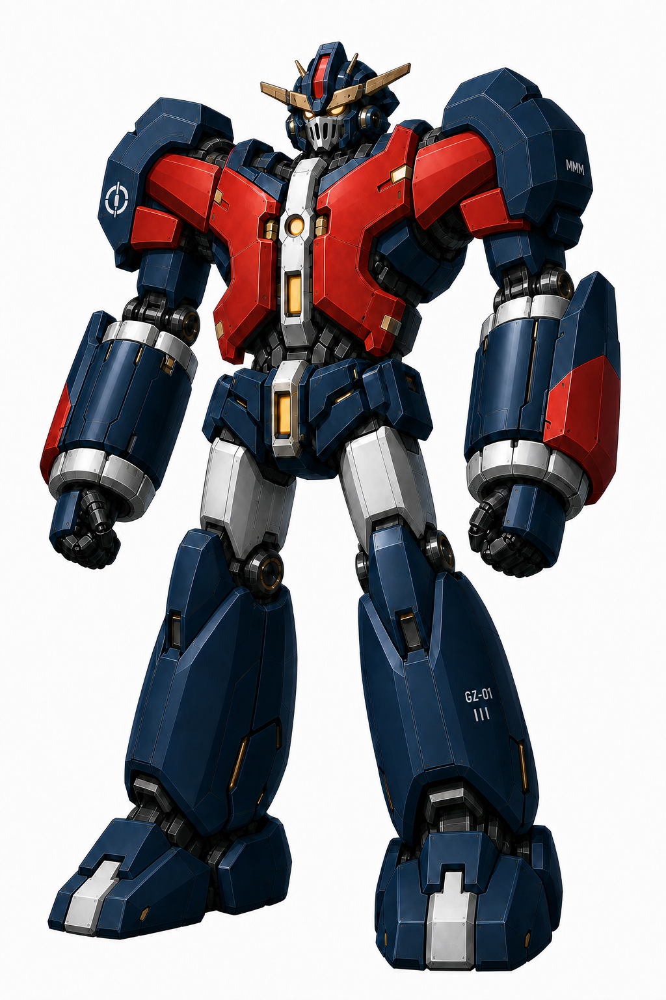

**上图范围：**沿用现有馆守Z；收藏/身份母稿与C01当时缺臂状态不同，不能恢复已毁右前臂；状态：`confirmed_scoped_parent_not_runtime_acceptance`。

| 图稿 | 状态 | 确认范围与来源 |
| --- | --- | --- |
| [guardian_z_collector_e02_lockframe_candidate_v10x.png](../../docs/superpowers/specs/production/art-direction-v0.3/art-delivery/review/guardian_z_collector_e02_lockframe_candidate_v10x.png) | `confirmed_scoped_parent_not_runtime_acceptance` | 沿用现有馆守Z；收藏/身份母稿与C01当时缺臂状态不同，不能恢复已毁右前臂；[原记录](../../docs/superpowers/specs/data/canon/character_mecha_art_locks.tsv)；CML130;CML131 |

## 无牌一号：仅R16头部

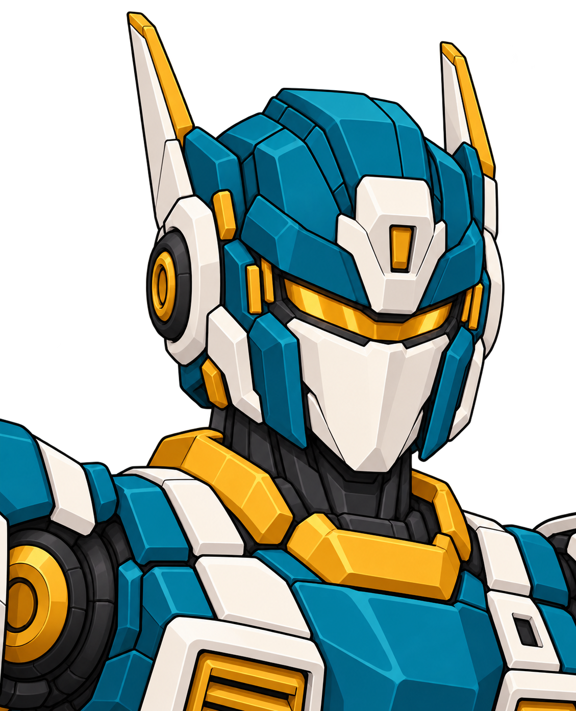

**上图范围：**仅R16头部，整机另行收敛；状态：`confirmed_source_design`。

| 图稿 | 状态 | 确认范围与来源 |
| --- | --- | --- |
| [M01-head-proportion-r16.png](../../captures/20261014-full-direction/review/20261016-internal-upgrade/samples/M01-head-proportion-r16.png) | `confirmed_source_design` | 仅R16头部，整机另行收敛；[原记录](../../captures/20261014-full-direction/review/20261016-internal-upgrade/confirmed-design-handoff-20261023.json)；CML133 |

## 旧拳王

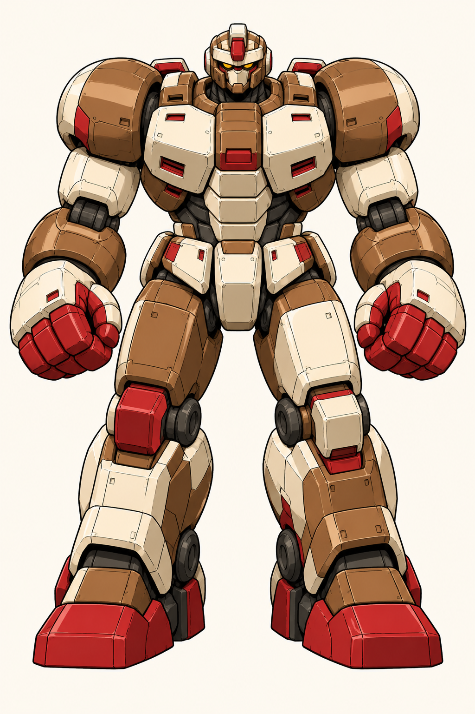

**上图范围：**已确定当前正侧背/头部源设计；状态：`confirmed_source_design`。

| 图稿 | 状态 | 确认范围与来源 |
| --- | --- | --- |
| [M02-front-r2.png](../../captures/20261014-full-direction/review/20261016-internal-upgrade/samples/M02-front-r2.png) | `confirmed_source_design` | 已确定当前正侧背/头部源设计；[原记录](../../captures/20261014-full-direction/review/20261016-internal-upgrade/confirmed-design-handoff-20261023.json)；CML136 |
| [M02-rear-r2.png](../../captures/20261014-full-direction/review/20261016-internal-upgrade/samples/M02-rear-r2.png) | `confirmed_source_design` | 已确定当前正侧背/头部源设计；[原记录](../../captures/20261014-full-direction/review/20261016-internal-upgrade/confirmed-design-handoff-20261023.json)；CML136 |
| [M02-side-r2b.png](../../captures/20261014-full-direction/review/20261016-internal-upgrade/samples/M02-side-r2b.png) | `confirmed_source_design` | 已确定当前正侧背/头部源设计；[原记录](../../captures/20261014-full-direction/review/20261016-internal-upgrade/confirmed-design-handoff-20261023.json)；CML136 |

## 完全版王者

| 图稿 | 状态 | 确认范围与来源 |
| --- | --- | --- |
| [M05-core-front-r11b.png](../../captures/20261014-full-direction/review/20261016-internal-upgrade/samples/M05-core-front-r11b.png) | `confirmed_source_design` | 已确定当前正侧背/头部源设计；[原记录](../../captures/20261014-full-direction/review/20261016-internal-upgrade/confirmed-design-handoff-20261023.json)；CML134;CML135 |
| [M05-core-rear-r11.png](../../captures/20261014-full-direction/review/20261016-internal-upgrade/samples/M05-core-rear-r11.png) | `confirmed_source_design` | 已确定当前正侧背/头部源设计；[原记录](../../captures/20261014-full-direction/review/20261016-internal-upgrade/confirmed-design-handoff-20261023.json)；CML134;CML135 |
| [M05-core-side-r11.png](../../captures/20261014-full-direction/review/20261016-internal-upgrade/samples/M05-core-side-r11.png) | `confirmed_source_design` | 已确定当前正侧背/头部源设计；[原记录](../../captures/20261014-full-direction/review/20261016-internal-upgrade/confirmed-design-handoff-20261023.json)；CML134;CML135 |
| [M05-full-front-backpack-r12.png](../../captures/20261014-full-direction/review/20261016-internal-upgrade/samples/M05-full-front-backpack-r12.png) | `confirmed_source_design` | 已确定当前正侧背/头部源设计；[原记录](../../captures/20261014-full-direction/review/20261016-internal-upgrade/confirmed-design-handoff-20261023.json)；CML134;CML135 |
| [M05-full-rear-backpack-r12c.png](../../captures/20261014-full-direction/review/20261016-internal-upgrade/samples/M05-full-rear-backpack-r12c.png) | `confirmed_source_design` | 已确定当前正侧背/头部源设计；[原记录](../../captures/20261014-full-direction/review/20261016-internal-upgrade/confirmed-design-handoff-20261023.json)；CML134;CML135 |
| [M05-full-side-backpack-r12.png](../../captures/20261014-full-direction/review/20261016-internal-upgrade/samples/M05-full-side-backpack-r12.png) | `confirmed_source_design` | 已确定当前正侧背/头部源设计；[原记录](../../captures/20261014-full-direction/review/20261016-internal-upgrade/confirmed-design-handoff-20261023.json)；CML134;CML135 |
| [M05-head-dual-turnaround-r10.png](../../captures/20261014-full-direction/review/20261016-internal-upgrade/samples/M05-head-dual-turnaround-r10.png) | `confirmed_source_design` | 已确定当前正侧背/头部源设计；[原记录](../../captures/20261014-full-direction/review/20261016-internal-upgrade/confirmed-design-handoff-20261023.json)；CML134;CML135 |

## 预算二号

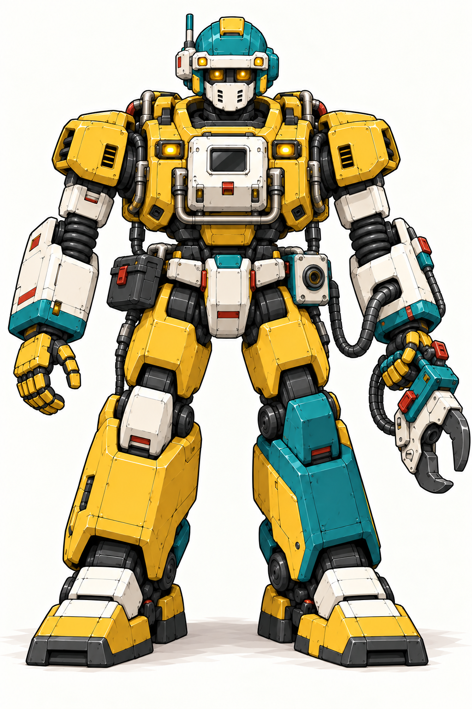

**上图范围：**指定源设计，具体采用范围见回执；状态：`confirmed_source_design`。

| 图稿 | 状态 | 确认范围与来源 |
| --- | --- | --- |
| [M06-front-r3.png](../../captures/20261014-full-direction/review/20261016-internal-upgrade/samples/M06-front-r3.png) | `confirmed_source_design` | 指定源设计，具体采用范围见回执；[原记录](../../captures/20261014-full-direction/review/20261016-internal-upgrade/M06-turnaround-design-fixed-20261023-r3.json)；CML143 |
| [M06-rear-r3.png](../../captures/20261014-full-direction/review/20261016-internal-upgrade/samples/M06-rear-r3.png) | `confirmed_source_design` | 指定源设计，具体采用范围见回执；[原记录](../../captures/20261014-full-direction/review/20261016-internal-upgrade/M06-turnaround-design-fixed-20261023-r3.json)；CML143 |
| [M06-side-r3c.png](../../captures/20261014-full-direction/review/20261016-internal-upgrade/samples/M06-side-r3c.png) | `confirmed_source_design` | 指定源设计，具体采用范围见回执；[原记录](../../captures/20261014-full-direction/review/20261016-internal-upgrade/M06-turnaround-design-fixed-20261023-r3.json)；CML143 |

## 雷翎

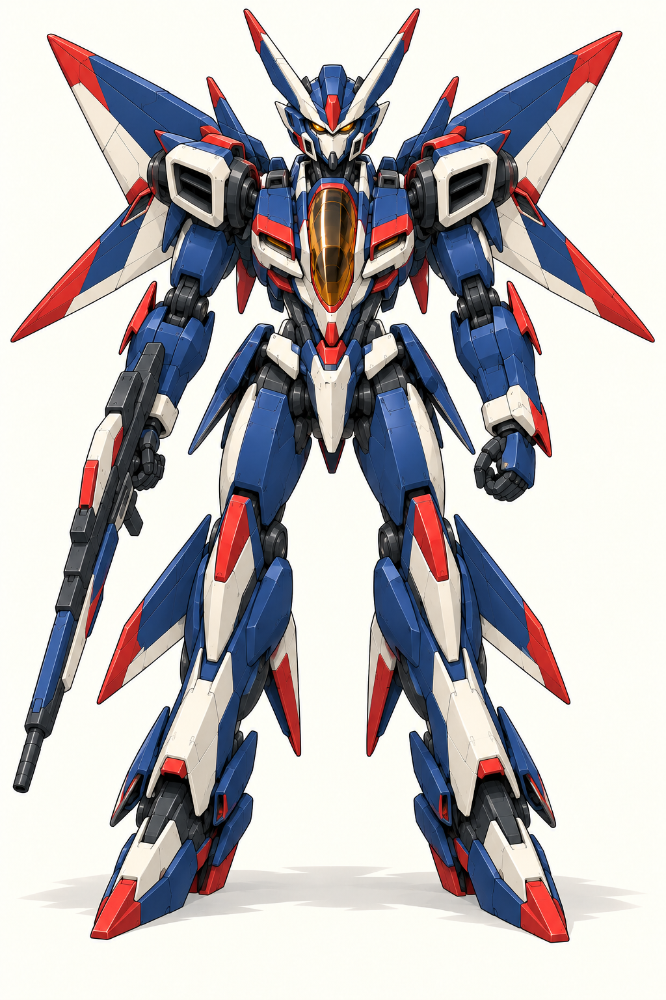

**上图范围：**当前R6已确定三视源设计；状态：`confirmed_source_design`。

| 图稿 | 状态 | 确认范围与来源 |
| --- | --- | --- |
| [M08-front-airframe-r6.png](../../captures/20261014-full-direction/review/20261016-internal-upgrade/samples/M08-front-airframe-r6.png) | `confirmed_source_design` | 当前R6已确定三视源设计；[原记录](../../captures/20261014-full-direction/review/20261016-internal-upgrade/confirmed-design-handoff-20261023.json)；CML141 |
| [M08-rear-airframe-r6.png](../../captures/20261014-full-direction/review/20261016-internal-upgrade/samples/M08-rear-airframe-r6.png) | `confirmed_source_design` | 当前R6已确定三视源设计；[原记录](../../captures/20261014-full-direction/review/20261016-internal-upgrade/confirmed-design-handoff-20261023.json)；CML141 |
| [M08-side-airframe-r6.png](../../captures/20261014-full-direction/review/20261016-internal-upgrade/samples/M08-side-airframe-r6.png) | `confirmed_source_design` | 当前R6已确定三视源设计；[原记录](../../captures/20261014-full-direction/review/20261016-internal-upgrade/confirmed-design-handoff-20261023.json)；CML141 |
| [M08-synthesis-r3.png](../../captures/20261014-full-direction/review/20261016-internal-upgrade/samples/M08-synthesis-r3.png) | `parent_context_only` | R3身份与航空形态父源；不冒充R6新航空三视；[原记录](../../captures/20261014-full-direction/review/20261016-internal-upgrade/confirmed-design-handoff-20261023.json)；CML141 |

## 歌翼

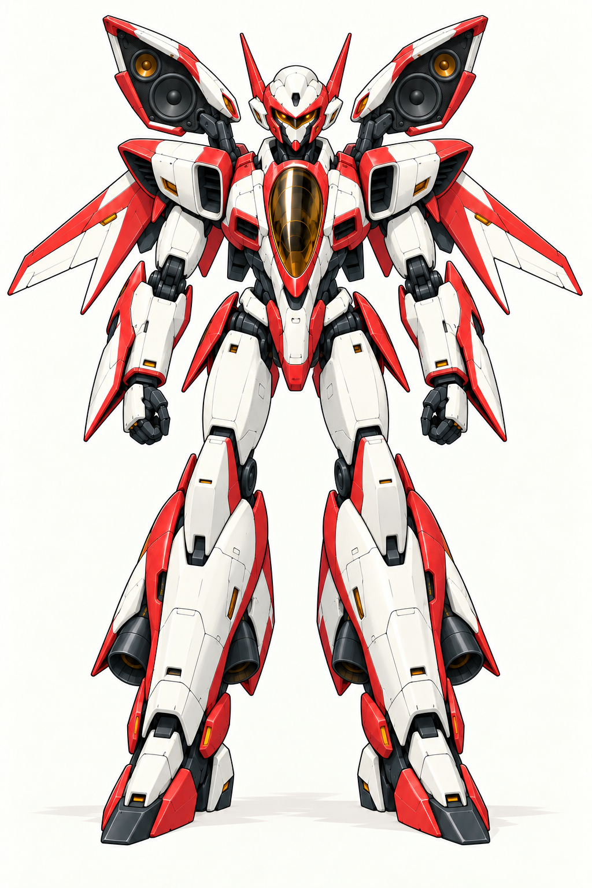

**上图范围：**当前R6已确定三视源设计；状态：`confirmed_source_design`。

| 图稿 | 状态 | 确认范围与来源 |
| --- | --- | --- |
| [M14-front-airframe-r6.png](../../captures/20261014-full-direction/review/20261016-internal-upgrade/samples/M14-front-airframe-r6.png) | `confirmed_source_design` | 当前R6已确定三视源设计；[原记录](../../captures/20261014-full-direction/review/20261016-internal-upgrade/confirmed-design-handoff-20261023.json)；CML140;CML142 |
| [M14-music-support-r4.png](../../captures/20261014-full-direction/review/20261016-internal-upgrade/samples/M14-music-support-r4.png) | `confirmed_source_design` | R4身份/音乐功能/收纳父源；表面三视依R6；[原记录](../../captures/20261014-full-direction/review/20261016-internal-upgrade/confirmed-design-handoff-20261023.json)；CML140;CML142 |
| [M14-rear-airframe-r6.png](../../captures/20261014-full-direction/review/20261016-internal-upgrade/samples/M14-rear-airframe-r6.png) | `confirmed_source_design` | 当前R6已确定三视源设计；[原记录](../../captures/20261014-full-direction/review/20261016-internal-upgrade/confirmed-design-handoff-20261023.json)；CML140;CML142 |
| [M14-side-airframe-r6.png](../../captures/20261014-full-direction/review/20261016-internal-upgrade/samples/M14-side-airframe-r6.png) | `confirmed_source_design` | 当前R6已确定三视源设计；[原记录](../../captures/20261014-full-direction/review/20261016-internal-upgrade/confirmed-design-handoff-20261023.json)；CML140;CML142 |

## 货柜领袖

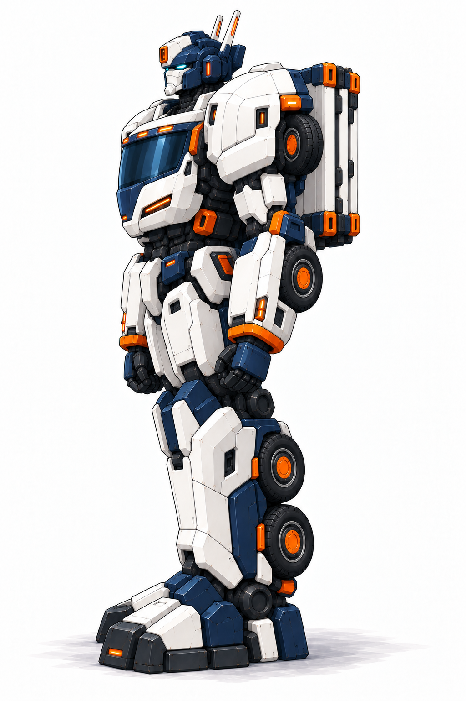

**上图范围：**R8整机形象母稿；状态：`confirmed_source_design`。

| 图稿 | 状态 | 确认范围与来源 |
| --- | --- | --- |
| [M11-front-r9.png](../../captures/20261014-full-direction/review/20261016-internal-upgrade/samples/M11-front-r9.png) | `authorized_derived_support` | 已确定R8形象的R9授权修正三视；[原记录](../../captures/20261014-full-direction/review/20261016-internal-upgrade/confirmed-design-handoff-20261023.json)；CML138;CML139 |
| [M11-posture-r8.png](../../captures/20261014-full-direction/review/20261016-internal-upgrade/samples/M11-posture-r8.png) | `confirmed_source_design` | R8整机形象母稿；[原记录](../../captures/20261014-full-direction/review/20261016-internal-upgrade/confirmed-design-handoff-20261023.json)；CML138;CML139 |
| [M11-rear-r9.png](../../captures/20261014-full-direction/review/20261016-internal-upgrade/samples/M11-rear-r9.png) | `authorized_derived_support` | 已确定R8形象的R9授权修正三视；[原记录](../../captures/20261014-full-direction/review/20261016-internal-upgrade/confirmed-design-handoff-20261023.json)；CML138;CML139 |
| [M11-selected-head-r6.png](../../captures/20261014-full-direction/review/20261016-internal-upgrade/samples/M11-selected-head-r6.png) | `confirmed_source_design` | 用户指定原头部父源；整机与颏甲依R8/R9；[原记录](../../captures/20261014-full-direction/review/20261016-internal-upgrade/confirmed-design-handoff-20261023.json)；CML138;CML139 |
| [M11-side-r9.png](../../captures/20261014-full-direction/review/20261016-internal-upgrade/samples/M11-side-r9.png) | `authorized_derived_support` | 已确定R8形象的R9授权修正三视；[原记录](../../captures/20261014-full-direction/review/20261016-internal-upgrade/confirmed-design-handoff-20261023.json)；CML138;CML139 |
| [M11-vehicle-views-r7.png](../../captures/20261014-full-direction/review/20261016-internal-upgrade/samples/M11-vehicle-views-r7.png) | `authorized_derived_support` | 车形结构参考；不冒充完整变形通过；[原记录](../../captures/20261014-full-direction/review/20261016-internal-upgrade/confirmed-design-handoff-20261023.json)；CML138;CML139 |

## 灰崎警备劳务机

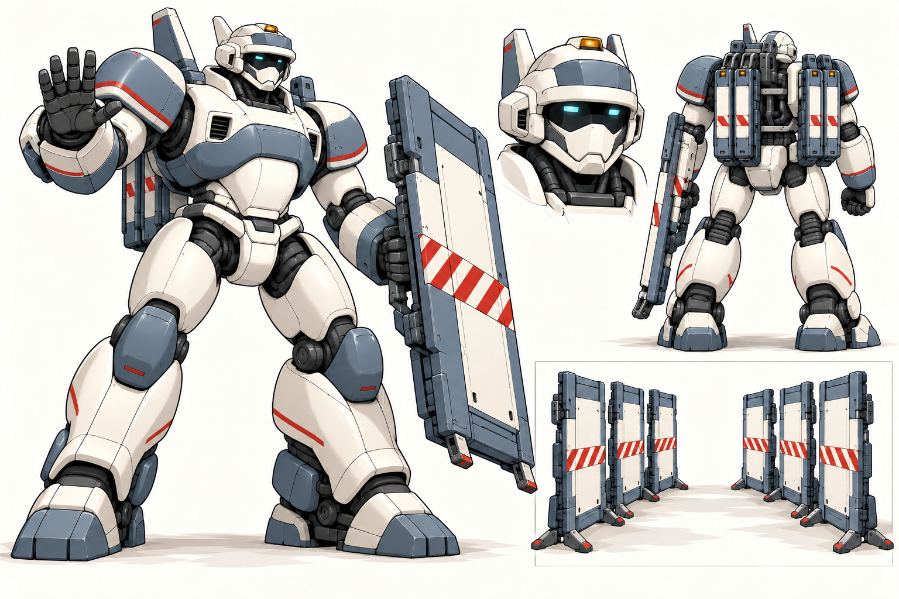

**上图范围：**采用灰崎R2源板：当前巡逻盔头型、灰白/蓝灰/红反光标记、成人身形与连续曲面外壳；六面平板交通墙，手持一面、背负五面。；状态：`confirmed_source_design`。

| 图稿 | 状态 | 确认范围与来源 |
| --- | --- | --- |
| [M09-curved-labor-r2.png](../../captures/20261014-full-direction/review/20261016-internal-upgrade/samples/M09-curved-labor-r2.png) | `confirmed_source_design` | 采用灰崎R2源板：当前巡逻盔头型、灰白/蓝灰/红反光标记、成人身形与连续曲面外壳；六面平板交通墙，手持一面、背负五面。；[原记录](../../captures/20261014-full-direction/review/20261016-internal-upgrade/city-response-design-fixed-20261023-r2.json)；CML144 |
| [M09-front-r4c.png](../../captures/20261014-full-direction/review/20261016-internal-upgrade/samples/M09-front-r4c.png) | `authorized_derived_support_not_individually_accepted` | 指定源设计，具体采用范围见回执；[原记录](../../captures/20261014-full-direction/review/20261016-internal-upgrade/city-response-main-handoff-20261024.json)；CML144 |
| [M09-rear-r4.png](../../captures/20261014-full-direction/review/20261016-internal-upgrade/samples/M09-rear-r4.png) | `authorized_derived_support_not_individually_accepted` | 指定源设计，具体采用范围见回执；[原记录](../../captures/20261014-full-direction/review/20261016-internal-upgrade/city-response-main-handoff-20261024.json)；CML144 |
| [M09-side-r4.png](../../captures/20261014-full-direction/review/20261016-internal-upgrade/samples/M09-side-r4.png) | `authorized_derived_support_not_individually_accepted` | 指定源设计，具体采用范围见回执；[原记录](../../captures/20261014-full-direction/review/20261016-internal-upgrade/city-response-main-handoff-20261024.json)；CML144 |

## 消防架桥机

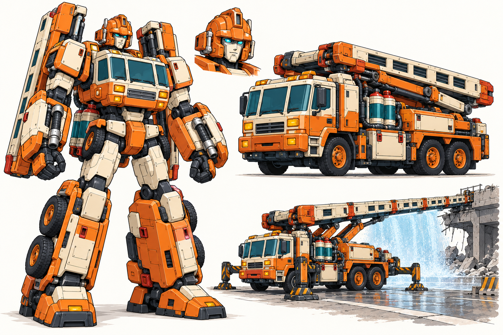

**上图范围：**采用消防架桥机R2源板：橙白双足工程人形与消防架桥载具，驾驶室胸、六轮组、成对折叠桥板、消防水路；四稳定腿用于车辆作业支撑。；状态：`confirmed_source_design`。

| 图稿 | 状态 | 确认范围与来源 |
| --- | --- | --- |
| [M10-engineering-transformer-r2.png](../../captures/20261014-full-direction/review/20261016-internal-upgrade/samples/M10-engineering-transformer-r2.png) | `confirmed_source_design` | 采用消防架桥机R2源板：橙白双足工程人形与消防架桥载具，驾驶室胸、六轮组、成对折叠桥板、消防水路；四稳定腿用于车辆作业支撑。；[原记录](../../captures/20261014-full-direction/review/20261016-internal-upgrade/city-response-design-fixed-20261023-r2.json)；CML145 |
| [M10-front-r3b.png](../../captures/20261014-full-direction/review/20261016-internal-upgrade/samples/M10-front-r3b.png) | `authorized_derived_support_not_individually_accepted` | 指定源设计，具体采用范围见回执；[原记录](../../captures/20261014-full-direction/review/20261016-internal-upgrade/city-response-main-handoff-20261024.json)；CML145 |
| [M10-rear-r3.png](../../captures/20261014-full-direction/review/20261016-internal-upgrade/samples/M10-rear-r3.png) | `authorized_derived_support_not_individually_accepted` | 指定源设计，具体采用范围见回执；[原记录](../../captures/20261014-full-direction/review/20261016-internal-upgrade/city-response-main-handoff-20261024.json)；CML145 |
| [M10-side-r3b.png](../../captures/20261014-full-direction/review/20261016-internal-upgrade/samples/M10-side-r3b.png) | `authorized_derived_support_not_individually_accepted` | 指定源设计，具体采用范围见回执；[原记录](../../captures/20261014-full-direction/review/20261016-internal-upgrade/city-response-main-handoff-20261024.json)；CML145 |
| [M10-transformation-sequence-r4.png](../../captures/20261014-full-direction/review/20261016-internal-upgrade/samples/M10-transformation-sequence-r4.png) | `authorized_derived_support_not_individually_accepted` | 指定源设计，具体采用范围见回执；[原记录](../../captures/20261014-full-direction/review/20261016-internal-upgrade/city-response-main-handoff-20261024.json)；CML145 |
| [M10-vehicle-turnaround-r4.png](../../captures/20261014-full-direction/review/20261016-internal-upgrade/samples/M10-vehicle-turnaround-r4.png) | `authorized_derived_support_not_individually_accepted` | 指定源设计，具体采用范围见回执；[原记录](../../captures/20261014-full-direction/review/20261016-internal-upgrade/city-response-main-handoff-20261024.json)；CML145 |

## C01有限范围整帧锚

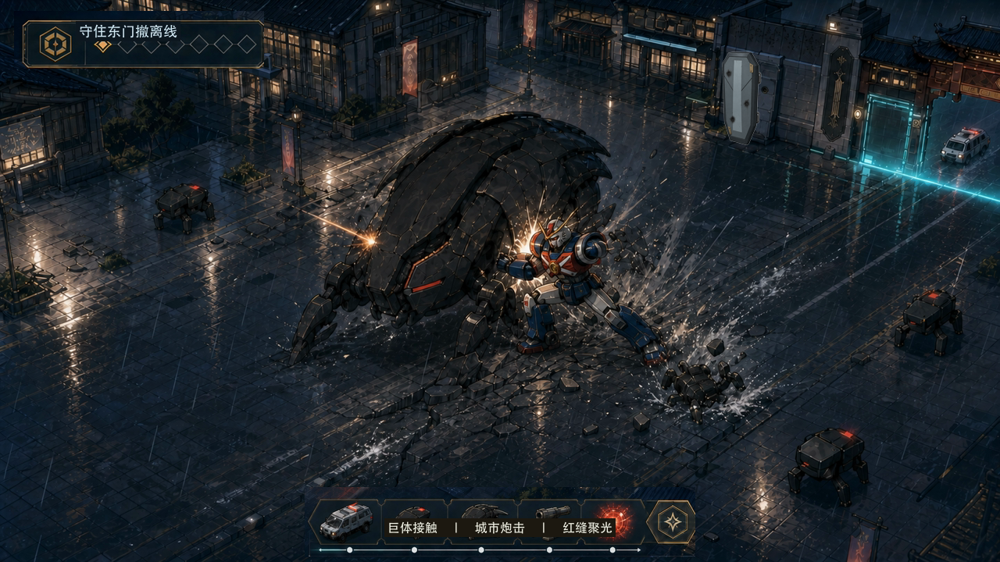

**上图范围：**C01整帧构图/动作/身份锚，不可拆成人物新母稿或直接当运行资产；状态：`confirmed_nonseparable_frame_anchor`。

| 图稿 | 状态 | 确认范围与来源 |
| --- | --- | --- |
| [GF_CONTACT_1280x720_v2.png](../../docs/superpowers/specs/production/c01-current-demo-v1/art-a9-gold-frame/delivery/GF_CONTACT_1280x720_v2.png) | `confirmed_nonseparable_frame_anchor` | C01整帧构图/动作/身份锚，不可拆成人物新母稿或直接当运行资产；[原记录](../../docs/superpowers/specs/剧情梗概/V35-GF纪存与BREAKER用户视觉锚Current-Canon迁移-2026-08-23.md)；CML001;CML129 |
| [GF_PLAN_1280x720_v2.png](../../docs/superpowers/specs/production/c01-current-demo-v1/art-a9-gold-frame/delivery/GF_PLAN_1280x720_v2.png) | `confirmed_nonseparable_frame_anchor` | C01整帧构图/动作/身份锚，不可拆成人物新母稿或直接当运行资产；[原记录](../../docs/superpowers/specs/剧情梗概/V35-GF纪存与BREAKER用户视觉锚Current-Canon迁移-2026-08-23.md)；CML001;CML129 |

原图尺寸、字节与SHA见[资产清单](ASSET-MANIFEST.tsv)。未收入M07/M12未确认新稿；旧画法例图和否决图仅供对应范围比较，不作为当前主体采用。
