# 建筑与设施

外部故事与设定评审用设计图。原卡面评语不等于用户逐图采用；最新确认范围看[已定设计图册](../../art/README.md)。本页不提供UI/UE、运行截图或三维资产。

## B01 有人避难楼

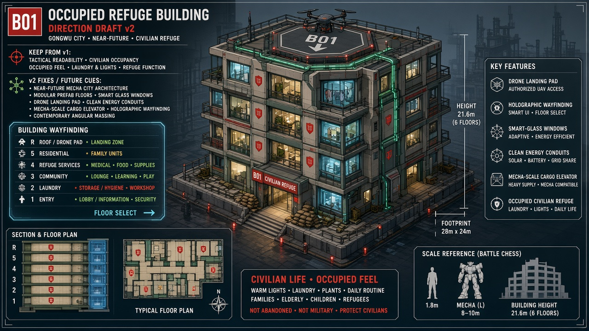

原卡面意见：结构与造型母版可采用。

该条从原298项评审中抽取，来源及摘要见[设计卡清单](../DESIGN-CARDS.json)。版本与采用依据见[文件清单](../FILE-MANIFEST.tsv)。

## B02 渠岸住宅

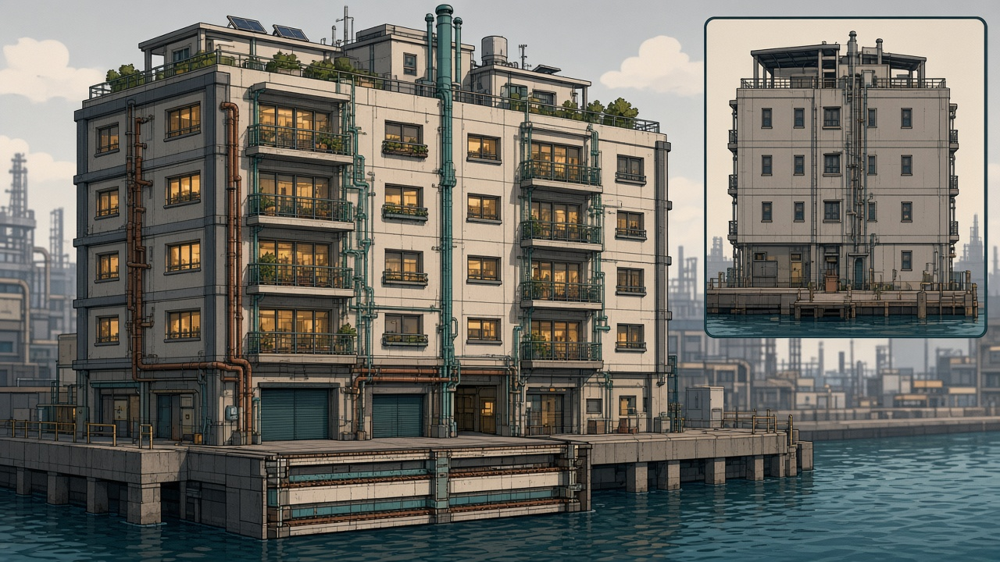

原卡面意见：内部修订后派生。

该条从原298项评审中抽取，来源及摘要见[设计卡清单](../DESIGN-CARDS.json)。版本与采用依据见[文件清单](../FILE-MANIFEST.tsv)。

## B03 环站公寓

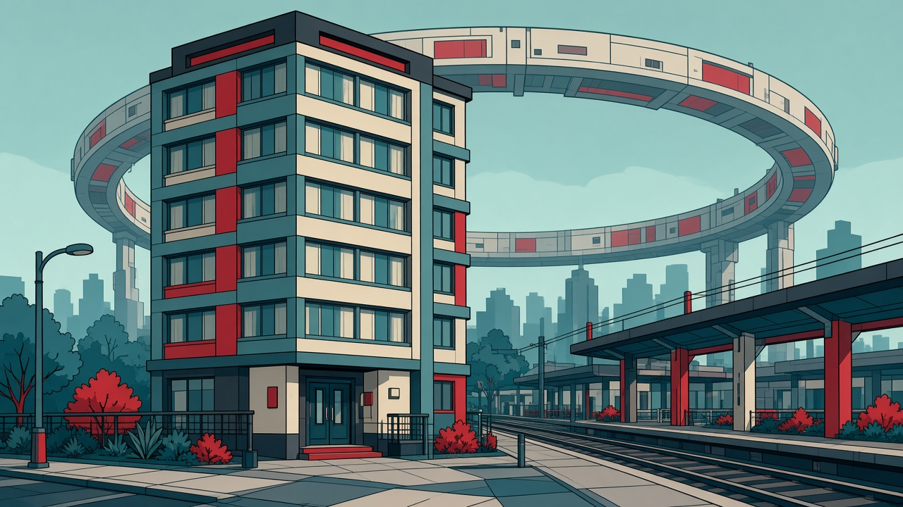

原卡面意见：内部修订后派生。

该条从原298项评审中抽取，来源及摘要见[设计卡清单](../DESIGN-CARDS.json)。版本与采用依据见[文件清单](../FILE-MANIFEST.tsv)。

## B04 供能前庭办公楼

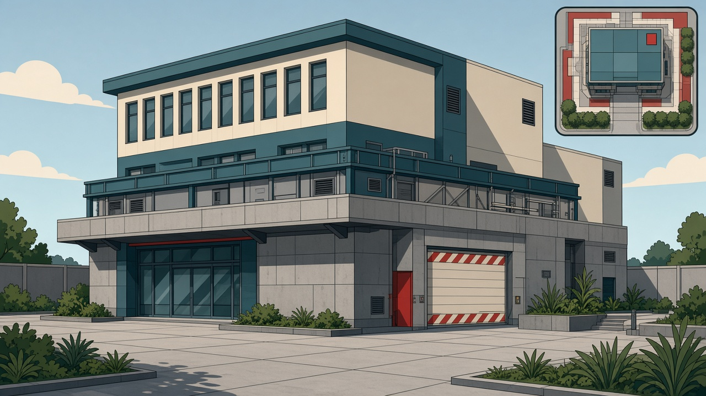

原卡面意见：结构与造型母版可采用。

该条从原298项评审中抽取，来源及摘要见[设计卡清单](../DESIGN-CARDS.json)。版本与采用依据见[文件清单](../FILE-MANIFEST.tsv)。

## B05 渠岸办公楼

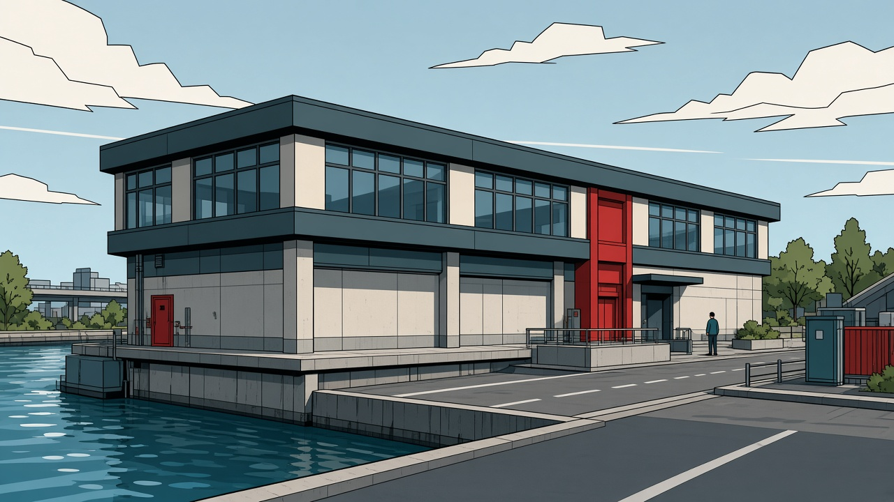

原卡面意见：结构与造型母版可采用。

该条从原298项评审中抽取，来源及摘要见[设计卡清单](../DESIGN-CARDS.json)。版本与采用依据见[文件清单](../FILE-MANIFEST.tsv)。

## B06 装卸站调度楼

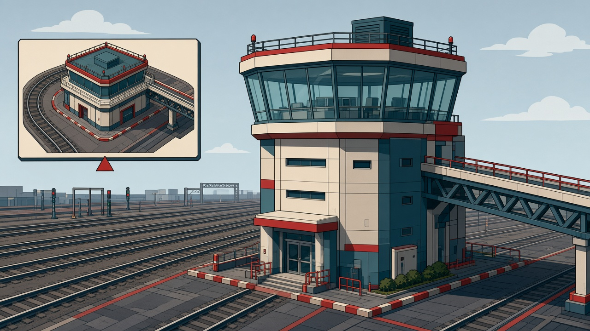

原卡面意见：结构与造型母版可采用。

该条从原298项评审中抽取，来源及摘要见[设计卡清单](../DESIGN-CARDS.json)。版本与采用依据见[文件清单](../FILE-MANIFEST.tsv)。

## B07 公共供电柜

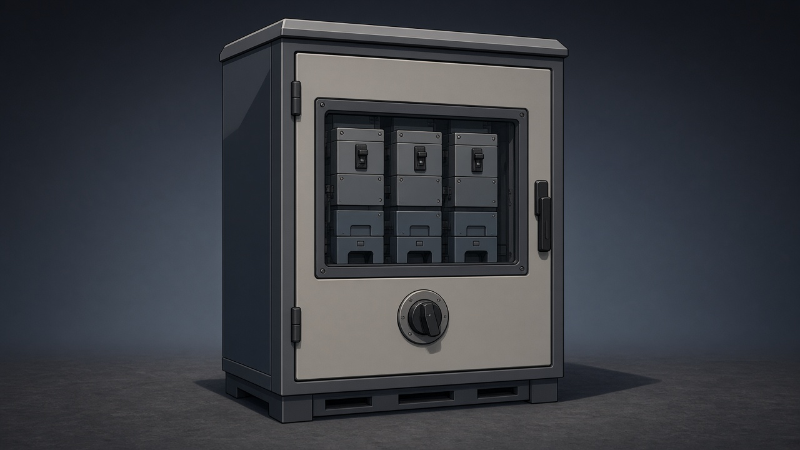

原卡面意见：内部修订后派生。

该条从原298项评审中抽取，来源及摘要见[设计卡清单](../DESIGN-CARDS.json)。版本与采用依据见[文件清单](../FILE-MANIFEST.tsv)。

## B08 远程馈电柜与中继

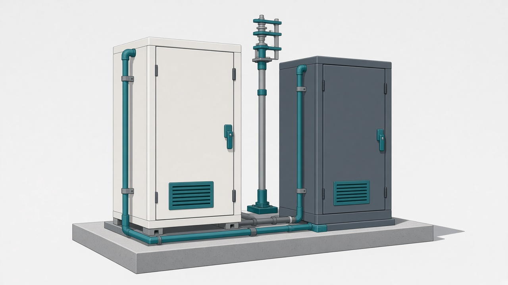

原卡面意见：内部修订后派生。

该条从原298项评审中抽取，来源及摘要见[设计卡清单](../DESIGN-CARDS.json)。版本与采用依据见[文件清单](../FILE-MANIFEST.tsv)。

## B09 变电设施

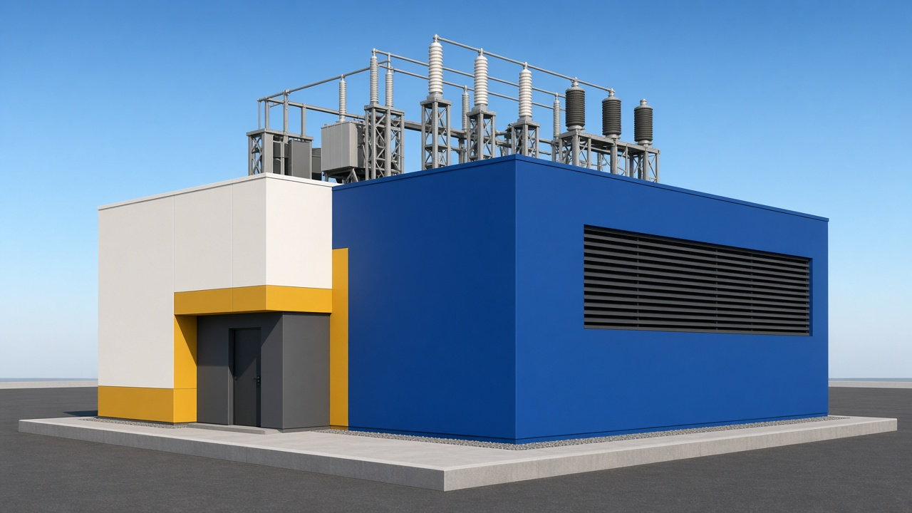

原卡面意见：内部修订后派生。

该条从原298项评审中抽取，来源及摘要见[设计卡清单](../DESIGN-CARDS.json)。版本与采用依据见[文件清单](../FILE-MANIFEST.tsv)。

## B10 维修工房

原卡面意见：结构与造型母版可采用。

该条从原298项评审中抽取，来源及摘要见[设计卡清单](../DESIGN-CARDS.json)。版本与采用依据见[文件清单](../FILE-MANIFEST.tsv)。

## B11 车站终端与控制台

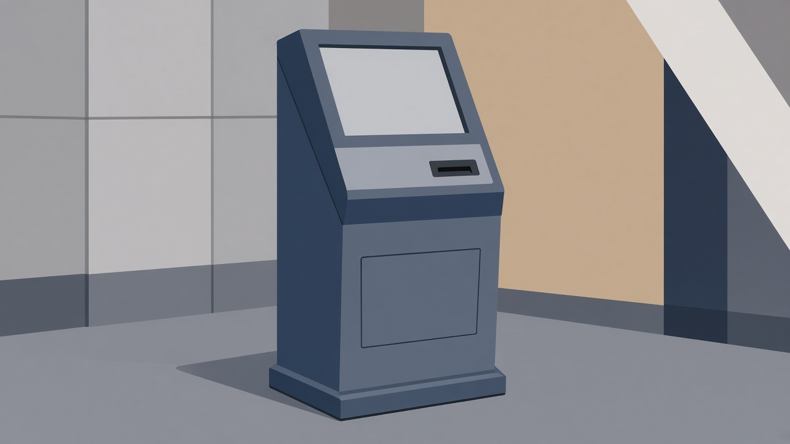

原卡面意见：内部修订后派生。

该条从原298项评审中抽取，来源及摘要见[设计卡清单](../DESIGN-CARDS.json)。版本与采用依据见[文件清单](../FILE-MANIFEST.tsv)。

## B12 撤离列车车头

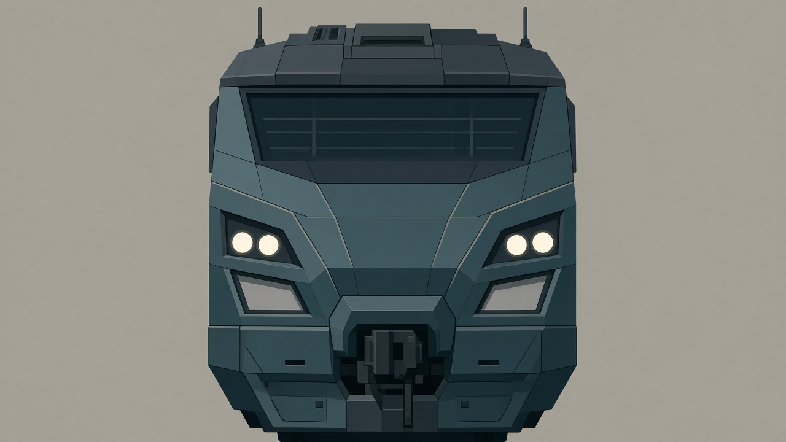

原卡面意见：内部修订后派生。

该条从原298项评审中抽取，来源及摘要见[设计卡清单](../DESIGN-CARDS.json)。版本与采用依据见[文件清单](../FILE-MANIFEST.tsv)。

## B13 撤离列车车厢

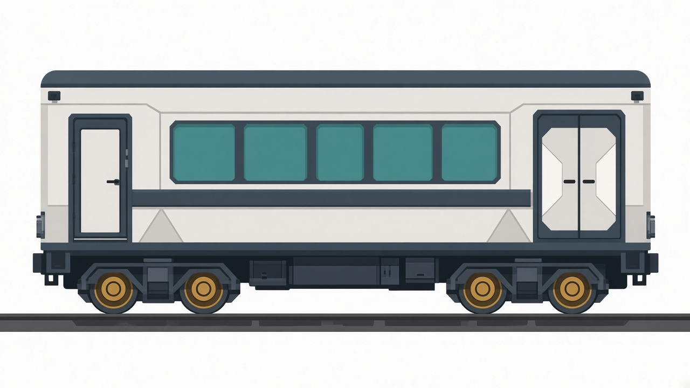

原卡面意见：内部修订后派生。

该条从原298项评审中抽取，来源及摘要见[设计卡清单](../DESIGN-CARDS.json)。版本与采用依据见[文件清单](../FILE-MANIFEST.tsv)。

## B14 跨渠桥面与桥锁

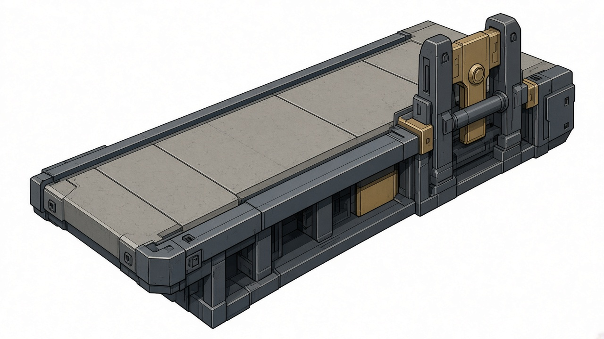

原卡面意见：内部修订后派生。

该条从原298项评审中抽取，来源及摘要见[设计卡清单](../DESIGN-CARDS.json)。版本与采用依据见[文件清单](../FILE-MANIFEST.tsv)。

## B15 上层检修栈桥

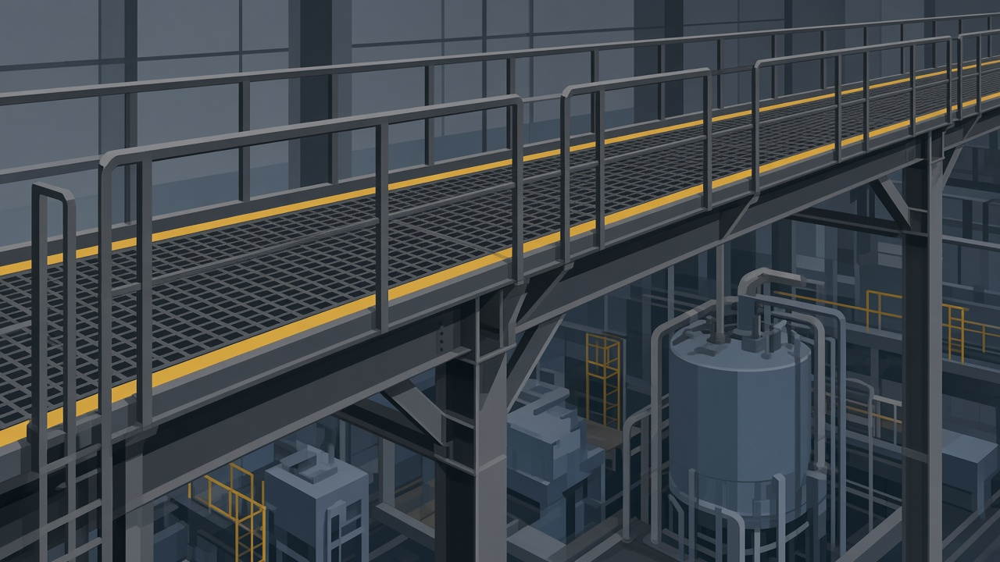

原卡面意见：内部修订后派生。

该条从原298项评审中抽取，来源及摘要见[设计卡清单](../DESIGN-CARDS.json)。版本与采用依据见[文件清单](../FILE-MANIFEST.tsv)。

## B16 支撑锚点与支座

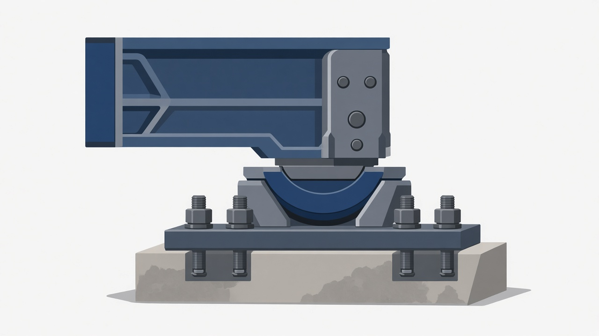

原卡面意见：结构与造型母版可采用。

该条从原298项评审中抽取，来源及摘要见[设计卡清单](../DESIGN-CARDS.json)。版本与采用依据见[文件清单](../FILE-MANIFEST.tsv)。

## B17 固定吊机

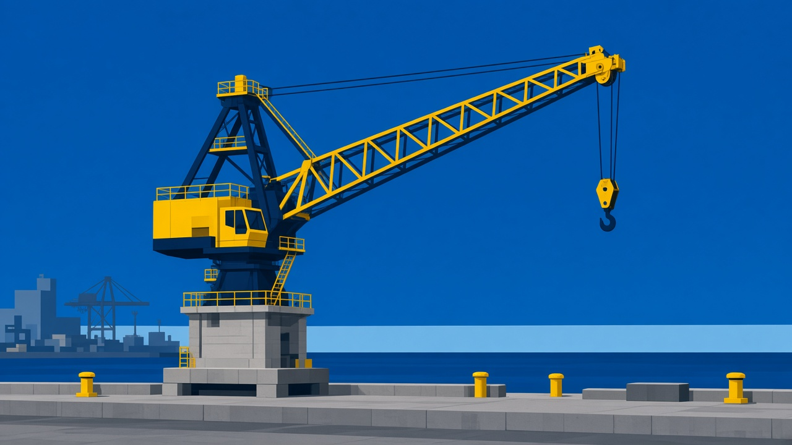

原卡面意见：内部修订后派生。

该条从原298项评审中抽取，来源及摘要见[设计卡清单](../DESIGN-CARDS.json)。版本与采用依据见[文件清单](../FILE-MANIFEST.tsv)。

## B18 升降平台

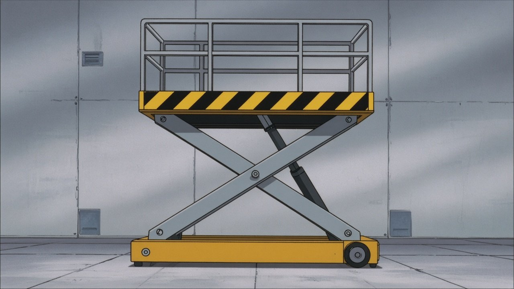

原卡面意见：内部修订后派生。

该条从原298项评审中抽取，来源及摘要见[设计卡清单](../DESIGN-CARDS.json)。版本与采用依据见[文件清单](../FILE-MANIFEST.tsv)。

## B19 轨道转台

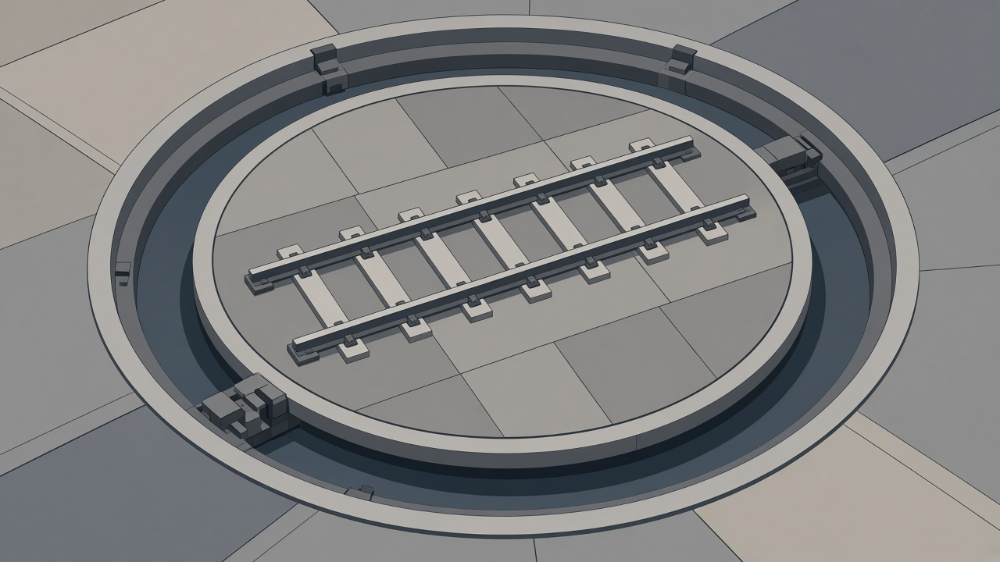

原卡面意见：结构与造型母版可采用。

该条从原298项评审中抽取，来源及摘要见[设计卡清单](../DESIGN-CARDS.json)。版本与采用依据见[文件清单](../FILE-MANIFEST.tsv)。

## B20 水闸驱动与闸门

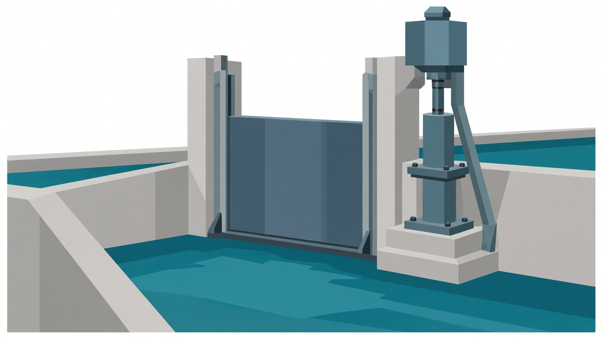

原卡面意见：结构与造型母版可采用。

该条从原298项评审中抽取，来源及摘要见[设计卡清单](../DESIGN-CARDS.json)。版本与采用依据见[文件清单](../FILE-MANIFEST.tsv)。

## B21 泵站

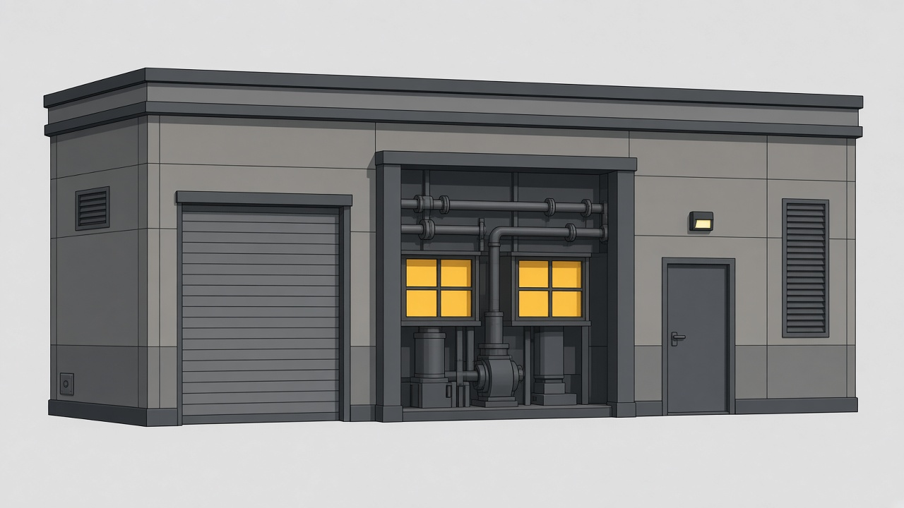

原卡面意见：内部修订后派生。

该条从原298项评审中抽取，来源及摘要见[设计卡清单](../DESIGN-CARDS.json)。版本与采用依据见[文件清单](../FILE-MANIFEST.tsv)。

## B22 货柜与吊点周转箱

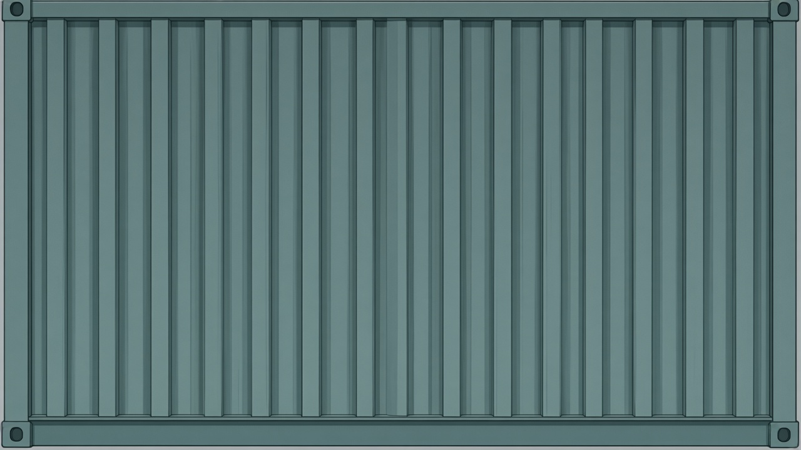

原卡面意见：内部修订后派生。

该条从原298项评审中抽取，来源及摘要见[设计卡清单](../DESIGN-CARDS.json)。版本与采用依据见[文件清单](../FILE-MANIFEST.tsv)。

## B23 实体隔离墙

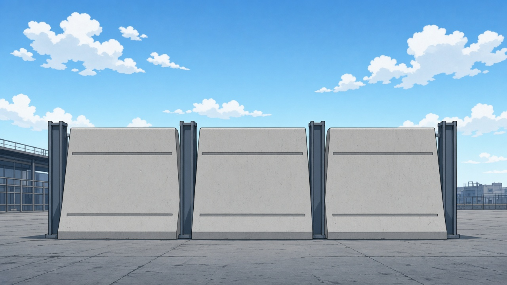

原卡面意见：内部修订后派生。

该条从原298项评审中抽取，来源及摘要见[设计卡清单](../DESIGN-CARDS.json)。版本与采用依据见[文件清单](../FILE-MANIFEST.tsv)。

## B24 燃料与补给接口

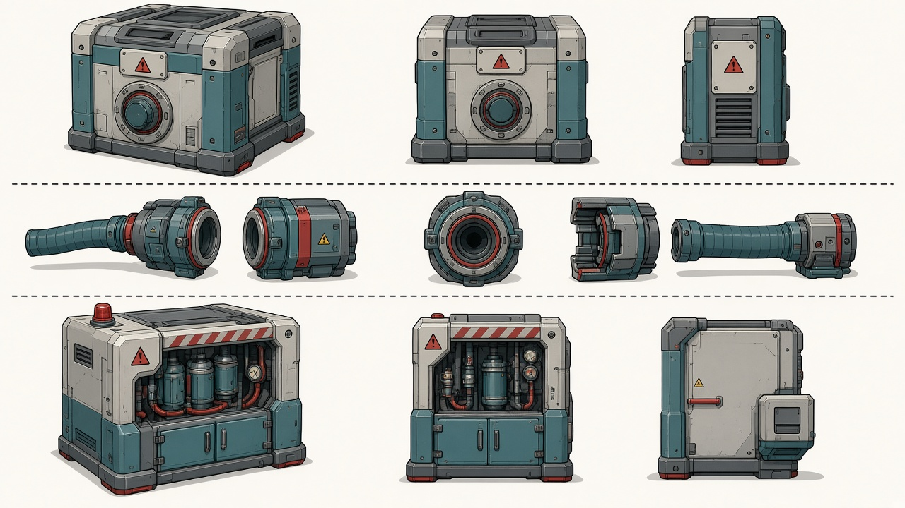

原卡面意见：结构与造型母版可采用。

该条从原298项评审中抽取，来源及摘要见[设计卡清单](../DESIGN-CARDS.json)。版本与采用依据见[文件清单](../FILE-MANIFEST.tsv)。

## B25 隔离电容

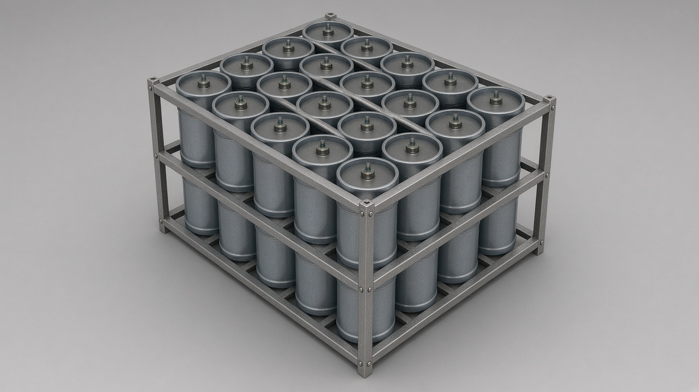

原卡面意见：内部修订后派生。

该条从原298项评审中抽取，来源及摘要见[设计卡清单](../DESIGN-CARDS.json)。版本与采用依据见[文件清单](../FILE-MANIFEST.tsv)。

## B26 猎巢入口

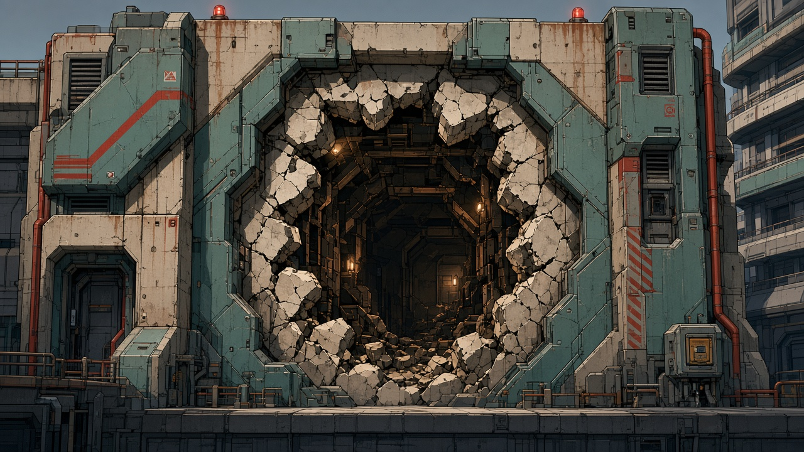

原卡面意见：内部修订后派生。

该条从原298项评审中抽取，来源及摘要见[设计卡清单](../DESIGN-CARDS.json)。版本与采用依据见[文件清单](../FILE-MANIFEST.tsv)。

## B27 承运交接点

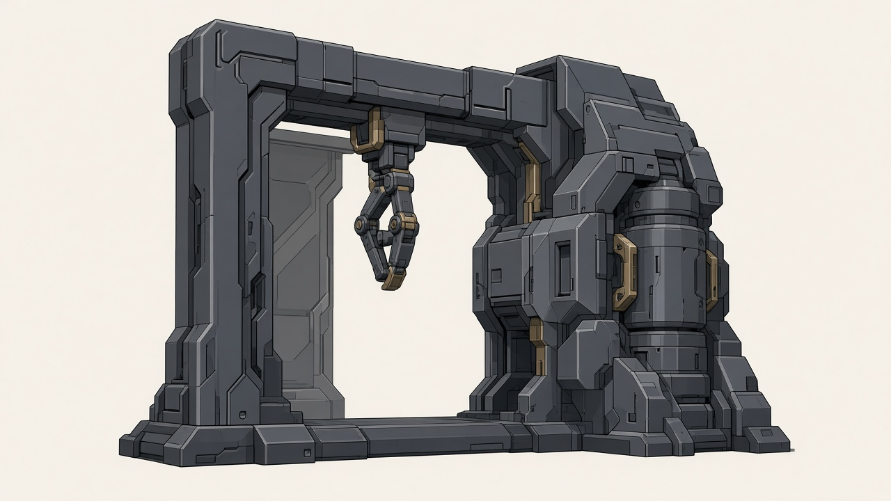

原卡面意见：内部修订后派生。

该条从原298项评审中抽取，来源及摘要见[设计卡清单](../DESIGN-CARDS.json)。版本与采用依据见[文件清单](../FILE-MANIFEST.tsv)。

## B28 整备复装工位

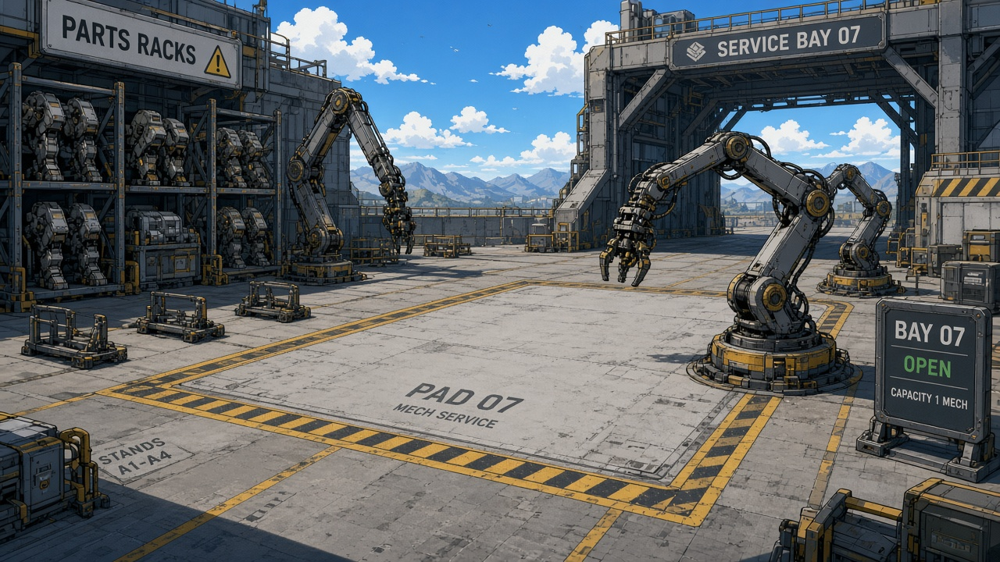

原卡面意见：内部修订后派生。

该条从原298项评审中抽取，来源及摘要见[设计卡清单](../DESIGN-CARDS.json)。版本与采用依据见[文件清单](../FILE-MANIFEST.tsv)。

## B29 电缆与母排连接段

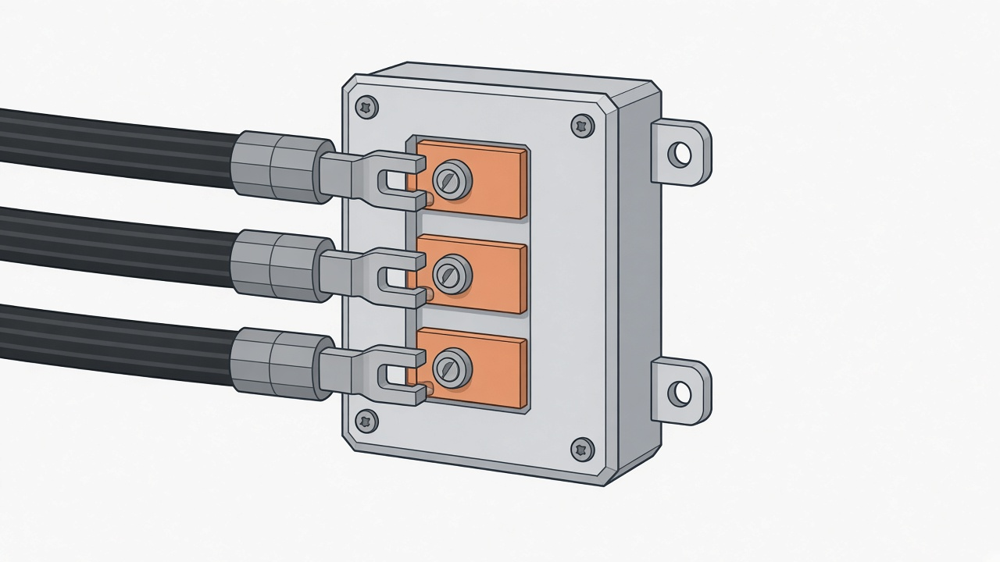

原卡面意见：结构与造型母版可采用。

该条从原298项评审中抽取，来源及摘要见[设计卡清单](../DESIGN-CARDS.json)。版本与采用依据见[文件清单](../FILE-MANIFEST.tsv)。

## B30 临时支杆与承重架

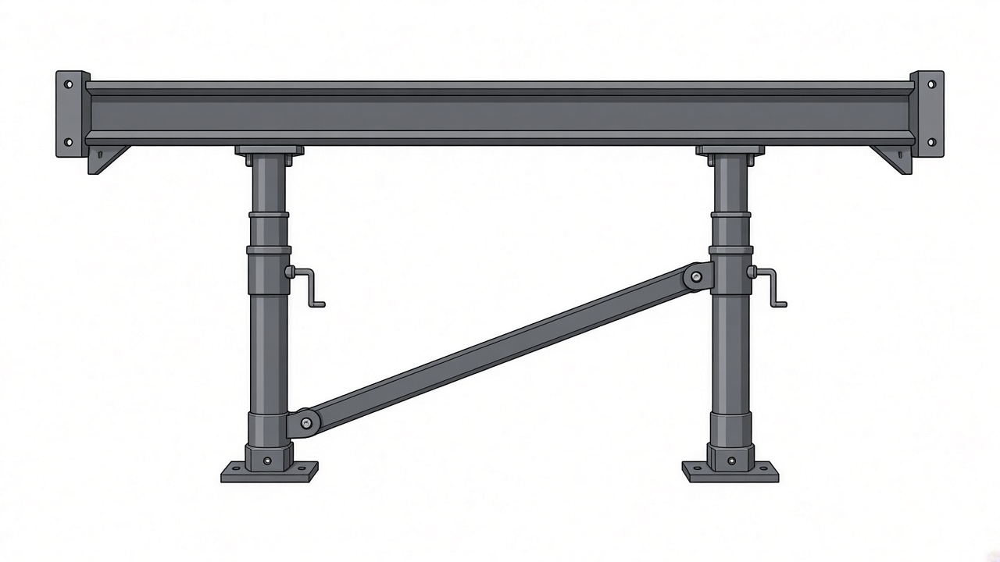

原卡面意见：结构与造型母版可采用。

该条从原298项评审中抽取，来源及摘要见[设计卡清单](../DESIGN-CARDS.json)。版本与采用依据见[文件清单](../FILE-MANIFEST.tsv)。

## B31 轨旁信号与站台设施

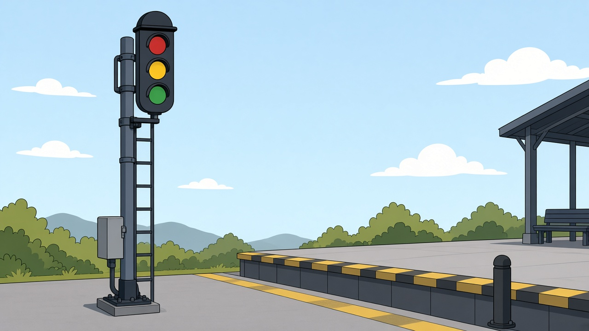

原卡面意见：结构与造型母版可采用。

该条从原298项评审中抽取，来源及摘要见[设计卡清单](../DESIGN-CARDS.json)。版本与采用依据见[文件清单](../FILE-MANIFEST.tsv)。

## B32 城市柱环与远景巨构

原卡面意见：内部修订后派生。

该条从原298项评审中抽取，来源及摘要见[设计卡清单](../DESIGN-CARDS.json)。版本与采用依据见[文件清单](../FILE-MANIFEST.tsv)。

## B33 道路街具与边界套件

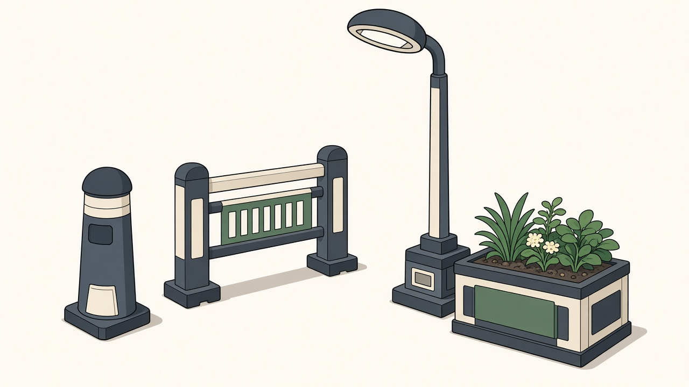

原卡面意见：结构与造型母版可采用。

该条从原298项评审中抽取，来源及摘要见[设计卡清单](../DESIGN-CARDS.json)。版本与采用依据见[文件清单](../FILE-MANIFEST.tsv)。

## B34 检修室和值班室

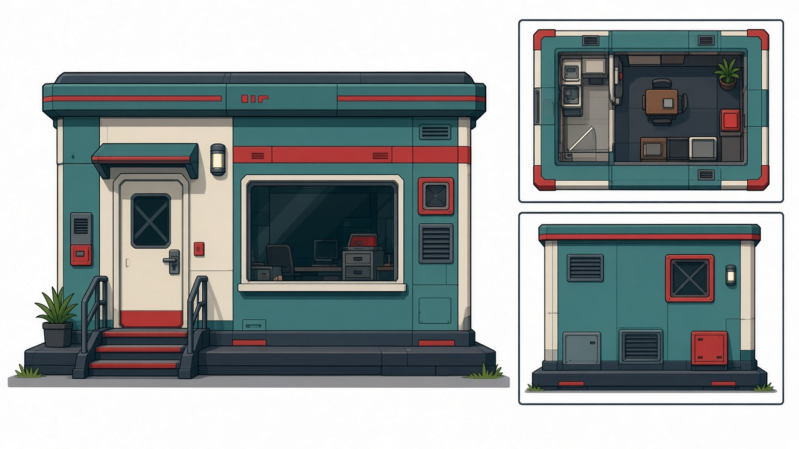

原卡面意见：结构与造型母版可采用。

该条从原298项评审中抽取，来源及摘要见[设计卡清单](../DESIGN-CARDS.json)。版本与采用依据见[文件清单](../FILE-MANIFEST.tsv)。
