# 敌人与威胁：完整外援评审图录

本页按原298项评审页的当前卡面机械整理，不新增采用结论。**卡面的A/B/C或“采用”是当时的评审意见，不等于用户已确认。** 正式已定源仍以[已定图册](../../art/README.md)与逐图回执为准。

旧图有的已被10月新母稿替代。读故事时不要把其原有造型、能力、身份或场景布局恢复成Canon。原图、历代修订和评语均供追溯。

## E01 啮线体

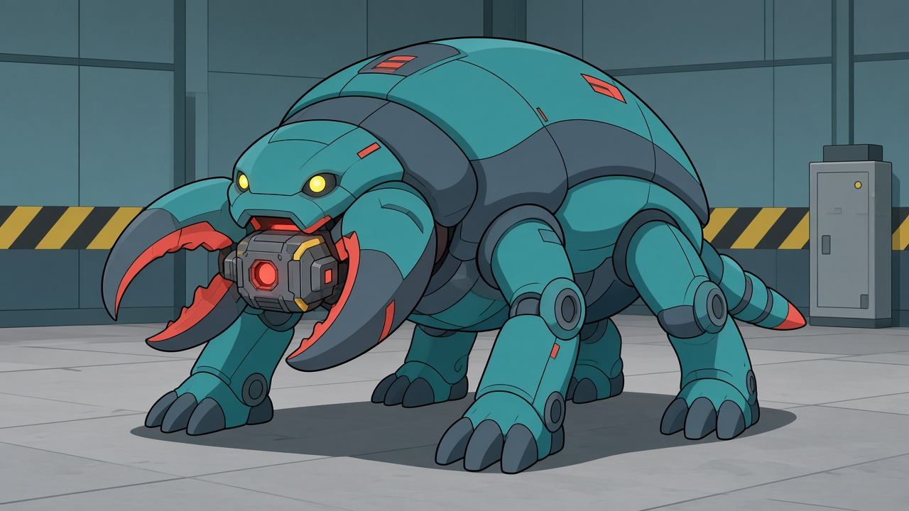

原卡面意见：结构与造型母版可采用。

[完整原卡面](../../../captures/20261014-full-direction/review-v2.html#E01)；其余版本及实际源文件在[全量文件清单](../FILE-MANIFEST.tsv)中按ID、名称或文件路径查询。

## E02 群生啮线幼体

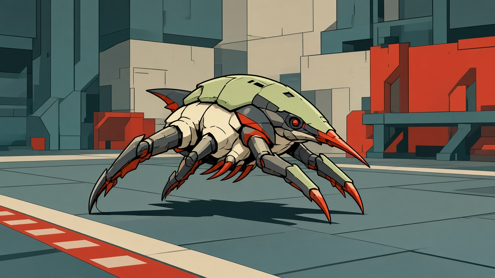

原卡面意见：内部修订后派生。

[完整原卡面](../../../captures/20261014-full-direction/review-v2.html#E02)；其余版本及实际源文件在[全量文件清单](../FILE-MANIFEST.tsv)中按ID、名称或文件路径查询。

## E03 喷酸体

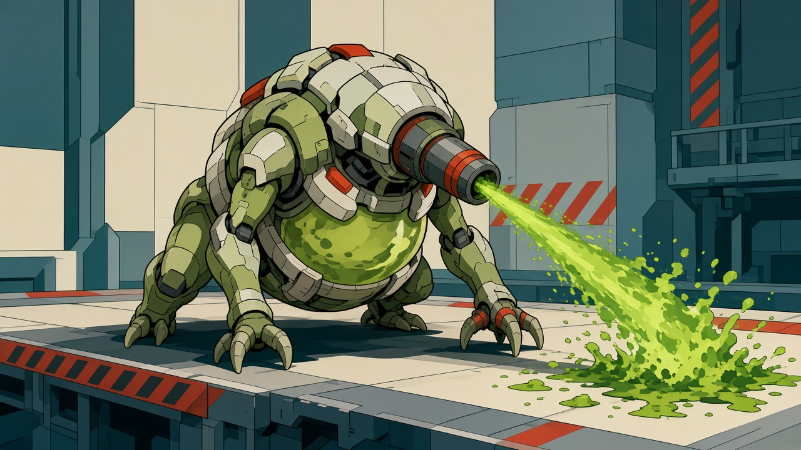

原卡面意见：结构与造型母版可采用。

[完整原卡面](../../../captures/20261014-full-direction/review-v2.html#E03)；其余版本及实际源文件在[全量文件清单](../FILE-MANIFEST.tsv)中按ID、名称或文件路径查询。

## E04 远程架设体

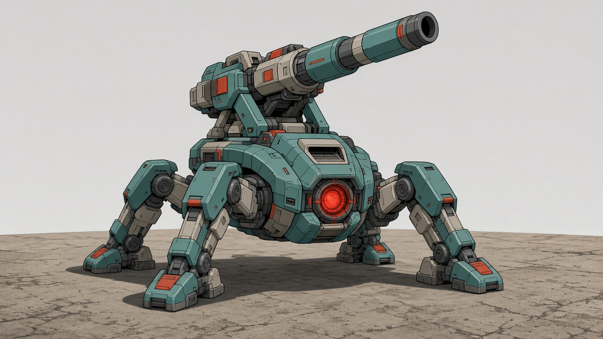

原卡面意见：结构与造型母版可采用。

[完整原卡面](../../../captures/20261014-full-direction/review-v2.html#E04)；其余版本及实际源文件在[全量文件清单](../FILE-MANIFEST.tsv)中按ID、名称或文件路径查询。

## E05 重型楔入体

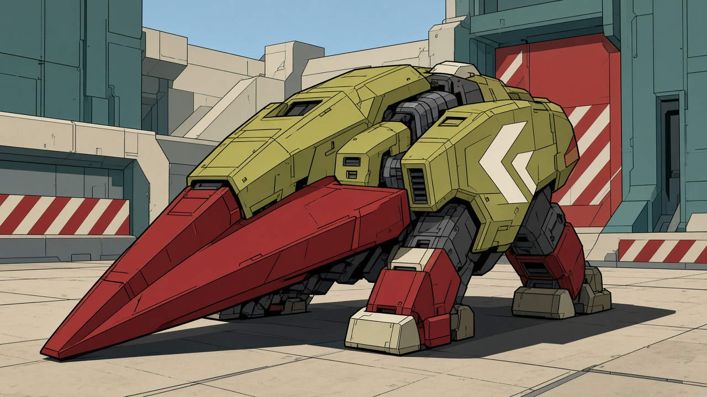

原卡面意见：结构与造型母版可采用。

[完整原卡面](../../../captures/20261014-full-direction/review-v2.html#E05)；其余版本及实际源文件在[全量文件清单](../FILE-MANIFEST.tsv)中按ID、名称或文件路径查询。

## E06 掠渠体

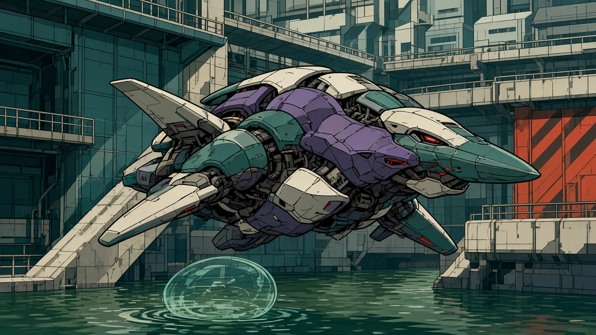

原卡面意见：结构与造型母版可采用。

[完整原卡面](../../../captures/20261014-full-direction/review-v2.html#E06)；其余版本及实际源文件在[全量文件清单](../FILE-MANIFEST.tsv)中按ID、名称或文件路径查询。

## E07 共振护群体

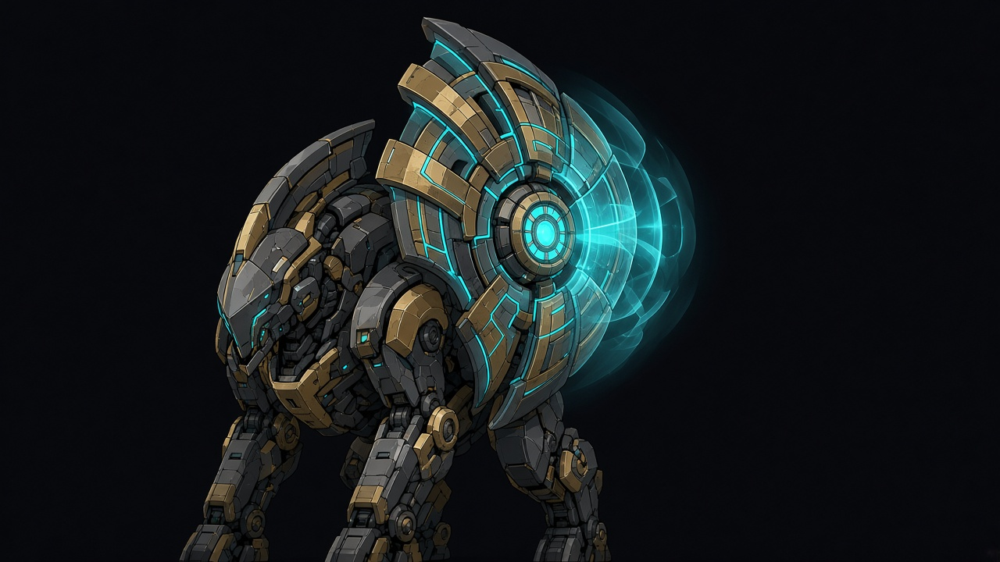

原卡面意见：内部修订后派生。

[完整原卡面](../../../captures/20261014-full-direction/review-v2.html#E07)；其余版本及实际源文件在[全量文件清单](../FILE-MANIFEST.tsv)中按ID、名称或文件路径查询。

## E08 自动拆锁工机

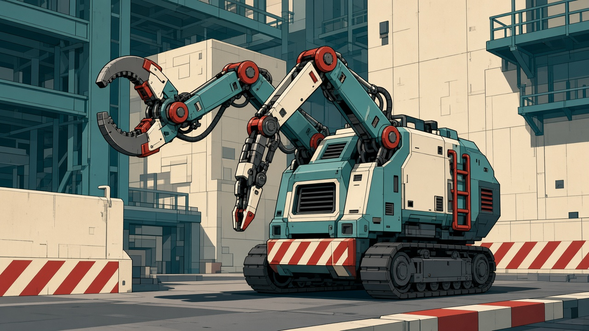

原卡面意见：结构与造型母版可采用。

[完整原卡面](../../../captures/20261014-full-direction/review-v2.html#E08)；其余版本及实际源文件在[全量文件清单](../FILE-MANIFEST.tsv)中按ID、名称或文件路径查询。

## E09 无人牵引工机

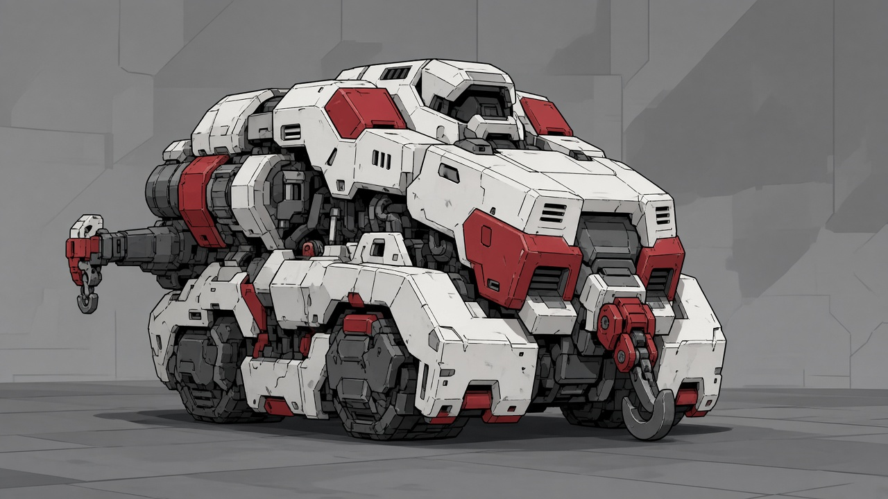

原卡面意见：内部修订后派生。

[完整原卡面](../../../captures/20261014-full-direction/review-v2.html#E09)；其余版本及实际源文件在[全量文件清单](../FILE-MANIFEST.tsv)中按ID、名称或文件路径查询。

## E10 断冠

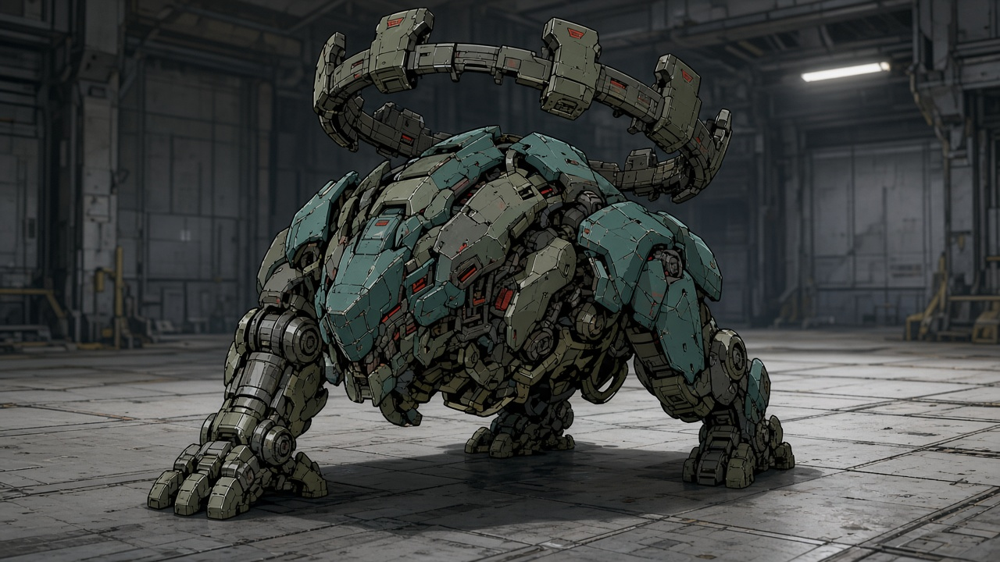

原卡面意见：内部修订后派生。

[完整原卡面](../../../captures/20261014-full-direction/review-v2.html#E10)；其余版本及实际源文件在[全量文件清单](../FILE-MANIFEST.tsv)中按ID、名称或文件路径查询。

## E11 架设体对空装备变体

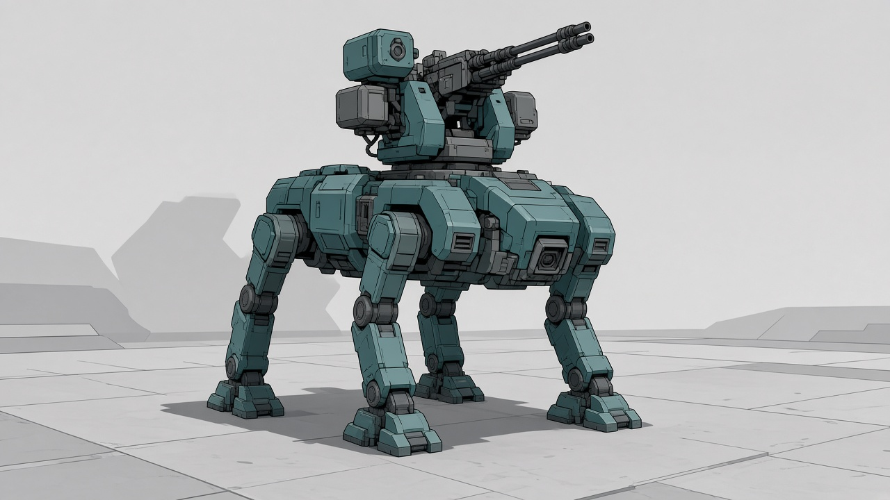

原卡面意见：内部修订后派生。

[完整原卡面](../../../captures/20261014-full-direction/review-v2.html#E11)；其余版本及实际源文件在[全量文件清单](../FILE-MANIFEST.tsv)中按ID、名称或文件路径查询。
