# 形态与组件

外部故事与设定评审用设计图。原卡面评语不等于用户逐图采用；最新确认范围看[已定设计图册](../../art/README.md)。本页不提供UI/UE、运行截图或三维资产。

## F01 完全版王者轻装本体

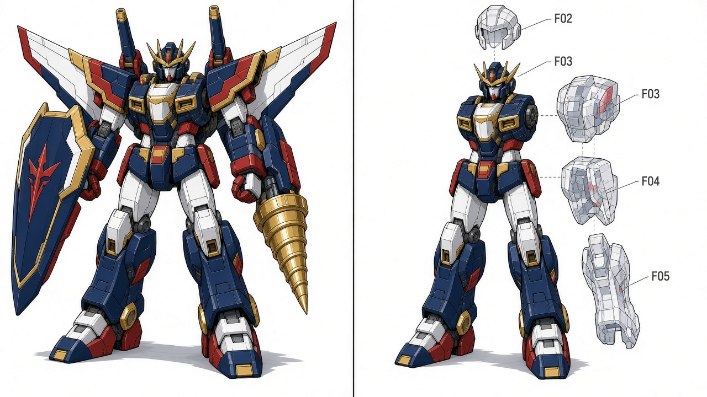

原卡面意见：内部修订后派生。

该条从原298项评审中抽取，来源及摘要见[设计卡清单](../DESIGN-CARDS.json)。版本与采用依据见[文件清单](../FILE-MANIFEST.tsv)。

## F02 完全版王者双肩炮组

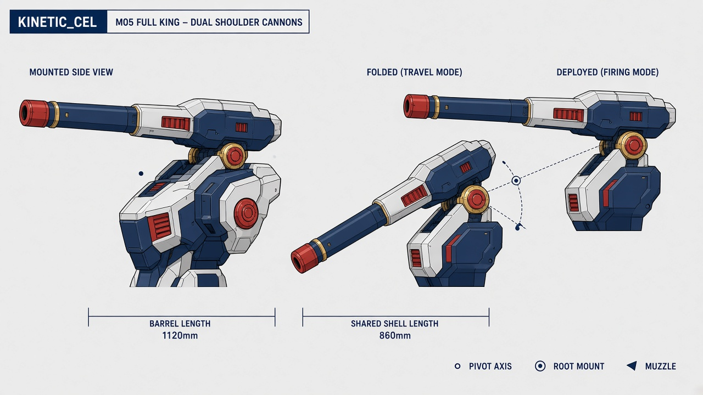

原卡面意见：内部修订后派生。

该条从原298项评审中抽取，来源及摘要见[设计卡清单](../DESIGN-CARDS.json)。版本与采用依据见[文件清单](../FILE-MANIFEST.tsv)。

## F03 完全版王者合盾护板

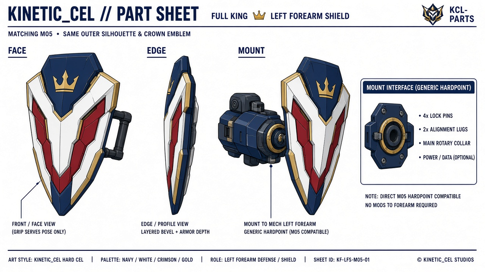

原卡面意见：内部修订后派生。

该条从原298项评审中抽取，来源及摘要见[设计卡清单](../DESIGN-CARDS.json)。版本与采用依据见[文件清单](../FILE-MANIFEST.tsv)。

## F04 完全版王者飞翼推进包

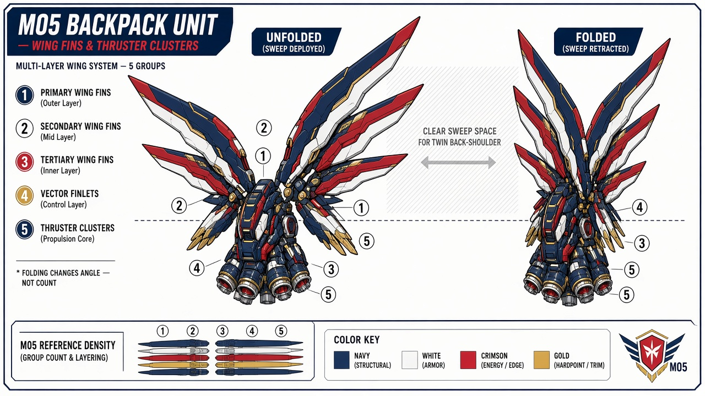

原卡面意见：内部修订后派生。

该条从原298项评审中抽取，来源及摘要见[设计卡清单](../DESIGN-CARDS.json)。版本与采用依据见[文件清单](../FILE-MANIFEST.tsv)。

## F05 完全版王者右臂贯岩钻

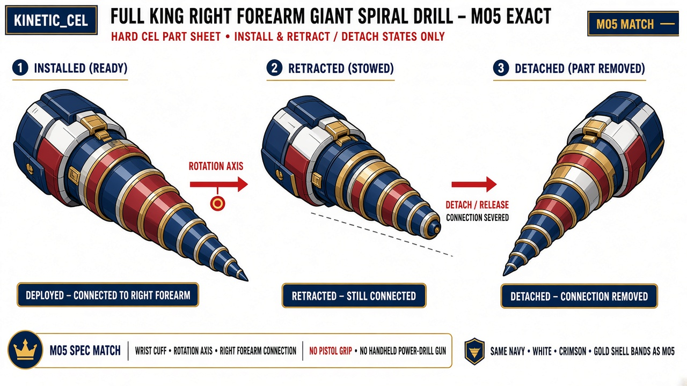

原卡面意见：内部修订后派生。

该条从原298项评审中抽取，来源及摘要见[设计卡清单](../DESIGN-CARDS.json)。版本与采用依据见[文件清单](../FILE-MANIFEST.tsv)。

## F06 货柜领袖车辆形态

原卡面意见：内部修订后派生。

该条从原298项评审中抽取，来源及摘要见[设计卡清单](../DESIGN-CARDS.json)。版本与采用依据见[文件清单](../FILE-MANIFEST.tsv)。

## F07 雷翎航空形态

原卡面意见：内部修订后派生。

该条从原298项评审中抽取，来源及摘要见[设计卡清单](../DESIGN-CARDS.json)。版本与采用依据见[文件清单](../FILE-MANIFEST.tsv)。

## F08 歌翼航空形态

原卡面意见：内部修订后派生。

该条从原298项评审中抽取，来源及摘要见[设计卡清单](../DESIGN-CARDS.json)。版本与采用依据见[文件清单](../FILE-MANIFEST.tsv)。

## F09 完整勇拳核心机

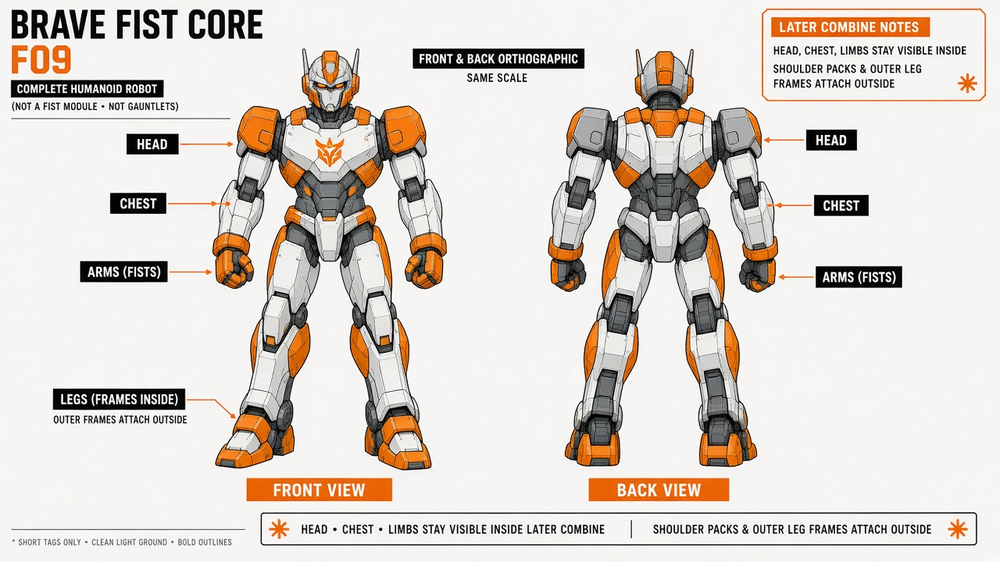

原卡面意见：内部修订后派生。

该条从原298项评审中抽取，来源及摘要见[设计卡清单](../DESIGN-CARDS.json)。版本与采用依据见[文件清单](../FILE-MANIFEST.tsv)。

## F10 社勇王完整合体

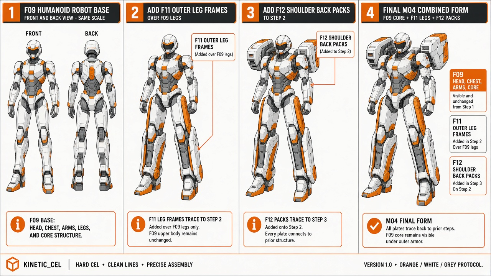

原卡面意见：内部修订后派生。

该条从原298项评审中抽取，来源及摘要见[设计卡清单](../DESIGN-CARDS.json)。版本与采用依据见[文件清单](../FILE-MANIFEST.tsv)。

## F11 社勇王外部腿架

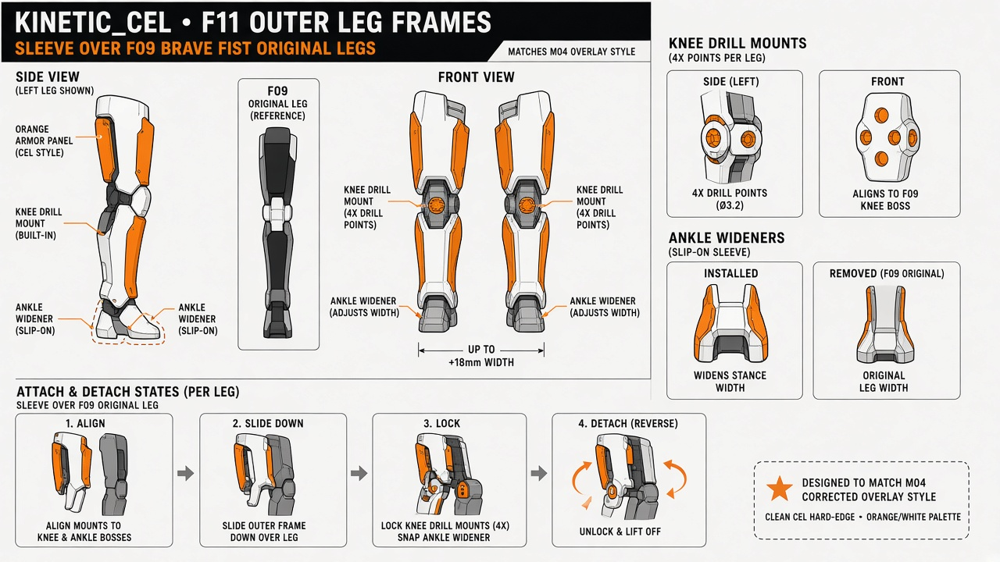

原卡面意见：内部修订后派生。

该条从原298项评审中抽取，来源及摘要见[设计卡清单](../DESIGN-CARDS.json)。版本与采用依据见[文件清单](../FILE-MANIFEST.tsv)。

## F12 社勇王肩背外部组件

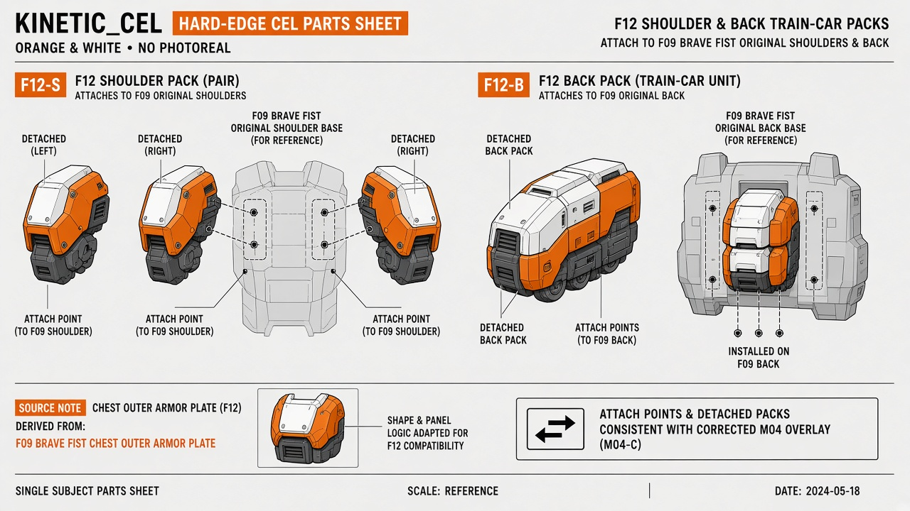

原卡面意见：内部修订后派生。

该条从原298项评审中抽取，来源及摘要见[设计卡清单](../DESIGN-CARDS.json)。版本与采用依据见[文件清单](../FILE-MANIFEST.tsv)。

## F13 工程液压顶具

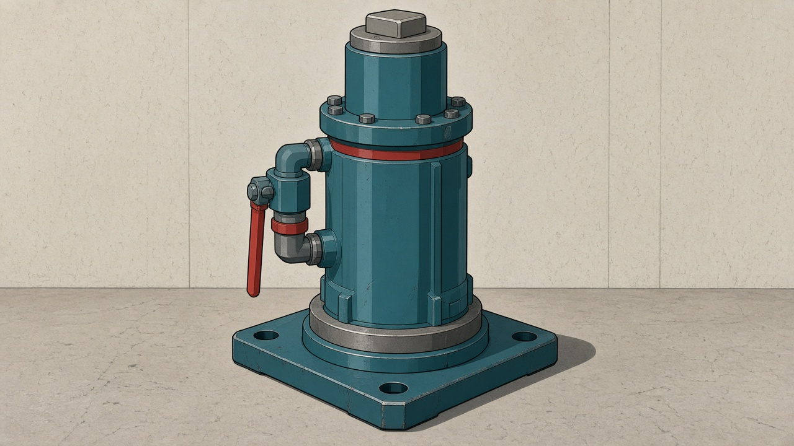

原卡面意见：结构与造型母版可采用。

该条从原298项评审中抽取，来源及摘要见[设计卡清单](../DESIGN-CARDS.json)。版本与采用依据见[文件清单](../FILE-MANIFEST.tsv)。

## F14 焊补工具与备件

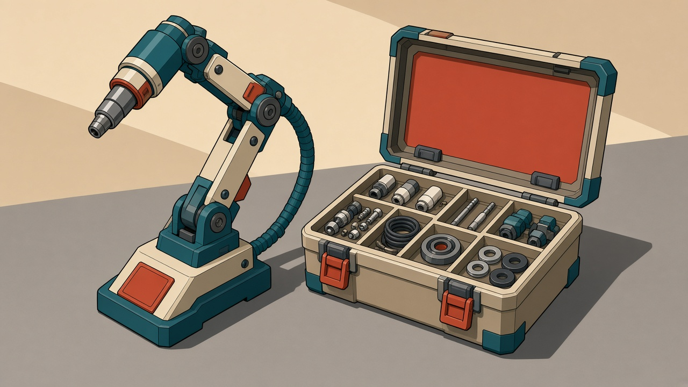

原卡面意见：结构与造型母版可采用。

该条从原298项评审中抽取，来源及摘要见[设计卡清单](../DESIGN-CARDS.json)。版本与采用依据见[文件清单](../FILE-MANIFEST.tsv)。

## F15 牵引与拘束索具

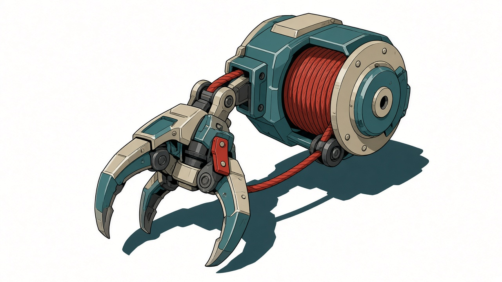

原卡面意见：结构与造型母版可采用。

该条从原298项评审中抽取，来源及摘要见[设计卡清单](../DESIGN-CARDS.json)。版本与采用依据见[文件清单](../FILE-MANIFEST.tsv)。

## F16 折叠隔离墙套件

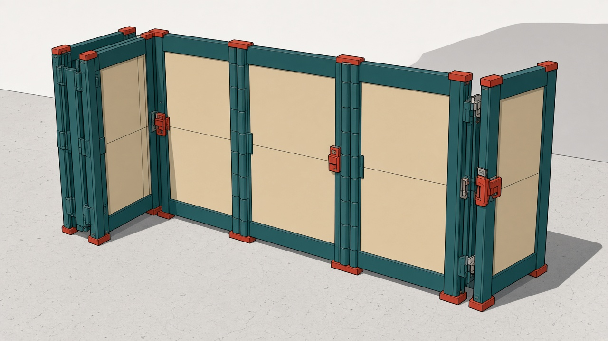

原卡面意见：内部修订后派生。

该条从原298项评审中抽取，来源及摘要见[设计卡清单](../DESIGN-CARDS.json)。版本与采用依据见[文件清单](../FILE-MANIFEST.tsv)。

## F17 消防应急桥板

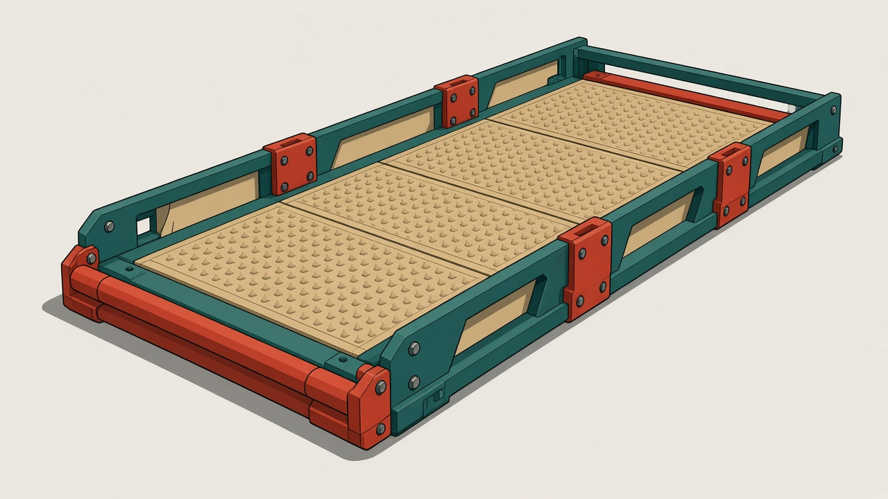

原卡面意见：内部修订后派生。

该条从原298项评审中抽取，来源及摘要见[设计卡清单](../DESIGN-CARDS.json)。版本与采用依据见[文件清单](../FILE-MANIFEST.tsv)。

## F18 炮弹导弹与弹壳

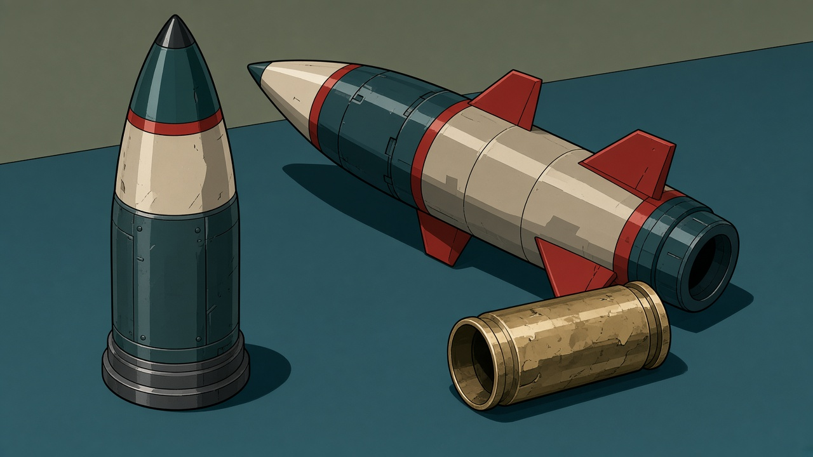

原卡面意见：内部修订后派生。

该条从原298项评审中抽取，来源及摘要见[设计卡清单](../DESIGN-CARDS.json)。版本与采用依据见[文件清单](../FILE-MANIFEST.tsv)。
