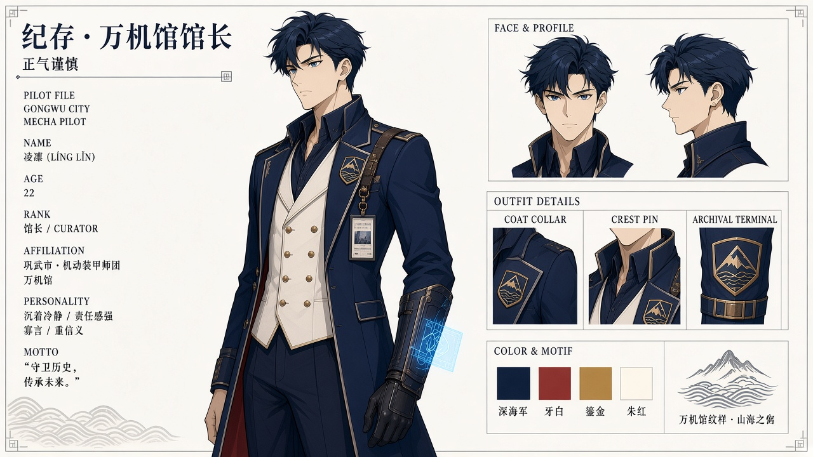
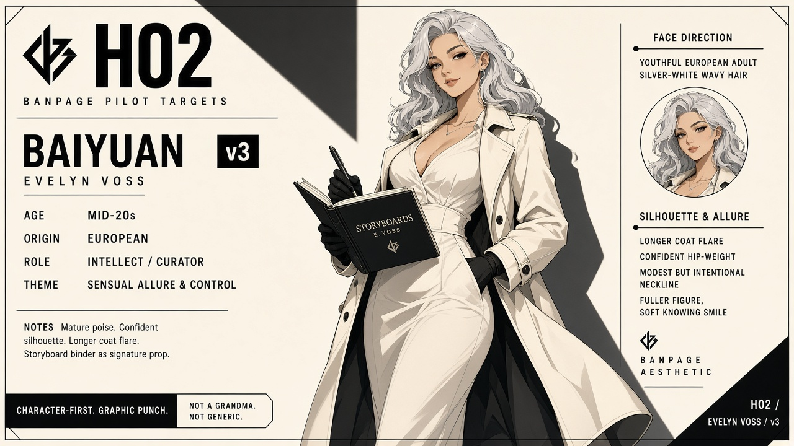
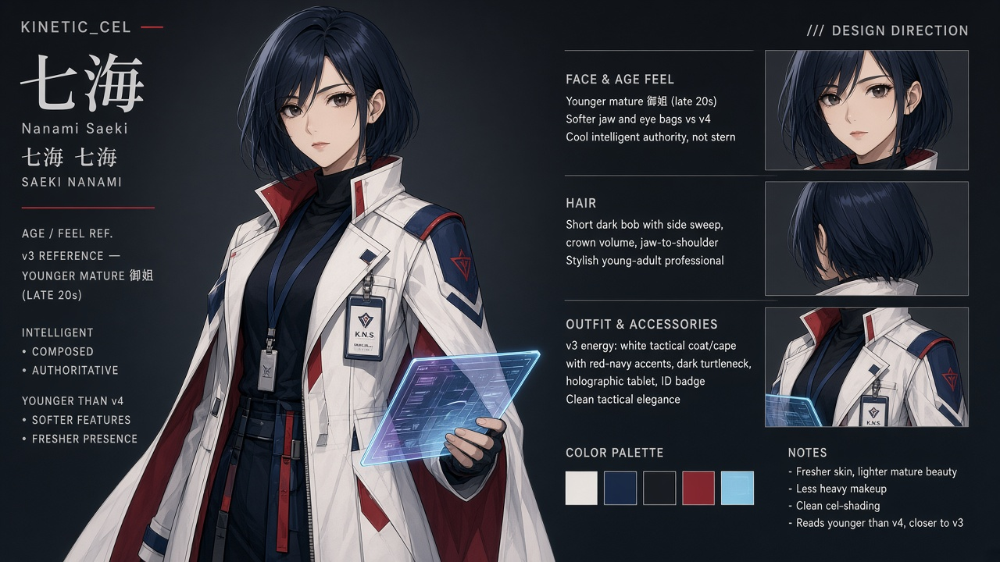
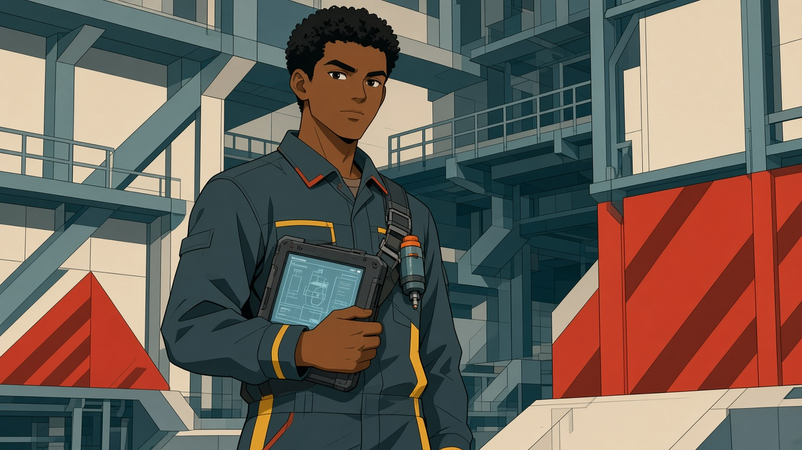
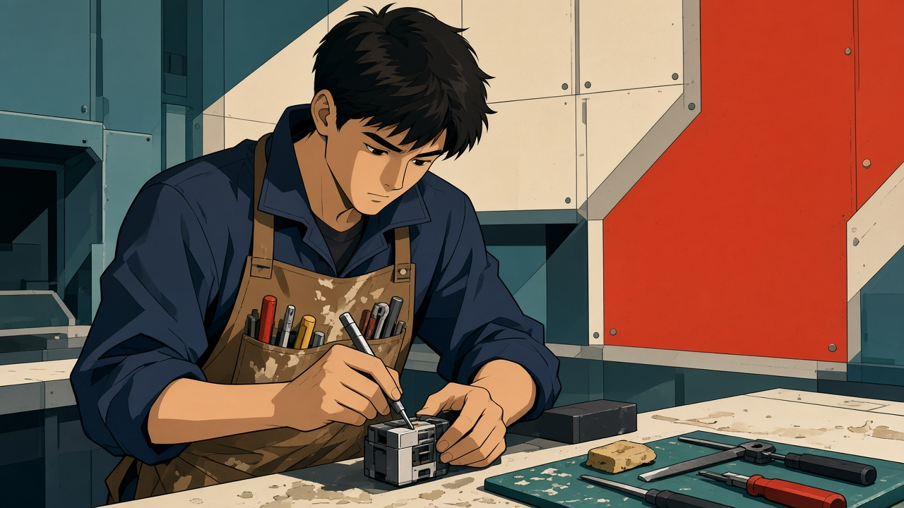
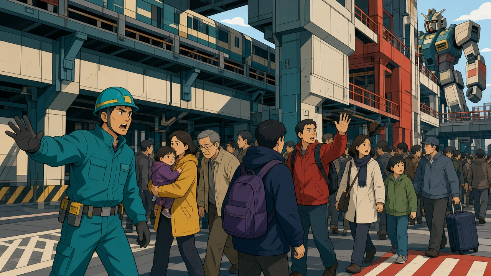
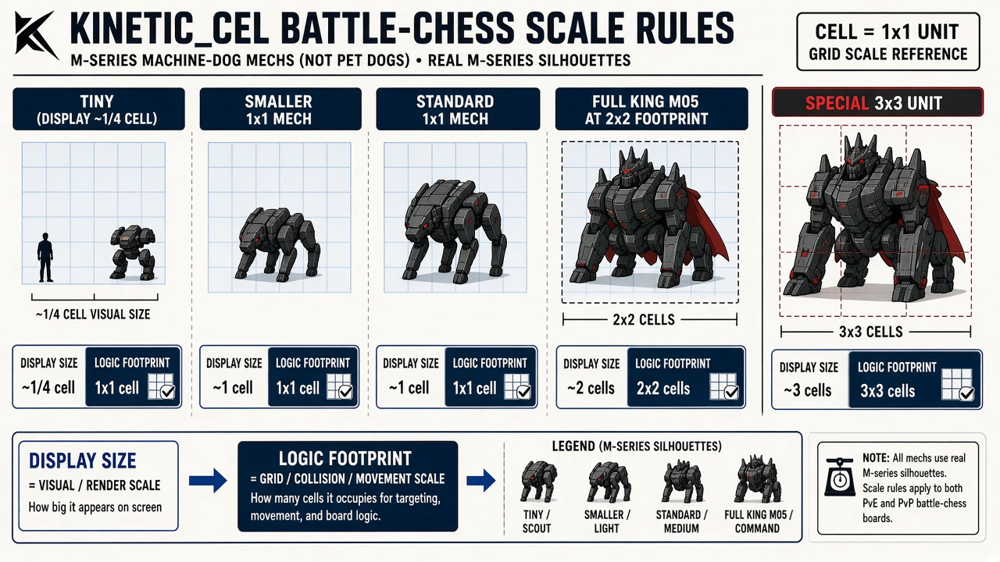

# 人物

外部故事与设定评审用设计图。原卡面评语不等于用户逐图采用；最新确认范围看[已定设计图册](../../art/README.md)。本页不提供UI/UE、运行截图或三维资产。

## H01 纪存

原卡面意见：二维原画可加工采用。

该条从原298项评审中抽取，来源及摘要见[设计卡清单](../DESIGN-CARDS.json)。版本与采用依据见[文件清单](../FILE-MANIFEST.tsv)。

## H02 白鸢

原卡面意见：二维原画可加工采用。

该条从原298项评审中抽取，来源及摘要见[设计卡清单](../DESIGN-CARDS.json)。版本与采用依据见[文件清单](../FILE-MANIFEST.tsv)。

## H03 七海

原卡面意见：二维原画可加工采用。

该条从原298项评审中抽取，来源及摘要见[设计卡清单](../DESIGN-CARDS.json)。版本与采用依据见[文件清单](../FILE-MANIFEST.tsv)。

## H04 兜灯

原卡面意见：内部修订后派生。

该条从原298项评审中抽取，来源及摘要见[设计卡清单](../DESIGN-CARDS.json)。版本与采用依据见[文件清单](../FILE-MANIFEST.tsv)。

## H05 陆衡

原卡面意见：二维原画可加工采用。

该条从原298项评审中抽取，来源及摘要见[设计卡清单](../DESIGN-CARDS.json)。版本与采用依据见[文件清单](../FILE-MANIFEST.tsv)。

## H06 豪司

原卡面意见：二维原画可加工采用。

该条从原298项评审中抽取，来源及摘要见[设计卡清单](../DESIGN-CARDS.json)。版本与采用依据见[文件清单](../FILE-MANIFEST.tsv)。

## H07 唐胶

原卡面意见：内部修订后派生。

该条从原298项评审中抽取，来源及摘要见[设计卡清单](../DESIGN-CARDS.json)。版本与采用依据见[文件清单](../FILE-MANIFEST.tsv)。

## H08 赵梅

原卡面意见：二维原画可加工采用。

该条从原298项评审中抽取，来源及摘要见[设计卡清单](../DESIGN-CARDS.json)。版本与采用依据见[文件清单](../FILE-MANIFEST.tsv)。

## H09 胶价王

原卡面意见：内部修订后派生。

该条从原298项评审中抽取，来源及摘要见[设计卡清单](../DESIGN-CARDS.json)。版本与采用依据见[文件清单](../FILE-MANIFEST.tsv)。

## H10 警备驾驶席

原卡面意见：内部修订后派生。

该条从原298项评审中抽取，来源及摘要见[设计卡清单](../DESIGN-CARDS.json)。版本与采用依据见[文件清单](../FILE-MANIFEST.tsv)。

## H11 工房工程员

原卡面意见：二维原画可加工采用。

该条从原298项评审中抽取，来源及摘要见[设计卡清单](../DESIGN-CARDS.json)。版本与采用依据见[文件清单](../FILE-MANIFEST.tsv)。

## H12 检修员与撤离人群

原卡面意见：二维原画可加工采用。

该条从原298项评审中抽取，来源及摘要见[设计卡清单](../DESIGN-CARDS.json)。版本与采用依据见[文件清单](../FILE-MANIFEST.tsv)。

## H13 机器犬及人物地图小单位

原卡面意见：图形、版式与演出参考。

该条从原298项评审中抽取，来源及摘要见[设计卡清单](../DESIGN-CARDS.json)。版本与采用依据见[文件清单](../FILE-MANIFEST.tsv)。
