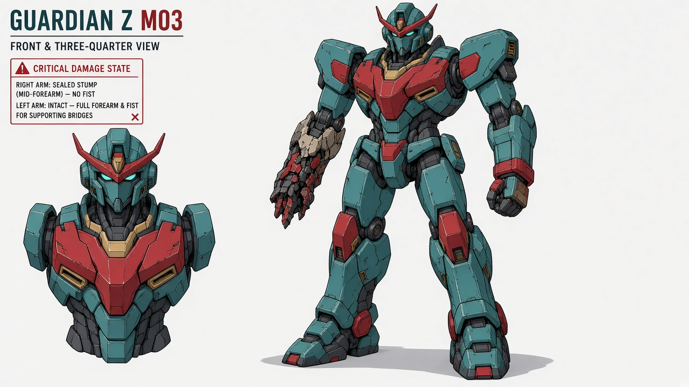
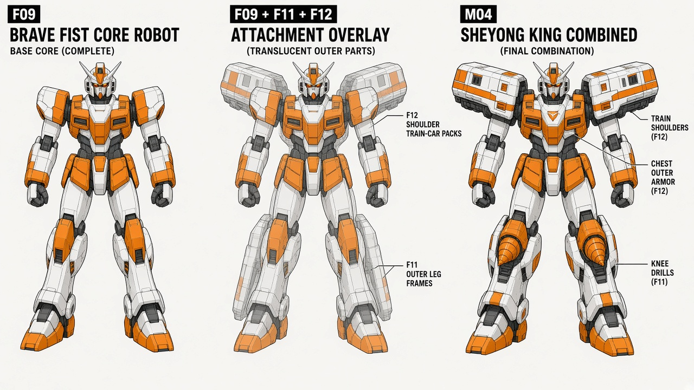
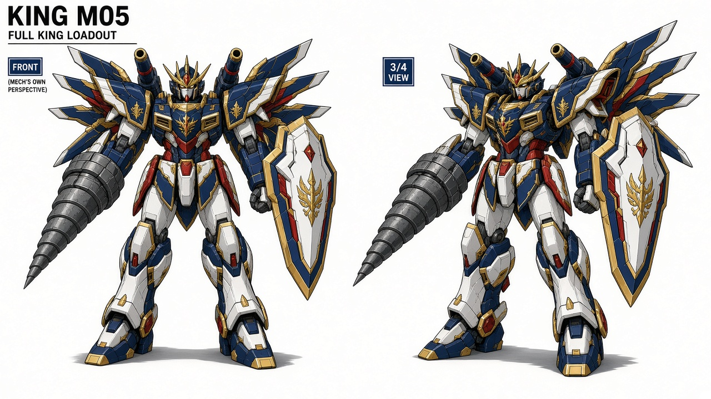
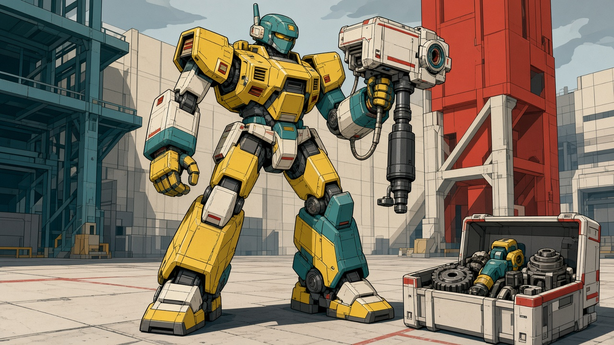
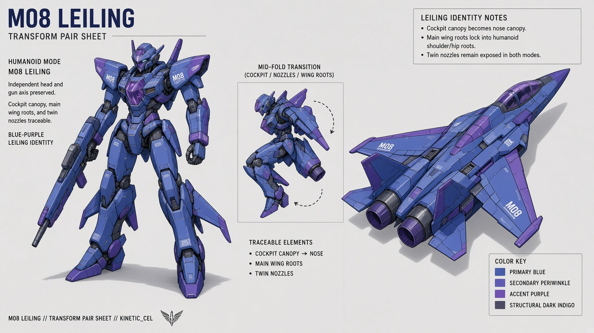
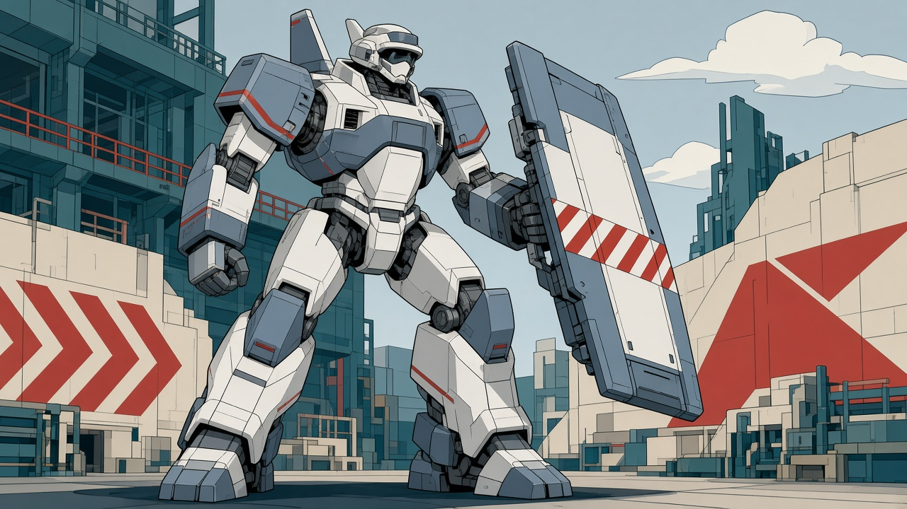
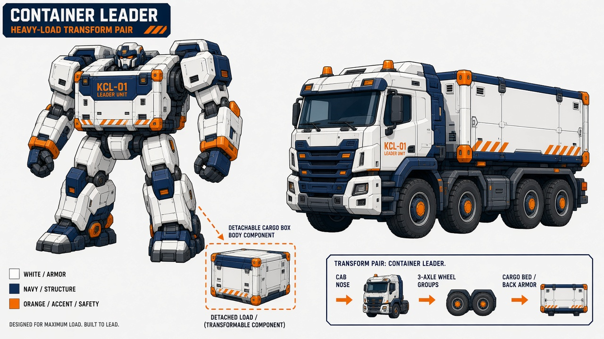
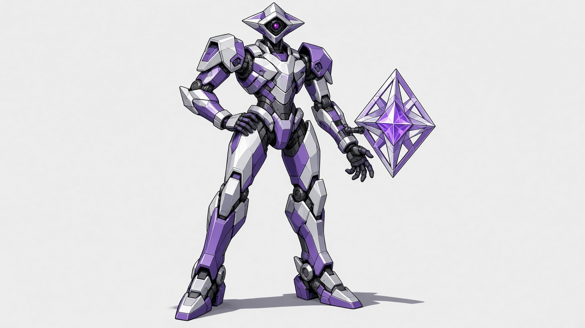
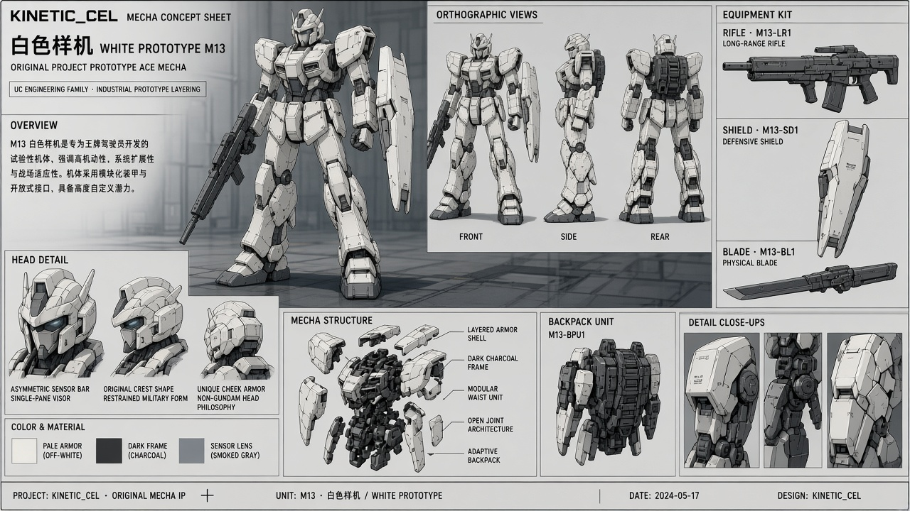
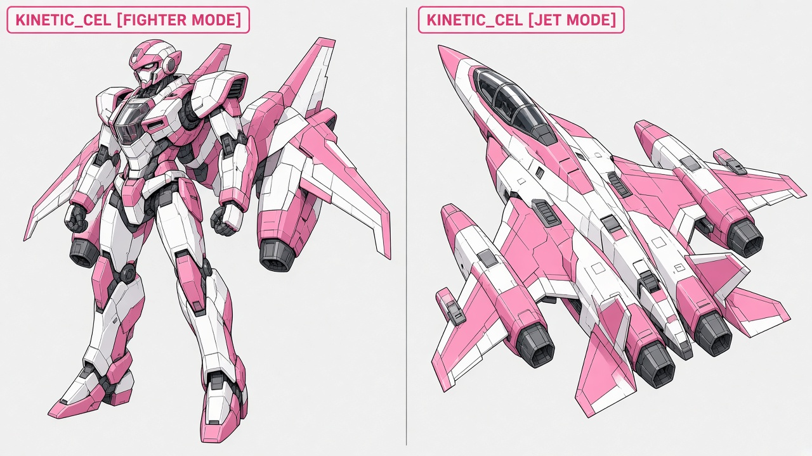

# 机体：完整外援评审图录

本页按原298项评审页的当前卡面机械整理，不新增采用结论。**卡面的A/B/C或“采用”是当时的评审意见，不等于用户已确认。** 正式已定源仍以[已定图册](../../art/README.md)与逐图回执为准。

旧图有的已被10月新母稿替代。读故事时不要把其原有造型、能力、身份或场景布局恢复成Canon。原图、历代修订和评语均供追溯。

## M01 无牌一号

原卡面意见：内部修订后派生。

[完整原卡面](../../../captures/20261014-full-direction/review-v2.html#M01)；其余版本及实际源文件在[全量文件清单](../FILE-MANIFEST.tsv)中按ID、名称或文件路径查询。

## M02 旧拳王

原卡面意见：结构与造型母版可采用。

[完整原卡面](../../../captures/20261014-full-direction/review-v2.html#M02)；其余版本及实际源文件在[全量文件清单](../FILE-MANIFEST.tsv)中按ID、名称或文件路径查询。

## M03 馆守 Z

原卡面意见：内部修订后派生。

[完整原卡面](../../../captures/20261014-full-direction/review-v2.html#M03)；其余版本及实际源文件在[全量文件清单](../FILE-MANIFEST.tsv)中按ID、名称或文件路径查询。

## M04 社勇王

原卡面意见：内部修订后派生。

[完整原卡面](../../../captures/20261014-full-direction/review-v2.html#M04)；其余版本及实际源文件在[全量文件清单](../FILE-MANIFEST.tsv)中按ID、名称或文件路径查询。

## M05 完全版王者

原卡面意见：内部修订后派生。

[完整原卡面](../../../captures/20261014-full-direction/review-v2.html#M05)；其余版本及实际源文件在[全量文件清单](../FILE-MANIFEST.tsv)中按ID、名称或文件路径查询。

## M06 预算二号

原卡面意见：结构与造型母版可采用。

[完整原卡面](../../../captures/20261014-full-direction/review-v2.html#M06)；其余版本及实际源文件在[全量文件清单](../FILE-MANIFEST.tsv)中按ID、名称或文件路径查询。

## M07 市政吊装机

原卡面意见：结构与造型母版可采用。

[完整原卡面](../../../captures/20261014-full-direction/review-v2.html#M07)；其余版本及实际源文件在[全量文件清单](../FILE-MANIFEST.tsv)中按ID、名称或文件路径查询。

## M08 雷翎

原卡面意见：内部修订后派生。

[完整原卡面](../../../captures/20261014-full-direction/review-v2.html#M08)；其余版本及实际源文件在[全量文件清单](../FILE-MANIFEST.tsv)中按ID、名称或文件路径查询。

## M09 灰崎警备劳务机

原卡面意见：结构与造型母版可采用。

[完整原卡面](../../../captures/20261014-full-direction/review-v2.html#M09)；其余版本及实际源文件在[全量文件清单](../FILE-MANIFEST.tsv)中按ID、名称或文件路径查询。

## M10 消防架桥机

原卡面意见：结构与造型母版可采用。

[完整原卡面](../../../captures/20261014-full-direction/review-v2.html#M10)；其余版本及实际源文件在[全量文件清单](../FILE-MANIFEST.tsv)中按ID、名称或文件路径查询。

## M11 货柜领袖

原卡面意见：内部修订后派生。

[完整原卡面](../../../captures/20261014-full-direction/review-v2.html#M11)；其余版本及实际源文件在[全量文件清单](../FILE-MANIFEST.tsv)中按ID、名称或文件路径查询。

## M12 镜星

原卡面意见：内部修订后派生。

[完整原卡面](../../../captures/20261014-full-direction/review-v2.html#M12)；其余版本及实际源文件在[全量文件清单](../FILE-MANIFEST.tsv)中按ID、名称或文件路径查询。

## M13 白色样机

原卡面意见：结构与造型母版可采用。

[完整原卡面](../../../captures/20261014-full-direction/review-v2.html#M13)；其余版本及实际源文件在[全量文件清单](../FILE-MANIFEST.tsv)中按ID、名称或文件路径查询。

## M14 歌翼可变机

原卡面意见：内部修订后派生。

[完整原卡面](../../../captures/20261014-full-direction/review-v2.html#M14)；其余版本及实际源文件在[全量文件清单](../FILE-MANIFEST.tsv)中按ID、名称或文件路径查询。

## M15 馆守Z轮式导览终端（旧守护者）

原卡面意见：内部修订后派生。

[完整原卡面](../../../captures/20261014-full-direction/review-v2.html#M15)；其余版本及实际源文件在[全量文件清单](../FILE-MANIFEST.tsv)中按ID、名称或文件路径查询。
