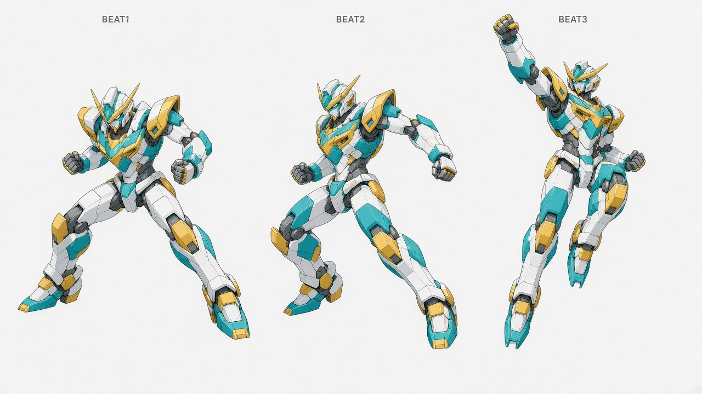
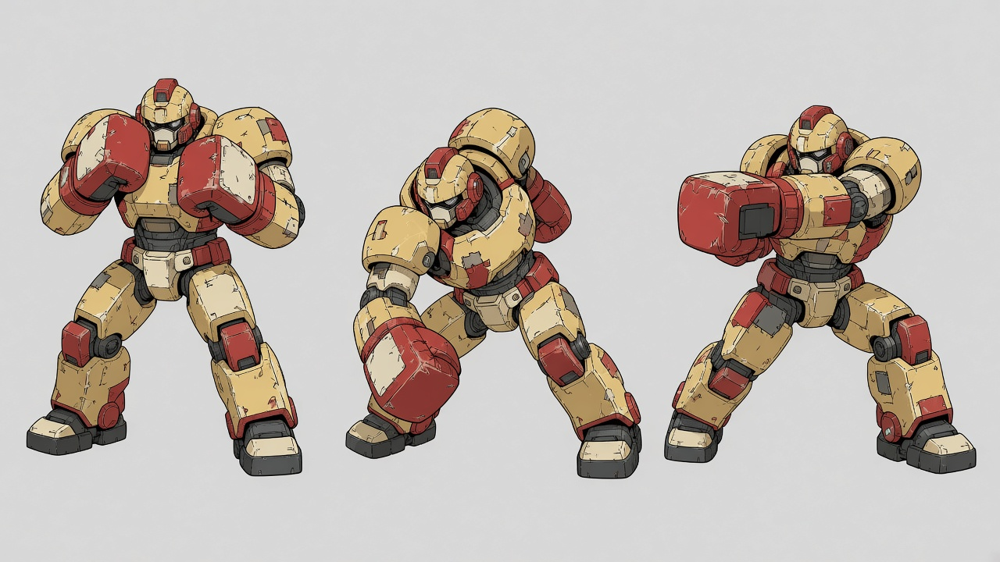
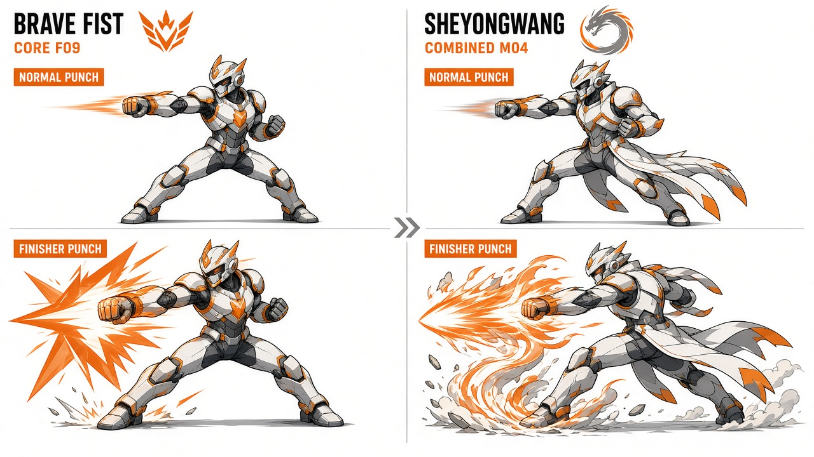
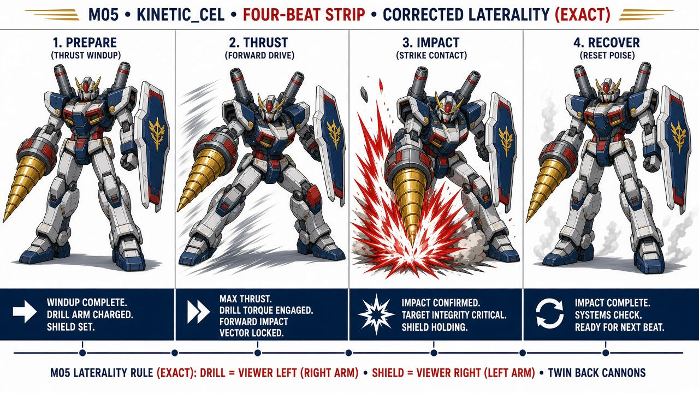
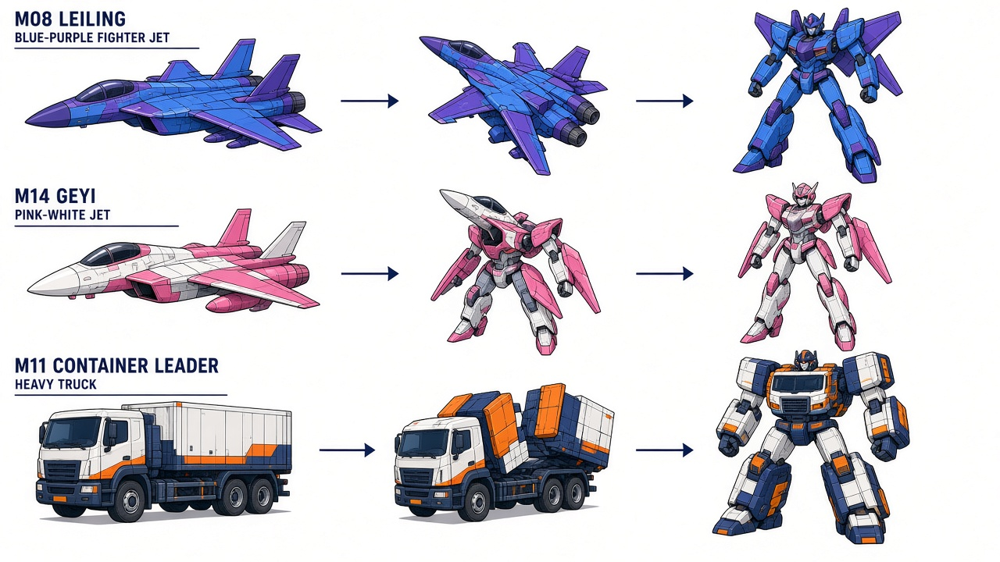
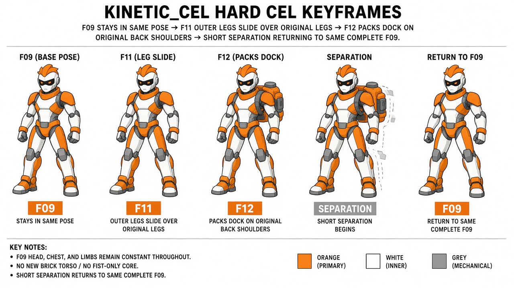

# 招牌动作与变形设计

外部故事与设定评审用设计图。原卡面评语不等于用户逐图采用；最新确认范围看[已定设计图册](../../art/README.md)。本页不提供UI/UE、运行截图或三维资产。

## N09 无牌拳脚与天冲拳

原卡面意见：图形、版式与演出参考。

该条从原298项评审中抽取，来源及摘要见[设计卡清单](../DESIGN-CARDS.json)。版本与采用依据见[文件清单](../FILE-MANIFEST.tsv)。

## N10 旧拳王拳击组

原卡面意见：图形、版式与演出参考。

该条从原298项评审中抽取，来源及摘要见[设计卡清单](../DESIGN-CARDS.json)。版本与采用依据见[文件清单](../FILE-MANIFEST.tsv)。

## N11 勇拳与社勇王招牌拳

原卡面意见：图形、版式与演出参考。

该条从原298项评审中抽取，来源及摘要见[设计卡清单](../DESIGN-CARDS.json)。版本与采用依据见[文件清单](../FILE-MANIFEST.tsv)。

## N12 王者钻击装备适配

原卡面意见：图形、版式与演出参考。

该条从原298项评审中抽取，来源及摘要见[设计卡清单](../DESIGN-CARDS.json)。版本与采用依据见[文件清单](../FILE-MANIFEST.tsv)。

## N13 车辆/航空变形

原卡面意见：图形、版式与演出参考。

该条从原298项评审中抽取，来源及摘要见[设计卡清单](../DESIGN-CARDS.json)。版本与采用依据见[文件清单](../FILE-MANIFEST.tsv)。

## N14 社勇王合体/分离

原卡面意见：图形、版式与演出参考。

该条从原298项评审中抽取，来源及摘要见[设计卡清单](../DESIGN-CARDS.json)。版本与采用依据见[文件清单](../FILE-MANIFEST.tsv)。
