# 剧情场面

外部故事与设定评审用设计图。原卡面评语不等于用户逐图采用；最新确认范围看[已定设计图册](../../art/README.md)。本页不提供UI/UE、运行截图或三维资产。

## S01 工务城三战场总构图

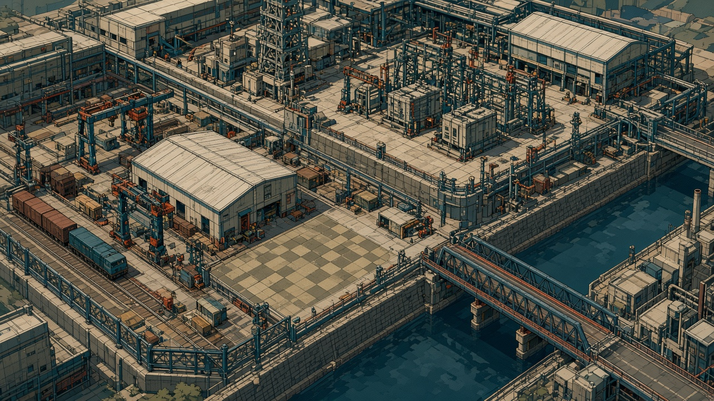

原卡面意见：内部修订后派生。

该条从原298项评审中抽取，来源及摘要见[设计卡清单](../DESIGN-CARDS.json)。版本与采用依据见[文件清单](../FILE-MANIFEST.tsv)。

## S02 A供能前庭正常战棋画面

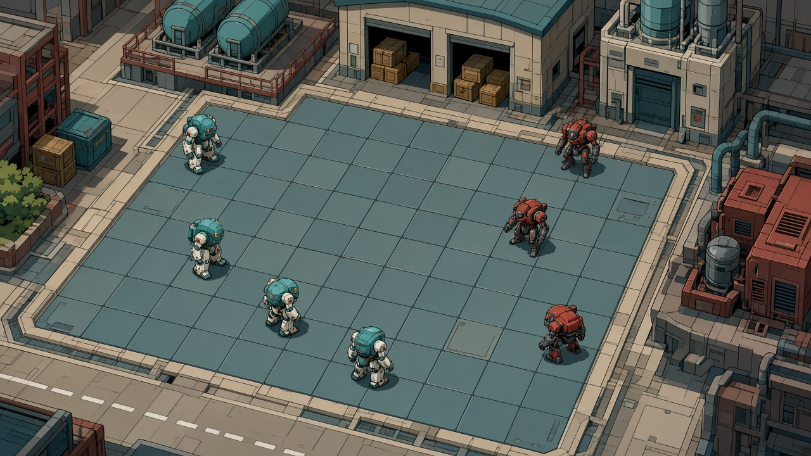

原卡面意见：内部修订后派生。

该条从原298项评审中抽取，来源及摘要见[设计卡清单](../DESIGN-CARDS.json)。版本与采用依据见[文件清单](../FILE-MANIFEST.tsv)。

## S03 B跨渠桥座正常战棋画面

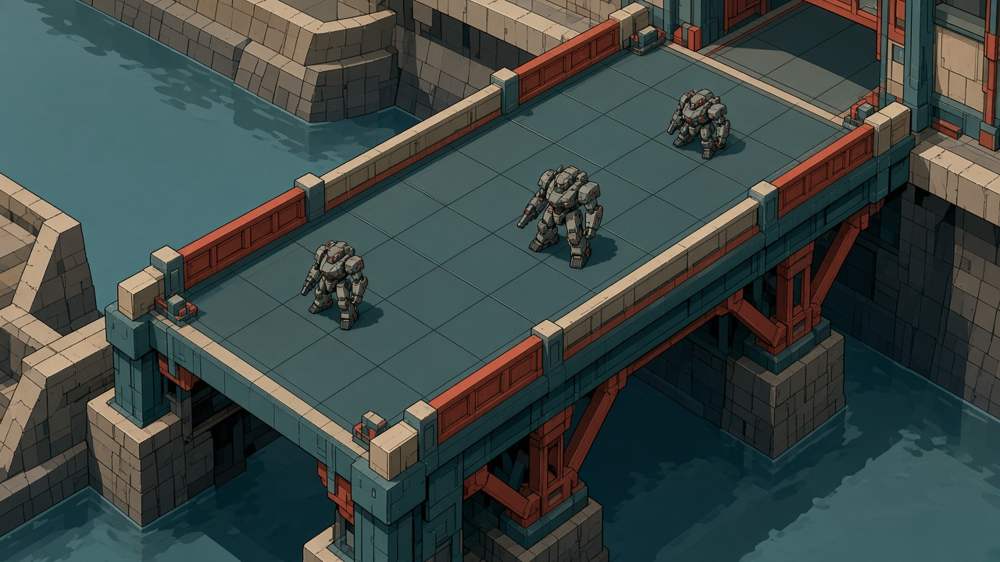

原卡面意见：内部修订后派生。

该条从原298项评审中抽取，来源及摘要见[设计卡清单](../DESIGN-CARDS.json)。版本与采用依据见[文件清单](../FILE-MANIFEST.tsv)。

## S04 C环下装卸站正常战棋画面

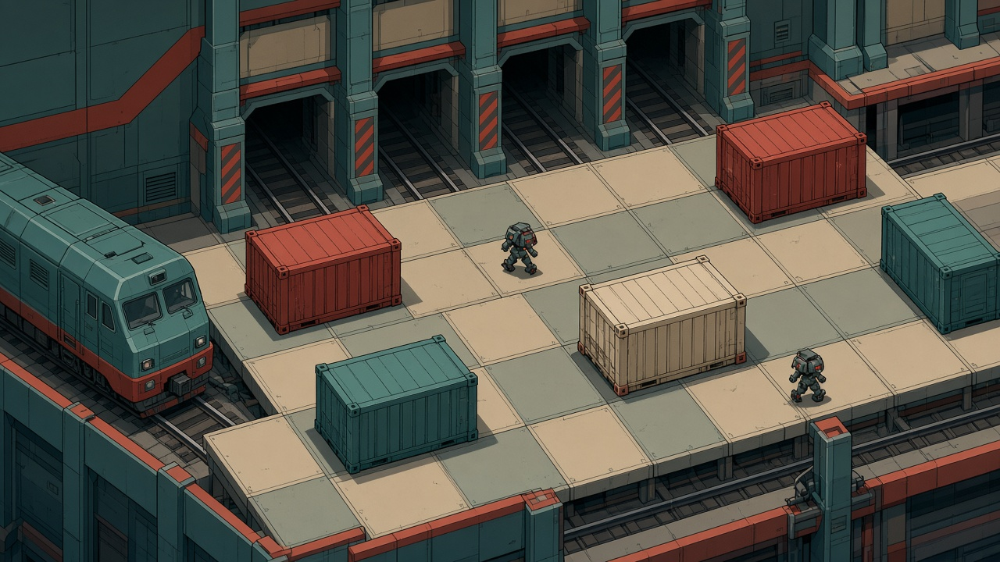

原卡面意见：内部修订后派生。

该条从原298项评审中抽取，来源及摘要见[设计卡清单](../DESIGN-CARDS.json)。版本与采用依据见[文件清单](../FILE-MANIFEST.tsv)。

## S05 指挥廊与部署背景

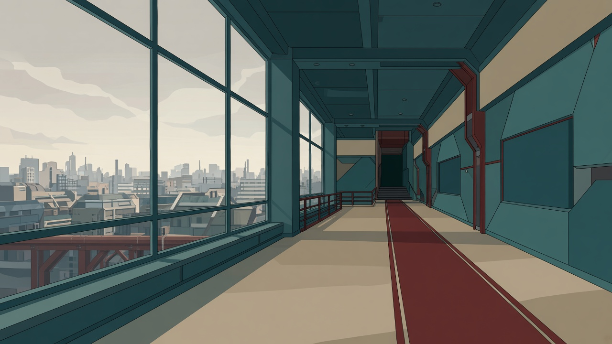

原卡面意见：二维原画可加工采用。

该条从原298项评审中抽取，来源及摘要见[设计卡清单](../DESIGN-CARDS.json)。版本与采用依据见[文件清单](../FILE-MANIFEST.tsv)。

## S06 列车与待救检修员

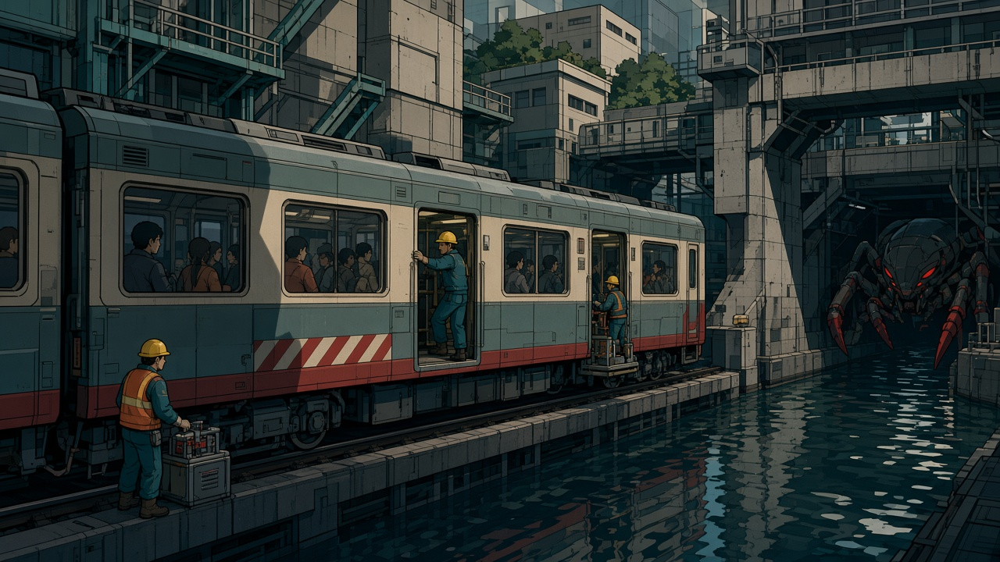

原卡面意见：内部修订后派生。

该条从原298项评审中抽取，来源及摘要见[设计卡清单](../DESIGN-CARDS.json)。版本与采用依据见[文件清单](../FILE-MANIFEST.tsv)。

## S07 母线接通与链路点亮

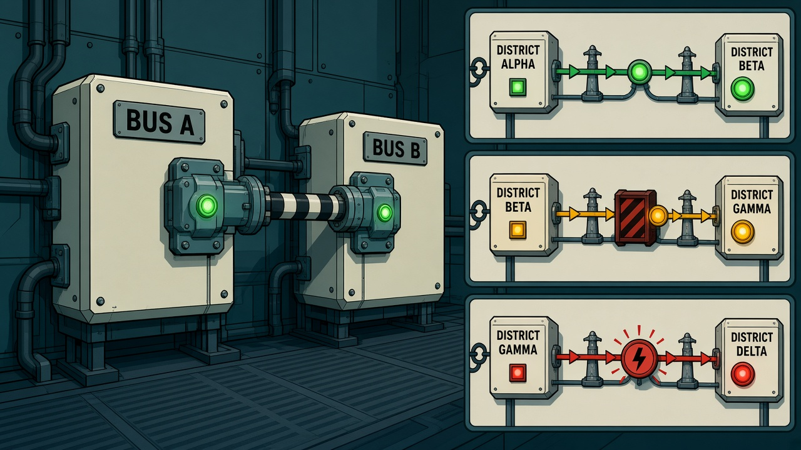

原卡面意见：内部修订后派生。

该条从原298项评审中抽取，来源及摘要见[设计卡清单](../DESIGN-CARDS.json)。版本与采用依据见[文件清单](../FILE-MANIFEST.tsv)。

## S08 托桥与列车通过

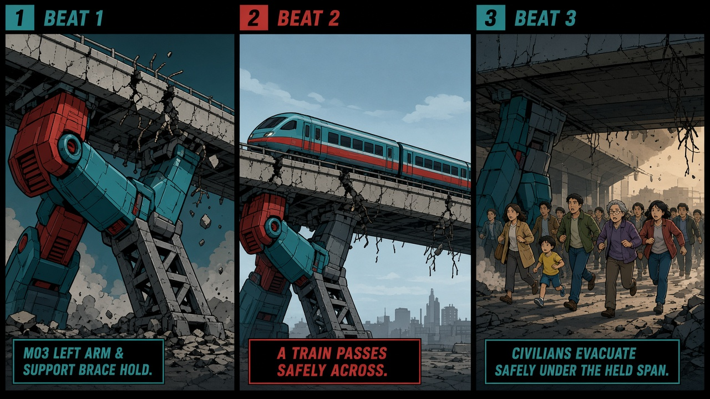

原卡面意见：内部修订后派生。

该条从原298项评审中抽取，来源及摘要见[设计卡清单](../DESIGN-CARDS.json)。版本与采用依据见[文件清单](../FILE-MANIFEST.tsv)。

## S09 纪存多方调度特写

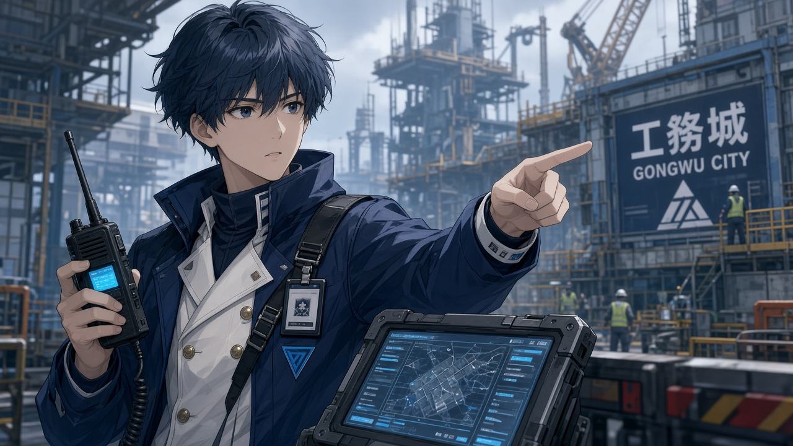

原卡面意见：内部修订后派生。

该条从原298项评审中抽取，来源及摘要见[设计卡清单](../DESIGN-CARDS.json)。版本与采用依据见[文件清单](../FILE-MANIFEST.tsv)。

## S10 白鸢预演特写

原卡面意见：内部修订后派生。

该条从原298项评审中抽取，来源及摘要见[设计卡清单](../DESIGN-CARDS.json)。版本与采用依据见[文件清单](../FILE-MANIFEST.tsv)。

## S11 七海核验撤令特写

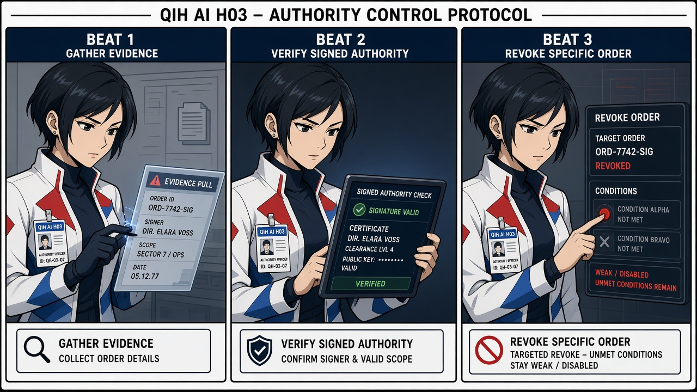

原卡面意见：内部修订后派生。

该条从原298项评审中抽取，来源及摘要见[设计卡清单](../DESIGN-CARDS.json)。版本与采用依据见[文件清单](../FILE-MANIFEST.tsv)。

## S12 王者右臂巨钻冲击图

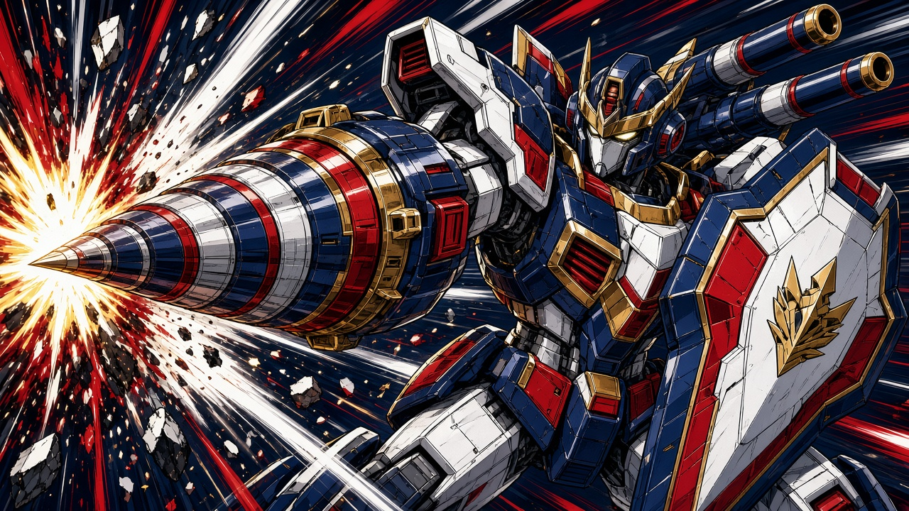

原卡面意见：内部修订后派生。

该条从原298项评审中抽取，来源及摘要见[设计卡清单](../DESIGN-CARDS.json)。版本与采用依据见[文件清单](../FILE-MANIFEST.tsv)。

## S13 无牌天冲拳冲击图

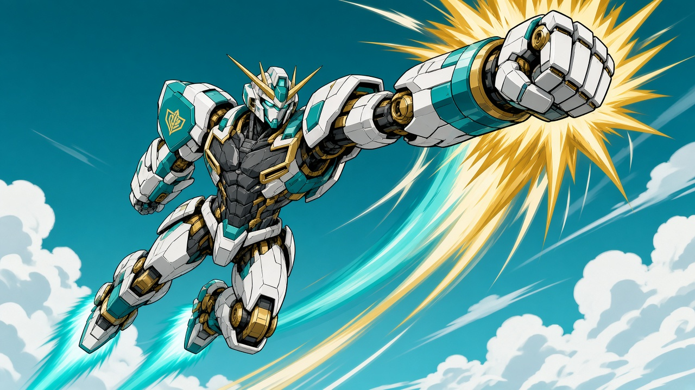

原卡面意见：内部修订后派生。

该条从原298项评审中抽取，来源及摘要见[设计卡清单](../DESIGN-CARDS.json)。版本与采用依据见[文件清单](../FILE-MANIFEST.tsv)。

## S14 社勇王合体关键镜头

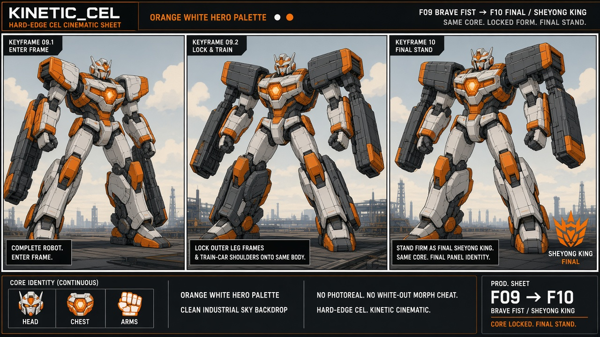

原卡面意见：内部修订后派生。

该条从原298项评审中抽取，来源及摘要见[设计卡清单](../DESIGN-CARDS.json)。版本与采用依据见[文件清单](../FILE-MANIFEST.tsv)。

## S15 断冠宿敌出场

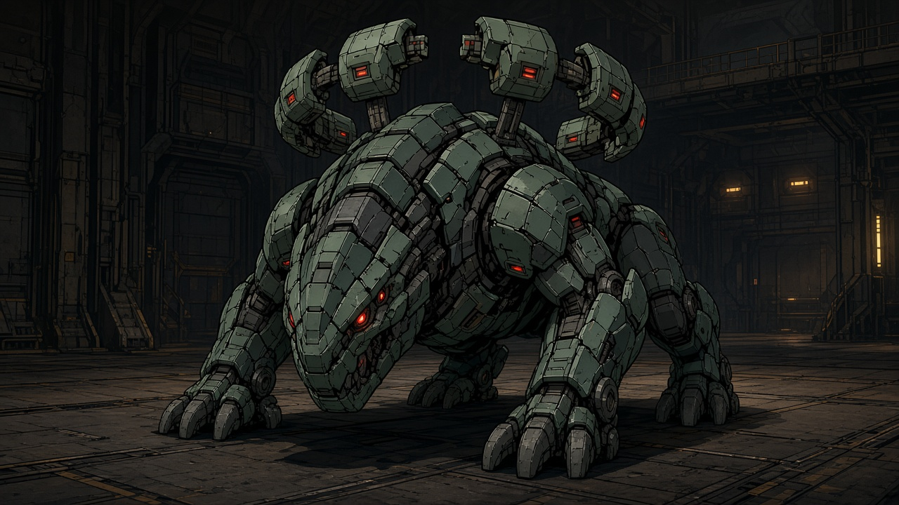

原卡面意见：内部修订后派生。

该条从原298项评审中抽取，来源及摘要见[设计卡清单](../DESIGN-CARDS.json)。版本与采用依据见[文件清单](../FILE-MANIFEST.tsv)。

## S16 救援成功与失守后果

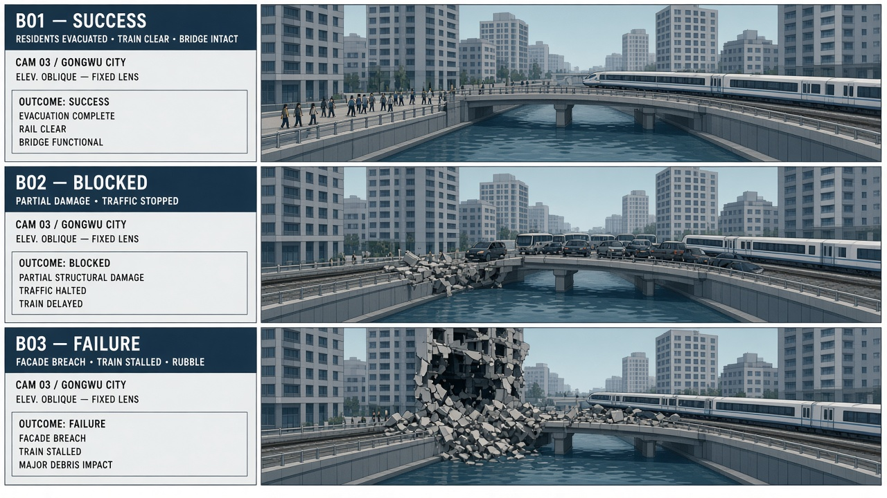

原卡面意见：图形、版式与演出参考。

该条从原298项评审中抽取，来源及摘要见[设计卡清单](../DESIGN-CARDS.json)。版本与采用依据见[文件清单](../FILE-MANIFEST.tsv)。

## S17 模型街与港口街景

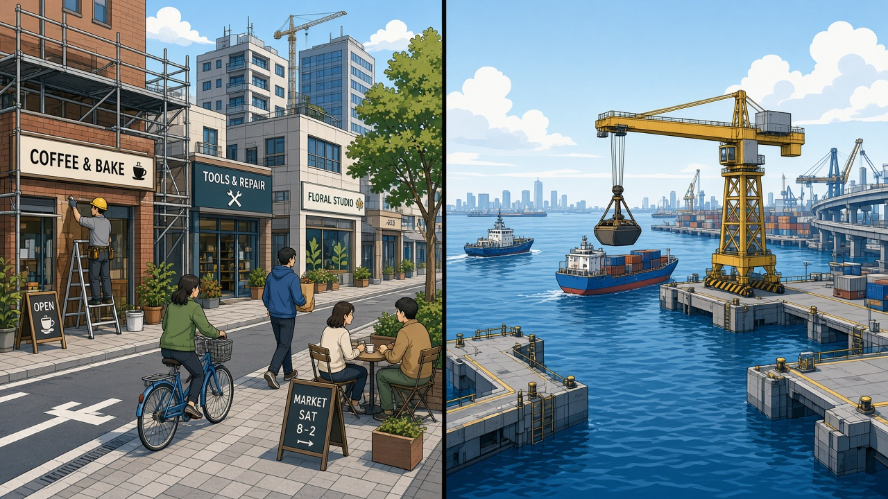

原卡面意见：内部修订后派生。

该条从原298项评审中抽取，来源及摘要见[设计卡清单](../DESIGN-CARDS.json)。版本与采用依据见[文件清单](../FILE-MANIFEST.tsv)。

## S18 模型病院与三号工房

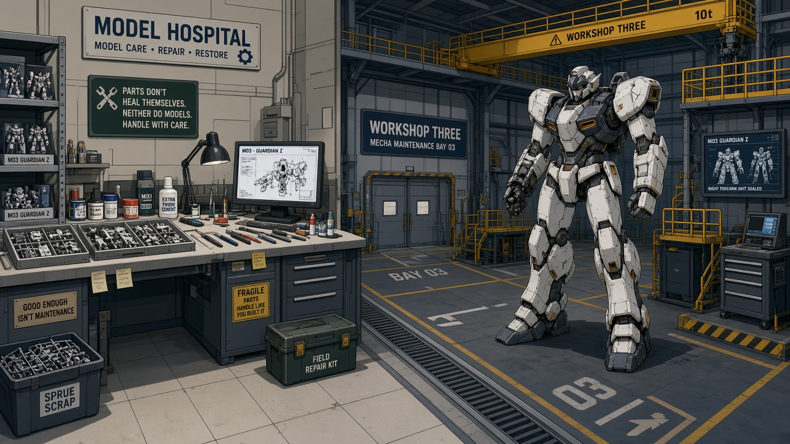

原卡面意见：内部修订后派生。

该条从原298项评审中抽取，来源及摘要见[设计卡清单](../DESIGN-CARDS.json)。版本与采用依据见[文件清单](../FILE-MANIFEST.tsv)。

## S19 货柜领袖事件图

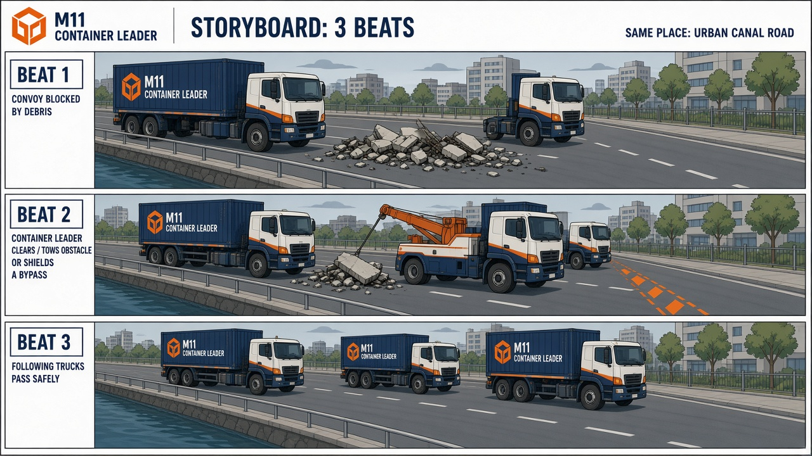

原卡面意见：内部修订后派生。

该条从原298项评审中抽取，来源及摘要见[设计卡清单](../DESIGN-CARDS.json)。版本与采用依据见[文件清单](../FILE-MANIFEST.tsv)。

## S20 完全版王者冠军展示与卸甲

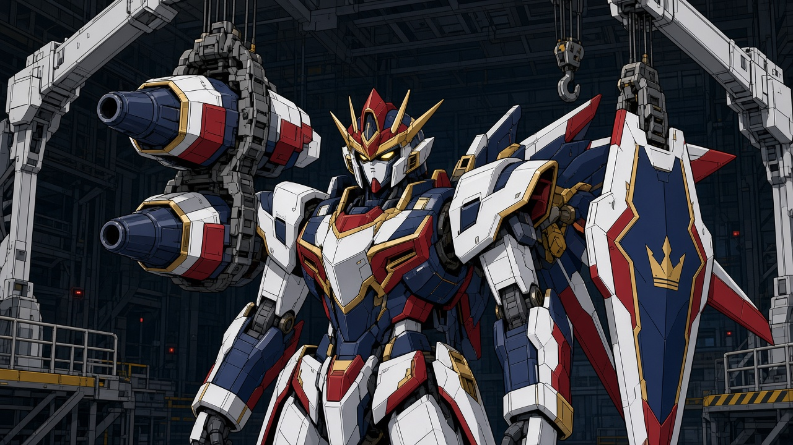

原卡面意见：内部修订后派生。

该条从原298项评审中抽取，来源及摘要见[设计卡清单](../DESIGN-CARDS.json)。版本与采用依据见[文件清单](../FILE-MANIFEST.tsv)。

## S21 白鸢作品与现场事件

原卡面意见：内部修订后派生。

该条从原298项评审中抽取，来源及摘要见[设计卡清单](../DESIGN-CARDS.json)。版本与采用依据见[文件清单](../FILE-MANIFEST.tsv)。
