# 地形与地图：完整外援评审图录

本页按原298项评审页的当前卡面机械整理，不新增采用结论。**卡面的A/B/C或“采用”是当时的评审意见，不等于用户已确认。** 正式已定源仍以[已定图册](../../art/README.md)与逐图回执为准。

旧图有的已被10月新母稿替代。读故事时不要把其原有造型、能力、身份或场景布局恢复成Canon。原图、历代修订和评语均供追溯。

## T01 承重混凝土地坪

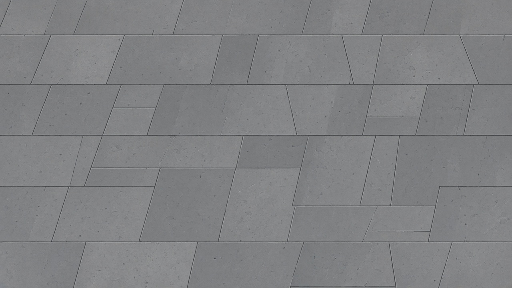

原卡面意见：结构与造型母版可采用。

[完整原卡面](../../../captures/20261014-full-direction/review-v2.html#T01)；其余版本及实际源文件在[全量文件清单](../FILE-MANIFEST.tsv)中按ID、名称或文件路径查询。

## T02 涂装金属甲板

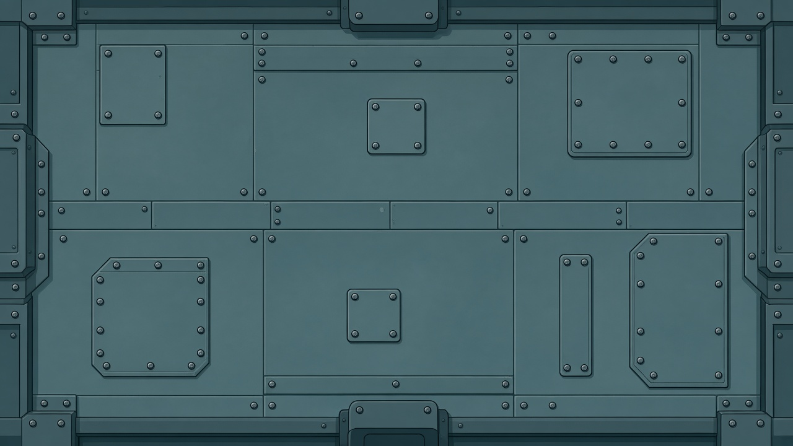

原卡面意见：结构与造型母版可采用。

[完整原卡面](../../../captures/20261014-full-direction/review-v2.html#T02)；其余版本及实际源文件在[全量文件清单](../FILE-MANIFEST.tsv)中按ID、名称或文件路径查询。

## T03 格栅与排水槽

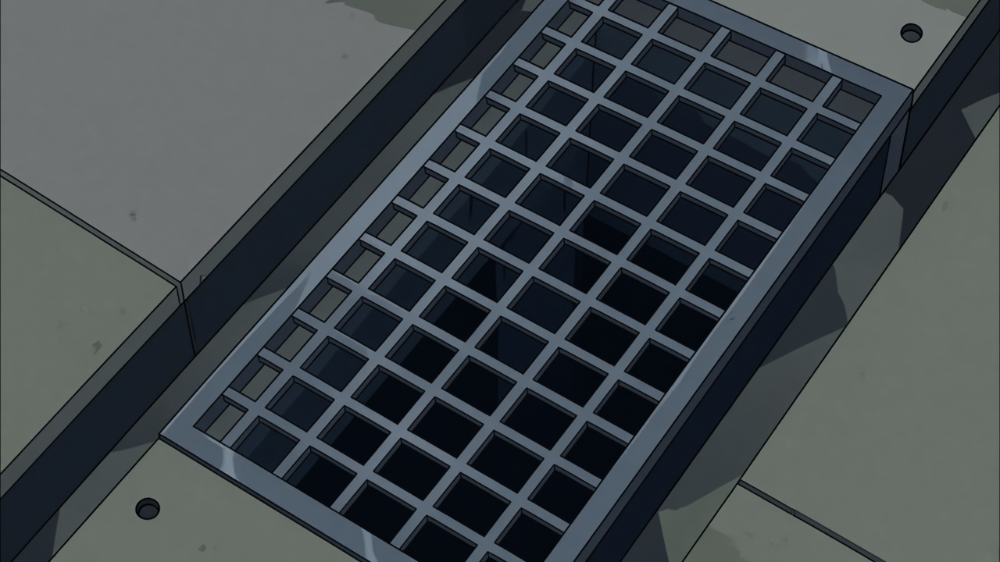

原卡面意见：结构与造型母版可采用。

[完整原卡面](../../../captures/20261014-full-direction/review-v2.html#T03)；其余版本及实际源文件在[全量文件清单](../FILE-MANIFEST.tsv)中按ID、名称或文件路径查询。

## T04 轨道与道岔

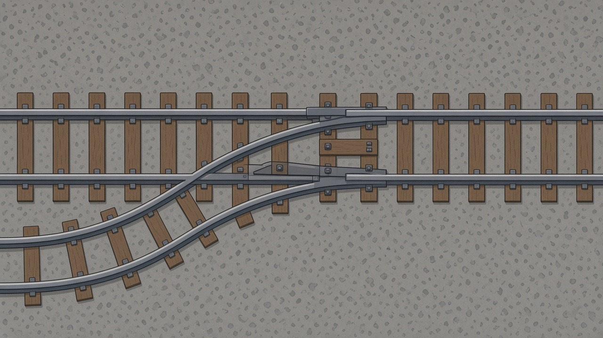

原卡面意见：内部修订后派生。

[完整原卡面](../../../captures/20261014-full-direction/review-v2.html#T04)；其余版本及实际源文件在[全量文件清单](../FILE-MANIFEST.tsv)中按ID、名称或文件路径查询。

## T05 输送带

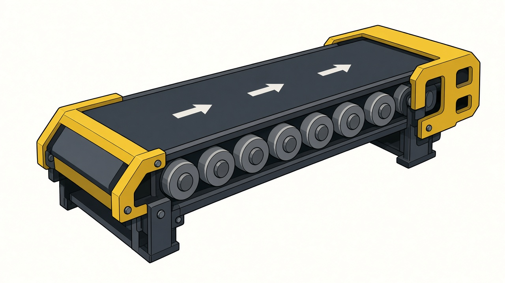

原卡面意见：结构与造型母版可采用。

[完整原卡面](../../../captures/20261014-full-direction/review-v2.html#T05)；其余版本及实际源文件在[全量文件清单](../FILE-MANIFEST.tsv)中按ID、名称或文件路径查询。

## T06 碎石与残骸地面

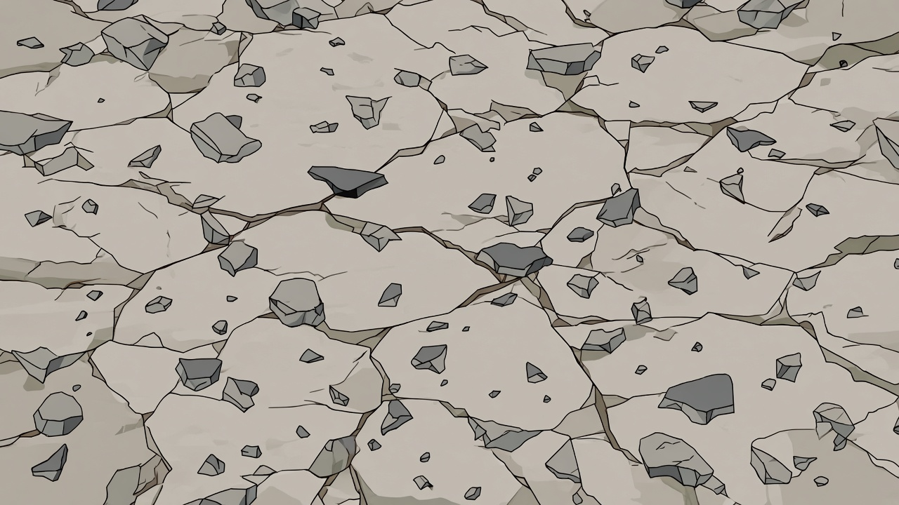

原卡面意见：内部修订后派生。

[完整原卡面](../../../captures/20261014-full-direction/review-v2.html#T06)；其余版本及实际源文件在[全量文件清单](../FILE-MANIFEST.tsv)中按ID、名称或文件路径查询。

## T07 浅水

原卡面意见：内部修订后派生。

[完整原卡面](../../../captures/20261014-full-direction/review-v2.html#T07)；其余版本及实际源文件在[全量文件清单](../FILE-MANIFEST.tsv)中按ID、名称或文件路径查询。

## T08 深渠与深水

原卡面意见：结构与造型母版可采用。

[完整原卡面](../../../captures/20261014-full-direction/review-v2.html#T08)；其余版本及实际源文件在[全量文件清单](../FILE-MANIFEST.tsv)中按ID、名称或文件路径查询。

## T09 深坑与结构缺口

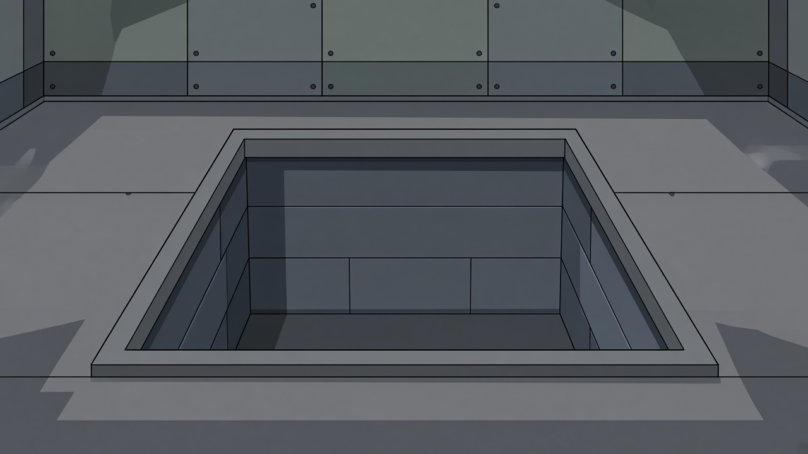

原卡面意见：结构与造型母版可采用。

[完整原卡面](../../../captures/20261014-full-direction/review-v2.html#T09)；其余版本及实际源文件在[全量文件清单](../FILE-MANIFEST.tsv)中按ID、名称或文件路径查询。

## T10 油面与可燃物

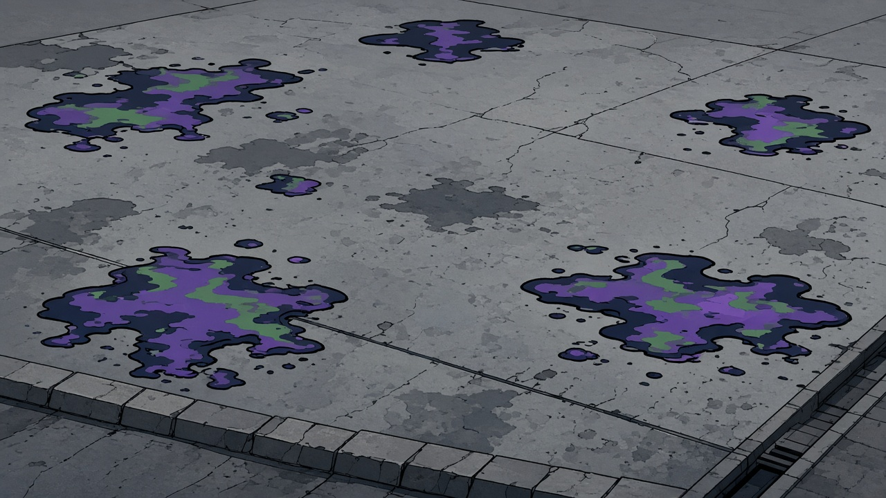

原卡面意见：内部修订后派生。

[完整原卡面](../../../captures/20261014-full-direction/review-v2.html#T10)；其余版本及实际源文件在[全量文件清单](../FILE-MANIFEST.tsv)中按ID、名称或文件路径查询。

## T11 燃后地面

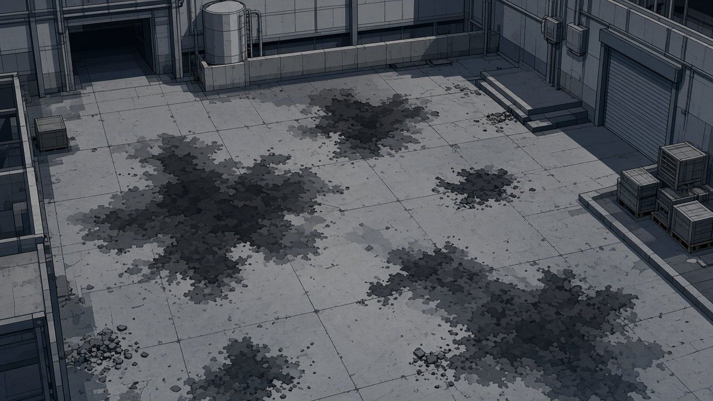

原卡面意见：结构与造型母版可采用。

[完整原卡面](../../../captures/20261014-full-direction/review-v2.html#T11)；其余版本及实际源文件在[全量文件清单](../FILE-MANIFEST.tsv)中按ID、名称或文件路径查询。

## T12 带电地面

原卡面意见：内部修订后派生。

[完整原卡面](../../../captures/20261014-full-direction/review-v2.html#T12)；其余版本及实际源文件在[全量文件清单](../FILE-MANIFEST.tsv)中按ID、名称或文件路径查询。

## T13 可行走屋顶与平台

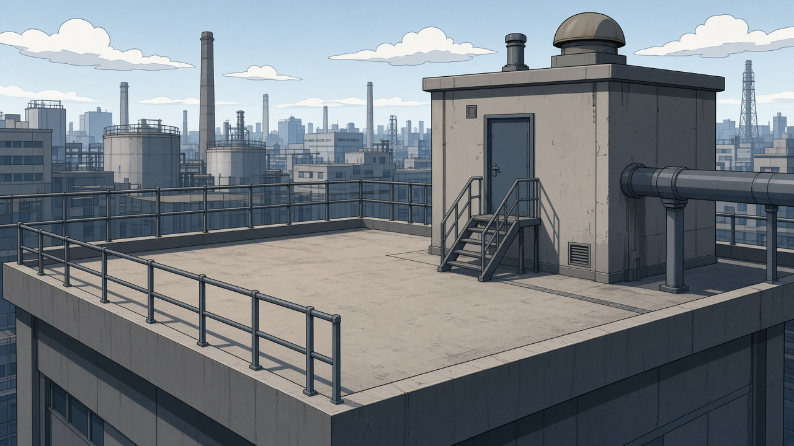

原卡面意见：内部修订后派生。

[完整原卡面](../../../captures/20261014-full-direction/review-v2.html#T13)；其余版本及实际源文件在[全量文件清单](../FILE-MANIFEST.tsv)中按ID、名称或文件路径查询。

## T14 坡道与阶梯

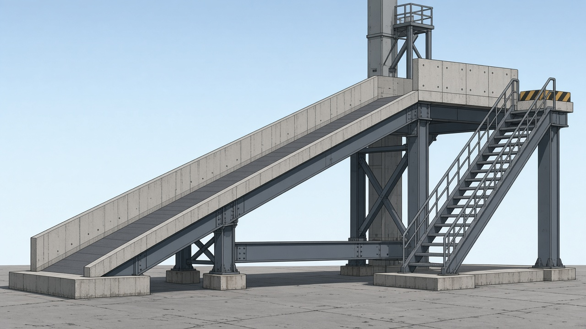

原卡面意见：内部修订后派生。

[完整原卡面](../../../captures/20261014-full-direction/review-v2.html#T14)；其余版本及实际源文件在[全量文件清单](../FILE-MANIFEST.tsv)中按ID、名称或文件路径查询。

## T15 塌桥断面与沉落物

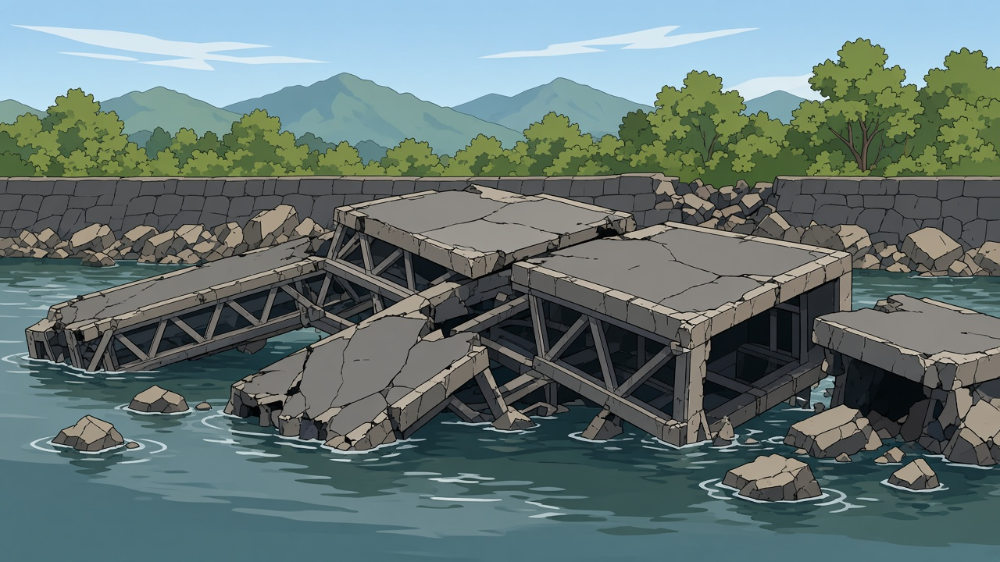

原卡面意见：内部修订后派生。

[完整原卡面](../../../captures/20261014-full-direction/review-v2.html#T15)；其余版本及实际源文件在[全量文件清单](../FILE-MANIFEST.tsv)中按ID、名称或文件路径查询。

## T16 统一表面材料家族

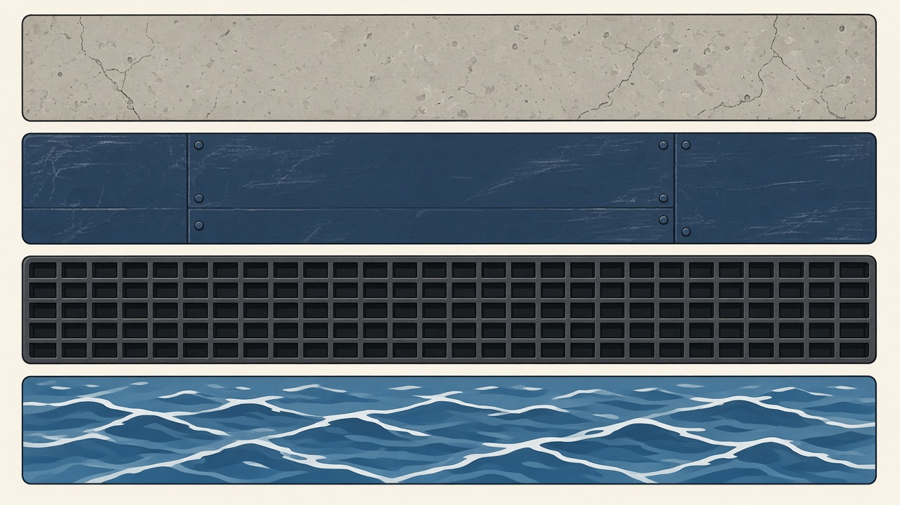

原卡面意见：内部修订后派生。

[完整原卡面](../../../captures/20261014-full-direction/review-v2.html#T16)；其余版本及实际源文件在[全量文件清单](../FILE-MANIFEST.tsv)中按ID、名称或文件路径查询。
